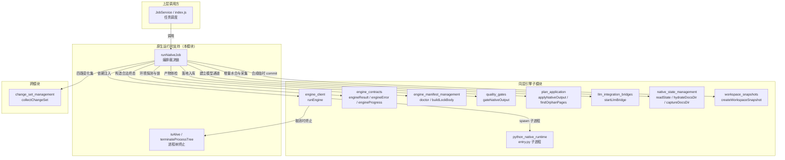
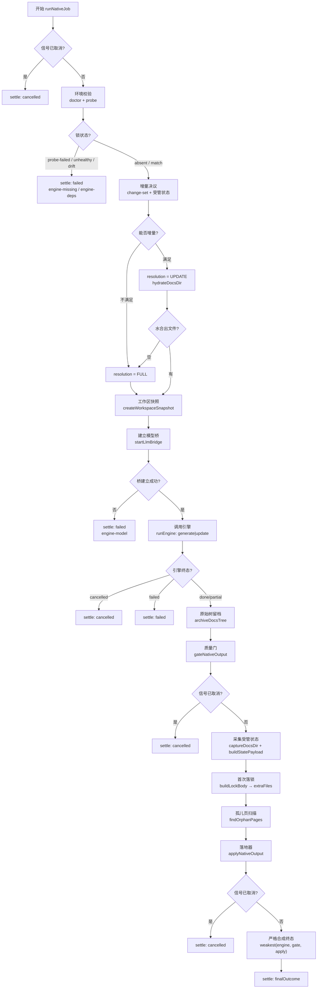
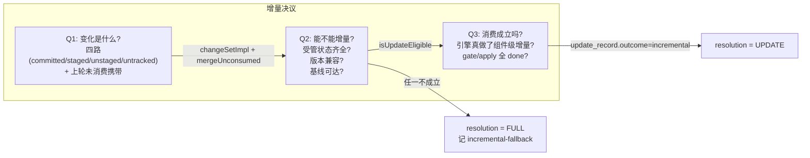
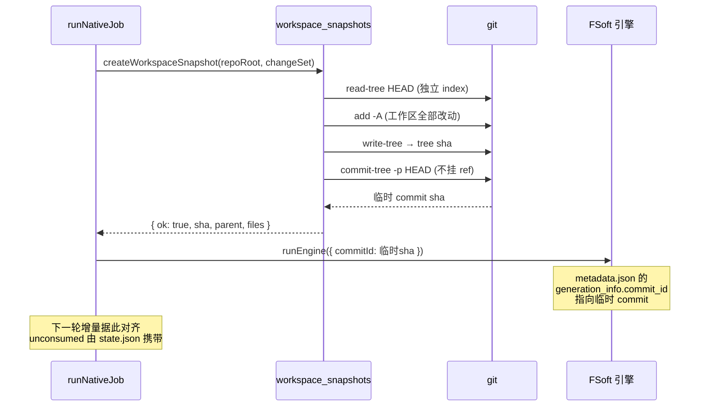
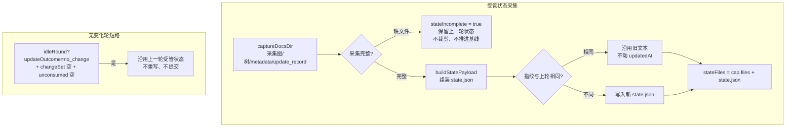
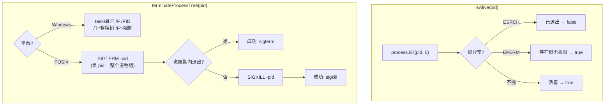

# 原生运行时支持（native_runtime_support）

## 概述

`native_runtime_support` 是 Code 引擎处理流水线（`Code_Engine_Processing_Pipeline`）中**最关键的编排层**，负责驱动「原生引擎一次完整编译」的全生命周期裁决链。它把分散在多个模块中的职责——环境校验、增量决议、工作区快照、模型桥、引擎调用、质量门、受管状态采集、落地入库——固定成一条**单向裁决链**，确保每一步的结论都不能被下一步洗白。

本模块由两个文件组成：

- `lib/engine/native-run.js` — 原生编译的完整编排（`runNativeJob`）
- `lib/engine/process-tree.js` — 受管子进程树的终止与存活探测（`isAlive` / `terminateProcessTree`）

---

## 架构定位



**图 1：模块在流水线中的位置与依赖关系**

---

## 裁决链：一次原生编译的完整流程

`runNativeJob` 把一次编译固定为一条直线：

```
env(doctor + engine-lock) → 增量决议(change-set + 受管状态) → 工作区快照 → 模型桥 → 引擎(full|update) → 原始树留档 → 质量门 → 受管状态采集 → 首次落锁 → 孤儿页清理 → 落地器(写盘→index→基线→提交) → 严格合成终态
```



**图 2：`runNativeJob` 完整裁决流程（每个分支都经过 `settle` 统一出口）**

---

## 核心不变量

本模块的设计目标是**消灭「引擎说 done 就 done」的模糊终态**。以下硬不变量与 `engine_contracts`、`quality_gates`、`plan_application` 的不变量叠加生效：

| # | 不变量 | 实现位置 |
|---|--------|----------|
| 1 | 锁不一致 / 依赖不闭合 → 直接 `failed`，**不跑引擎** | 环境校验段（doctor → drift/unhealthy） |
| 2 | 引擎 `done` **不能**替代质量门：gate 说 `partial`，终态就是 `partial` | 终态合成段：`weakest(engineOutcome, gateOutcome)` |
| 3 | 落地器（apply）说 `partial`/`failed`，终态不许是 `done` | 终态合成段：`weakest(..., applyOutcome)` |
| 4 | `failed`/`cancelled`/`partial` 一律不推进基线 | `advanceBaseline: stateIncomplete ? false : null` |
| 5 | 取消是终态：取消后不再 gate/apply，也不覆盖已写好的终态 | 各段 `signal?.aborted` 早退分支 |

### 终态强弱合成

```javascript
const RANK = { cancelled: 0, failed: 1, partial: 2, done: 3 }
const weakest = (a, b) => (RANK[a] <= RANK[b] ? a : b)
// finalOutcome = weakest(weakest(engineOutcome, gateOutcome), applyOutcome)
```

合成后的终态**只能取最弱的那一个**，绝不允许被后续步骤提升。若三者都说 `done` 却还有 blockers，宁可降级为 `partial` 也不掩盖。

---

## 增量决议（阶段 5：统一增量）

增量决议排在 env 之后、引擎之前，回答三个问题，每个都用**可查事实**而不是猜测：



**图 3：增量决议的三个问题**

### 决议结论

- `FULL` — 显式全量（调用方要全量，或增量不可用）
- `UPDATE` — 组件级增量（引擎会读上一轮的图/树/文章做图 diff）

**注意**：「变化集为空」**不是**跳过引擎的理由——FSoft 的「有没有变」是图 diff 说的，不是 git 路径集合说的。

### 引擎增量参数

```javascript
export const DEFAULT_UPDATE_OPTIONS = Object.freeze({ rung: '3' })
```

`rung: '3'` 表示组件级方法（图 diff 决定哪些模块要重写）。显式给出而不是留空，是为了让测试能断言「调用方确实要求了组件级增量」，而不是「碰巧默认成了增量」。

### 引擎请求预算：同层并行度与单模块请求上限

引擎 `payload` 里还有两个由调用方（插件设置）下发的预算参数：

| 参数 | 语义 | 下发规则 |
|------|------|----------|
| `moduleConcurrency` | 同层模块并行度，引擎默认 1（严格串行） | 取 `max(1, Number(moduleConcurrency))` 显式下发；只有显式给 `>1` 才开并行 |
| `requestLimit` | 单模块写作的 LLM 请求上限，由插件设置下发（默认 300） | **只有 `>0` 才下发**（`Math.round(Number(requestLimit))`）；不传时引擎退回自身默认（100） |

`requestLimit` 的缺省值是合法预算，所以 `0` 不能原样下发——它不是合法预算。不下发就是「用引擎自己的默认」，显式给正值才覆盖；硬顶由插件设置侧收口，本层只负责透传与取整。

---

## 工作区快照：内容与账本对齐

FSoft 只从 `<old_commit>..<new_commit>` 取 diff。它读的是工作区文件——内容是对的，可记账只能写 HEAD。于是「文章反映了工作区、账却指向 HEAD」：下一轮拿 HEAD 当 old_commit 就把这些改动当成已消化，正是「变化悄悄丢」的入口。



**图 4：工作区快照的时序——让本轮记账指向含未提交改动的真实树**

造不出快照不算失败：退回用 HEAD 记账（旧行为）并记 note。快照是**对齐精度**的改进，不是编译成立的前提。

---

## 受管状态采集：与文章同事务

采集点是「gate 之后、apply 之前」。此时引擎已写完 `docsDir`，而 apply 还没动仓库。放进 apply 的 `extraFiles` 意味着这些文件与文章共享同一份 pre-image——index/基线失败时它们随文章一起回滚，提交时随文章一起进同一个 commit。



**图 5：受管状态采集与无变化轮短路**

### 「无变化轮」判据

三个条件**同时成立**才跳过状态重写：

1. `resolution === UPDATE`
2. `updateOutcome === 'no_change'`
3. `effectiveChanges.length === 0` 且 `unconsumed.length === 0`

只要还有一项未消化的账（哪怕是未提交的源码改动），本轮就必须照常采集——那份状态是下一轮唯一能把它算进变化集的凭据。

---

## 进程树终止（process-tree.js）

FSoft 的 Python 进程自己也会派生子进程（flake8、find、以及某些后端会 fork claude/codex）。只 kill 直接子进程的 pid，孙进程会变成孤儿继续跑——表现为「任务已取消，但机器上还挂着一个 python 在烧 token」。



**图 6：进程存活探测与终止策略**

### 平台差异

| 平台 | 策略 | 原因 |
|------|------|------|
| Windows | `taskkill /T /F` | 没有进程组信号，`/T` 递归整棵树，`/F` 强制 |
| POSIX | `detached: true` 起的子进程自成进程组，`process.kill(-pid)` 打整组 | 先 SIGTERM 收尾，超时再 SIGKILL |

---

## 关键常量

```javascript
export const DEFAULT_ENGINE_ENTRY = path.join(here, 'python', 'entry.py')
export const DEFAULT_UPDATE_OPTIONS = Object.freeze({ rung: '3' })
export const DEFAULT_ENGINE_TIMEOUT_MS = 180 * 60 * 1000  // 3 小时
```

### 为什么默认超时是 3 小时

阶段 1C 按小 fixture（约 1 分钟）估的 45 分钟，真机上根本不成立。实测 `job-mvt1mrvu-6` 的分阶段耗时：

- articles 66.0 min
- crosscut 10.0 min
- review 68.9 min
- queued 29.2 min
- **合计 ≈ 174 分钟**

按 45 分钟给预算，任何中等规模仓库都会在「阶段 3 Documentation Generation」刚开头（percent 54）被砍掉。3 小时是**上限**而非预期耗时：真跑得快就早结束；超时后靠 `client.js` 的 partial 抢救路径把已写出的文章救回来。

---

## 依赖注入与可测试性

`runNativeJob` 的全部依赖都可以从 `deps` 注入：

```javascript
const deps = {
  doctor,              // 环境探测（真实: manifest.doctor）
  runEngine,           // 引擎调用（真实: client.runEngine）
  gate,                // 质量门（真实: quality-gate.gateNativeOutput）
  apply,               // 落地器（真实: apply-plan.applyNativeOutput）
  bridge,              // 模型桥（真实: llm-bridge.startLlmBridge）
  probe,               // 环境探测函数
  engineFor,           // 引擎构造函数
  collectChangeSet,    // 变化集采集（真实: change-set.collectChangeSet）
  snapshot,            // 工作区快照（真实: workspace-snapshot.createWorkspaceSnapshot）
  config,              // 配置（batchProvider/batchModel/engine 等）
  updateOptions,       // 增量参数覆盖
  applyDeps,           // 落地器内部依赖
  findOrphanPages,     // 孤儿页扫描
  onRequestStart,      // 会话记录钩子
}
```

测试可以换成假 `runEngine` + 真实 gate/apply，从而既覆盖接线又覆盖裁决。

---

## 输出契约：EngineResult 附加字段

`runNativeJob` 返回 `engineResult(base)` 的扩展对象，附加以下现场证据：

| 字段 | 含义 |
|------|------|
| `requestId` | 协议 requestId |
| `baselineEligible` | 质量门许可（「这一轮的变化都消化完了，可以推进」） |
| `baselineAdvanced` | 落地器事实（cw meta update 真的成功） |
| `canAdvanceBaseline` | 兼容字段，语义取落地事实 |
| `artifacts.rawTree` | 消费之前留下的整棵原始 docs 树快照 |
| `incremental` | 增量现场证据（决议/变化集/水合/受管状态/回退原因） |
| `gate` | 质量门逐篇明细（articles 列表） |
| `apply` | 落地证据（written/deleted/pruned/index/baseline/commit） |
| `engineLock` | 引擎锁状态与 diffs |
| `notes` | 人读诊断笔记 |

---

## 相关模块

| 模块 | 关系 |
|------|------|
| [engine_client](engine_client.md) | 被 `runNativeJob` 调用，负责 spawn Python 子进程与协议帧解析 |
| [engine_contracts](engine_contracts.md) | 提供 `engineResult`/`engineError`/`engineProgress`，终态合法性在此生效 |
| [engine_manifest_management](engine_manifest_management.md) | 提供 `doctor`/`buildLockBody`，环境校验与首次落锁 |
| [quality_gates](quality_gates.md) | 被 `runNativeJob` 调用，产物体检与基线许可裁决 |
| [plan_application](plan_application.md) | 被 `runNativeJob` 调用，写盘→index→基线→提交的事务性落地 |
| [llm_integration_bridges](llm_integration_bridges.md) | 被 `runNativeJob` 调用，建立 OpenAI 兼容的本地模型桥 |
| [native_state_management](native_state_management.md) | 被 `runNativeJob` 大量使用，增量水合/状态采集/指纹比对 |
| [workspace_snapshots](workspace_snapshots.md) | 被 `runNativeJob` 调用，合成含未提交改动的临时 commit |
| [python_native_runtime](python_native_runtime.md) | 被 `runEngine` spawn 的 Python 入口（`entry.py`） |
| [code_engine_module](code_engine_module.md) | 上层模块目录 |
