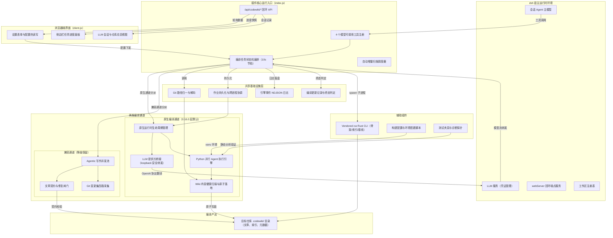

# dsh-codewiki 仓库总览

## 仓库定位与用途
dsh-codewiki 是一款运行在 DeepSeek Harness（dsh）宿主平台上的本地私有插件，核心目标是为任意代码仓库自动化生成、维护一套结构化、可随代码版本控制的 CodeWiki 文档。插件通过 LLM 驱动的 agentic 流程将源码模块转化为带 frontmatter 契约、带质量校验、带增量感知的 wiki 文章，内置严格的终态裁决机制，根治「假装成功」「悄悄退化」两类常见文档流水线缺陷，保证 wiki 文档与源码状态始终一致。

自 0.16.0 版本起，插件默认采用上游 FSoft-AI4Code/CodeWiki Python 原生引擎作为编译主通道，内置 Node 实现保留为最小兼容降级通道；同时提供侧边栏可视化面板、模型可调用工具集、无凭证泄露的跨语言 LLM 桥接能力，让 wiki 编译完全融入 dsh 的日常开发工作流。与上游 CodeWiki 的关键 fork 差异是：wiki 产物固定存储在目标仓库的 `.codewiki/` 目录内，随代码一起提交版本控制，而非存放在用户主目录下的全局路径。

## 端到端架构
下图展示了插件从宿主交互、任务编排、双通道执行、支撑设施到最终产物落地的全链路架构：

## 核心模块文档索引
仓库各模块的详细设计、实现细节与使用说明可通过以下文档查阅：

| 模块名称 | 核心职责 | 详细文档 |
|---|---|---|
| 浏览器端 UI 客户端 | 承载插件设置表单、侧边栏编译进度面板、仓库总览与 LLM 会话视图，通过轮询回环 API 获取运行时数据，转发用户控制指令 | [Browser_UI_Client.md](Browser_UI_Client.md) |
| 构建、配置与环境搭建 | 维护 npm 包清单、dsh 装载补丁、原生引擎 Python venv 搭建脚本，定义插件安装方式与全量配置项口径 | [Build,_Configuration___Environment_Setup.md](Build,_Configuration___Environment_Setup.md) |
| 核心应用运行入口 | 插件服务端入口，负责注册模型可调用工具、驱动 10s 节拍的编译任务状态机、挂载回环 API、实现自动增量调度 | [Core_Application_Runtime_Entry.md](Core_Application_Runtime_Entry.md) |
| Agentic 文章处理库 | 兼容通道的核心实现，包含 agentic 写作循环、文章结构契约闸门、存量页自动修复、Git 四路变更集采集能力 | [Agentic_Article_Processing_Library.md](Agentic_Article_Processing_Library.md) |
| CodeWiki 引擎子系统 | 原生编译通道核心层，负责跨语言协议契约、原生进程生命周期治理、安全 LLM 桥接、Python 并行执行、产物原子落地全链路 | [CodeWiki_Engine_Subsystem.md](CodeWiki_Engine_Subsystem.md) |
| 共享基础设施工具集 | 横向公共能力层，收口 Git 路径归一、作业持久化、引擎日志落盘、编译更新记录等跨模块复用能力 | [Shared_Infrastructure_Utilities.md](Shared_Infrastructure_Utilities.md) |
| 测试夹具与诊断工具 | 非运行时测试底座，包含对拍基准生成器、非 ASCII 路径对抗夹具、无 LLM 静态分析验收探针 | [Test_Fixtures___Diagnostic_Tooling.md](Test_Fixtures___Diagnostic_Tooling.md) |
| Vendored cw Rust 实现 | 上游 CodeWiki CLI 的本地 fork 副本，提供 wiki 目录初始化、索引重建、基线提交推进、过期文章扫描等无 LLM 依赖的骨架能力 | [Vendored_CodeWiki_Rust_Implementation.md](Vendored_CodeWiki_Rust_Implementation.md) |

## 构建与运行说明
本插件为纯 ESM 形态的本地 dsh bundle，Node 侧代码无需额外编译步骤；Rust 侧 `cw` CLI 已预编译为可执行文件随包分发。完整的安装步骤、配置口径、原生引擎环境搭建流程详见 [构建、配置与环境搭建模块文档](Build,_Configuration___Environment_Setup.md)。核心流程可概括为：
1.  通过在 dsh 用户 profile 的 `package.json` 中以 `link:` 形式引入本仓库路径，执行 `pnpm install` 建立本地依赖链接；
2.  执行 `tools/fsoft-engine/setup-env.sh` 为原生引擎搭建依赖闭合的独立 Python venv（不影响宿主进程的 Python 环境）；
3.  重启 dsh 进程后，插件会通过 bundle 补丁自动完成装载，所有配置项可通过浏览器侧边栏面板热修改，无需重启进程。

测试与诊断工具的使用方式详见 [测试夹具与诊断工具模块文档](Test_Fixtures___Diagnostic_Tooling.md)。