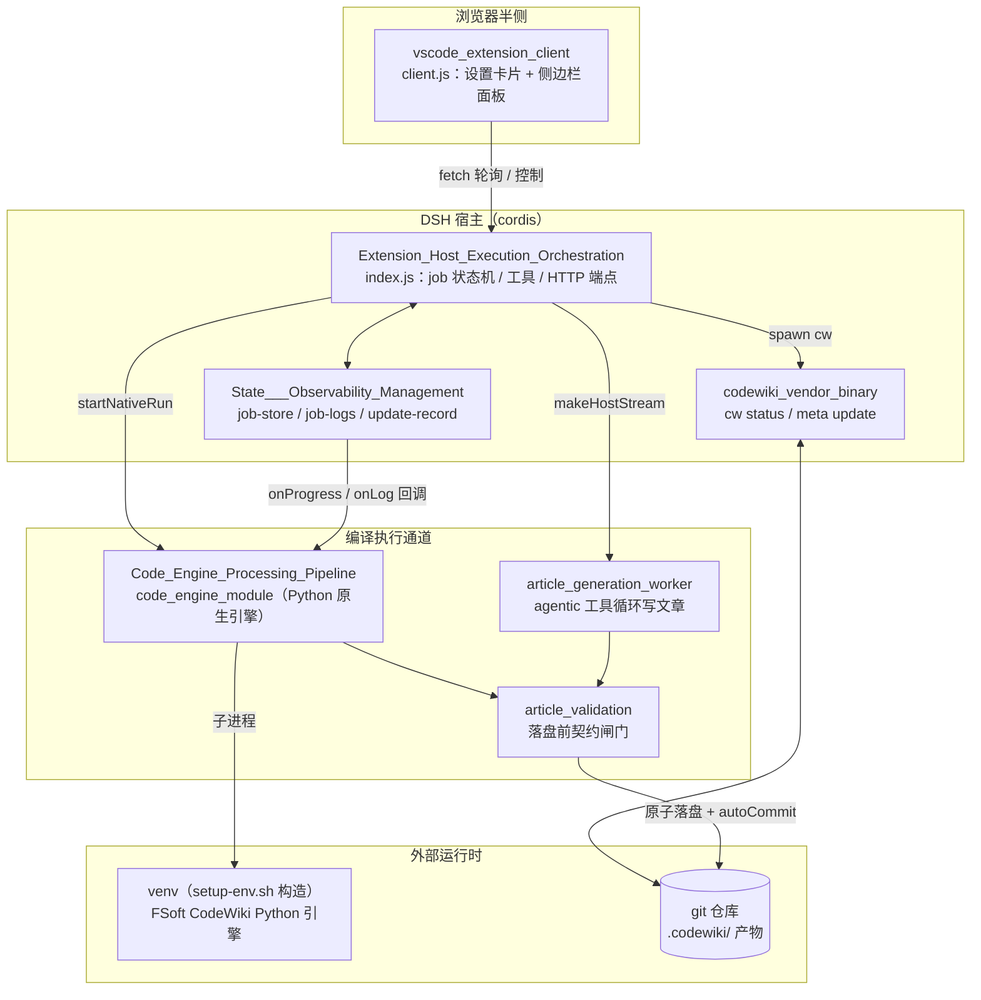
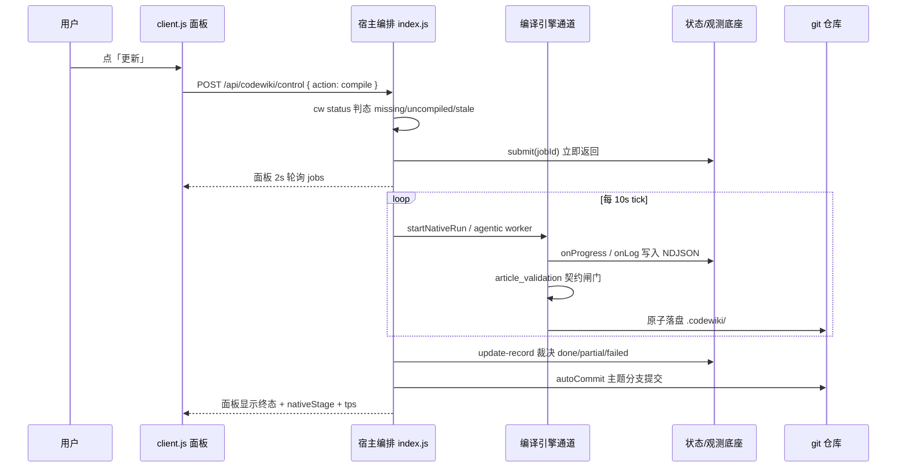

# dsh-codewiki 仓库总览

## 仓库定位

`dsh-codewiki` 是 DeepSeek Harness（DSH）的一款插件，用于把源码仓库自动编译成一份随代码版本演进的结构化知识库 wiki。它以 VS Code / Web 插件形态运行在 cordis 宿主之上，向侧边栏注入设置卡片与编译进度面板，在后台以「提交制」驱动编译任务，把 `.codewiki/` 产物（`modules/`、`concepts/`、`decisions/` 等目录及 `_meta.yaml`）随代码一起提交回 git。

仓库由七层职责构成：

| 层级 | 模块 | 一句话职责 |
|---|---|---|
| 浏览器前端 | [vscode_extension_client](vscode_extension_client.md) | `client.js`：注入设置卡片与侧边栏面板，轮询 `/api/codewiki/*` 端点 |
| 宿主编排 | [Extension_Host_Execution_Orchestration](Extension_Host_Execution_Orchestration.md) | 插件入口、job 状态机、工具注册、回环 HTTP 端点、agentic 写作能力 |
| 编译执行 | [Code_Engine_Processing_Pipeline](Code_Engine_Processing_Pipeline.md) | Python 原生引擎通道 + Node agentic 通道，落盘前经统一契约校验 |
| 状态与观测 | [State___Observability_Management](State___Observability_Management.md) | `jobs.json` 原子写、NDJSON 引擎日志、版本化更新记录与终态裁决 |
| 包与运行时 | [build_deployment_config](build_deployment_config.md) | `package.json`、`cordis.patch.yml`、`setup-env.sh`：打包 → 装载 → venv 引导 |
| 捆绑二进制 | [codewiki_vendor_binary](codewiki_vendor_binary.md) | Rust 源码 `cw init/status/meta/index/...`：wiki 产物与基线管理 |
| 开发期验收 | [Testing___Probing_Tooling](Testing___Probing_Tooling.md) | 无 LLM 探针 + 对拍夹具，验证原生引擎图分析链路 |

## 端到端架构

下图展示一次「用户在侧边栏点更新 → 编译落盘 → 面板看到结果」的完整链路：

## 关键数据流：从提交到终态

## 构建、运行与部署

插件通过 bundle 形态被 DSH 宿主装载：仓库根 `package.json`（`name: @local/dsh-codewiki`，`dsh.client.platform: "web"`，`dsh.bundle.patch: ./cordis.patch.yml`）声明入口与 profile 补丁；`cordis.patch.yml` 自动合并 `id=codewiki` 的装载条目与全部运行时配置命名空间；默认通道（`nativeEngine: true`）依赖 `tools/fsoft-engine/setup-env.sh` 在仓库外构造依赖闭合的 Python venv，再由 `nativeEnginePython` 配置项指回该解释器。Rust 侧 `cw` 二进制需单独 `cargo build --release` 后拷贝到 `bin/`。

完整的打包清单、profile 装载、venv 引导脚本与端到端部署时序见 [build_deployment_config](build_deployment_config.md)。开发期的无 LLM 图分析探针与确定性对拍夹具见 [Testing___Probing_Tooling](Testing___Probing_Tooling.md)。

## 核心模块文档

- 浏览器前端：[vscode_extension_client](vscode_extension_client.md)
- 宿主侧执行编排：[Extension_Host_Execution_Orchestration](Extension_Host_Execution_Orchestration.md)
- 代码引擎处理管线：[Code_Engine_Processing_Pipeline](Code_Engine_Processing_Pipeline.md)
- 状态与可观测性管理：[State___Observability_Management](State___Observability_Management.md)
- 构建与部署配置：[build_deployment_config](build_deployment_config.md)
- 捆绑 `cw` 二进制：[codewiki_vendor_binary](codewiki_vendor_binary.md)
- 测试与探针工具：[Testing___Probing_Tooling](Testing___Probing_Tooling.md)