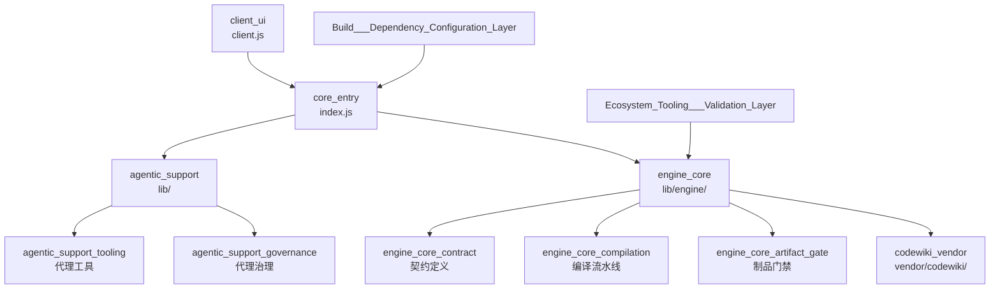

# dsh-codewiki 仓库概览

## 仓库用途

`dsh-codewiki` 是一款基于 Cordis 框架构建的 **代码知识库（CodeWiki）引擎**项目。它在开源的 `codewiki` 供应商实现之上，构建了一套用于将源代码编译、解析并生成可检索知识库的完整引擎体系。其核心职责包括：

1. 提供统一的引擎契约（Contract），定义知识库的输入、输出与生命周期接口；
2. 执行代码编译流水线，将源码转换为结构化的代码索引；
3. 通过制品门禁（Artifact Gate）对生成的知识库产物进行校验与质量把控；
4. 为客户端 UI 提供后端支撑，并通过 agentic 支持模块为 AI 代理提供工具与治理能力。

## 端到端架构

上图展示了请求从客户端进入、经核心入口分发、最终到达引擎核心与供应商实现的完整链路。构建依赖配置层（`cordis.patch.yml`、`package.json`）与生态工具验证层（测试夹具、`fsoft-engine` 工具）从外围为整个体系提供装配与质量保障。

## 核心模块文档

各顶层模块的详细说明请参考以下文档：

| 模块 | 入口路径 | 说明 | 文档 |
| --- | --- | --- | --- |
| 客户端 UI | `client.js` | 面向用户的代码知识库交互界面 | [client_ui](client_ui.md) |
| 核心入口 | `index.js` | 应用启动与模块装配的主入口 | [core_entry](core_entry.md) |
| Agentic 支持 | `lib/` | 为 AI 代理提供的工具与治理能力 | [agentic_support](agentic_support.md) |
| 引擎核心 | `lib/engine/` | 知识库编译引擎的契约、流水线与门禁实现 | [engine_core](engine_core.md) |
| 构建与依赖配置层 | — | `cordis.patch.yml`、`package.json` 等构建清单与补丁配置 | [Build___Dependency_Configuration_Layer](Build___Dependency_Configuration_Layer.md) |
| 生态工具与验证层 | — | 测试夹具与 `fsoft-engine` 辅助工具 | [Ecosystem_Tooling___Validation_Layer](Ecosystem_Tooling___Validation_Layer.md) |
| CodeWiki 供应商 | `vendor/codewiki/` | 第三方 codewiki 的本地 vendor 实现 | [codewiki_vendor](codewiki_vendor.md) |

## 构建、运行与部署

本项目的构建、测试、打包与部署流程由以下关键制品驱动：

- **清单文件**：[`package.json`](Build___Dependency_Configuration_Layer.md) 定义依赖、脚本与发布元数据；
- **配置文件**：[`cordis.patch.yml`](Build___Dependency_Configuration_Layer.md) 描述 Cordis 框架的补丁与装配规则；
- **环境脚本**：[`tools/fsoft-engine/setup-env.sh`](Ecosystem_Tooling___Validation_Layer.md) 用于一键初始化开发与运行环境。

关于依赖安装、编译构建、测试执行、打包发布及环境部署的完整步骤，请参阅 [构建与依赖配置层](Build___Dependency_Configuration_Layer.md) 与 [生态工具与验证层](Ecosystem_Tooling___Validation_Layer.md) 的模块文档。