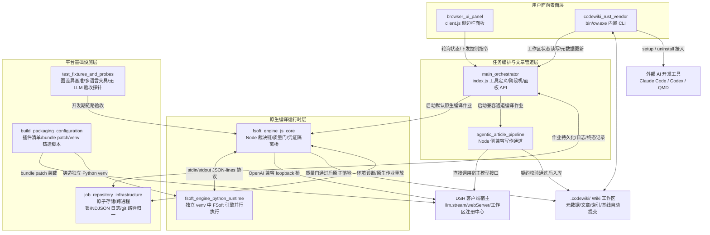

# dsh-codewiki 仓库概览

这个仓库是 `@local/dsh-codewiki` 插件的完整实现，核心目标是为 DSH（DeepSeek Harness）客户端提供自动化的代码 Wiki 构建与维护能力。插件可以扫描目标代码仓库，自动生成结构化的项目 Wiki 文档存储在 `.codewiki/` 工作区，通过客户端侧边栏面板向用户展示编译进度、仓库总览、LLM 会话记录，支持任务取消、立即编译等控制操作，并可通过内置 CLI 将 Wiki 接入 Claude Code、Codex、QMD 等外部 AI 开发环境，为 AI 编码工具提供项目上下文检索能力。

自 v0.16.0 版本起，插件默认采用独立的跨语言原生 FSoft 引擎通道完成编译，同时保留 Node 侧 agentic 写作通道作为兼容回退；全链路遵循「编译终态不被洗白」的设计红线，通过固定的质量裁决链杜绝「引擎报完成即判定成功、产物未入库仍报通过、部分失败被掩盖为完整成功」等历史缺陷，且全程不持有用户 LLM 凭证，所有模型请求均通过 DSH 宿主的 `llm.stream` 桥接转发，保证凭证安全隔离。

## 端到端架构总览

仓库采用四层垂直分离的架构设计，各层职责正交、边界清晰，从用户交互到最终产物落地的全链路流转关系如下图所示：

## 核心模块文档

仓库的代码与能力按职责拆分为四个独立的垂直模块，每个模块都有独立的详细文档说明其设计、执行流程与不变量边界：

| 核心模块 | 文档链接 | 核心职责 |
|---|---|---|
| 用户面向表面层 | [codewiki_user_facing_surfaces.md](codewiki_user_facing_surfaces.md) | 实现浏览器侧边栏交互面板与内置 Rust `cw` CLI，承载用户配置、进度可视化、Wiki 工作区初始化、外部 AI 工具接入等面向终端用户的能力。 |
| 任务编排与文章管道层 | [agentic_orchestration_and_article_pipeline.md](agentic_orchestration_and_article_pipeline.md) | 插件运行时主干，定义对外暴露的编译工具、驱动常驻任务阶段机、协调双编译通道、提供回环面板 API、把关文章入库前的锚点修正与契约校验。 |
| 原生编译运行时层 | [fsoft_engine_runtime.md](fsoft_engine_runtime.md) | v0.16.0 起的默认编译执行层，通过 Node/Python 跨语言隔离架构、固定线性裁决链覆盖环境校验、引擎执行、质量门检、产物提交全流程，确保编译终态不被掩盖。 |
| 平台基础设施层 | [platform_infrastructure_and_developer_tooling.md](platform_infrastructure_and_developer_tooling.md) | 插件运行底座，提供 fail-closed 的作业原子存储、跨进程锁、git 路径归一、任务日志、打包配置、Python 虚拟环境铸造、开发期测试夹具与验收探针能力。 |

## 构建、运行与打包说明

项目的构建、打包、运行环境配置与测试资产统一归集到平台基础设施模块，不分散在业务代码中：
- 插件身份与 DSH 装载规则通过 `package.json` 与 `cordis.patch.yml` 定义，随 npm 包发布后可被 DSH 宿主自动识别装载；
- 原生引擎依赖的 Python 运行环境通过 `tools/fsoft-engine/setup-env.sh` 脚本铸造，生成依赖完全锁定的独立 venv，运行期通过只读 `doctor` 探针检测环境漂移，不自动降级到兼容通道；
- 开发期配套的图差异对拍基准、多语言路径 fixture、无 LLM 依赖图探针均作为独立资产存在，不打包进运行时 bundle。

详细的构建步骤、配置项说明、环境诊断逻辑可参考 [平台基础设施模块文档](platform_infrastructure_and_developer_tooling.md)。