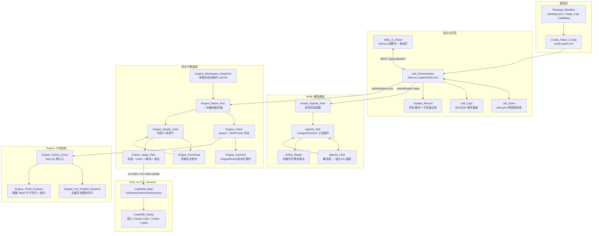
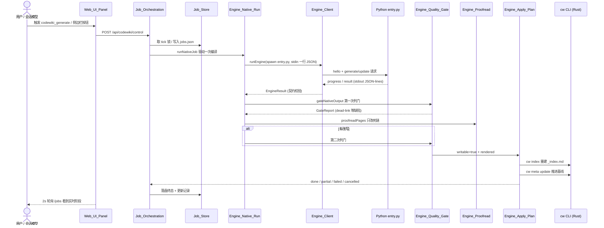

# dsh-codewiki 仓库总览

## 仓库定位

`dsh-codewiki`（npm 包名 `@local/dsh-codewiki`，当前版本 0.17.53）是 DeepSeek Harness（dsh）宿主的一个本地插件，把「为代码仓库生成并持续维护一份全仓 Wiki」这件事做成了**服务化的后台编译流水线 + 侧边栏可观测面板**。它同时提供：

- 面向会话模型的工具（`cw`、`codewiki_generate`、`codewiki_update`、`codewiki_progress`）；
- 面向浏览器的插件设置页与侧边栏编译面板（实时进度、LLM 请求会话、取消控制）；
- 两条并列的编译通道：**原生引擎通道**（默认，`nativeEngine: true`，spawn 上游 FSoft-AI4Code/CodeWiki 的 Python 引擎子进程）与 **Node 兼容通道**（agentic 写作池 + 单轮批量请求）。

仓库本体是 Node ESM 双入口（`index.js` 宿主侧 + `client.js` 前端侧），并 vendored 了一套 Rust 版 `cw` CLI（`vendor/codewiki/`）与上游 FSoft Python 引擎源码锚点（`lib/engine/python/`）。包身份、运行时约束（Node ≥ 24.9、dsh ≥ 0.2.0-rc.0）与 bundle patch 声明见 [Package_Manifest](Package_Manifest.md)；向 dsh 宿主注册自身的装配补丁见 [Cordis_Patch_Config](Cordis_Patch_Config.md)。

## 端到端架构

### 分层视图

下图把整个仓库按「宿主装配 → 编排中枢 → 双通道执行 → 跨语言边界 → 产物落地」五层展开。

### 一次编译的端到端时序

下图跟踪一条任务从用户在侧边栏发起，到产物真正写盘并推进基线的全过程。

## 核心模块索引

按职责分组，下面把仓库的核心模块链接到各自的详细文档。

### 装配与包身份
- [Package_Manifest](Package_Manifest.md) — npm 包身份、双入口声明、Node/dsh 版本约束、跨语言阶段口径、Rust 侧 `WikiMeta`。
- [Cordis_Patch_Config](Cordis_Patch_Config.md) — `cordis.patch.yml` 如何把 `id: codewiki` 的插件注册进 dsh 宿主，以及配置覆盖语义。

### 宿主交互与编排中枢
- [Job_Orchestration](Job_Orchestration.md) — 插件入口 `index.js`：工具注册、回环 REST API、10s 节拍有限阶段机、两条编译通道的开关。
- [Job_Store](Job_Store.md) — `jobs.json` 原子读写、跨进程 tick 锁、多窗口现场合并、宿主重启后的重放裁决。
- [Job_Logs](Job_Logs.md) — NDJSON 事件日志、wiki 链接扫描、git 路径归一、中文+空格 fixture。
- [Update_Record](Update_Record.md) — 终态裁决（done/partial/failed/cancelled）与「能否推进基线」的可复盘 JSON 记录。
- [Web_UI_Panel](Web_UI_Panel.md) — `client.js`：设置表单、侧边栏进度面板、LLM 请求会话视图。

### Node 兼容通道（agentic 写作池）
- [Article_Agentic_Pool](Article_Agentic_Pool.md) — `runPool` 双池并发调度，normal 池 + big 池独立限流。
- [Agentic_Edit](Agentic_Edit.md) — 单篇文章的多轮工具循环（`read_code` / `list_files` / `edit_article` / `generate_sub_module`）。
- [Agentic_Host](Agentic_Host.md) — 裸 `{role, content}` 消息 ↔ 宿主 `llm.stream` 正式 Message 的适配层与消息身份缓存。
- [Article_Contract](Article_Contract.md) — Wiki 文章结构性最低质量契约（frontmatter / 必需章节 / source_files / 死链），三个写入通道共用。
- [Article_Repair](Article_Repair.md) — 存量坏页「先修，修不动才删」的纯函数修复裁决层。

### 原生引擎通道（Python 子进程）
- [Engine_Native_Run](Engine_Native_Run.md) — 一次原生编译的完整裁决链（env/lock → 增量决议 → 引擎调用 → 判门 → 落地）。
- [Engine_Workspace_Snapshot](Engine_Workspace_Snapshot.md) — 把未提交的四路改动合成一个不挂 ref 的临时 commit，对齐记账。
- [Engine_Client](Engine_Client.md) — 跨语言薄适配层：spawn、stdin 一行 JSON、stdout JSON-lines、超时/取消/崩溃裁决。
- [Engine_Contract](Engine_Contract.md) — 跨进程数据契约（`EngineResult` / `EngineProgress` / `EngineError`）的版本化、可校验纯函数。
- [Engine_Quality_Gate](Engine_Quality_Gate.md) — 产物采用门：产物自洽、目标格式契约、基线可推进性，问题三分类（defect / degradation / stale）。
- [Engine_Proofread](Engine_Proofread.md) — 判出 dead-link 后只改链接、不改别的，改完重跑判门。
- [Engine_Apply_Plan](Engine_Apply_Plan.md) — 落地器三条硬不变量：写集封闭、索引/基线失败即回滚、提交失败不回滚。
- [Engine_Python_Entry](Engine_Python_Entry.md) — `entry.py`：协议翻译、五段→八段进度映射、stdout 守卫、不读本机凭证库。
- [Engine_Full_Parallel_Runtime](Engine_Full_Parallel_Runtime.md) — 替换 `_generate_modules_in_order`，兄弟模块并行且守住拓扑顺序等四条不变量。
- [Engine_FSoft_Runtime](Engine_FSoft_Runtime.md) — 替换增量 Step 5：叶子独立临时副本并行 + 按序合并 + 冲突串行重跑 + 断点恢复。

### Rust `cw` CLI（vendor）
- [CodeWiki_Main](CodeWiki_Main.md) — `cw init / status / meta update / index / projects / path` 等子命令。
- [CodeWiki_Setup](CodeWiki_Setup.md) — 把会话规约安装到 Claude Code / Codex / QMD。

### 工具与测试
- [FSoft_Engine_Setup_Script](FSoft_Engine_Setup_Script.md) — `tools/fsoft-engine/setup-env.sh`：在仓库外造出依赖闭合的 Python venv。
- [No-LLM_Graph_Probe](No-LLM_Graph_Probe.md) — `probe-no-llm-graph.py`：不依赖 LLM 的依赖图端到端验收探针。
- [Graphdiff_Golden_Generator](Graphdiff_Golden_Generator.md) — 图差异算法 Node 移植版的对拍基准生成器。

## 构建、运行与配置

本仓库不自带独立的构建/打包流水线——它是一个被 dsh 宿主装载的本地插件。关键事实分散在三份工程产物里：

- `package.json`（包身份、双入口、Node/dsh 引擎约束、bundle patch 指针）；
- `cordis.patch.yml`（向宿主声明插件 id 与运行期配置命名空间）；
- `tools/fsoft-engine/setup-env.sh`（原生引擎所依赖的 Python venv 环境）。

它们的字段含义、装配方式与环境搭建步骤已在以下模块文档中完整说明，此处不再重复：

- 包身份、入口与运行时约束 → [Package_Manifest](Package_Manifest.md)
- 插件如何被 dsh 宿主装载、两种安装方式（bundle 依赖 / `file:///` 直挂）与配置覆盖优先级 → [Cordis_Patch_Config](Cordis_Patch_Config.md)
- Python venv 依赖闭合、`pip check` 自证与快速失败约定 → [FSoft_Engine_Setup_Script](FSoft_Engine_Setup_Script.md)

简言之：`pnpm install` 把本仓库以 link 形式接入 dsh 的 profile，宿主启动时自动合并 `cordis.patch.yml` 完成注册；原生引擎通道在首次使用前需要运行 `setup-env.sh` 准备好独立的 Python venv，并在插件设置页显式选择 provider 与编译模型。