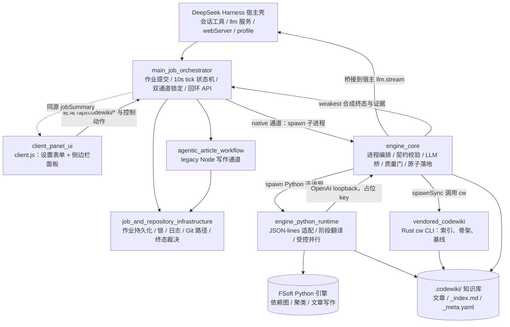

# dsh-codewiki 仓库总览

## 仓库用途

`dsh-codewiki` 是 DeepSeek Harness（dsh）的插件 `@local/dsh-codewiki`，用于为代码仓库自动编译并维护全仓 wiki。它把原本同步、长耗时的编译过程改造为「提交即返回、后台推进、可观测、可取消」的作业系统，并在目标仓库内生成 `.codewiki/` 知识库。

其核心能力包括：

- 浏览器侧设置表单与侧边栏面板，展示任务进度、仓库 wiki 状态、LLM 会话日志；
- 回环 HTTP API 与会话工具，支持编译、更新、查询进度、取消任务；
- 原生 Python 引擎通道，负责代码图、模块聚类、文章写作、校验、索引与基线推进；
- legacy Node agentic 写作通道，可离线测试、精确编辑文章并并发派发；
- 质量门、原子落地、孤儿页清理、自动提交与最弱环终态裁决；
- 插件配置、Python 运行时环境建设与迁移期对拍探针。

真实 LLM 凭证不落地到引擎子进程或日志，只由宿主进程按 provider 解析。

## 端到端架构

一次编译通常由会话工具或面板动作触发：编排器先把作业持久化到磁盘，再在首个 tick 锁定通道。默认走原生通道，由 `engine_core` 拉起 Python 运行时，Python 侧适配 FSoft 引擎；引擎的模型请求经 loopback 桥回到宿主 `llm.stream`。产物经质量门校验后，由落地器写盘、调用 `cw index` 收录，并按最弱环原则合成 `done` / `partial` / `failed` / `cancelled` 终态。

## 核心模块文档

| 模块 | 主要职责 | 文档 |
| --- | --- | --- |
| `client_panel_ui` | 浏览器半侧：插件设置表单、侧边栏面板、任务/仓库/会话标签页、轮询与控制交互 | [client_panel_ui.md](client_panel_ui.md) |
| `job_orchestration_and_agentic_article_pipeline` | 作业总线：提交、取消、tick 状态机、双通道锁定、回环 API、持久化与终态裁决 | [job_orchestration_and_agentic_article_pipeline.md](job_orchestration_and_agentic_article_pipeline.md) |
| `engine_runtime_and_codewiki_kernel` | 原生编译内核：Node/Python/Rust 跨语言编排、LLM 桥、质量门、原子落地、索引与基线 | [engine_runtime_and_codewiki_kernel.md](engine_runtime_and_codewiki_kernel.md) |
| `build_configuration_and_test_verification_tooling` | 包清单、宿主 profile 装配、Python venv 建设、图 diff 对拍与无 LLM 验收探针 | [build_configuration_and_test_verification_tooling.md](build_configuration_and_test_verification_tooling.md) |

## 构建、运行与验收

本插件以 ESM 包形式由 dsh 宿主加载，不单独部署为独立服务：

- `package.json` 声明插件身份、`.` 与 `./client` 导出面、Node/dsh 版本约束以及 `bundle.patch` 元数据；
- `cordis.patch.yml` 随包合并到宿主 profile，定义 `codewiki` 配置命名空间、bundle 依赖与 `file:///` 直挂方式；
- `tools/fsoft-engine/setup-env.sh` 在仓库外建设闭合 Python venv，按冻结快照安装依赖、editable 安装 FSoft、执行 `pip check` 与 import 冒烟；
- 测试侧提供图 diff 黄金集生成器、无 LLM 依赖图探针，以及专门覆盖中文与空格路径的混语言 fixture。

构建、配置、环境搭建与验收细节见 [build_configuration_and_test_verification_tooling.md](build_configuration_and_test_verification_tooling.md)。