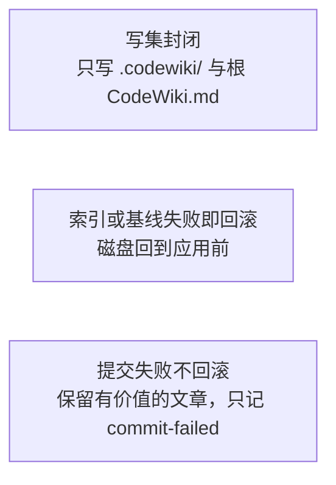
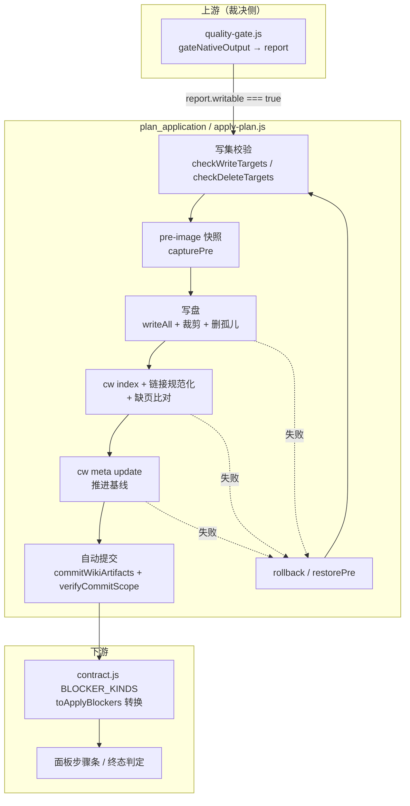
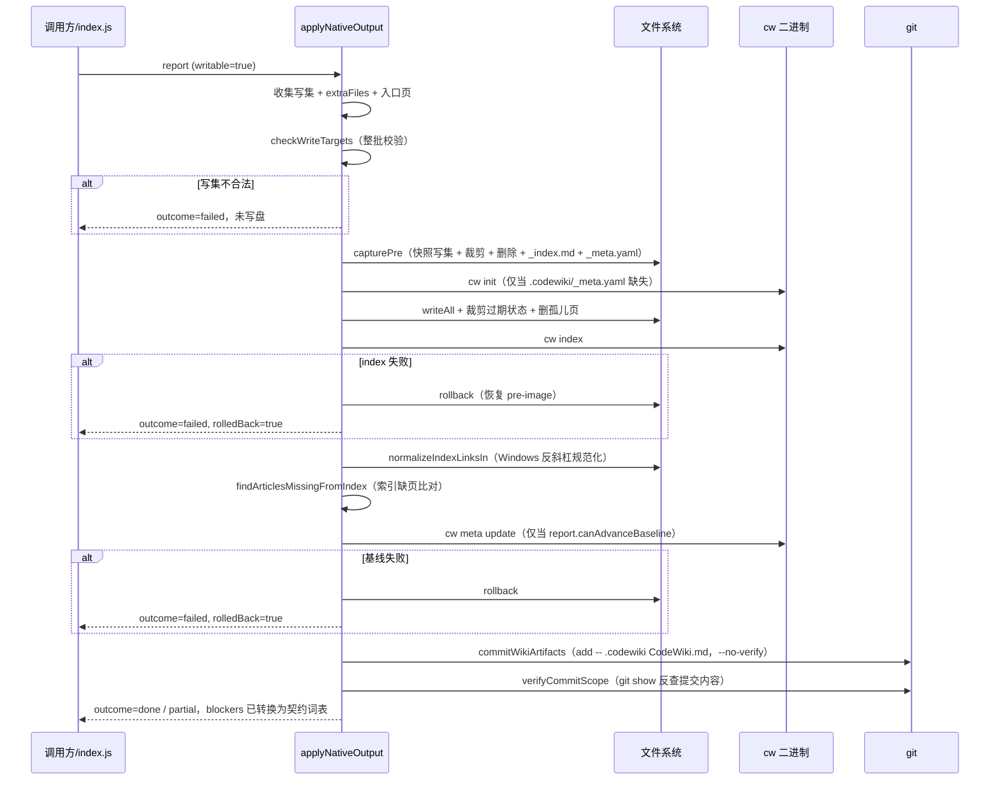
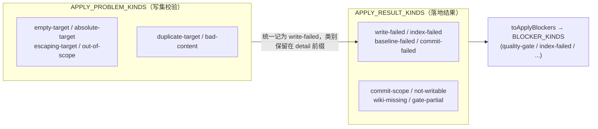
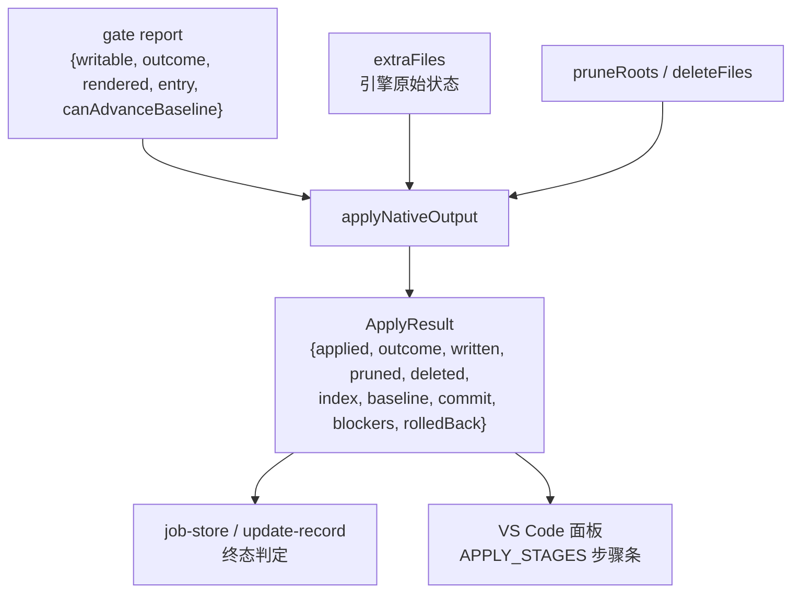

# plan_application 模块：原生产物的落地器

## 简介

`plan_application`（实现于 `lib/engine/apply-plan.js`）是 Code Engine 处理管线中**质量闸门通过之后、产物真正进入仓库之前**的最后一道落地层。它回答一个单一问题：「gate 裁决说这批产物可以入库，那么入库这件事本身有没有成立？」

它不做质量判断——那是 [quality_gates](quality_gates.md)（`quality-gate.js`）的职责；本模块只负责把一份已经被批准的产物**原子地**写盘、建索引、推进基线、自动提交，并在任意一步失败时把磁盘恢复到应用前的状态。它存在的直接动因是 0.14.0 的教训：「1 篇成功 + 19 篇失败也报 done」——把「写成几篇」当成「成立」。

### 三条硬不变量（本模块唯一的验收标准）



1. **写集封闭**：绝对路径、盘符、`..` 上跳、白名单外路径一律**整批拒写**（不是跳过坏条目——残缺写集落盘后，调用方会误判「大部分成功」）。
2. **索引/基线失败即回滚**：写盘后 `cw index` 或 `cw meta update` 失败，磁盘必须回到 pre-image（旧文章写回、新文件删掉、`_index.md` 与 `_meta.yaml` 恢复）。否则库会留下「文章在、索引没有」或「文章在、基线已推进」的脏结构，下次编译在脏库上判「已消化」，而脏库永不自愈。
3. **提交失败不回滚**：自动提交失败时文章本身是好的、有用的，只记 `commit-failed` 阻塞并如实返回 partial，绝不把有价值的文章删掉。

## 架构与定位



### 与管线其他阶段的关系

| 相邻模块 | 关系 |
| --- | --- |
| [quality_gates](quality_gates.md) | 唯一输入源：`applyNativeOutput` 只认 `report.writable` 与 `report.outcome` 的结论，不重复做质量判定。`writable=false` 时一个字都不写。 |
| [engine_contracts](engine_contracts.md) | 输出词表对齐：`toApplyBlockers` 把落地问题（`write-failed`/`index-failed`/…）映射到契约的 `BLOCKER_KINDS`，契约测试会枚举全表。 |
| [module_indexing](module_indexing.md) | 写集白名单常量 `WIKI_DIR`（`.codewiki`）、`WIKI_ENTRY`（`CodeWiki.md`）、`WIKI_META_REL`（`.codewiki/_meta.yaml`）从 `mapping.js` 导入。 |
| [article_validation](article_validation.md) | `parseFrontmatter` 用于剥放入口页 frontmatter、以及孤儿页的 `source_files` 证据读取。 |
| `lib/git-paths.js` | 所有 git 读路径统一 `withQuotepathOff` + `decodeGitPaths`，否则中文页名会被八进制转义，被提交范围校验误判为「wiki 之外的路径」。 |
| `Extension_Host_Execution_Orchestration`（宿主主入口 index.js） | 生产路径通过依赖注入替换本模块的默认实现：`deps.runCw`（异步版）、`deps.commit`（分支合并式 `autoCommitWiki`）。本模块**刻意不 import index.js**——加载它会连带拉起宿主服务与 webServer，让单测变成「为测一个写盘函数启动整个插件」。 |

## 核心组件

### `applyNativeOutput`：落地主入口

把一次采用裁决落地为一个原子事务。签名要点：

```javascript
await applyNativeOutput({
  repoRoot,          // 仓库根（绝对路径）
  report,            // gateNativeOutput 返回的裁决
  docsDir,           // 引擎产出的 docs 目录
  entryMode,         // 'keep' | 'overwrite' | 'skip' 根入口已有内容时的处置
  dryRun,            // 只算写集与判定，不写盘、不跑 cw、不提交
  extraFiles,        // 引擎原始状态（模块树/元数据/依赖图/增量凭据），与文章同事务
  pruneRoots,        // 受管状态目录：本轮写集之外的文件将被裁剪删除
  deleteFiles,       // 显式删除集（孤儿页），与裁剪共用 pre-image 与回滚语义
  deps,              // { runCw, commit, normalizeIndexLinks, verifyCommit, cwBinary }
})
```

**阶段顺序**（`APPLY_STAGES = ['write', 'index', 'baseline', 'commit']`，面板步骤条按它对齐）：



**终态语义**：

- `outcome=done`：problems 为空且提交已成立（或无改动可提交）。
- `outcome=partial`：有任意一条 problem（例如 gate 裁决本身是 partial、commit-failed、commit-scope）。落地器**不许把 gate 的 partial 洗成 done**——`gate-partial` 问题会原样保留。
- `applied=true && rolledBack=true` 不可能同时出现：回滚发生时 `applied` 必为 `false`。

### `defaultRunCw`：默认 cw 通道

`spawnSync` 同步调用 cw 二进制（默认命令名取自环境变量 `DSH_CODEWIKI_CW`，缺省为 `cw`），返回 `{ exitCode, stdout, stderr, timedOut }`。生产环境由 `deps.runCw` 注入异步版本替换，签名一致。

### `findOrphanPages`：孤儿页扫描

找出 `.codewiki/modules/` 下「`source_files` 非空、且其中**每一个**在仓库里都已不存在」的存量页。为什么必须由落地层而不是 gate 来扫：

- gate 只体检**本次产物**里的页；删除模块时 FSoft 可能回 `full_fallback` + `pages_removed: []`，不告诉我们「哪篇该消失」。
- 这些页永久留在库里还挂在 `_index.md` 上，读者点进去看到的是一份描述已删代码的文档，没有任何一处报错。

判据刻意保守，宁可漏删不可误删：

- `source_files` 为空 = 没有归属证据（不是孤儿证据），跳过；
- 只要还有**一个**文件存在就不是孤儿（部分失效由 gate 的 `source-missing` 报）；
- frontmatter 缺失/坏掉的页不动（可能是人工页）；
- 本轮 `keepPages` 里的页不判孤儿。

## 关键安全设计

### 1. 写集与删除集共用同一把尺子

`checkTargetPath` 是写集（`checkWriteTargets`）与删除集（`checkDeleteTargets`）共用的纯函数判据（空路径 / 绝对路径 / 上跳 / 白名单）。原本两处各抄四段同形 `if`，同形复制最危险的后果不是重复而是**不对称**——某一侧补了判据另一侧没补，「写不许越界但删可以越界」这类缺陷肉眼不可见。删错比写错更不可逆，两侧必须共用判据。

### 2. pre-image 事务与逆序恢复

`capturePre` 快照的对象不只本次写的文件，还包括 `_index.md`、`_meta.yaml`、裁剪与删除目标——因为 `cw index` 会重写 `_index.md`、`cw meta update` 会重写 `_meta.yaml`，它们才是「库是否干净」的判据。`restorePre` **逆序**恢复（后写的先撤），语义上更接近「撤销这次事务」；pre-image 中不存在 = 本次新建的，回滚时删掉。若整个 `.codewiki/` 是本次才出现的，连目录一起删掉，避免回滚后留下「有 wiki 但没有文章」的空壳。

### 3. 无变化不重写

`writeAll` 逐字节比对磁盘内容：相同则跳过。无变化的一轮不该产生 mtime 抖动，更不该让「产物无改动」的自动提交因为一次空写而变成真实提交。

### 4. 缺页静默成功的防御

`cw index` 的退出码只表示「索引文件写成功」，不表示「文章被收录」——vendor `codewiki` 的实现是逐篇 `frontmatter::parse`，解析失败就 `continue`，最后照样写索引并返回 0。`findArticlesMissingFromIndex` 在 index 成功后把 `written` 的文章路径与 `_index.md` 里的 `[[link]]` 逐项比对：缺页即 `index-failed` 并整体回滚。

### 5. 自动提交的安全边界

`commitWikiArtifacts` 是阶段 3 自带的小提交器，安全边界逐条对齐宿主的 `autoCommitWiki`（不 import 它以避免连锁加载）：

- 只 `git add -- .codewiki CodeWiki.md`（固定 pathspec，与 `-A/--all` 无关）；
- `--no-verify`：不跑 husky/lint-staged 钩子；
- 无 HEAD、MERGE/REBASE/CHERRY-PICK 进行中、未解决冲突、`.gitignore` 忽略、缺 git user 配置——一律拒绝提交而不是硬上；
- 提交成立后 `verifyCommitScope` 用 `git show --name-only` **反查实际提交内容**：「命令带了 pathspec」与「提交里真的只有这两个路径」是两件事（仓库钩子、并发暂存都可能跑偏），反查把边界变成可断言的事实；混进 wiki 之外路径时记 `commit-scope` 但不回滚。

### 6. 依赖注入而非 import

`runCw` / `commit` / `normalizeIndexLinks` / `verifyCommit` 全部由调用方注入，默认值自带同语义实现（不是「没有注入就什么都不做」——不提交还报 done 正是要消灭的那类失败）。测试注入桩，生产由宿主注入异步 runCw 与分支合并式提交器。

## 问题词表



- **写集问题**（`APPLY_PROBLEM_KINDS`）不单独进结果词表，统一记 `write-failed`，原子类别保留在 `detail` 前缀里（机读靠前缀，人读靠 detail）。
- **落地结果问题**（`APPLY_RESULT_KINDS`）通过 `TO_CONTRACT_KIND` 映射表转换为契约词表；未登记的 kind 在 `toApplyBlockers` 里直接抛错——契约测试会枚举全表，写错 kind 会让面板与终态判定同时失明。

## 数据流小结



一句话概括：**`report` 说「可以入库」，`applyNativeOutput` 负责把「入库真的成立」这件事做对——要么这批算数、一步都不少，要么磁盘一步都没动过。**
