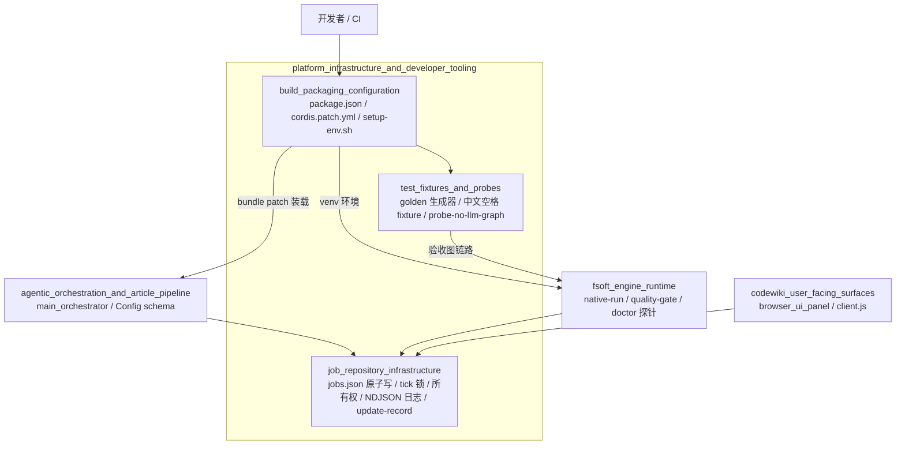
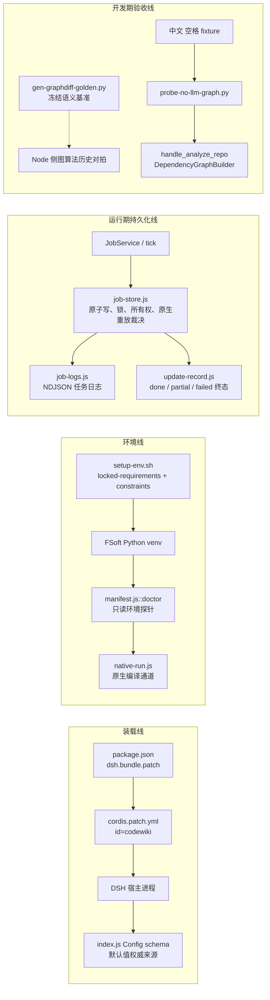

# 平台基础设施与开发工具（platform_infrastructure_and_developer_tooling）

## 模块定位

本模块是 CodeWiki 插件的**底座与接线层**。它把三类“不直接推进编译业务、但任何一环语义错误都会造成重复执行、现场丢失或环境漂移”的职责从主编排逻辑中剥离出来：

1. **运行期持久化与观测**：作业状态、引擎日志、git 路径归一、编译结果记录。
2. **打包、宿主装载与原生引擎环境**：插件身份声明、DSH bundle 装载条目、FSoft Python venv 铸造。
3. **开发期质量保障资产**：图差异对拍基准、多语言 fixture 仓库、无 LLM 依赖图验收探针。

本模块不承载文章生成或编译推进逻辑，而是为 [agentic_orchestration_and_article_pipeline](agentic_orchestration_and_article_pipeline.md)、[fsoft_engine_runtime](fsoft_engine_runtime.md) 与 [codewiki_user_facing_surfaces](codewiki_user_facing_surfaces.md) 提供稳定、可独立测试的基础能力。

## 架构总览

## 核心组成

| 子模块 | 主要职责 | 文档 |
| --- | --- | --- |
| `job_repository_infrastructure` | 提供 `jobs.json` 原子读写、跨进程 tick 锁、所有权判定、git 路径归一、任务 NDJSON 日志与编译结果更新记录，保证 fail-closed 的持久化语义。 | [作业仓储基础设施（job_repository_infrastructure）](job_repository_infrastructure.md) |
| `build_packaging_configuration` | 定义插件 npm 包清单、DSH 宿主 bundle patch、配置命名空间，以及铸造依赖闭合 FSoft Python 引擎 venv 的脚本与冻结依赖。 | [构建、打包与运行环境配置（build_packaging_configuration）](build_packaging_configuration.md) |
| `test_fixtures_and_probes` | 提供 graph-diff 对拍基准生成器、含中文与空格路径的多语言 fixture 仓库，以及不依赖 LLM 的阶段 1A 依赖图验收探针。 | [测试夹具与探针（test_fixtures_and_probes）](test_fixtures_and_probes.md) |

## 关键链路

## 设计边界

- **运行期状态显式失败**：作业仓储区分 `ok / missing / corrupt / unreadable`，读不出任务时不允许静默当成“没有任务”，避免同仓库被重复提交或双引擎并发写入。
- **环境不自动修复**：原生引擎 venv 由 `setup-env.sh` 铸造；运行期 `doctor` 只做只读诊断，环境漂移时以 `engine-deps` 明确失败，不悄悄回退 Node 通道。
- **测试资产不进运行时 bundle**：fixture 与探针是开发期/验收期工具，不被 `index.js` 或 `lib/engine/*` 导入；删除它们不影响插件运行。
- **配置默认值单一权威来源**：`index.js` 的 Config schema 是默认值来源，`cordis.patch.yml` 主要承担装载条目与用户可读配置说明。