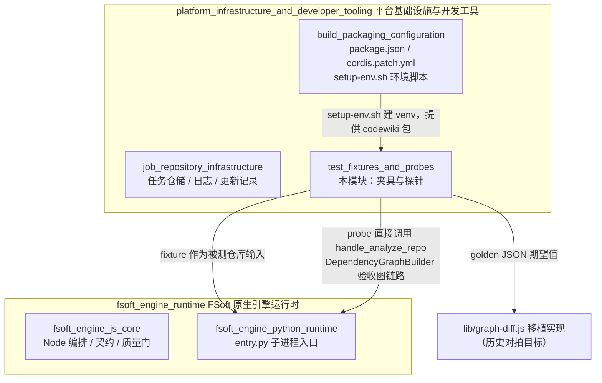
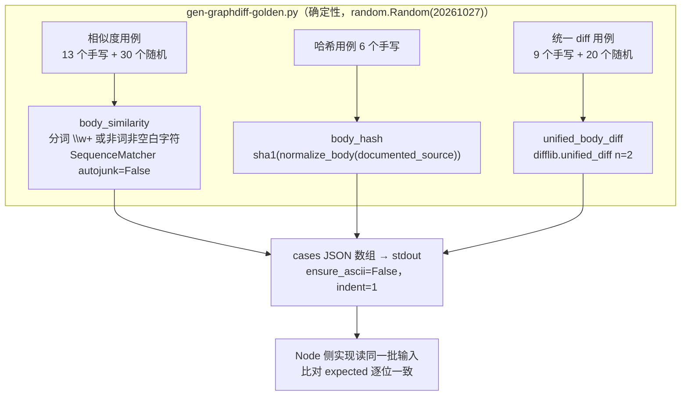
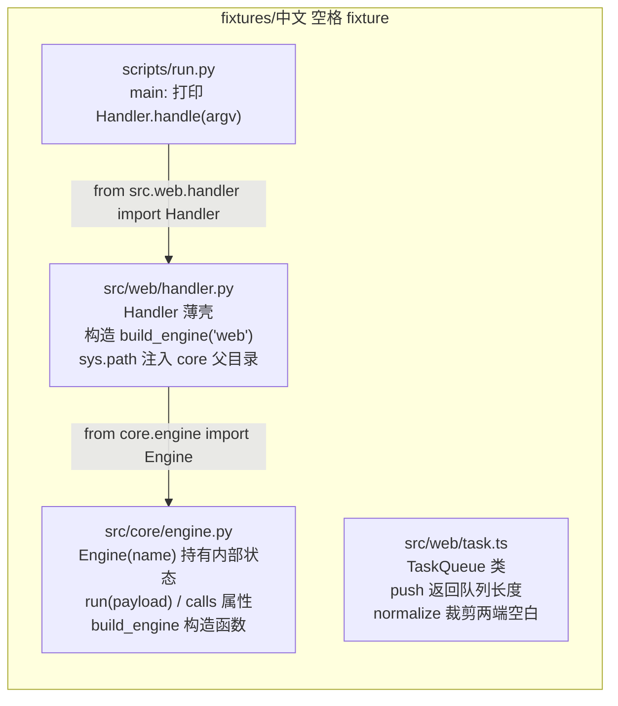
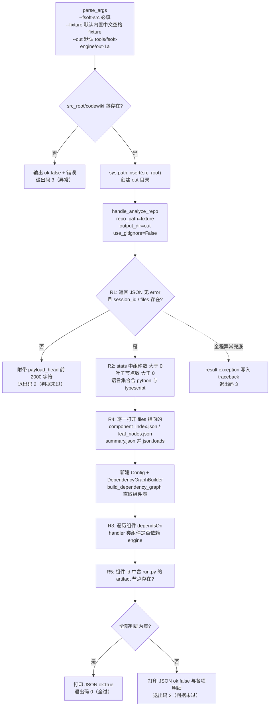

# 测试夹具与探针（test_fixtures_and_probes）

本模块是平台基础设施层的**质量保障资产集**：它不参与插件的运行时数据流，而是为 FSoft 原生引擎通道提供三类开发期验证工具——图差异算法的对拍基准生成器、一个刻意使用「中文 + 空格路径」的多语言微型 fixture 仓库，以及一条完全不依赖 LLM 的阶段 1A 依赖图验收探针。它解决的核心问题是：在「原生引擎 = 模型链路 + 图/artifact 链路」的复杂集成里，先把唯一无模型的一环（tree-sitter 静态依赖图）单独跑通，使后续阶段的故障可以被干净地分离定位。

## 1. 模块定位

本模块是 [platform_infrastructure_and_developer_tooling](platform_infrastructure_and_developer_tooling.md) 的三个子模块之一，与 [job_repository_infrastructure](job_repository_infrastructure.md)（任务仓储）和 [build_packaging_configuration](build_packaging_configuration.md)（构建、打包与环境脚本）并列。它的产出全部是**开发期/验收期资产**：CLI 脚本与 fixture 文件，不进入插件运行时 bundle。



**两条验证链：**

- **对拍链（已归档语义参考）**：`gen-graphdiff-golden.py` 用 Python 原生 `difflib` 算出期望值 JSON，供 Node 侧实现逐位比对。据 `package.json`（v0.17.31）记载，Node 侧算法移植（symbols / cluster / graph-diff / incremental / update-planner）已于 0.16.0 phase 7 退役删除，因此该生成器现在作为**冻结的边界用例集**留存——它覆盖了 `difflib.SequenceMatcher` 全部易踩坑的情形，可供未来重新推导语义时参考。
- **探针链（活跃验收）**：`probe-no-llm-graph.py` 以 `中文 空格 fixture` 小仓库为输入，驱动引擎的 `handle_analyze_repo` 走一遍完整的无模型分析，并输出结构化 JSON 判据结果。

## 2. 组件清单

| 文件 | 核心符号 | 角色 |
|---|---|---|
| `test-fixtures/gen-graphdiff-golden.py` | `main` | 确定性对拍基准生成器（种子 20261027） |
| `tools/fsoft-engine/fixtures/中文 空格 fixture/src/core/engine.py` | `Engine`（含 `build_engine`） | fixture 的 Python 核心层 |
| `tools/fsoft-engine/fixtures/中文 空格 fixture/src/web/handler.py` | `Handler` | fixture 的 Python web 层，依赖 core 层以建出依赖边 |
| `tools/fsoft-engine/fixtures/中文 空格 fixture/src/web/task.ts` | `TaskQueue`、`TaskQueue.push`、`normalize` | fixture 的 TypeScript 节点 |
| `tools/fsoft-engine/fixtures/中文 空格 fixture/scripts/run.py` | `main` | fixture 的 artifact 入口脚本 |
| `tools/fsoft-engine/probe-no-llm-graph.py` | `main` | 阶段 1A 无 LLM 图探针 |

## 3. 对拍基准生成器：gen-graphdiff-golden.py

### 3.1 数据流



### 3.2 归一化与语义约定

生成器固化了三条与被移植算法必须一致的规则：

- **`normalize_body(text)`**：`\s+` 全部折叠为单空格，再 `strip()`——因此 `"x = 1\n  y  =   2"` 与 `"x = 1\ny = 2"` 的哈希相同。
- **`documented_source(code, docstring)`**：若 docstring 非空且不是 code 的子串，则前置拼成 `doc + "\n" + code` 再哈希；这模拟「函数体 = 代码 + 文档注释」的整体签名。
- **相似度分词**：正则 `\w+|[^\w\s]`——标识符与标点各自成 token；双空序列相似度为 1.0，单空为 0.0。

### 3.3 刻意覆盖的边界情形

手写用例专门覆盖肉眼核对不可信的 `difflib` 边界：

- 空序列双向、完全相同、全不同；
- 重复 token（`"dup dup dup dup"` vs `"dup dup"`）——`autojunk=False` 关闭了 SequenceMatcher 对高频 token 的启发式跳过，保证确定性；
- 中文注释（`中文注释 abc` vs `中文注释 abd`）；
- 仅差空白（归一化后哈希相等）；
- 统一 diff：纯新增、纯删除、多 hunk（10 行替换 2 处）、无末尾换行（`no-trailing-newline` 对比）、`a\nb` 对比 `a\nb\n` 的末尾换行差异。

### 3.4 使用方式

```bash
# 生成期望值快照（输出到 stdout，重定向落盘）
python test-fixtures/gen-graphdiff-golden.py > golden.json
```

## 4. 中文空格 fixture 小仓库

`tools/fsoft-engine/fixtures/中文 空格 fixture/` 是一个**路径本身就含中文与空格**的微型多语言仓库。路径命名是刻意的：它同时检验两件事——文件系统路径含非 ASCII/空格时，静态分析器是否仍能正确发现文件，以及各语言分析器是否都能产出节点。

### 4.1 内部依赖结构



### 4.2 四个 fixture 角色

| 组件 | 探针用途 |
|---|---|
| `Engine`（core 层） | 作为被依赖方，证明叶子节点被采集（R2 的 leaf_nodes） |
| `Handler`（web 层） | 通过 `from core.engine import ...` 建出 **web → core 方向的依赖边**（R3 的判据对象） |
| `TaskQueue`（task.ts） | 提供 **typescript 语言节点**（R2 要求语言集合同时含 python 与 typescript） |
| `scripts/run.py` | **artifact 节点**：作为可执行入口被采集（R5），证明 artifact 类脚本没有被静态分析漏掉 |

fixture 的设计原则是「最小但每种分析目标恰好一个」：没有多余代码，保证探针报告里的节点/边可以被人工一眼核对。

## 5. 阶段 1A 无 LLM 探针：probe-no-llm-graph.py

### 5.1 定位与设计意图

这是**引擎侧的验收探针**：不碰 DSH 插件、不需要任何模型或凭证。FSoft 的 `handle_analyze_repo` 走 tree-sitter 静态分析，是整条迁移链路里唯一完全无模型的一环。把它先跑通，才能在阶段 1B/1C 里把「模型链路故障」与「图/artifact 链路故障」分开定位。探针参数化设计——`--fsoft-src`、`--fixture`、`--out` 均可替换，因此可在任意 FSoft 源码树与任意 fixture 上重跑，而非一次性脚本。

### 5.2 执行流程



### 5.3 五条判据（R1–R5）

| 判据 | 断言内容 | 数据来源 |
|---|---|---|
| R1 | `handle_analyze_repo` 返回非 error JSON，含 `session_id` 与 `files` | analyze 原始返回 |
| R2 | `total_components > 0`、`total_leaf_nodes > 0`，语言集合同时含 python 与 typescript | `payload.stats` |
| R3 | 依赖图存在 **web.handler → core.engine** 方向的边（兼容读取 `dependsOn` / `depends_on` 两种命名） | `DependencyGraphBuilder` 直建的组件表 |
| R4 | `component_index.json`、`leaf_nodes.json`、`summary.json` 三个 workspace 文件真实落盘且可 JSON 解析 | `payload.files` 指向的磁盘文件 |
| R5 | `scripts/run.py` 被采集为 artifact 节点（组件 id 含 `run.py`） | 组件表 id 扫描 |

R3 的实现带两级回退：先扫 `dependsOn` 边表；若 builder 的边命名不同，再退一步检查 handler 组件是否在任何依赖字段里声明了 engine。这种防御式读取是因为探针面向的是**外部 FSoft 源码树**（版本可能漂移），不假设内部字段名一成不变。

### 5.4 退出码语义

| 退出码 | 含义 | 典型场景 |
|---|---|---|
| 0 | 五条判据全部为真 | 引擎图链路健康 |
| 2 | 判据未过（R1 失败或 R2–R5 任一为假） | 引擎已跑但图/节点/边/产物不符预期，JSON 中附明细供定位 |
| 3 | 异常（参数缺失、fixture 不存在、import 失败、分析抛错） | 环境问题：`codewiki` 包不可导入、路径错误等 |

### 5.5 使用方式

前置条件：先用 [build_packaging_configuration](build_packaging_configuration.md) 中的 `tools/fsoft-engine/setup-env.sh <目标目录> <FSoft 源码根>` 建好含 `codewiki` 包的 venv（该脚本按冻结依赖快照落盘 + `pip check` 闭合验证，详见 `cordis.patch.yml` 中 `nativeEngine` 条目描述的原生通道环境要求）。

```bash
# 默认：使用仓库内置的中文空格 fixture
python tools/fsoft-engine/probe-no-llm-graph.py --fsoft-src <FSoft 源码根>

# 完整参数化形态
python tools/fsoft-engine/probe-no-llm-graph.py \
  --fsoft-src  ../.probe-fsoft/src \
  --fixture    "tools/fsoft-engine/fixtures/中文 空格 fixture" \
  --out        tools/fsoft-engine/out-1a
```

stdout 输出一份 JSON，包含 `checks`（各判据布尔值）、`stats`、`workspace_files`（三个产物文件的路径/存在性/条目数）、`edge_sample`（边表前 20 条）、`edge_count`、`artifact_ids` 等明细——可直接重定向存档作为阶段 1A 的验收凭据。

## 6. 与其他模块的关系

- **上游（环境供给）**：[build_packaging_configuration](build_packaging_configuration.md) 提供 `setup-env.sh`、`locked-requirements.txt` 与 `constraints.txt`，探针能否 import 到 `codewiki.mcp.session` / `codewiki.mcp.tools.analysis` / `codewiki.src.be.dependency_analyzer` 完全取决于该环境。
- **下游（被测对象）**：探针验证的 `handle_analyze_repo` 与 `DependencyGraphBuilder` 正是 [fsoft_engine_runtime](fsoft_engine_runtime.md) → [fsoft_engine_python_runtime](fsoft_engine_python_runtime.md) 在生产中通过子进程驱动的同一批代码路径；探针绿灯是引擎通道（`nativeEngine: true`，见 `cordis.patch.yml`）整体可用的前置信号。
- **对拍目标（历史）**：`gen-graphdiff-golden.py` 的期望值原本喂给 Node 侧 `lib/graph-diff.js`；该移植通道已在 0.16.0 phase 7 退役（见 `package.json` 描述），生成器留存为语义基准文档。
- **运行时无耦合**：本模块不被 `index.js` 或 `lib/engine/*` 任何代码 import——它是纯开发期工具，删除它不影响插件运行。

## 7. 维护注意事项

- **确定性**：golden 生成器与探针输出都不应混入随机顺序——golden 用固定种子 20261027，探针 JSON 的 key 已排序，便于 diff 与归档。
- **路径敏感性**：fixture 目录名含空格与中文，shell 调用时必须加引号；这本身就是被测试的一部分，不要「顺手」改成英文路径。
- **版本漂移防御**：探针假设外部 FSoft 源码树的 API（`handle_analyze_repo` 签名、`Config` 字段、组件 `dependsOn` 命名）；升级 FSoft 源码后若退出码 3，优先检查 import 面而非 fixture。
