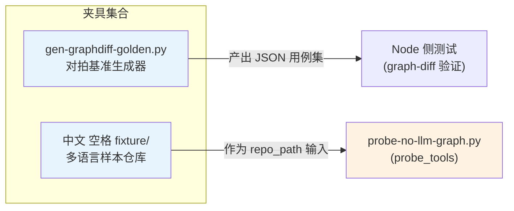
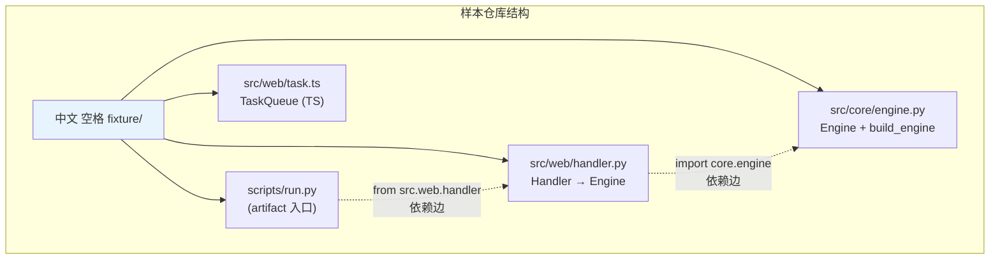
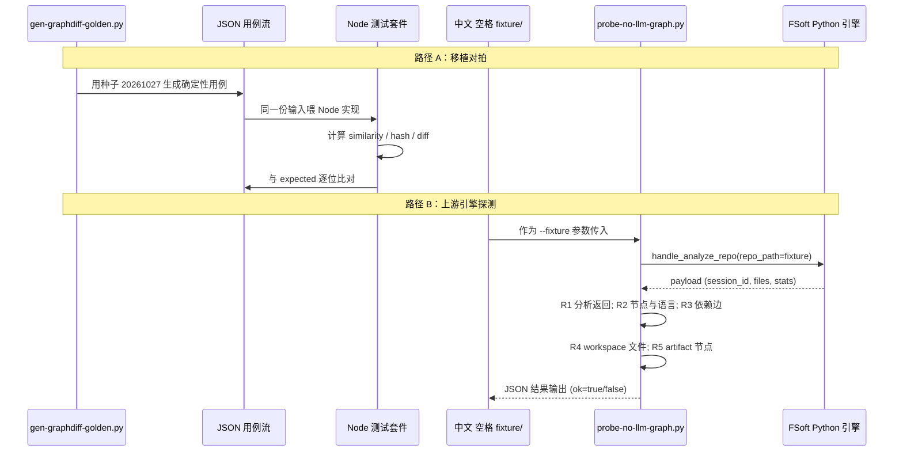

# testing_fixtures（测试夹具）

## 概述

`testing_fixtures` 是 [Testing___Probing_Tooling](./README.md) 模块下的测试夹具集合，为引擎移植对拍和上游 FSoft Python 引擎的探测验证提供确定性输入数据与最小可分析代码样本。它解决两个核心问题：

1. **移植正确性对拍**：Node 侧算法若与上游 Python 原版在边界情形（空序列、重复 token、中文路径）下行为不一致，靠肉眼核对无法发现，必须用同一批输入喂两侧实现并逐位比对输出。
2. **依赖图边界验证**：上游引擎在真实仓库路径（含中文、空格）下的符号提取、依赖边建图、artifact 节点采集行为，需要一个结构最小但覆盖关键路径的样本仓库来触发与验证。

本模块的产出物是**测试输入数据**而非运行时代码，它与同属 [Testing___Probing_Tooling](./README.md) 的 [probe_tools](probe_tools.md) 配套使用：夹具提供被探测的目标，探测脚本负责执行断言。

## 组成与职责



### 1. 对拍基准生成器 `test-fixtures/gen-graphdiff-golden.py`

`main()` 函数是唯一入口，它调用 Python 标准库 `difflib` 的**原版实现**计算三类指标的期望值，序列化为 JSON 输出到 stdout，供 Node 侧测试读取并比对。

**生成的用例类别：**

| 类别 | kind 字段 | 覆盖的边界情形 |
|------|-----------|----------------|
| 相似度 | `similarity` | 空序列对空、单边空、完全相同、部分重叠、全不同、重复 token（`dup dup dup` vs `dup dup`）、中文注释差异、空白归一化 |
| 内容哈希 | `hash` | 空 code + 空 doc、纯 code、纯 doc、code 与 doc 拼接、中文字符、多行 code |
| 统一 diff | `unified` | 空对空、行级替换、多 hunk、纯新增、纯删除、无末尾换行、仅末尾换行差异 |

**确定性保障**：随机用例（30 组相似度 + 20 组 diff）统一使用种子 `random.Random(20261027)`，保证每次运行产出完全一致的 JSON，测试方可将输出落盘为快照或直接流式比对。

**关键函数（Python 原版语义来源）：**

```python
# 相似度：token 化后用 SequenceMatcher(autojunk=False) 计算 ratio
body_similarity(a, b)

# 哈希：归一化空白后拼接 docstring，再算 sha1
body_hash(code, docstring)

# 统一 diff：difflib.unified_diff，上下文 n=2
unified_body_diff(old_lines, new_lines, label)
```

### 2. 多语言样本仓库 `tools/fsoft-engine/fixtures/中文 空格 fixture/`

目录名本身（含中文与空格）即是一条测试用例——验证上游引擎的路径处理在非 ASCII、含空格路径下不崩溃。仓库结构如下：



各文件的角色与被验证的引擎行为：

| 文件 | 核心组件 | 触发的引擎行为 |
|------|----------|----------------|
| `src/core/engine.py` | `Engine`（类）、`build_engine`（工厂函数） | Python AST 符号提取：类节点、函数节点、属性节点（`calls`） |
| `src/web/handler.py` | `Handler`（类） | **依赖边建图**：`Handler` 通过 `from core.engine import ...` 依赖 `Engine`，验证 `dependsOn` 边 |
| `src/web/task.ts` | `TaskQueue`（类）、`TaskQueue.push`（方法）、`normalize`（函数） | TypeScript 分析器在中文路径下的节点提取，验证语言统计同时包含 Python 与 TypeScript |
| `scripts/run.py` | `main` | **artifact 节点采集**：顶层脚本入口应被识别为独立的 artifact 组件，而非仅作为叶子文件 |

样本仓库的设计原则是**最小化但关键路径全覆盖**：核心引擎（core）、Web 层（web）、脚本入口（scripts）三层目录结构，恰好对应上游依赖图分析的三个观察维度——符号节点、模块依赖边、artifact 归属。

## 数据流：从夹具到验证结果



## 在整体系统中的位置

本模块位于 [Code_Engine_Processing_Pipeline](Code_Engine_Processing_Pipeline.md) 的**质量保障外围**：引擎流水线（[code_engine_module](code_engine_module.md)）负责实际的代码分析、模块索引与计划执行，而本模块的夹具用于在引擎交付前验证其正确性。

具体关联：

- **依赖图分析**：`中文 空格 fixture` 的 `Handler → Engine` 依赖边，直接测试上游引擎 `DependencyGraphBuilder.build_dependency_graph()` 的输出，该引擎由 [python_native_runtime](python_native_runtime.md) 中的 `entry.py` 以子进程方式驱动。
- **环境前置条件**：夹具的探测验证依赖 [setup-env.sh](build_deployment_config.md)（在 `tools/fsoft-engine/setup-env.sh`）构建的独立 Python venv——该脚本用 `--no-deps` 安装冻结快照并做 `pip check` 兜底，确保探测在依赖闭合的环境中运行。
- **对拍验证对象**：`gen-graphdiff-golden.py` 产出的相似度 / diff / hash 用例，验证的是已退役的 Node 侧算法移植（0.16.0 起原生引擎通道为默认），这些用例仍作为回归保护防止任何残留 Node 实现被误用。

## 使用方式

### 生成对拍基准

```bash
# 直接运行，JSON 输出到 stdout
python test-fixtures/gen-graphdiff-golden.py > /tmp/golden-cases.json
```

输出为一个 JSON 数组，每个元素含 `kind`（`similarity` / `hash` / `unified`）、输入字段（`a`/`b` 或 `code`/`docstring` 或 `oldText`/`newText`/`label`）与 `expected` 期望值。

### 用样本仓库探测上游引擎

```bash
# 需先通过 setup-env.sh 建好 venv
# 然后将夹具目录作为输入传给探测脚本
python tools/fsoft-engine/probe-no-llm-graph.py \
  --fsoft-src ../.probe-fsoft/src \
  --fixture "tools/fsoft-engine/fixtures/中文 空格 fixture" \
  --out /tmp/probe-out
```

探测脚本的详细检查项（R1–R5）与返回码语义见 [probe_tools](probe_tools.md)。

## 设计要点

1. **确定性优先**：随机用例全部钉死种子，避免测试输出漂移导致误报。
2. **路径即测试**：fixture 目录名「中文 空格」不是装饰，而是对非 ASCII 路径处理的主动压力测试。
3. **最小覆盖关键路径**：样本仓库仅 4 个文件，但同时覆盖 Python AST、TS 分析、跨目录依赖边、artifact 采集四个维度，避免大仓库引入噪声。
4. **与运行时解耦**：夹具不被任何生产代码 import，仅在测试 / 探测脚本中被引用，确保对运行时零侵入。
