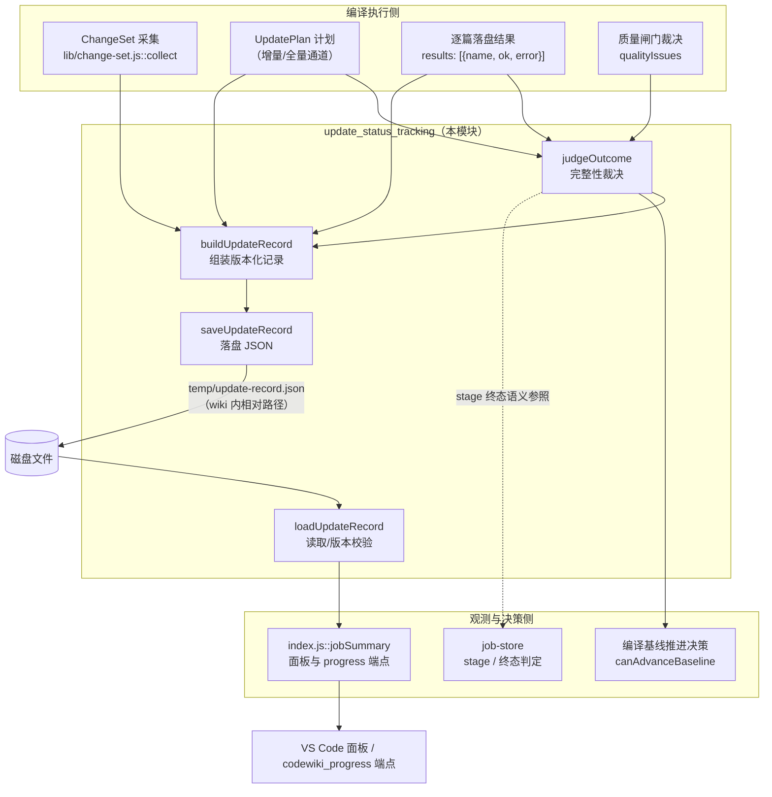
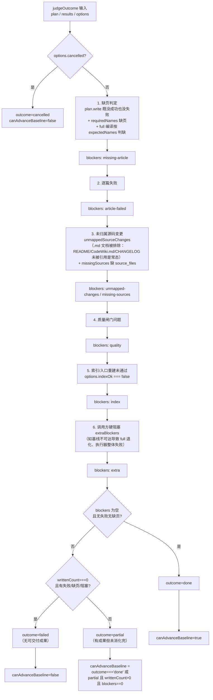
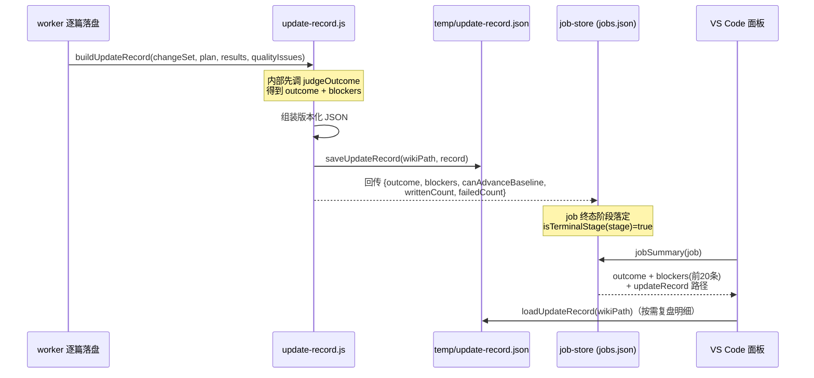

# 更新状态追踪（update_status_tracking）

## 概述

`update_status_tracking` 模块（`lib/update-record.js`）负责把一次编译的**过程事实**沉淀成一份可机读、可复盘的 JSON 更新记录，并在编译结束时给出严格的**完整性裁决**。

它要解决的核心缺陷（审计确认）：编译结束只留下 `writtenCount` / `failedCount` 两个数字，job 文件里塞的是整张模块树与任务快照，于是「为什么这篇没重写」「哪几个变更没人管」事后无法复盘，面板也只能显示一句「完成」——而实际上可能 1 篇成功、19 篇失败。

本模块的三项职责：

1. 把 **ChangeSet + UpdatePlan + 逐篇结果** 收成一份版本化记录；
2. 判定终态（`done` / `partial` / `failed` / `cancelled`），把「完整性不成立」的每种情形写进 `blockers`；
3. 明确回答「能不能推进编译基线」（`canAdvanceBaseline`）——只有完整成功才可以。

模块由**纯函数 + 两个 IO 助手**组成，便于离线单测；`fsImpl` 可注入。

---

## 架构定位

`update_status_tracking` 是 [State___Observability_Management.md](State___Observability_Management.md) 的三个子模块之一，与负责 job 跨进程持久化的 [job_state_storage.md](job_state_storage.md)（`lib/job-store.js`）、负责引擎事件日志的 [job_log_management.md](job_log_management.md)（`lib/job-logs.js`）并列：

- `job-store.js` 记录「任务在系统里处于什么阶段、归谁所有」；
- `update-record.js` 记录「这一轮编译**为什么**落成这个结局、哪些变化没被消化」；
- `job-logs.js` 记录「这一轮编译的引擎流水（NDJSON 事件）」。



---

## 核心数据模型

更新记录以固定版本号 `UPDATE_RECORD_VERSION = 1` 写入 `<wikiPath>/temp/update-record.json`（常量 `UPDATE_RECORD_REL`）。放在 wiki 内部的 `temp/` 而非仓库外，是为了让记录随 wiki 产物一起被提交与追溯；job 文件里只存**路径与摘要**，不塞整图。

记录的主干结构（由 `buildUpdateRecord` 产出）：

| 字段 | 来源 | 说明 |
| --- | --- | --- |
| `version` | 常量 | 读取时校验，不符返回 `null` |
| `jobId` / `scope` / `wikiPath` | 调用方 | 关联哪次任务、哪种编译范围 |
| `startedAt` / `finishedAt` | 调用方 | 时间线 |
| `baseCommit` / `headCommit` | ChangeSet | 编译基线与目标 commit |
| `changeSet` | `collectChangeSet` | 仅保留 state/ok/fallback/reason + 七类计数 + `sourceChanges`/`ignored` 名单 |
| `plan` | UpdatePlan | 每个 action 带 `reason`（「可复盘」的最低要求），含 `unmappedChanges`、`missingSources`、`routedTo`、`warnings` |
| `results` | 逐篇 | `name` / `ok` / `stopReason` / `error`（截断 300 字符） |
| `qualityIssues` | 质量闸门 | 每条 `{name, issue}` |
| `outcome` / `blockers` / `canAdvanceBaseline` | `judgeOutcome` | 裁决三要素 |
| `writtenCount` / `failedCount` | `judgeOutcome` | 聚合计数 |
| `notes` | 调用方 | 最多保留最近 20 条 |

---

## 终态语义与裁决流程

### 终态集合

`TERMINAL = { 'done', 'partial', 'failed', 'cancelled' }`，由 `isTerminalStage(stage)` 判定。语义：

- **`done`** 完整成功：计划内必需文章全部写好、变更全部有归属、质量闸门全过；
- **`partial`** 部分完成：已成功的文章可以入库，但「全部已消化」不成立，**基线不得前移**；
- **`failed`** 失败：没有可交付的成果（0 篇成功，或硬性前置缺失）；
- **`cancelled`** 任务被取消（任何重放裁决都不得复活血）。

注意：`isTerminalStage` 同时存在于 [job_state_storage.md](job_state_storage.md)（`TERMINAL_STAGES` 用于跨实例孤儿判定）与本模块，两处终态集合一致——job 的 `stage` 与记录的 `outcome` 共用同一套四态语义。

### judgeOutcome 的六类降级来源

`judgeOutcome({ plan, results, options })` 按以下顺序把「完整性不成立」写成 `blockers`（每类的 `kind` 稳定、可机读）：



### `canAdvanceBaseline` 的显式判据（关键设计）

```javascript
canAdvanceBaseline: outcome === 'done'
  || (outcome === 'partial' && writtenCount > 0 && blockers.length === 0)
```

源码注释中的实测结论（`.tmp-cab-probe` 探针）：**`partial` 必然至少带一条 blocker**——六类降级来源每一个都会 push blocker，所以 `partial` 分支当前不可达，这一行与旧的 `outcome === 'done'` 行为完全一致。

写成显式形式而非别名 `outcome === 'done'` 的理由：

- 本函数服务**兼容通道**（`tickIndex`），它的 blocker 含「未归属变更」「缺页」这类「没消化完」语义，一旦放宽就会把未消化的变化记成已消化——下一轮这些变化不再触发文章更新，wiki 会**静默落后于代码**；
- 而 native 通道与 [quality_gates](quality_gates.md) 用的是另一种判据（「有成果且无硬缺陷」），两处看似矛盾、实际是通道不同。显式判据让将来有人放宽 blocker 规则时，partial 分支自动按「有成果且无缺陷才推进」生效，而不是靠 `done` 别名悄悄失效。

---

## 与上下游的数据交互

### 输入：来自 ChangeSet 与 UpdatePlan

`buildUpdateRecord` 消费的 `changeSet` 由 [change_set_management.md](change_set_management.md) 的 `collect` 产出（committed / staged / unstaged / untracked 四路合一）。记录只保留它的**摘要**（state、ok、fallback、reason、七类计数、sourceChanges/ignored 名单），原始条目不入记录——这与 job-store「job 文件只存路径与摘要」的原则一致。

### 输出：面板与端点

裁决结果写入 job 的 `outcome` / `blockers` / `canAdvanceBaseline` 字段后，由 `index.js::jobSummary` 统一抽取（连同 `baselineEligible` / `baselineAdvanced` / `deliveryComplete` / `updateRecord`），供 [vscode_extension_client.md](vscode_extension_client.md) 的面板与 `codewiki_progress` 端点消费。`describeOutcome(outcome, blockers)` 提供三态一眼可分的中文文案（如「部分完成（N 项未满足：…）」「失败（…）」）。



---

## 模块边界与设计取舍

| 主题 | 本模块的取舍 | 理由 |
| --- | --- | --- |
| 记录存放 | `<wikiPath>/temp/update-record.json` | 随 wiki 提交、可追溯；job 文件只存摘要 |
| IO 风格 | 纯函数 + 可注入 `fsImpl` | 离线单测；读写失败显式返回 `{ok, reason}`，不抛断编译 |
| 版本兼容 | `loadUpdateRecord` 校验 `version !== UPDATE_RECORD_VERSION` 返回 `null` | 旧格式记录不当作有效现场 |
| 未归属变更口径 | `.md` 文档不计入 `unmappedSourceChanges` | 否则 README/CHANGELOG 未被引用会让正常增量永远落 partial，把「诚实终态」退化成「永远不完整」 |
| 错误截断 | error/detail 一律 slice 300 | 记录必须保持精简、可 diff |
| notes 容量 | 最多保留最近 20 条 | 防止无限增长 |

相关但**不在本模块**的能力（见对应文档）：

- 跨进程 job 持久化、原子写、孤儿接管与重放裁决 → [job_state_storage.md](job_state_storage.md)；
- 引擎 NDJSON 事件日志（进程死后仍可查「为什么慢、为什么 partial」）→ [job_log_management.md](job_log_management.md)；
- 原生通道的采用门（defect / degradation / stale 三分类）→ [quality_gates](quality_gates.md)；
- ChangeSet 四路采集与「采不全即退全量」→ [change_set_management.md](change_set_management.md)。
