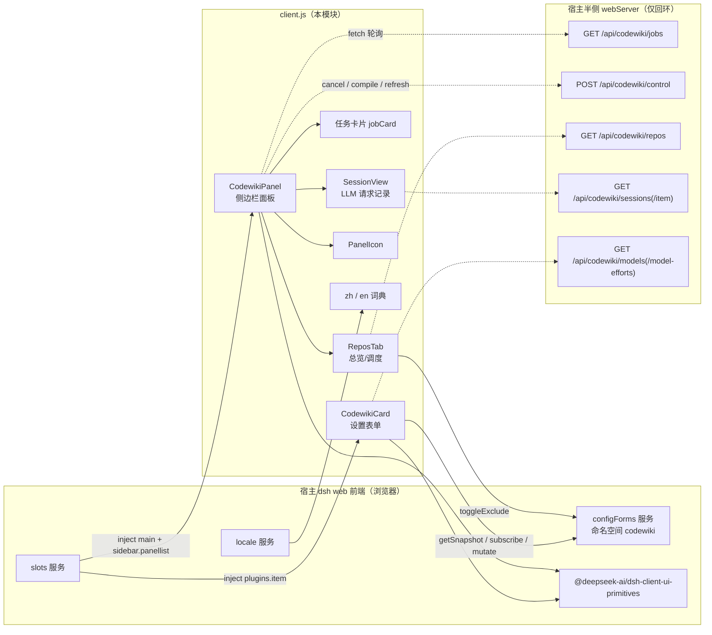
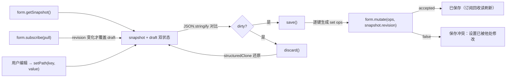
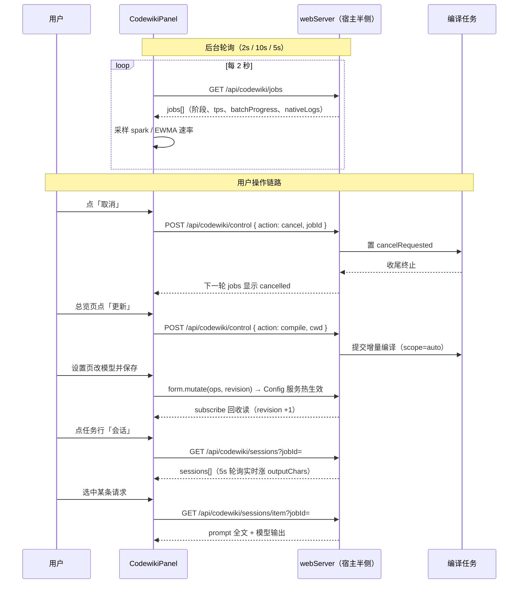
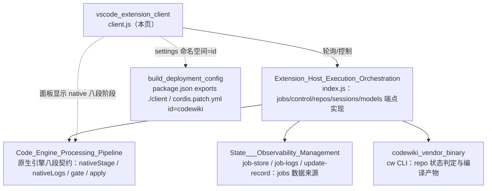

# VS Code 扩展客户端（vscode_extension_client）

## 简介

`vscode_extension_client` 是 dsh-codewiki 插件的**浏览器半侧（client）**实现，单文件 `client.js` 即全部代码。它通过 `window.__ModuleLoader__.load()` 以 `@local/dsh-codewiki` 为 id 注册，向宿主 dsh（DeepSeek Harness）的 web 前端注入两类 UI：

1. **插件设置卡片**（`plugins.item` 插槽，id = `codewiki`）：读写宿主 Config 服务 `codewiki` 命名空间的编译模型、并发、自动提交、调度等全部设置；
2. **侧边栏面板**（`main` 渲染内容 + `sidebar.panellist` 出入口，key = `codewiki`）：编译任务进度、取消、会话（LLM 请求）查看、仓库总览与自动更新调度。

客户端本身**不含任何编译逻辑**——所有数据来自宿主半侧（webServer）的 REST 端点（见 [Extension_Host_Execution_Orchestration.md](Extension_Host_Execution_Orchestration.md)），所有状态持久化经 configForms 热生效。

包形态见 [build_deployment_config.md](build_deployment_config.md)（`package.json` 的 `exports."./client"` 即本文件，`dsh.client.platform = "web"`）。

## 架构总览

### 挂载点与生命周期

| 挂载点 | 注册 key / id | order | 何时出现 |
|---|---|---|---|
| `plugins.item` | id = `codewiki`（与 `cordis.patch.yml` 的 profile 条目一致） | 30 | 仅当宿主 Config 服务已 served `codewiki` 命名空间（`configForms.whileServed`）——插件停用时插件页不显形 |
| `main` | key = `codewiki` | — | 始终注册（`ctx.effect`） |
| `sidebar.panellist` | id = `codewiki`（必须与 main 的 key 一致） | 52，排在 `dsh-hindsight-on-demand`（50）之后 | 始终注册 |

> 注册 id 必须等于 `package.json` 的 name——client-modules 按 nearestPackage 的 name 校验注册者；词典值必须是字符串（`t()` 遇到函数值会回退返回键名）。

## 组件说明

### 词典与国际化：`zh` / `en`

`zh()` 与 `en()` 返回完整的文案字典（约 180 个键），在 `apply()` 中经 `ctx.locale.register('codewiki', { zh, en })` 注册。所有组件通过 `tBound = ctx.locale.bind(NS)` 取文案，设置卡片以 `props.t` 注入。

词典不仅承载界面文案，还**编码了全部配置项语义**（如 `autoCommitHint`、`bigConcurrencyHint`），是用户理解各设置含义的主要来源。

步骤条与阶段标签的文案由**键名派生**，不是硬编码在组件里：`stepName(s)` 取 `step` + 阶段名首字母大写（现为 `stepQueued`/`stepArticles`/`stepCrosscut`/`stepReview`/`stepIndex`/`stepCommit`），`stageLabel(s)` 同理取 `stage` 前缀。因此**每个 `ACTIVE_STAGES` 里的阶段都必须在词典中有对应的 `step*` 键**——增删阶段时两侧的键要一起动，否则步骤条会直接显示键名。`compose` 阶段已从 `ACTIVE_STAGES` 移除，词典里对应的 `stepCompose`（「合成 / Compose」）随之删除，`stepCommit`（「提交 / Commit」）改为紧跟 `stepIndex`，让 `en` 与 `zh` 的键序与新的渲染顺序一致；`stageCompose` 仍保留，用于给历史任务里残留的旧阶段名兜底出中文标签。

### 设置卡片：`CodewikiCard`

设置表单组件（`view='summary'` 时只渲染一行简介），数据流如下：

关键实现细节：

- **乐观草稿**：`draft` 从快照克隆而来，只有宿主值的 `revision` 变化（含保存成功后的回收读）才覆盖草稿，避免编辑中被轮询冲掉；
- **乐观并发**：`form.mutate(ops, snapshot.revision)` 带 revision 作 CAS——他处同时修改时返回 `false`，显示冲突提示；
- **校验**：`maxConcurrency`、`bigConcurrency`（0 = 跟随默认档，不算非法）必须是 1–8 的整数；
- **逐键 diff**：只把发生变化的键（`enabled`、`batchProvider`、`excludePaths`、`autoUpdateMin` 等 23 个）发 `set` op，未列出的键不参与。

#### 编译模型区的 `requestLimit` 字段

「编译模型」分区（`secCompile`）在普通档三字段、`sessionTier`（兜底档位）之外，新增**单模块请求上限**字段（放在 `sessionTier` 字段之后）：

| 字段 | 键 | 控件 | 语义 |
|---|---|---|---|
| 单模块请求上限 | `requestLimit` | `number` 输入（min 1 / max 1000 / step 50，默认 300） | 写一个模块时允许的 LLM 请求次数（1–1000）。页面没写出来时引擎会续发补写提醒，每次提醒各自一份预算；调大才能写完更大的模块，调得太小复杂模块会中断成「部分完成」 |

校验在 `save` 提交前执行：非整数、小于 1 或大于 1000 一律拦下，显示 `invalidRequestLimit` 提示（「单模块请求上限需在 1–1000 之间」），避免 0 或负数被当成「不限制」。

#### 模型目录联动（`modelTrio`）

编译模型的「提供商 / 模型 / 思考程度」三字段（普通档 `batch*` 与大档 `big*` 共用一套逻辑）：

1. 挂载时 `GET /api/codewiki/models` 拉取提供商目录（宿主 llm 服务）；拉不到则 `catalogError` 有值，全部退回手填输入框，不阻断保存；
2. 换提供商时清空模型与旧档位（避免残留上一家的模型 id）；目录里没有的已配置 provider/model 保留为 `__custom` 选项，防止静默丢失；
3. 选中 model 后 `GET /api/codewiki/model-efforts?provider=&model=` 二次拉取 `reasoning.efforts`；未声明档位的模型回落到通用档 `GENERIC_EFFORTS = ['off','low','medium','high','xhigh','max']`（选了不支持的值由 llmChat 兜底剥档重试）。

### 侧边栏面板：`CodewikiPanel`

面板入口，聚合四个标签页（`overview` / `tasks` / `sessions` / `settings`）：

- **jobs 轮询**：每 `POLL_MS = 2000` ms 拉一次 `GET /api/codewiki/jobs`；`inFlightRef` 保证服务卡顿不重叠拉取；卸载后不再 setState；
- **焦点任务**：`byUpdated(a, b)` 按 `updatedAt/createdAt` 排序——活动任务（六阶段内）优先，其余收进「历史任务」折叠区，并按 `cwd` 分组（保持首次出现顺序）；
- **面板侧派生数据**（不在服务端）：
  - `sparkRef`：每 job 的 `tps` 滚动窗口（最近 30 点），喂给 `Spark` 微趋势线；
  - `batchRateRef`：批量完成速率 EWMA（`rate = prev*0.6 + inst*0.4`），用于吞吐徽标的篇/分与 ETA；
- **取消**：`POST /api/codewiki/control { action: 'cancel', jobId }`，请求期间 `busyId` 置灰按钮，服务端置 `cancelRequested` 后按钮文案变「取消中…」；
- **单任务会话视图**：点任务行的「会话」按钮，`SessionView` 占满面板（`sessJob != null` 时整个面板被替换）。

`jobCard` 渲染内容的语义：

| 区块 | 数据来源 | 说明 |
|---|---|---|
| 阶段步骤条 `stageBar` | `ACTIVE_STAGES = ['queued','articles','crosscut','review','index','commit']` | 六步圆点（`compose` 阶段已随单轮写作通道退役，词典的 `stepCompose` 一并删除）；每步标签取自 `step*` 键；失败/取消在最后计时阶段标红/黄；`partial` 与 `done` 一样全绿（活干完了，只是完整性没成立） |
| 引擎阶段行 | `channel === 'native'` 时的 `nativeStage/nativePercent` | 八段契约（env/graph/cluster/articles/validate/index/baseline/commit）与粗粒度六步粒度不同，另起一行不改动步骤条序号 |
| 总进度条 `overallPct` | 定权 `STAGE_WEIGHTS` + 阶段内 taskList 完成率 | 封顶 99，`done/partial` 才 100 |
| 已用时 `elapsedSplit` | `stageTimings.queued` 与总时长差 | 拆「排队 / 执行」，不让 2 小时排队被看成编译跑了 2 小时 |
| 排队可见性 | `queueAhead` | queued 任务显示「在等：A → B」 |
| 用量行 `usageLine` | `job.usage`（inputTok/outputTok/requests/overTier2） | 超单请求预算的请求数红字提示 |
| 自动提交结果 | `job.autoCommit` | committed 显示短 sha；失败原因放 title 悬停，不撑爆 meta 行 |
| 阻塞原因 | `partial` 的 `blockers` | 首个阻塞原因入 title，meta 显示「未消化 N 项」 |
| 引擎日志 `engineLogBlock` | `job.nativeLogs`（最近 40 条） | 折叠渲染；完整 NDJSON 路径显示为「完整日志」引导 |

### 总览标签页：`ReposTab`

每 `REPOS_POLL_MS = 10000` ms 轮询 `GET /api/codewiki/repos`，渲染：

1. **自动更新调度卡**：开关状态、间隔、上次/下次扫描时间、扫描统计（scanned/submitted/skipped）；
2. **仓库列表**：每仓库 wiki 状态（`missing/uncompiled/clean/stale/error`）、stale 篇数与变更文件数、最近任务摘要；
   - 「更新」按钮：`POST /api/codewiki/control { action: 'compile', cwd }` 手动提交增量编译；
   - 「排除/取消排除」：直接 `form.mutate([{ op: 'set', path: ['excludePaths'], value }])` 改插件配置（与设置卡保存同链路、热生效），成功后 `POST /api/codewiki/control { action: 'refresh' }` 让服务端总览缓存失效并立即重拉。

### 会话视图：`SessionView`

并发池每一次 LLM 请求的记录仪（保留 24h）：

- **两种模式**：`job != null` 为单任务（面板整页替换）；`job = null` 为全局聚合，走不带 jobId 的 `GET /api/codewiki/sessions`，行内带上「哪个任务 + 哪个仓库」；
- **列表 5s 轮询**；选中行后 `GET /api/codewiki/sessions/item?jobId=&n=` 拉 prompt 与模型输出全文；
- **进行中任务区**：列出尚未发出过 LLM 请求的活动任务（依赖图/聚类/收尾阶段），带阶段、引擎阶段百分比、已写篇数、请求数；
- **`embedded` 模式**：嵌进面板 Tab 时改用 `data-dscw-p-sesswrap` 而非 `data-dscw-p-page`——避免双层 padding + 双层滚动条把列表压成窄缝。

### 辅助组件

- **`Spark`**：纯 SVG polyline 微趋势线（宽 56 × 高 16），输入 <2 个点时不渲染；
- **`PanelIcon`**：侧边栏出入口的「摊开的书」16×16 SVG 图标；
- **样式表**：`document.createElement('style')` 注入全部 `[data-dscw-*]` CSS，HMR 重复加载时按 `style[data-plugin]` 去重只挂一次。

## 数据流与交互时序

## 端点契约一览

| 端点 | 方法 | 调用方 | 用途 |
|---|---|---|---|
| `/api/codewiki/jobs` | GET | `CodewikiPanel`（2s） | 任务列表：阶段、taskList、stageTimings、usage、nativeLogs、queueAhead |
| `/api/codewiki/control` | POST | 面板/总览 | `cancel`（按 jobId）、`compile`（按 cwd）、`refresh`（总览缓存失效） |
| `/api/codewiki/repos` | GET | `ReposTab`（10s） | 仓库 wiki 状态 + 调度统计 |
| `/api/codewiki/sessions` | GET | `SessionView`（5s，可带 `?jobId=`） | LLM 请求列表 + 进行中任务 |
| `/api/codewiki/sessions/item` | GET | `SessionView`（选中时） | 单条 prompt / 输出全文 |
| `/api/codewiki/models` | GET | `CodewikiCard`（挂载一次） | 提供商/模型目录 |
| `/api/codewiki/model-efforts` | GET | `CodewikiCard`（选模型时） | 该模型的 reasoning efforts |

> `apiGet` / `apiPost` 统一封装 fetch：非 2xx 时抛出 `body.error || HTTP <status>`；`body` 解析失败按 `{}` 兜底。

## 与其他模块的关系

- **[Extension_Host_Execution_Orchestration.md](Extension_Host_Execution_Orchestration.md)**：客户端全部端点的服务端实现——`jobSummary`（jobs 行的字段组装）、`progressView`、`runPool`、`wakeCompileSession`、调度与排除清单；
- **[Code_Engine_Processing_Pipeline.md](Code_Engine_Processing_Pipeline.md)**：`channel === 'native'` 时客户端渲染的 `nativeStage`（八段契约）、`nativeLogs`、`gate.apply` 结果均来自原生 Python 引擎通道；
- **[State___Observability_Management.md](State___Observability_Management.md)**：jobs 行数据（stageTimings、updatedAt、日志）的持久化后端；
- **[codewiki_vendor_binary.md](codewiki_vendor_binary.md)**：`ReposTab` 的仓库 wiki 状态由宿主调 `cw status` 判定；
- **[build_deployment_config.md](build_deployment_config.md)**：包导出与 bundle patch（`id: codewiki`）决定客户端的注册命名空间与安装形态。
