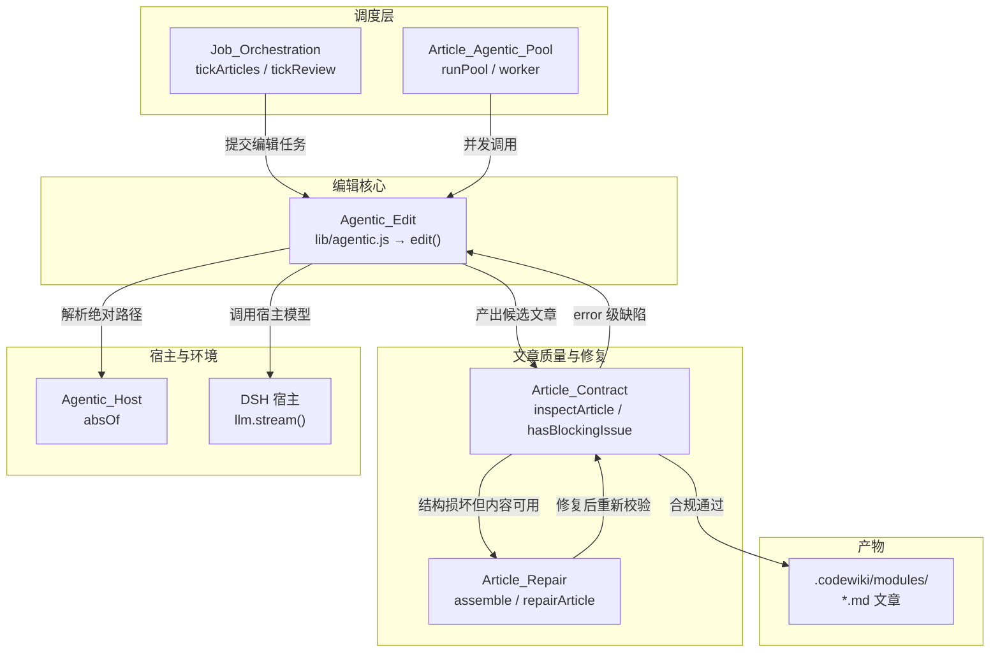
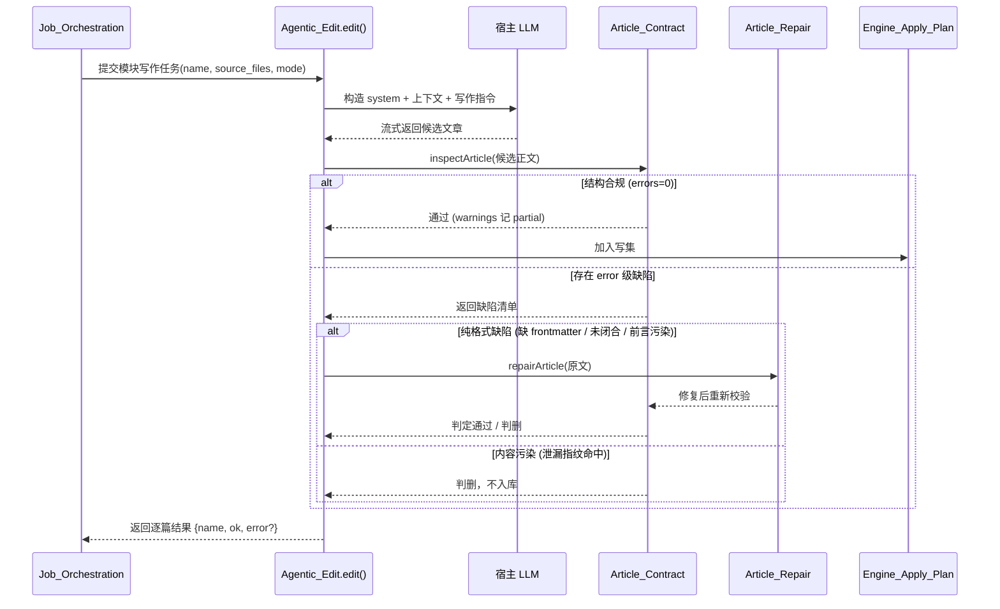
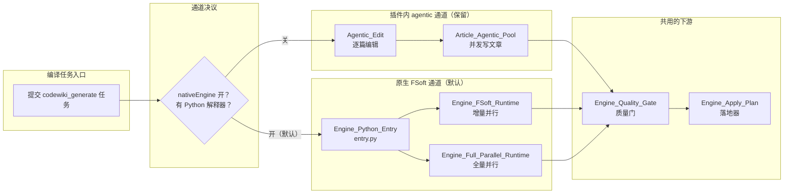

# Agentic_Edit 模块

!!! info "Generated documentation"
    This page was written by CodeWiki from the source code at commit [`4877231e`](https://github.com/ikliml666/dsh-codewiki/commit/4877231e2f743a3ba18890a9db2d6468a9885218) on 2026-11-07 with `doubao-seed-2.1-lite`. Check the code before relying on details.

## 简介

`Agentic_Edit` 是 dsh-codewiki 插件中负责**智能体式文章编辑（agentic article editing）**的核心模块。它封装了对 wiki 文章的结构化编辑能力，是整个编译流水线中「写文章」这一环节的底层执行器。

该模块的核心导出是 `edit` 函数，位于 `lib/agentic.js`。它接收文章路径与编辑指令，通过宿主的 LLM 能力完成文章内容的生成、修订与重写，产出符合 [Article_Contract（文章契约闸门）](Article_Contract.md) 契约的合规 Markdown 页面。

`Agentic_Edit` 在系统中的定位：
- **上游**：被 [Job Orchestration（编译任务编排服务）](Job_Orchestration.md) 的任务调度层调用（`tickArticles` / `tickReview` 等阶段推进函数），也被 [文章 Agentic 池（Article_Agentic_Pool）](Article_Agentic_Pool.md) 的并发执行池复用。
- **下游**：编辑产出的文章必须通过 [Article_Contract（文章契约闸门）](Article_Contract.md) 的结构校验；若存量文章格式损坏，由 [存量文章修复（Article_Repair）](Article_Repair.md) 的 `assemble` 进行修复性组装。
- **宿主侧**：与 [Agentic 宿主层（Agentic_Host）](Agentic_Host.md) 的 `absOf`（绝对路径解析）配合，确保编辑操作落在正确的工作区路径上。

---

## 架构关系

---

## 核心组件

### `edit`（`lib/agentic.js`）

`edit` 是本模块唯一的公开能力，承担「把模块对应的源码上下文 + 写作指令 变成一篇合规 wiki 文章」的任务。

**典型输入**：
- 目标文章的相对路径（如 `.codewiki/modules/change-set.md`）。
- 写作上下文：模块名称、归属文件（`source_files`）、依赖图摘要、聚类信息。
- 编辑模式：全量重写（full）还是增量修订（update）。

**典型输出**：
- 文章正文（含 frontmatter：`title` / `type` / `source_files` / `tags`）。
- 附带的编辑元数据（用了多少次模型请求、是否触发补写提醒）。

**与原生引擎通道的关系**：

在当前默认配置下（`nativeEngine: true`），文章写作环节由上游 FSoft Python 引擎通过 [Engine_Python_Entry](Engine_Python_Entry.md) → [Engine_FSoft_Runtime：增量 Step 5 的受控并行与断点运行时](Engine_FSoft_Runtime.md) / [全量并行运行时（Engine_Full_Parallel_Runtime）](Engine_Full_Parallel_Runtime.md) 完成模型调用，`Agentic_Edit` 代表的「插件内 agentic 通道」作为保留能力存在，在以下场景仍被引用：
- 关闭 `nativeEngine` 开关时的降级通道（见 [Engine_Native_Run（原生编译裁决编排层）](Engine_Native_Run.md) 的通道选择逻辑）。
- 校对（proofread）环节：[Engine_Proofread：原生引擎产物的死链语义校对](Engine_Proofread.md) 对质量门判出的死链源页做原位改写时，复用编辑语义。
- 存量文章体检与修复：[存量文章修复（Article_Repair）](Article_Repair.md) 判删前的修复组装。

---

## 数据流：一篇文章的完整生命周期

---

## 依赖关系

| 依赖方向 | 模块 | 关系说明 |
|---------|------|---------|
| 被调用 | [Job Orchestration（编译任务编排服务）](Job_Orchestration.md) | `tickArticles`、`tickReview` 阶段推进时调用编辑能力 |
| 被调用 | [文章 Agentic 池（Article_Agentic_Pool）](Article_Agentic_Pool.md) | `runPool` / `worker` 提供并发执行池，复用 `edit` |
| 路径解析 | [Agentic 宿主层（Agentic_Host）](Agentic_Host.md) | `absOf` 把相对路径解析为宿主工作区内的绝对路径 |
| 质量校验 | [Article_Contract（文章契约闸门）](Article_Contract.md) | `inspectArticle` / `hasBlockingIssue` 决定产出能否入库 |
| 修复组装 | [存量文章修复（Article_Repair）](Article_Repair.md) | `assemble` 在格式损坏时抢救内容 |
| 产物落地 | [Engine_Apply_Plan（原生产物落地器）](Engine_Apply_Plan.md) | 合规文章最终由落地器原子写盘 + `cw index` + 基线推进 |
| 变更上下文 | [Change_Set 变更集采集模块](Change_Set.md) | `collect` 提供增量编辑时的四路变更上下文 |
| 结果记录 | [Update_Record（编译更新记录）](Update_Record.md) | `judgeOutcome` / `buildUpdateRecord` 汇总逐篇成败 |

---

## 编辑通道在系统中的位置

下图展示 `Agentic_Edit` 代表的「插件内 agentic 通道」与「原生 FSoft 引擎通道」之间的分工。当前系统默认走原生通道（`nativeEngine: true`），但 agentic 通道的语义（文章契约、修复、并发池）仍被原生通道的质量门与落地层复用。

---

## 配置与测试

- **配置入口**：插件配置在 `index.js` 的 `Config` schema 中定义（[package.json](package.json) 的 `main` 字段指向 `index.js`）。agentic 通道相关的关键设置包括 `batchProvider` / `batchModel`（写作模型）、`maxConcurrency`（并发上限）、`requestLimit`（单模块请求预算）。
- **bundle 补丁**：安装方式与配置命名空间见 [Cordis_Patch_Config（插件装配配置）](Cordis_Patch_Config.md)（`cordis.patch.yml`，plugin id 为 `codewiki`）。
- **环境要求**：`package.json` 声明 `engines.node >= 24.9.0`、`engines.dsh >= 0.2.0-rc.0`。

---

## 设计要点

1. **编辑与校验分离**：`edit` 只负责产出候选正文，「能不能入库」完全交给 [Article_Contract（文章契约闸门）](Article_Contract.md) 的 `inspectArticle` 裁决。这种分离让「模型产出」与「结构合规」两个问题可以独立演进、独立测试。
2. **先修后删**：候选文章被判坏时，不立即丢弃——先经 [存量文章修复（Article_Repair）](Article_Repair.md) 判断是「纯格式缺陷」还是「内容污染」，前者修复后复用，后者才判删（避免用格式问题销毁真实内容）。
3. **并发可注入**：编辑能力被 [文章 Agentic 池（Article_Agentic_Pool）](Article_Agentic_Pool.md) 的 `runPool` / `worker` 包装成并发池，并发度受 `maxConcurrency` 控制（硬顶 8），与原生引擎的 `moduleConcurrency` 是两套独立预算。
4. **终态不可洗白**：编辑结果汇入 [Update_Record（编译更新记录）](Update_Record.md) 的 `judgeOutcome`，「1 篇成功 + 19 篇失败」永远是 `partial` 而非 `done`——这是整个系统反复强调的硬不变量。

---

## 相关页面索引

- 任务如何被调度与推进：[Job Orchestration（编译任务编排服务）](Job_Orchestration.md)
- 文章契约闸门：[Article_Contract（文章契约闸门）](Article_Contract.md)
- 存量文章修复：[存量文章修复（Article_Repair）](Article_Repair.md)
- 并发执行池：[文章 Agentic 池（Article_Agentic_Pool）](Article_Agentic_Pool.md)
- 变更集采集：[Change_Set 变更集采集模块](Change_Set.md)
- 原生引擎落地器：[Engine_Apply_Plan（原生产物落地器）](Engine_Apply_Plan.md)
- 原生引擎质量门：[Engine_Quality_Gate（原生引擎产物采用门）](Engine_Quality_Gate.md)
- 更新记录与终态判定：[Update_Record（编译更新记录）](Update_Record.md)
- 宿主路径解析：[Agentic 宿主层（Agentic_Host）](Agentic_Host.md)
- 插件配置与安装：[Cordis_Patch_Config（插件装配配置）](Cordis_Patch_Config.md)

??? abstract "Documented components (1)"
    - [`edit`](https://github.com/ikliml666/dsh-codewiki/blob/4877231e2f743a3ba18890a9db2d6468a9885218/lib%5Cagentic.js) — `lib\agentic.js`

