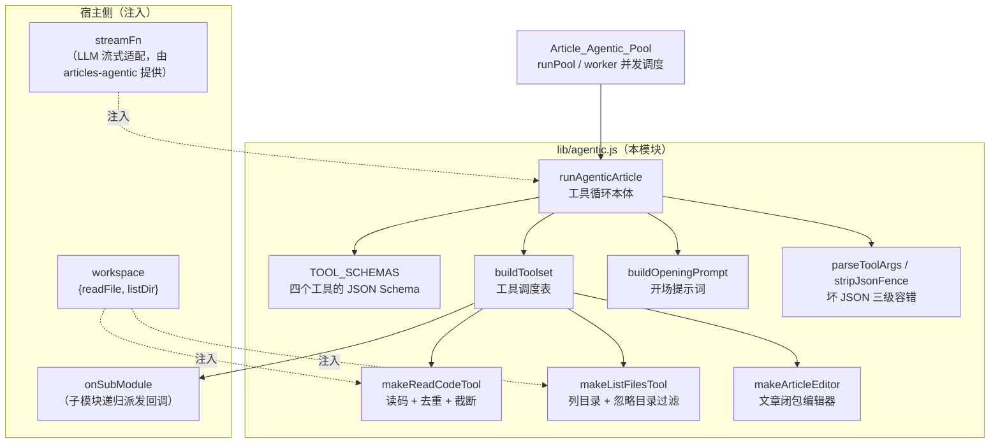
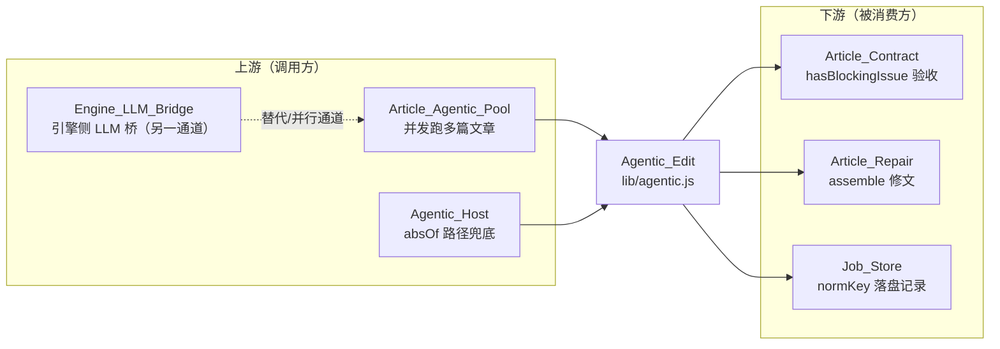

# Agentic_Edit 模块

!!! info "Generated documentation"
    This page was written by CodeWiki from the source code at commit [`a41aaf18`](https://github.com/ikliml666/dsh-codewiki/commit/a41aaf189f3b46e72c5373c9694d989d325386d7) on 2026-11-06 with `doubao-seed-2.1-lite`. Check the code before relying on details.

## 简介

`lib/agentic.js` 是单篇文章的「agentic 写作工作台」本体：把一次「写完一篇模块文档」拆成一个可反复读源码、可对文章做精确编辑、可把大模块拆给子任务的多轮工具循环。它是对上游 FSoft-AI4Code/CodeWiki 中 `agent_tools/` 与 `documentation_generator.py` 的 pydantic-ai 工具循环的轻量重写——价值主张不是「把所有源码塞进一次 prompt 求一篇文章」，而是让行号、签名这类硬事实现场核对，而不是靠一次性读进上下文后猜。

与上游的差异：

- **纯逻辑 + 注入式**：工具循环不绑死 pydantic-ai，也不绑死宿主的 LLM 服务；`streamFn` 与工具实现全部由调用方注入，测试可以完全离线。
- **workspace 抽象**：工具读写的不是某个固定磁盘目录，而是一个 `{ readFile, listDir }` 接口，便于在插件里接到任意 cwd（真实接入侧见 [Agentic_Host（agentic 工具循环 ↔ 宿主 llm 服务适配层）](Agentic_Host.md)）。

模块唯一对外入口是 `runAgenticArticle({ mission, workspace, streamFn, tools?, maxSteps })`，返回 `{ article, steps, usedTools, stopReason, messages }`。

## 架构总览



## 核心组件

### 工具定义（TOOL_SCHEMAS）

声明给模型的四个工具，均以 JSON Schema 形态描述：

| 工具 | 职责 | 关键约束 |
| --- | --- | --- |
| `read_code` | 读仓库文件或某段行范围 | 引用行号必须以返回的「行号\| 」前缀为准，禁止自行推算 |
| `list_files` | 列目录文件与子目录 | 用于摸清仓库结构后决定读哪些文件 |
| `edit_article` | 对当前文章做 `view` / `str_replace` / `insert` | `str_replace` 要求 `old_str` 唯一匹配 |
| `generate_sub_module` | 把可独立成篇的子部分委派出去单独成文 | 仅在确有职责边界时使用 |

### 读码工具（makeReadCodeTool）

读码是整个循环里最容易烧步数的环节，因此做了三道防护：

1. **重复读抑制**：以 `(path, 起始行, 结束行)` 为 key 在闭包 `seen` Map 里记账，重复请求不再回吐正文，只回一句「你已经在第 N 步读过这段」。背景是实测中模型曾在 45 步里把同一个 `index.js` 读了 13 次、累计 2.1MB 上下文，最后 `stopReason=max-steps` 而文章没写完。
2. **行数截断**：单段最多返回 `MAX_READ_LINES = 2000` 行。
3. **字符截断**：`MAX_READ_CHARS = 40000` 字符兜底，挡得住单行 20 万字符的压缩产物（行数上限对它无效，因为它只有 1 行）。

行号前缀格式由 `numberLines` 统一生成，与插件其余环节一致。

### 列目录工具（makeListFilesTool）

深度钳制在 1–4 层，并过滤 `IGNORED_DIRS`（`node_modules`、`.git`、`dist`、`build`、`.next`、`target`、`vendor`、`__pycache__`、`.venv`、`venv`）——模型看到这些目录会当源码探索，白白烧步数。

### 文章编辑器（makeArticleEditor）

文章状态就在闭包里，三种命令：

- `view`：返回带行号的当前全文；
- `str_replace`：要求 `old_str` 唯一匹配；
- `insert`：在指定行之后插入文本（`line=0` 表示文件开头）。

两个针对真实仓库环境的细节：

- **行尾归一化**：真实仓库 `core.autocrlf=true`，`.codewiki` 下文章常见 CRLF。模型按 `view` 输出写 `old_str`（自然带 `\n`），而文章存的是 `\r\n`，纯字面匹配永远对不上。因此匹配两侧先统一成 `\n`，命中后再按原文风格写回，避免整个文件被悄悄改成 LF。
- **负数行号报错**：不被静默吞成「插到最前」，否则内容会跑到文件头部而模型以为插对了位置。

### 子模块派发（buildToolset 中的 generate_sub_module）

派发回调 `onSubModule` 由调用方提供（见 [Article Agentic Pool 文章智能体执行池](Article_Agentic_Pool.md)）。关键设计是**失败必须说实话**：此前无论什么原因不可用都回「已记录子模块 X（已派发）」，模型据此在父文里写下「详见 xxx.md」，而那个文件从未生成——死链且父任务仍记 `ok:true`。现在区分两种受阻原因（`max-depth` 与「当前模式不支持递归成文」），分别指示模型改为在本文内直接写清，不要留下死链。

### 路径安全（safeRelPath）

所有路径参数先经 `safeRelPath` 归一化：拒绝绝对路径、盘符路径与任何形式的 `..` 越界，返回 POSIX 风格的归一化相对路径。

## 工具循环流程

```mermaid
sequenceDiagram
    participant Pool as Article_Agentic_Pool
    participant Loop as runAgenticArticle
    participant Model as streamFn（LLM）
    participant Tool as 工具实现
    participant Editor as makeArticleEditor

    Pool->>Loop: mission, workspace, streamFn, onSubModule
    Loop->>Loop: buildOpeningPrompt 生成首条 user 消息
    Loop->>Model: streamFn({messages, tools, signal})
    Model-->>Loop: assistant blocks（text + tool-call）
    alt 没有 tool-call
        Loop->>Editor: 若正文已给且 editor 为空则收下
        Loop-->>Pool: stopReason=finished
    else 有 tool-call
        loop 每个 tool-call
            Loop->>Loop: parseToolArgs 三级容错（原样→剥围栏→截平衡对象）
            Loop->>Tool: 执行对应实现
            Tool-->>Loop: {isError, text}
        end
        Loop->>Loop: 结果打包为 tool-result 消息回灌 messages
        Loop->>Model: 下一轮 streamFn
    end
    Note over Loop: 达到 maxSteps 或 signal.aborted 时退出
```

退出原因（`stopReason`）取值：`finished`（模型主动收尾）、`max-steps`（默认 30 步耗尽，`DEFAULT_MAX_STEPS` 为唯一定义点）、`aborted`、`stream-error`、`empty-response`。

## 设计要点

### 坏 JSON 的三级容错（parseToolArgs / stripJsonFence / sliceBalancedObject）

模型常把 JSON 包在 ` ```json ` 围栏里，或在前后加解释性句子。解析按「原样 → 剥围栏 → 截取首个括号平衡的 `{...}`（跳过字符串字面量内的括号）」三级递进，都不成才把警告记进 `steps` 并回退为 `{}`。不剥围栏的后果是真实的：围栏 JSON 一律解析失败，参数退化成空对象，工具拿着空参数执行，模型只能反复重试同一个错。

### 工具声明的动态过滤

`schemas` 只把实际可用的工具声明给模型——比如没有注入 `workspace` 就不声明 `read_code`，没有 `onSubModule` 就不声明 `generate_sub_module`。这避免模型调用一个根本不存在的工具。

### 步数上限的唯一定义点

`DEFAULT_MAX_STEPS = 30` 是全插件唯一定义点。此前直接调用 `runAgenticArticle` 拿 24、走生产链路拿 30，同一配置两种行为；0.17.5 起（见 [Package_Manifest 包清单](Package_Manifest.md) 的 `package.json`）不再作为设置项暴露。

## 与其他模块的关系



- [Agentic_Host（agentic 工具循环 ↔ 宿主 llm 服务适配层）](Agentic_Host.md)：提供 `absOf` 之类的路径解析能力，把注入的 workspace 安全地锚定到仓库根目录。
- [Article Agentic Pool 文章智能体执行池](Article_Agentic_Pool.md)：以 `runPool` / `worker` 并发调度多篇文章，每篇文章一次 `runAgenticArticle`；产出的 `stopReason`、`usedTools`、`subModules` 直接进任务结果。
- [Job Orchestration（编译任务编排服务）](Job_Orchestration.md)：整体作业编排，决定何时触发文章写作、如何收集产物、如何取消。
- [Article_Contract（文章契约闸门）](Article_Contract.md)：对产出的文章做阻塞性问题验收（`hasBlockingIssue`），与本模块的 `stopReason` 共同决定一篇文章是否可用。
- [存量文章修复（Article_Repair）](Article_Repair.md)：对不合格文章做修复装配。
- [Job Store（作业持久化与跨实例协调层）](Job_Store.md)：把任务结果按 `normKey` 规范化后持久化。
- Engine_LLM_Bridge：native 引擎通道的 LLM 桥，与本模块是两条并行的 LLM 接入路径。

## 配置与依赖

- 运行环境：Node ≥ 24.9.0（见 [Package_Manifest 包清单](Package_Manifest.md) 的 `package.json` `engines` 字段）。
- 无外部运行时依赖：本模块只用 `node:path`，不依赖任何第三方包。
- 插件打包修补经 `cordis.patch.yml` 配置（见 [Cordis_Patch_Config（插件装配配置）](Cordis_Patch_Config.md)），与本模块行为无关，仅影响打包形态。

## 快速参考：对外导出

| 导出 | 类型 | 用途 |
| --- | --- | --- |
| `runAgenticArticle(opts)` | 异步函数 | 单篇文章的完整工具循环 |
| `TOOL_SCHEMAS` | 数组 | 四个工具的 JSON Schema |
| `DEFAULT_MAX_STEPS` | 常量 | 默认步数上限（30） |
| `makeReadCodeTool(workspace, opts)` | 工厂 | 带去重/截断的读码工具 |
| `makeListFilesTool(workspace)` | 工厂 | 带忽略目录过滤的列目录工具 |
| `makeArticleEditor(initial)` | 工厂 | 闭包态文章编辑器 |
| `buildToolset(deps)` | 工厂 | 拼装工具调度表 |
| `safeRelPath(rel)` | 函数 | 路径越界防护 |
| `numberLines(text)` | 函数 | 行号前缀格式化 |
| `buildOpeningPrompt(opts)` | 函数 | 首条 user 消息生成 |
| `parseToolArgs / stripJsonFence / sliceBalancedObject` | 函数 | 坏 JSON 三级容错 |

??? abstract "Documented components (1)"
    - [`edit`](https://github.com/ikliml666/dsh-codewiki/blob/a41aaf189f3b46e72c5373c9694d989d325386d7/lib%5Cagentic.js) — `lib\agentic.js`

