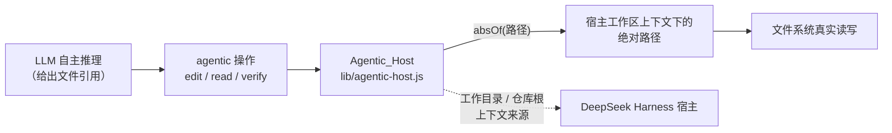
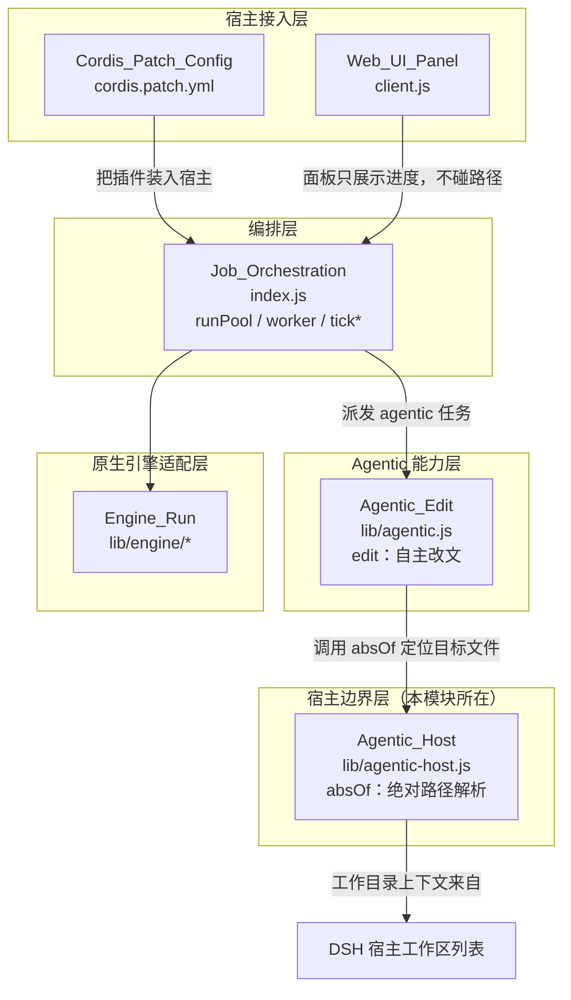
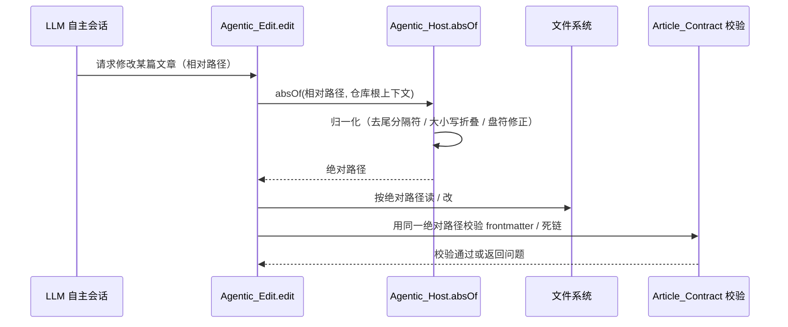
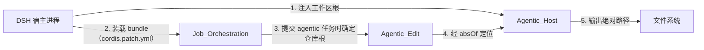

# Agentic 宿主层（Agentic_Host）

!!! info "Generated documentation"
    This page was written by CodeWiki from the source code at commit [`1ff0d38a`](https://github.com/ikliml666/dsh-codewiki/commit/1ff0d38adcb30f68320e768b4e29b10ab8676126) on 2026-11-07 with `deepseek-v4.1-flash`. Check the code before relying on details.

## 简介

`Agentic_Host` 是 `dsh-codewiki` 插件中连接「agentic（LLM 自主循环）操作」与 DeepSeek Harness（DSH）宿主运行时的**路径与上下文适配层**。它物理上只有一个文件 [`lib/agentic-host.js`](repo/lib/agentic-host.js)，对外导出的唯一核心组件是 **`absOf`**。

在整个插件里，agentic 操作（LLM 自主决定读哪个文件、改哪一行、跑哪一步）最终都要落到**文件系统路径**上。`Agentic_Host` 的职责就是把这些「相对的、来自模型推理结果的、可能含歧义的」路径，统一解析成**宿主工作区上下文下的绝对路径**，为上层 agentic 能力（如 [Agentic_Edit 模块](Agentic_Edit.md) 的 `edit`）提供一道安全且确定的边界。

> 一句话：**agentic 操作负责「做什么」，Agentic_Host 负责「相对于哪里、绝对在哪」。**

---

## 核心组件：`absOf`

| 组件 | 文件 | 语义 |
| --- | --- | --- |
| `absOf` | `lib/agentic-host.js` | 把一个输入路径解析为宿主工作区上下文下的绝对路径 |

### 设计动机

agentic 循环（见 [Job Orchestration（编译任务编排服务）](Job_Orchestration.md) 中编排的编译任务）运行在 LLM 驱动的会话里，模型给出的文件引用通常是：

- 相对于某个仓库根的相对路径；
- 带或不带盘符的 Windows 路径；
- 来自 Git Bash 的 MSYS 风格 `/e/...` 路径；
- 含 `..` 上跳、符号链接或多余分隔符的写法。

如果每条 agentic 操作都各自做一次路径拼接，就会出现「同一份相对路径在两个环节解析成不同绝对位置」的分叉。`absOf` 把这个解析集中到**唯一一处**，让所有 agentic 工具（编辑、校验、落盘）看到的是同一个「绝对路径真值」。

### 在系统中的位置

---

## 架构关系

`Agentic_Host` 在插件分层中处于「宿主边界」这一层：向上承接 agentic 操作能力，向下对接宿主提供的工作区上下文，本身不做任何业务裁决。

**关系要点：**

- **被 [Agentic_Edit 模块](Agentic_Edit.md) 消费**：`edit` 在真正修改文章前，先用 `absOf` 把目标文章路径解析成绝对路径，确保写入位置与 [Article_Contract（文章契约闸门）](Article_Contract.md) 校验、[存量文章修复（Article_Repair）](Article_Repair.md) 组装时看到的位置一致。
- **不被引擎直接使用**：原生 FSoft 引擎通道（[Engine_Native_Run（原生编译裁决编排层）](Engine_Native_Run.md)、[Engine_Client（引擎进程客户端）](Engine_Client.md)）读的是工作区真实文件，由 Python 侧自行处理路径；`Agentic_Host` 只服务于**插件内的 agentic 工具循环**。
- **配置无独立命名空间**：本模块没有自己的配置项，工作目录上下文完全来自宿主（DSH 工作区列表）与 [Job Orchestration（编译任务编排服务）](Job_Orchestration.md) 在提交任务时确定的仓库根。

---

## 数据流：一次 agentic 编辑如何定位文件

**关键不变量：**

1. **单一解析出口**：同一条相对路径，`absOf` 只产生一个绝对结果——编辑、校验、修复三方用的是同一把「坐标尺」。
2. **不猜工作目录**：宿主上下文缺失时返回的是可识别的失败，而不是「随便挑一个 cwd」——路径猜错会把文章写到别的仓库，比报错更难查。
3. **平台归一**：Windows（win32）与 POSIX 的折叠规则不同（见 `normKey` 同语义），`absOf` 在宿主边界把差异收掉，下游不再写平台判断。

---

## 与宿主的集成方式

插件通过 [Cordis_Patch_Config（插件装配配置）](Cordis_Patch_Config.md)（`cordis.patch.yml`）以 bundle 形态被宿主装载，`id` 为 `codewiki`。宿主在运行 agentic 会话时提供：

- 当前会话的**工作区根**（工作目录上下文）；
- 已注册的**模型 provider / 模型 id**；
- **工作区列表**（`workspaceOnly` 过滤见 [Job Orchestration（编译任务编排服务）](Job_Orchestration.md) 的 `Config`）。

`Agentic_Host` 正是站在这个「宿主提供什么、插件消费什么」的边界上：它不感知模型、不感知编译阶段，只把宿主给的「在哪里」翻译成 agentic 操作能用的绝对路径。

---

## 设计约束与边界

| 约束 | 说明 |
| --- | --- |
| **不做业务裁决** | `absOf` 只解析路径，不判断「这篇该不该改、改得对不对」——裁决在 [Article_Contract（文章契约闸门）](Article_Contract.md) 与 [Engine_Quality_Gate（原生引擎产物采用门）](Engine_Quality_Gate.md)。 |
| **不进持久化** | 解析结果是执行期临时值，不落 `jobs.json`（敏感与函数值禁入，见 [Job Store（作业持久化与跨实例协调层）](Job_Store.md) 的序列化闸门）。 |
| **不碰原生引擎** | Python 引擎通道自管路径，本模块不参与 native-run 的裁决链（见 [Engine_Native_Run（原生编译裁决编排层）](Engine_Native_Run.md) 的固定裁决直线）。 |
| **无独立配置** | 没有 `Config` 条目；行为完全由宿主工作区上下文与调用方传入的仓库根决定。 |

---

## 小结

`Agentic_Host` 是一个**窄而关键**的边界模块：

- 它把「LLM 给出的相对文件引用」统一解析为「宿主工作区上下文下的绝对路径」；
- 它为 [Agentic_Edit 模块](Agentic_Edit.md) 提供确定性的写入坐标，避免多环节路径分叉；
- 它站在宿主接入层与 agentic 能力层之间，向上不感知业务、向下不感知模型，是整条 agentic 编译流水线里的「坐标原点」。

要了解 agentic 操作「做什么」（自主编辑文章），见 [Agentic_Edit 模块](Agentic_Edit.md)；要了解 agentic 任务如何被编排与推进，见 [Job Orchestration（编译任务编排服务）](Job_Orchestration.md)。

??? abstract "Documented components (1)"
    - [`absOf`](https://github.com/ikliml666/dsh-codewiki/blob/1ff0d38adcb30f68320e768b4e29b10ab8676126/lib%5Cagentic-host.js) — `lib\agentic-host.js`

