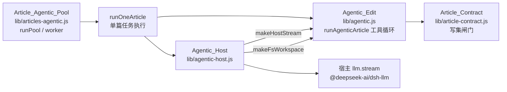
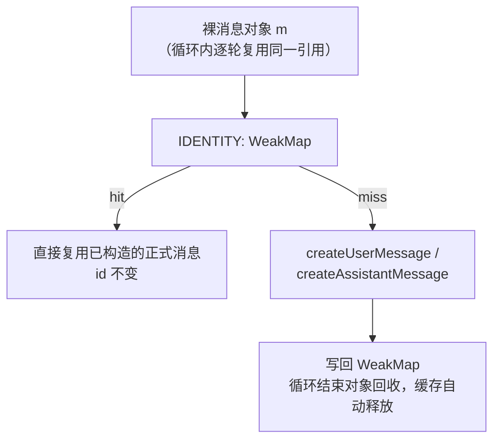
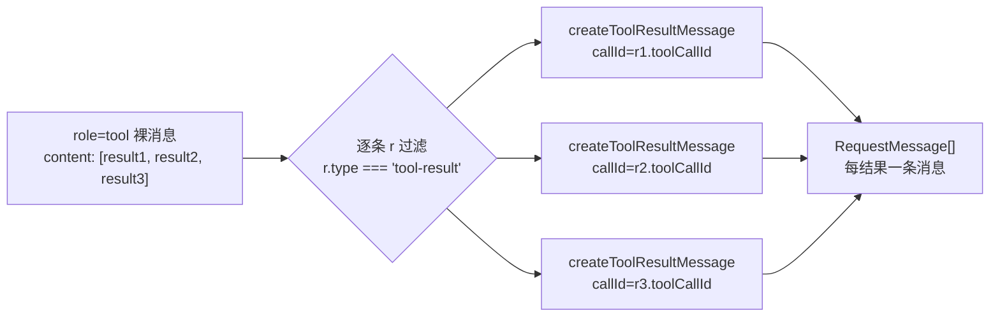
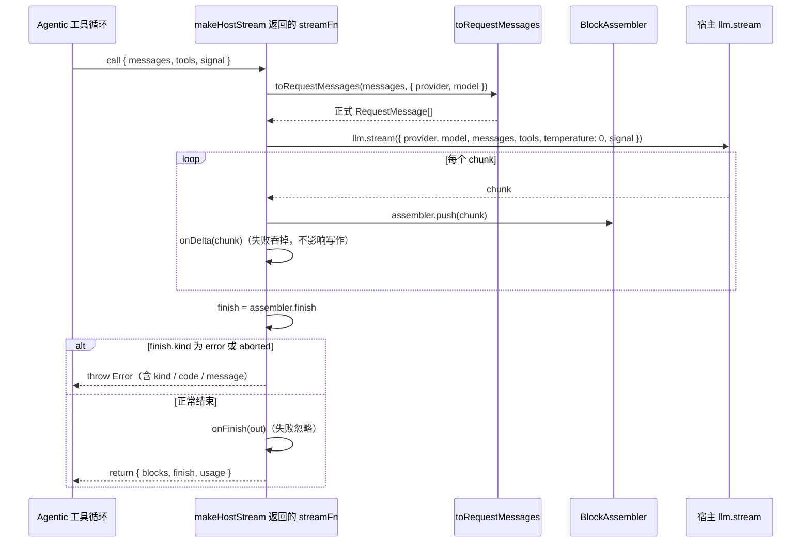
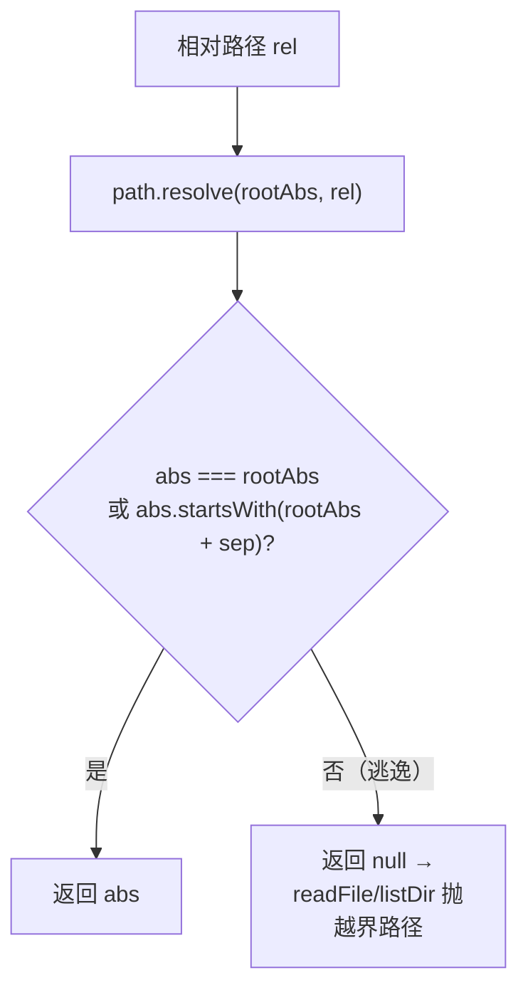
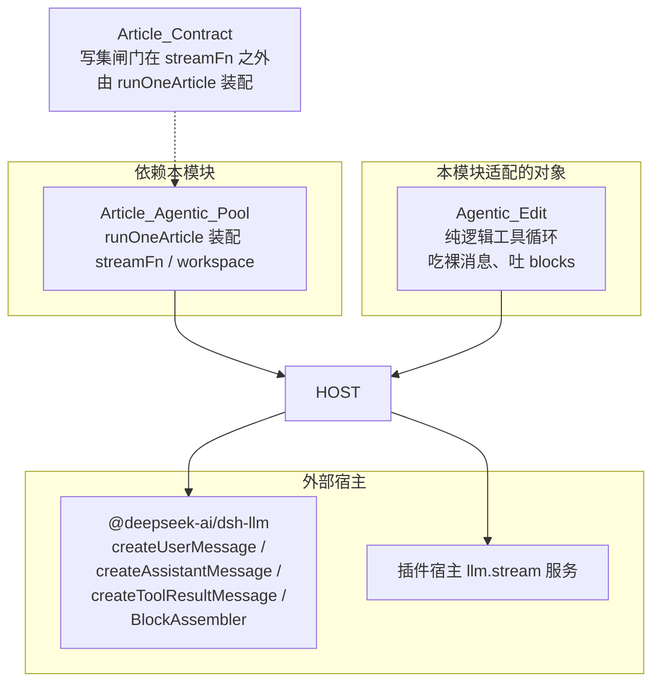
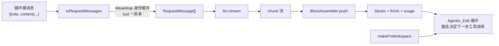

# Agentic_Host（agentic 工具循环 ↔ 宿主 llm 服务适配层）

!!! info "Generated documentation"
    This page was written by CodeWiki from the source code at commit [`6809738d`](https://github.com/ikliml666/dsh-codewiki/commit/6809738d25eb24d2eac5d5da75a639b88b67e63e) on 2026-11-06 with `doubao-seed-2.1-lite`. Check the code before relying on details.

## 模块定位

`lib/agentic-host.js` 是 agentic 文章写作通道里的**格式适配层**。它本身不做任何写作决策，只负责把「纯逻辑工具循环」与「宿主 dsh 插件的 llm 服务」两套互不兼容的消息形态对接起来：

- **上游（纯逻辑侧）**：[Agentic_Edit 模块](Agentic_Edit.md) 的 `lib/agentic.js` 只消费 `{role, content}` 裸消息、只认 blocks，方便离线测试；
- **下游（宿主侧）**：宿主 `llm.stream` 要求 `@deepseek-ai/dsh-llm` 构造的正式 `Message`（带 id + source），不接受手搓裸对象。

本模块由三个导出函数组成：

| 导出函数 | 职责 |
| --- | --- |
| `toRequestMessages(messages, { provider, model })` | 裸消息数组 → 宿主 `RequestMessage[]`，并做身份缓存与「一条 tool 消息拆多条」展开 |
| `makeHostStream({ llm, provider, model, reasoningEffort, onDelta, onFinish })` | 建一个交给 `runAgenticArticle` 调用的 `streamFn`，内部用 `BlockAssembler` 把 chunk 流收成 blocks |
| `makeFsWorkspace(fs, path, cwd)` | 仓库 workspace 抽象：agentic 工具只认 `readFile / listDir`，此函数返回带路径越界防护的这两个接口 |

## 在整体系统中的位置



调用链上，`runOneArticle`（见 [Article Agentic Pool 文章智能体执行池](Article_Agentic_Pool.md)）在装配执行环境时调用本模块：

```javascript
// lib/articles-agentic.js 里的装配片段
const workspace = makeFsWorkspace(fsImpl, pathImpl, cwd ?? process.cwd())
const streamFn = injectedStreamFn ?? makeHostStream({ llm, provider, model, reasoningEffort, onDelta })
```

- `streamFn` 可被注入（离线测试用假模型）；默认走宿主 llm；
- 装配好的 `streamFn` 与 `workspace` 一起传给 [Agentic_Edit 模块](Agentic_Edit.md) 的工具循环，循环每一步把裸消息数组喂给 `streamFn`，拿回 `{ blocks, finish, usage }`。

## 核心机制一：消息身份缓存（IDENTITY WeakMap）

### 为什么需要稳定身份

宿主 `d.ts` 对 `MessageId` 的要求是 *"Stable identity preserved across every representation boundary"*。工具循环每一轮都会把同一份 `messages` 重新丢进 `toRequestMessages`——如果每次都 `createUserMessage / createAssistantMessage`，同一轮对话里同一条消息每步都会换一个新 UUID：语义上违约。当前插件走一次性 `llm.stream`、没有 Session/replay，所以不会崩，但下游一旦按 id 去重或做游标就会失真。

### 缓存实现



- 以**裸消息对象为键**（不是 JSON 序列化），天然跟随循环的消息生命周期；
- `WeakMap` 在循环结束、对象不可达后自动释放，无需手动清理。

## 核心机制二：tool 消息「一拆多」

宿主的 `ToolResultMessage` 带 `toolCallId + source.callId`，**一条消息只能装一个结果**；而工具循环里「一轮多个工具调用」是一条 `role: 'tool'` 消息的 content 数组里装多条结果。展开规则：



因为同一裸消息要拆出多条、且每轮循环会重复调用，缓存键不能直接用裸消息本身。实现是**两层缓存**：

```javascript
const IDENTITY = new WeakMap()   // 裸消息 -> 单条消息 或 Map（tool 消息情形）

function stableKeyFor(role, r, index) {
  return `${role}#${index ?? ''}#${r?.toolCallId ?? ''}`
}
```

- tool 裸消息在 `IDENTITY` 里存一个 `Map`，键为 `stableKeyFor(...)`（角色 + 结果序号 + toolCallId），值为对应的 `ToolResultMessage`；
- user / assistant 消息则直接在 `IDENTITY` 里存构造结果；
- assistant 分支还有个短路：**已构造过的正式消息（`m.id` 存在）直接透传**，避免重复造身份。

content 归一化细节：

- `user` / `assistant` 的 content 取数组（非数组一律当 `[]`）；
- tool 结果的 content 若不是数组，包成 `[{ type: 'text', text: String(...) }]`；`isError` 强制转 boolean。

## 核心机制三：makeHostStream —— chunk 流收成 blocks

`makeHostStream` 返回一个签名为 `({ messages, tools, signal }) => { blocks, finish, usage }` 的异步函数，正好匹配 [Agentic_Edit 模块](Agentic_Edit.md) 工具循环对 `streamFn` 的约定。



关键行为：

1. **参数校验**：`llm` 缺失或 `llm.stream` 不是函数时直接 `throw new Error('makeHostStream 需要宿主 llm 服务')`；
2. **请求装配**：`reasoningEffort` 非空才带上；`tools` 非空才把工具列表映射成 `{ name, description, parameters }`（parameters 缺省为 `{ type: 'object', properties: {} }`）；`temperature` 固定为 `0`；有 `signal` 就透传以支持取消；
3. **回调隔离**：`onDelta` / `onFinish` 都包在 `try/catch` 里——回调（如 Web 面板进度推送）失败绝不影响主写作流程；
4. **失败语义**：`finish.kind` 为 `error` / `aborted` 时抛错，把 `finish.failure.code / message` 拼进错误文本，让上层池（[Article Agentic Pool 文章智能体执行池](Article_Agentic_Pool.md)）能按单任务失败记账、不拖垮其它任务。

## 核心机制四：makeFsWorkspace —— 带越界防护的文件视图

agentic 工具循环（`read_code / list_files` 之类）只认一个简单的 `{ readFile, listDir }` 接口。`makeFsWorkspace(fs, path, cwd)` 返回的实现以 `cwd` 解析出的真实绝对路径 `rootAbs` 为根，并在每次调用前用内层函数 `absOf` 做一次真实路径越界检查：



> 这是**第二道防线**：注释明确写道，符号链接逃逸已由上层 `safeRelPath` 兜一层，这里用真实路径再兜一层。

接口行为：

| 方法 | 行为 |
| --- | --- |
| `readFile(rel)` | 越界抛 `越界路径：${rel}`；否则 `fs.readFileSync(abs, 'utf8')` |
| `listDir(rel)` | `rel` 空串按 `.` 处理；越界抛错；`withFileTypes: true` 读目录，返回 `[{ path, dir }]`，`path` 带相对前缀（`rel/name`） |

## 与其它模块的关系



- **被谁消费**：仅 [Article Agentic Pool 文章智能体执行池](Article_Agentic_Pool.md) 的 `runOneArticle` 装配；池的 `runPool / worker` 在此之上并发调度（见其文档）。
- **对谁适配**：[Agentic_Edit 模块](Agentic_Edit.md) 的纯逻辑循环——本模块存在的全部理由就是让它不用感知宿主消息协议。
- **同形的另一条桥**：Engine_LLM_Bridge.md 的 `startLlmBridge` 是把同一宿主 `llm.stream` 暴露成 OpenAI HTTP 接口给 Python 引擎用；本模块则是**进程内直连**，面向插件自己的 agentic 写作通道。两者都要求宿主提供 `llm.stream`，但一个出 HTTP、一个出函数。
- **凭据占位 key 区分**：Engine_OpenAI_Bridge.md 的 `isPlaceholderKey` 服务于 HTTP 桥的鉴权闸门；本模块走进程内调用，不涉及 key。

## 进程内数据流总览



## 小结

`Agentic_Host` 是一个典型的**防腐层（anti-corruption layer）**：

1. 用 `WeakMap` + `stableKeyFor` 解决多轮循环下消息身份漂移问题；
2. 用「一拆多」弥合「一条 tool 消息多结果」与「一条消息单结果」的协议差；
3. 用 `BlockAssembler` 把宿主 chunk 流折成纯逻辑侧只认的 blocks；
4. 用双层真实路径检查给 agentic 工具循环划死仓库边界。

它的价值在「让 [Agentic_Edit 模块](Agentic_Edit.md) 保持纯逻辑可离线测试」这一点上——所有宿主相关的复杂性都被吸收在这一个文件里。

??? abstract "Documented components (1)"
    - [`absOf`](https://github.com/ikliml666/dsh-codewiki/blob/6809738d25eb24d2eac5d5da75a639b88b67e63e/lib%5Cagentic-host.js) — `lib\agentic-host.js`

