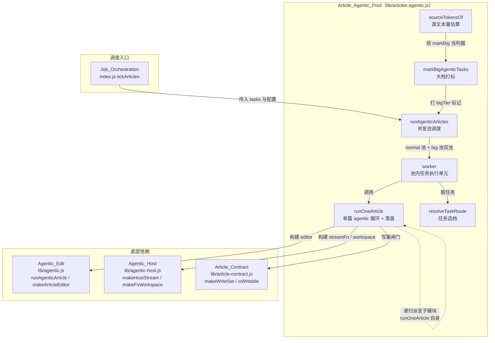
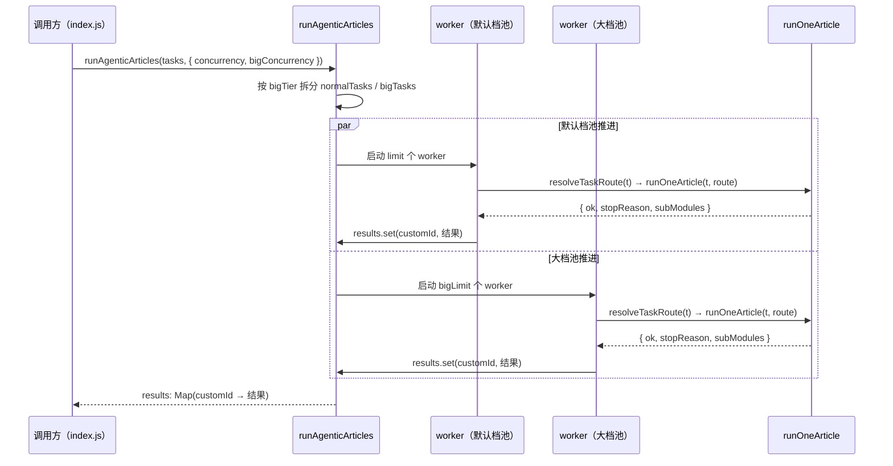
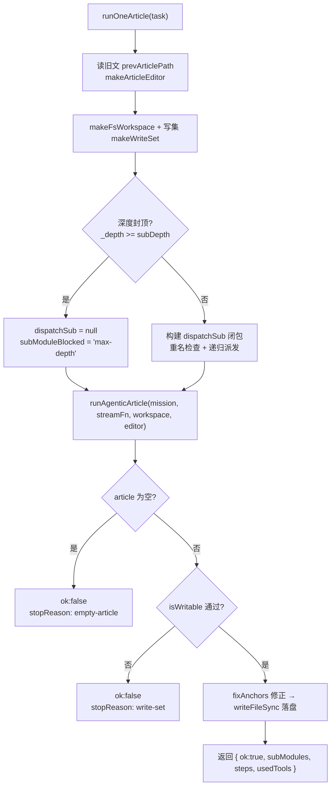
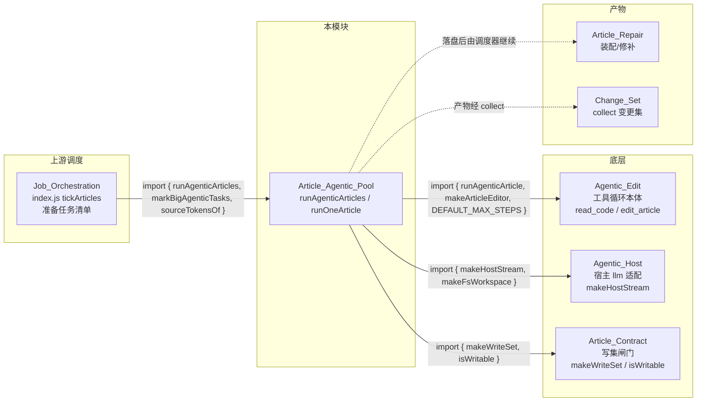

# Article Agentic Pool 文章智能体执行池

!!! info "Generated documentation"
    This page was written by CodeWiki from the source code at commit [`2a82c7bf`](https://github.com/ikliml666/dsh-codewiki/commit/2a82c7bf7a1b2b8b5b27622740b3a295b0732d8e) on 2026-11-07 with `doubao-seed-2.1-lite`. Check the code before relying on details.

> 模块文件：`lib/articles-agentic.js`
> 核心组件：`runPool`（并发池调度）、`worker`（池内任务执行单元）

## 简介

Article_Agentic_Pool 是插件内置 Node 兼容通道的**第二条文章执行通道**，负责把「模块任务清单」并行跑成 wiki 文章。它与 `index.js` 里的单轮通道（把源码内联进 prompt、模型一次吐出全文）并列，但执行方式完全不同：

- **单轮通道**：源码整包塞进 prompt → 模型一次输出全文 → 插件落盘。需要「装填超预算 → 拆观察批 → 合成」一整套缓冲逻辑。
- **agentic 通道（本模块）**：模型自己用 `read_code` / `list_files` 读源码、用 `edit_article` 增量写文章，不整包内联源码，因此没有装填预算问题。

本模块吸收自上游 FSoft-AI4Code/CodeWiki 的 module agent 设计，把「给模型一个可反复读代码、可精确编辑文章、可把子模块拆给子任务的工作台」搬成纯逻辑 + 可注入实现，既适配宿主 dsh-llm 服务，也能在离线测试里用假模型跑通。

## 架构总览



## 核心组件详解

### `runPool`（并发池调度）

对应导出函数 `runAgenticArticles(tasks, opts)`。职责：

1. **双池拆分**：把任务按 `bigTier` 标记分成两组——普通任务走默认档池（`concurrency`，默认 2），大档任务走大档池（`bigConcurrency`，缺省回落到 `concurrency`）。两池各自独立限流、同时推进，因为大档常是付费长上下文，与免费默认档配额互不相干。
2. **池内限流**：每个池按 `limit = min(concurrency, tasks.length)` 个 worker 协程并发消费任务队列（游标 `cursor++` 取任务，无锁）。
3. **结果记账**：每个任务完成后写入 `Map(customId → { name, ok, stopReason, steps, tools, subModules })`，单任务失败只记账、不影响其它任务。
4. **钩子**：`onRequestStart(task)` 返回该任务的记录器钩子（`onDelta` / `onDone` / `onError`），`onTaskDone({ outputTokens, durationMs })` 用于进度统计，`signal.aborted` 时全池停止。



### `worker`（池内任务执行单元）

每个 worker 的循环体（`runPool` 内部闭包）：

```
for (;;) {
  if (signal?.aborted) return
  i = cursor++
  if (i >= pool.tasks.length) return
  t = pool.tasks[i]
  rec = onRequestStart ? onRequestStart(t) : null
  route = resolveTaskRoute(t, rest)
  out = await runOneArticle(t, { ...rest, ...route, onDelta: rec?.onDelta })
  results.set(t.customId, 收口后的结果)
}
```

失败语义：任何环节抛错都被 catch 成一条 `notes` 记录 + `results.set(customId, { ok:false, stopReason:'error' })`，让调用方决定是否整体降级到单轮通道。

### `runOneArticle`（单篇执行 + 落盘）

`runOneArticle(task, opts)` 是单篇文章的完整执行链：

1. **初始内容**：若 `task.prevArticlePath` 存在旧文，读入作为 editor 初始内容——模型用 `str_replace` 增量改，而不是从零重写。
2. **装配依赖**：`makeArticleEditor(initialArticle)`（见 [Agentic_Edit 模块](Agentic_Edit.md)）、`makeFsWorkspace(fs, path, cwd)`（见 [Agentic_Host（agentic 工具循环 ↔ 宿主 llm 服务适配层）](Agentic_Host.md)）、`makeWriteSet(allowedWritePaths)`（见 [Article_Contract（文章契约闸门）](Article_Contract.md)）。
3. **streamFn**：默认 `makeHostStream({ llm, provider, model, reasoningEffort, onDelta })`；离线测试可注入 `streamFn` 假模型。
4. **子模块派发**：模型调 `generate_sub_module` 工具时，递归调 `runOneArticle` 写子模块文章，落盘到 `modules/<父 slug>/<子 slug>.md`。深度封顶 `subDepth`（默认 2），子模块名全局唯一（`_takenNames` 集合共享，重名加父前缀，仍重名跳过）。
5. **空文兜底**：模型全程没写过正文但最后一段文本像文章时，`runAgenticArticle` 已收下；这里再校一次——空文章算失败（`stopReason='empty-article'`），不能写下去覆盖旧文。
6. **写集闸门落盘**：`isWritable(task.articlePath, writeSet, { cwd })` 不通过则拒写，返回 `stopReason='write-set'` + `writeSetViolation`，不静默越界、也不静默丢。



### 辅助函数

| 函数 | 职责 |
| --- | --- |
| `sourceTokensOf(task, cwd)` | 估算模块源文本量（CJK 按 1、其余按 3.5 字符/token，与单轮通道 `estimateTokens` 同口径），读不到的文件按 0 计，不阻断。 |
| `resolveTaskRoute(task, { provider, model, reasoningEffort })` | 任务自带 `provider`+`model`（大档任务）时完全以任务为准，effort 也不回落默认档；否则用参数里的默认档。 |
| `markBigAgenticTasks(tasks, { bigTier, sizeOf })` | 按体量打大档标记：`size > budget` 时把 `bigTier = { provider, model, reasoningEffort? }` 写到任务上。未配置（无 provider）时原样返回。 |
| `DEFAULT_MAX_STEPS` | 从 `lib/agentic.js` 再导出（= 30），保持 `index.js` / 测试的既有导入路径可用，避免又出现一份独立常量。 |

## 关键设计决策

### 1. 子模块递归的深度判定

`dispatchSub` 是**本层**的闭包，其深度判定绑在本层 `_depth`。递归时必须把 `onSubModule` 传 `null`，让子层按自己的 `_depth + 1` 重建判定——否则原样下传会让子层永远用父层的深度判定（`_depth >= subDepth` 恒不成立），`subDepth` 封顶形同虚设、模型可以无限往下拆。

### 2. 到顶必须「说实话」

深度到顶时 `dispatchSub = null`，同时用 `subModuleBlocked='max-depth'` 告诉工具层「是因为到顶了才不能派」——否则工具笼统回「已记录/已派发」，模型据此在父文里写「详见 xxx.md」，那个文件从未生成，形成死链且父任务仍记 `ok:true`。

### 3. 写集闸门

agentic 通道里模型有自由工具循环，但**能写哪些文件**由调度器说了算：父任务只准写自己那一篇，子模块只准写调度器分配给它那一条路径。`allowedWritePaths` 三种语义：

- `undefined`（未给）→ 保持旧行为不设限（既有调用方与测试沿用）；
- `null` / `[]` → 「谁都不许写」（有意收紧）；
- 具体路径清单 → 编译成 writeSet，越界拒写并记账。

详见 [Article_Contract（文章契约闸门）](Article_Contract.md) 的 `makeWriteSet` / `isWritable`。

### 4. 双池独立限流

`bigConcurrency` 为 0/未传时回落到 `concurrency`。大档任务与默认档任务同时在飞，总并发 = 两者之和，互不抢占配额。

## 与其它模块的关系



- **上游**：[Job Orchestration（编译任务编排服务）](Job_Orchestration.md) 在 `tickArticles` 环节准备任务清单，调用 `runAgenticArticles` 推进文章写作。
- **底层**：[Agentic_Edit 模块](Agentic_Edit.md) 提供工具循环本体（`runAgenticArticle` / `makeArticleEditor`），[Agentic_Host（agentic 工具循环 ↔ 宿主 llm 服务适配层）](Agentic_Host.md) 提供宿主 llm 适配（`makeHostStream` / `makeFsWorkspace`），[Article_Contract（文章契约闸门）](Article_Contract.md) 提供写集闸门（`makeWriteSet` / `isWritable`）。
- **下游**：落盘后的文章进入 [存量文章修复（Article_Repair）](Article_Repair.md) 装配修补，最终由 Change_Set 收集变更集。

## 配置项关联

本模块的行为由 `index.js` 的 `Config` 与 `cordis.patch.yml` 的设置驱动：

| 配置项 | 本模块中的作用 |
| --- | --- |
| `maxConcurrency` | 默认档池并发上限（默认 2，硬顶 8）。 |
| `bigConcurrency` | 大档池并发上限（0 = 跟随默认档）。 |
| `bigEnabled` / `bigProvider` / `bigModel` / `bigReasoningEffort` / `bigTokenBudget` | `markBigAgenticTasks` 的 `bigTier` 来源；关闭后大档标记不生效。 |
| `batchProvider` / `batchModel` / `batchReasoningEffort` | `resolveTaskRoute` 缺省的默认档。 |
| `articleLanguage` | `runOneArticle` 的 `language` 参数。 |
| `agenticArticles` | 总开关：开启时 `tickArticles` 走本模块，否则走单轮通道（见 `cordis.patch.yml`）。 |

## 失败与降级语义

- **单任务失败**：只在 `results` 里记 `ok:false` + `notes` 追加一条原因（越界写入 / 未产出正文 / 请求失败），不影响其它任务。
- **整体降级**：缺 `llm` / 无 `workspace` / agentic 循环抛错时，由调用方（`index.js`）决定是否整体降级到单轮通道。
- **中止**：`signal.aborted` 时所有 worker 立即返回，已完成任务的结果照常返回。

## 相关页面

- [Agentic_Edit 模块](Agentic_Edit.md) — 工具循环本体与文章编辑器。
- [Agentic_Host（agentic 工具循环 ↔ 宿主 llm 服务适配层）](Agentic_Host.md) — 宿主 llm 适配与文件系统 workspace。
- [Article_Contract（文章契约闸门）](Article_Contract.md) — 写集闸门与文章结构契约。
- [Job Orchestration（编译任务编排服务）](Job_Orchestration.md) — 上游任务编排。
- [存量文章修复（Article_Repair）](Article_Repair.md) — 落盘后的装配修补。
- Change_Set — 变更集收集。

??? abstract "Documented components (2)"
    - [`runPool`](https://github.com/ikliml666/dsh-codewiki/blob/2a82c7bf7a1b2b8b5b27622740b3a295b0732d8e/lib%5Carticles-agentic.js) — `lib\articles-agentic.js`
    - [`worker`](https://github.com/ikliml666/dsh-codewiki/blob/2a82c7bf7a1b2b8b5b27622740b3a295b0732d8e/lib%5Carticles-agentic.js) — `lib\articles-agentic.js`

