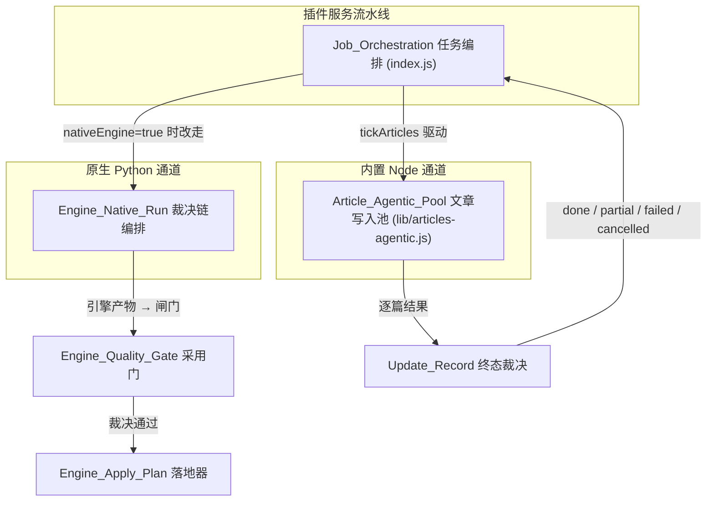
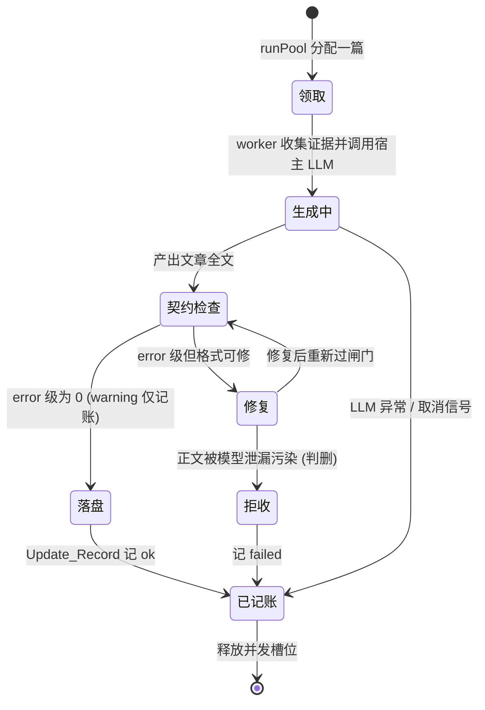
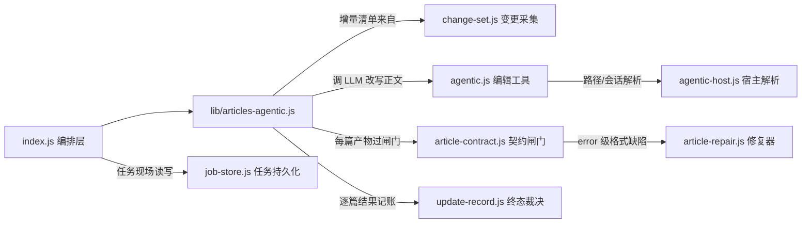
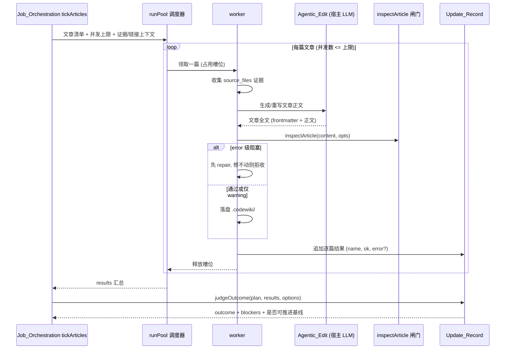

# 文章 Agentic 池（Article_Agentic_Pool）

!!! info "Generated documentation"
    This page was written by CodeWiki from the source code at commit [`df743bda`](https://github.com/ikliml666/dsh-codewiki/commit/df743bda12b693793139b00990016d9a63536736) on 2026-11-07 with `doubao-seed-2.1-lite`. Check the code before relying on details.

## 简介

`Article_Agentic_Pool` 是插件**内置 Node 通道**（零子代理）的文章写作并发池，源码位于 `lib/articles-agentic.js`，核心导出两个组件：

- `runPool` —— 有界并发调度器：接收本阶段的文章清单、并发上限与逐篇执行上下文，把文章分发给并发槽位上的 `worker` 执行，并汇总逐篇结果；
- `worker` —— 单篇写手：领取一篇文章，收集源码证据、调用宿主 LLM 生成/重写正文、过文章契约闸门、决定落盘或拒收，并把结果记账。

它与默认的原生 FSoft Python 引擎通道（见 [Engine_Native_Run（原生编译裁决编排层）](Engine_Native_Run.md)）是两条平行通道：按 `package.json` 的描述，默认通道走上游 Python 引擎（需要本机 Python 3.10+ 闭合依赖环境），而「一条最小可用的内置 Node 通道保留给跑不起来它的宿主」。本模块就是这条内置通道的 articles 环节主体。

## 模块定位

编排层（[Job Orchestration（编译任务编排服务）](Job_Orchestration.md) 的 `tickArticles`）按「写文章 → 横切 → 审校 → 索引」的固定顺序推进一个编译任务；articles 这一步被下沉到本模块：`tickArticles` 只负责准备文章清单、模型上下文与回调，真正的并发循环在 `runPool` 里完成。这样编排层不必知道每篇文章是怎么写出来的，池也不必知道任务为什么要写这篇。

## 核心组件

### `runPool`（并发调度器）

- **输入**：本阶段要处理的文章清单（全量编译为全部模块页，增量编译为 [Change_Set 变更集采集模块](Change_Set.md) 裁决出的受影响页）、并发上限、每篇文章的执行上下文（证据文件清单、期望 type、允许链接集合、语言等）。
- **并发模型**：槽位制。任一时刻在写文章数不超过并发上限，一篇完成后立即补上下一篇，直到清单清空或收到取消信号。
- **取消语义**：取消是终态（与 [Update_Record（编译更新记录）](Update_Record.md) 的 `cancelled` 对齐）——已被 `worker` 领取的文章按中途失败记账，不再启动新的文章。
- **输出**：逐篇结果数组 `[{ name, ok, error? }]`，交给 `judgeOutcome` 判终态。

并发上限由配置 `maxConcurrency` 决定（`index.js` 中 `DEFAULT_CONCURRENCY = 2`，硬顶 `CONCURRENCY_HARD_CAP = 8`），与原生引擎的 `moduleConcurrency`（模块生成并行度）是两个独立设置，不能混用。

### `worker`（单篇写手）

每篇文章的生命周期：

要点：

- **证据先行**：`source_files` 必须是本次实际读取过的文件子集，否则契约闸门报 `source-not-evidence`（error）。worker 因此必须把「这次真正读过哪些文件」作为证据清单传给闸门。
- **契约即闸门**：每篇产出先走 [Article_Contract（文章契约闸门）](Article_Contract.md) 的 `inspectArticle`；`hasBlockingIssue` 为真（存在 error 级问题）即拒写，只有 warning 级（如缺非必需章节）允许落盘，但会把本轮终态降为 `partial`、阻止基线前移——「装绿」是不允许的。
- **先修后删**：error 级中大量是纯格式缺陷（缺 frontmatter、前言污染、未闭合头、type 与目录不符），这类页先由 [存量文章修复（Article_Repair）](Article_Repair.md) 尝试装配修复；只有正文被模型思考/提示原文污染（泄漏指纹命中）才判删。
- **链接白名单**：死链检查依赖调用方传入的 `allowedLinks`（编排层的 `allowedLinkTargets` / `makeLinkExists` 负责维护这张表），不在表内的 `[[链接]]` 会被判成 `dead-link`。

## 依赖关系

- **[Agentic_Edit 模块](Agentic_Edit.md)**（`agentic.js::edit`）：worker 写文章时实际调用的编辑工具，内部走宿主 `dsh-llm` 的消息装配（`BlockAssembler`），不直接发 HTTP 请求。
- **[Agentic 宿主层（Agentic_Host）](Agentic_Host.md)**（`agentic-host.js::absOf`）：把相对路径解析成宿主会话可理解的绝对路径，供编辑工具定位证据文件与写入目标。
- **[Article_Contract（文章契约闸门）](Article_Contract.md)**：`hasBlockingIssue` 决定拒写、`issueSummary` 把问题压成一行可读文案写进日志与面板。
- **[存量文章修复（Article_Repair）](Article_Repair.md)**（`assemble`）：纯函数修复器，决定「修回合规」还是「判删」。
- **[Change_Set 变更集采集模块](Change_Set.md)**（`collect`）：增量轮时回答「这篇要不要重写」——四路改动（committed/staged/unstaged/untracked）收成规范化 ChangeSet 后映射到受影响文章。
- **[Update_Record（编译更新记录）](Update_Record.md)**（`isTerminalStage` / `loadUpdateRecord`）：池产出的 `results` 经 `judgeOutcome` 判成 `done / partial / failed / cancelled`，落成 `temp/update-record.json`；只有完整 `done` 才允许推进编译基线。
- **[Job Store（作业持久化与跨实例协调层）](Job_Store.md)**（`normKey`）：任务跨进程持久层，池在其中一个已认领的 job 现场内运行；心跳与孤儿认领保证同一时刻只有一个宿主实例驱动该池。

## 时序与数据流

数据要点：

- **输入数据**：文章清单（全量 / ChangeSet 增量映射）、证据文件可读性清单、`allowedLinks` 链接白名单、书写语言（配置 `articleLanguage`，默认「中文」）。
- **输出数据**：每篇落盘的 wiki 文章（`.codewiki/modules|concepts|.../*.md`）、逐篇结果列表、写入 `temp/update-record.json` 的终态记录。
- **不落盘即不记账**：契约闸门未过的文章不会进入 `.codewiki/`，但它的失败会进 `results`——这是「1 篇成功 + 19 篇失败也报 done」类缺陷被根治后的记账口径。

## 配置旋钮

以下配置（定义见 [Package_Manifest 包清单](Package_Manifest.md) 的 `index.js::Config` 与 [Cordis_Patch_Config（插件装配配置）](Cordis_Patch_Config.md)）直接影响本池行为：

| 配置项 | 默认值 | 对本池的影响 |
| --- | --- | --- |
| `maxConcurrency` | 2（硬顶 8） | `runPool` 的并发槽位数；调大缩短墙钟，代价是同批 LLM 请求更密集 |
| `batchProvider` / `batchModel` | 空 | worker 调用宿主 LLM 用的模型通道；留空会在提交任务时显式报错，不静默空跑 |
| `batchReasoningEffort` / `effortByStage.articles` | 空 | articles 环节的思考档位；缺省回落到模型默认档 |
| `articleLanguage` | 中文 | 写入正文的语言 |
| `excludePaths` | 空 | 这些目录（含子目录）不进入文章清单 |
| `nativeEngine` | true | 开启时 articles 环节改由原生引擎承担（见下节），本池仅在该通道不可用/关闭时兜底 |

## 与原生通道的关系

默认配置 `nativeEngine: true` 时，编译任务走 [Engine_Native_Run（原生编译裁决编排层）](Engine_Native_Run.md) 固定的裁决链（`env → 增量决议 → 引擎 → 质量门 → 落地器`），articles 由上游 Python 引擎在子进程内完成，本池不参与。此时 [引擎 LLM 桥（Engine_LLM_Bridge）](Engine_LLM_Bridge.md) 以 loopback 桥把引擎的 OpenAI-compatible 请求翻译成宿主模型调用，凭证不出宿主。

本池（内置 Node 通道）的定位是**兜底通道**：当宿主无法满足原生引擎的环境前提（Python 3.10+ 闭合依赖、`tools/fsoft-engine/setup-env.sh` 安装的 venv）时，插件仍能在插件内完成「写文章 → 横切 → 审校 → 索引」全流程。两条通道共享同一套文章契约判据（[Article_Contract（文章契约闸门）](Article_Contract.md) 的 `inspectArticle` 与 `NATIVE_ARTICLE_OPTS`），保证「刚渲染出来的页」与「库里躺着的存量页」用同一把尺子。

## 相关模块

- 任务驱动：[Job Orchestration（编译任务编排服务）](Job_Orchestration.md)
- 逐篇写作工具：[Agentic_Edit 模块](Agentic_Edit.md) · [Agentic 宿主层（Agentic_Host）](Agentic_Host.md)
- 质量闸门与修复：[Article_Contract（文章契约闸门）](Article_Contract.md) · [存量文章修复（Article_Repair）](Article_Repair.md)
- 增量来源与终态记账：[Change_Set 变更集采集模块](Change_Set.md) · [Update_Record（编译更新记录）](Update_Record.md)
- 任务现场：[Job Store（作业持久化与跨实例协调层）](Job_Store.md)
- 平行通道：[Engine_Native_Run（原生编译裁决编排层）](Engine_Native_Run.md) · [Engine_Quality_Gate（原生引擎产物采用门）](Engine_Quality_Gate.md) · [Engine_Apply_Plan（原生产物落地器）](Engine_Apply_Plan.md) · [引擎 LLM 桥（Engine_LLM_Bridge）](Engine_LLM_Bridge.md)
- 配置与打包：[Package_Manifest 包清单](Package_Manifest.md) · [Cordis_Patch_Config（插件装配配置）](Cordis_Patch_Config.md)

??? abstract "Documented components (2)"
    - [`runPool`](https://github.com/ikliml666/dsh-codewiki/blob/df743bda12b693793139b00990016d9a63536736/lib%5Carticles-agentic.js) — `lib\articles-agentic.js`
    - [`worker`](https://github.com/ikliml666/dsh-codewiki/blob/df743bda12b693793139b00990016d9a63536736/lib%5Carticles-agentic.js) — `lib\articles-agentic.js`

