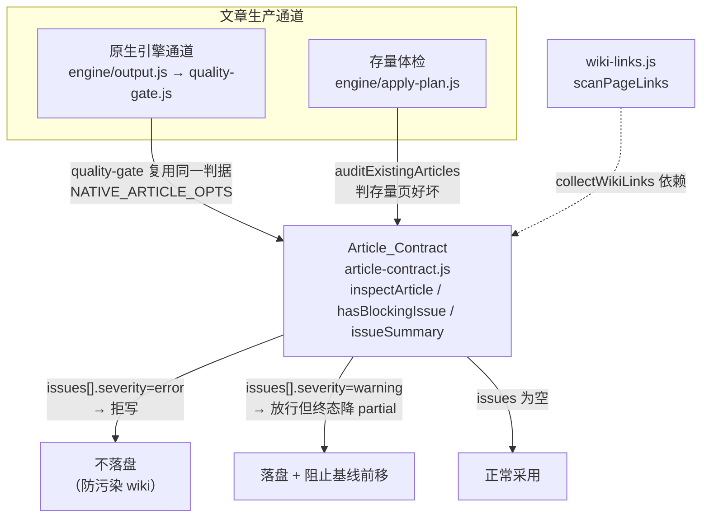
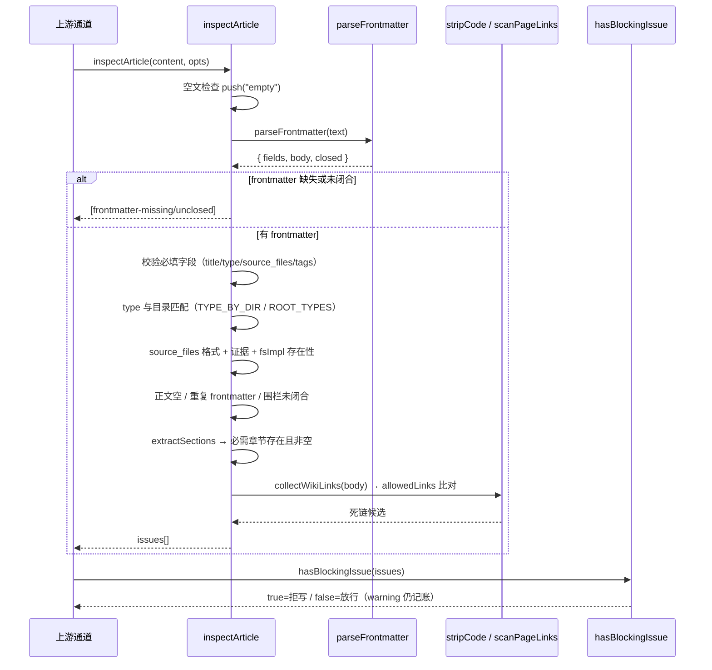
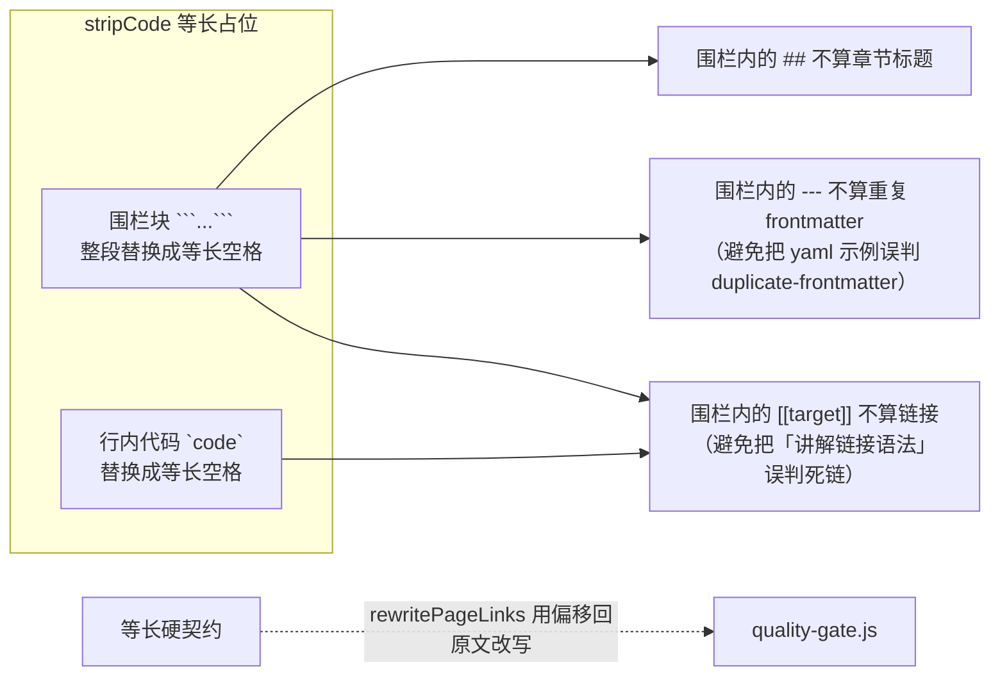

# Article_Contract（文章契约闸门）

!!! info "Generated documentation"
    This page was written by CodeWiki from the source code at commit [`695bf7d0`](https://github.com/ikliml666/dsh-codewiki/commit/695bf7d0681fd06c15e63a731761d443a069a9e3) on 2026-11-07 with `doubao-seed-2.1-lite`. Check the code before relying on details.

## 简介

`Article_Contract` 是 Wiki 文章的**结构性最低质量契约**模块，位于 `lib/article-contract.js`。它是一组**纯函数**（不碰文件系统、不依赖宿主服务），负责统一判定一篇 Markdown 文章是否满足「可以落盘进 `.codewiki/` wiki」的结构要求。

该模块诞生于一次审计确认的缺陷：旧闸门 `validateArticleEnvelope`（`index.js`）只检查「frontmatter 有没有开头、有没有闭合」，导致以下坏文章都能入库——重复贴入第二份 frontmatter、必需章节存在但正文为空、`source_files` 列着不存在的文件或目录、正文 `[[链接]]` 指向已删除文章、代码围栏未闭合。本模块把这些判据集中到一处，并被**所有写入与校验通道共用**，避免各写各的导致判据漂移。

> 背景口径注记：原生引擎通道（`nativeEngine=true`）已是**唯一编译通道**——`index.js` 里的旧 Node 兼容写作通道（单轮 prompt 与 agentic 双池）已整体删除，`articles-agentic.js`、`tickArticles` 等不再存在。下文提到的 agentic 通道写集语义（`makeWriteSet` / `isWritable`）仍是本模块导出的能力，但其调用方已随旧通道一并移除；原生通道的采用门（[Engine_Quality_Gate（原生引擎产物采用门）](Engine_Quality_Gate.md)）与存量体检（[Engine_Apply_Plan（原生产物落地器）](Engine_Apply_Plan.md)）才是本模块当前的真实消费者。

核心职责：

- 解析并校验 frontmatter（含极简 YAML 解析，支持双引号/单引号标量转义还原）；
- 按「文章类型 → 必需章节」校验正文结构；
- 校验 `source_files` 的格式、存在性与证据来源；
- 扫描正文内部 wiki 链接并判死链（自动跳过代码围栏与行内代码中的「语法示例」）；
- 输出分级（`error` 拒写 / `warning` 降级 partial）问题清单；
- 提供写集（write-set）路径规范化与越界判定，曾服务 agentic 工具的写入白名单（调用方随旧通道删除后，导出能力本身保留）。

## 在系统中的位置



`Article_Contract` 是典型的「被多处共用的底层纯函数库」：上游两个通道（原生引擎采用门、存量体检）都 import 它，从而保证「判坏一篇文章的口径全系统一致」。这一点尤其关键——`quality-gate.js` 与 `apply-plan.js` 曾各自写过一遍同样的判据并发生过漂移，`NATIVE_ARTICLE_OPTS` 常量就是为了让两边共用同一份原生通道口径。

## 核心数据模型

### 文章类型与目录映射

| 目录 / 特殊文件 | 对应 type | 必需章节（默认） |
|---|---|---|
| `modules/` | `module` | `Overview`, `Key Components` |
| `concepts/` | `concept` | `Overview` |
| `learnings/` | `learning` | `Overview` |
| `decisions/` | `decision` | `Overview` |
| `patterns/` | `pattern` | `Overview` |
| `queries/` | `query` | `Overview` |
| `_architecture.md` | `architecture` | `Overview`, `Key Components` |
| `_index.md` | `index` | 无 |

- `REQUIRED_FIELDS = ['title', 'type', 'source_files']`，且 `tags` 即使为空也必须显式写出（`tags: []`）。
- `ARTICLE_CONTRACT_VERSION = 1`：契约版本号，便于下游识别判据口径。

### 问题分级（SEVERITY）

分级是**闸门行为的分界**，不只是措辞差异：

| 级别 | 含义 | 处置 |
|---|---|---|
| `error` | 结构已破坏，落盘即污染 wiki | **拒写**（`hasBlockingIssue` 判 true） |
| `warning` | 内容不达标但结构完整 | 放行落盘，但本次编译终态降为 `partial`，阻止基线前移 |

`error` 类：`empty`、`frontmatter-missing`、`frontmatter-unclosed`、`missing-field`、`type-mismatch`、`bad-source`、`missing-source`、`source-not-evidence`、`empty-body`、`duplicate-frontmatter`、`duplicate-section`、`unclosed-fence`、`dead-link`、`empty-section`。

`warning` 类：`missing-section`（压根没写这一章）、`empty-section-optional`（非必需章节写了标题却空着）。

> 设计要点：`missing-section` 与 `empty-section` 必须分开——「压根没写这一章」与「写了标题却空着」是两种缺陷，前者旧通道常见，后者是明确的坏文章。

## 核心组件

### `inspectArticle(content, opts)` — 主入口

返回 `issues[]`，空数组表示通过。`opts` 可调：

| 参数 | 默认 | 说明 |
|---|---|---|
| `cwd` | `null` | 仓库根，用于 `source_files` 存在性判定 |
| `articlePath` | `null` | 文章在 wiki 里的相对路径（如 `modules/x.md`），用于 type 与目录匹配 |
| `expectedType` | `null` | 覆盖目录推断的期望 type |
| `readableSources` | `null` | 本次实际读取/喂给模型的文件清单；`source_files` 必须是其子集（否则报 `source-not-evidence`） |
| `allowedLinks` | `null` | 允许的 wiki 链接目标集合；`null` 表示不查死链 |
| `fsImpl` | `null` | 提供 `exists(relPath)` / 可选 `isDirectory` 的文件系统适配 |
| `requiredSections` | `null` | 章节要求覆盖；原生引擎通道传 `[]` 只查结构完整 |
| `allowEmptySourceFiles` | `false` | 空 `source_files` 是否合法；原生 whole-repository 模式下开启 |

执行顺序（任一 `error` 触发即累积返回，不中断）：空文 → frontmatter 缺失/未闭合 → 必填字段 → type 与目录匹配 → `source_files` 格式/证据/存在性 → 正文空/重复 frontmatter/围栏未闭合 → 必需章节存在且非空 → 非必需章节非空 → 死链。

### 辅助解析函数

- `parseFrontmatter(content)`：只认文首第一个 `---` 块，返回 `{ fields, body, endLine, closed, raw }`；自动剥离 BOM。
- `parseYamlLite(raw)`：极简 YAML，只支持本仓库文章形态（`key: value`、`key:` 后跟 `- item` 列表、内联 `[a, b]`）；不引依赖。
- `unquote(s)`：双引号标量优先 `JSON.parse` 还原转义（`YAML 1.2 是 JSON 超集`），失败回退到切引号；单引号标量处理 `''` → `'` 的 YAML 专有转义。
- `extractSections(body)`：按 `## 标题` 切章节，返回 `[{ title, content, line }]`；**围栏内的 `##` 不当章节**。
- `fencesBalanced(body)`：判代码围栏（``` 或 ~~~）是否成对。
- `collectWikiLinks(body)`：收集 `[[target]]` 与 Markdown 链接目标，先经 `stripCode` 剥代码；跳过 `scheme:` 形式的外链（由 [Job_Logs](Job_Logs.md) 中的 `isExternalTarget` 共同约定）。
- `stripCode(text)`：把围栏块与行内代码替换成**等长**占位（这是硬契约——`quality-gate.js` 的 `rewritePageLinks` 靠它的偏移回原文做链接重写）。
- `hasDuplicateFrontmatter(body)`：检测正文里又贴了一份 frontmatter（围栏外 40 行内成对 `---` 且中间出现 `title:/type:/source_files:`）。

### 闸门行为函数

- `hasBlockingIssue(issues)`：`issues` 中任一 `severity === 'error'` 即返回 `true`（只有 error 级才拦落盘）。
- `issueSummary(issues)`：压成一行人类可读文案，`null` 表示通过；取首条 detail，多于一条时附「（共 N 项）」。
- `makeWriteSet(paths)` / `normalizeWritePath(p)` / `isWritable(target, writeSet, { cwd })`：写集白名单。按规范化后的 POSIX 路径比对，相对路径以 `cwd` 为基准解析后再比对，防止 `../` 越界写到别的仓库。返回 `null` 表示调用方未设限。

## 典型数据流



## 原生引擎通道的特殊口径（NATIVE_ARTICLE_OPTS）

原生（FSoft）通道与 agentic 通道的正文约定不同，`NATIVE_ARTICLE_OPTS` 是冻结常量，由 [Engine_Quality_Gate（原生引擎产物采用门）](Engine_Quality_Gate.md)（判「刚渲染出来的页」）与 [Engine_Apply_Plan（原生产物落地器）](Engine_Apply_Plan.md)（判「库里存量页」）**共用**：

```javascript
{
  cwd: null,
  readableSources: null,
  fsImpl: null,
  requiredSections: [],          // 原生章节名由上游 prompt 决定
  allowEmptySourceFiles: true,   // whole-repository 模式 module_tree 为 {}
}
```

设计理由：

- `requiredSections: []`：原生正文章节名是上游 prompt 决定的（`## 1. Purpose`…），用 agentic 通道的 `Overview`/`Key Components` 去判，会产出一堆**不可修复**的 warning（计划硬约束「不改技术内容」），闸门退化成噪声。
- `allowEmptySourceFiles: true`：whole-repository 模式下 `module_tree.json` 就是 `{}`，空 `source_files` 是诚实记录，由上层降级成 `partial` 阻止基线推进，而不是在这里拒写。
- `fsImpl: null`：`source_files` 存在性由 Engine_Output 的 `source-missing` 单独判，这里再判一次只会把同一条缺陷翻倍上报。

## 防误判的关键设计



真机教训（来自源码注释）：`article_validation`、`plan_application`、`codewiki_vendor_binary` 三篇文档都曾因为「正文里用代码块演示 frontmatter/链接语法」而被误判成 `dead-link` / `duplicate-frontmatter` 拒写。`stripCode` 的「等长」是硬契约——`quality-gate.js` 的 `rewritePageLinks` 依赖它返回的匹配偏移回原文做替换，长度一变就会错位。

## 与其他模块的关系

- **上游使用者**：
  - [Engine_Quality_Gate（原生引擎产物采用门）](Engine_Quality_Gate.md)：把引擎映射结果渲染成真正的 wiki 文章后，走 `inspectArticle`（用 `NATIVE_ARTICLE_OPTS`）做采用门；`article-contract` 是其 `GATE_DEFECT_KINDS` 之一。
  - [Engine_Apply_Plan（原生产物落地器）](Engine_Apply_Plan.md)：存量 `auditExistingArticles` 判坏页，配合 [存量文章修复（Article_Repair）](Article_Repair.md) 先修后删。
  - [存量文章修复（Article_Repair）](Article_Repair.md)：直接 import `TYPE_BY_DIR`、`parseFrontmatter`、`stripCode` 做修复推断。
  - 旧 agentic 通道已随旧 Node 兼容通道整体删除；`isWritable`/写集导出（`makeWriteSet` / `normalizeWritePath` / `isWritable`）仍保留在本模块，当前无调用方。
- **底层依赖**：
  - [Job_Logs](Job_Logs.md) 中的 `lib/engine/wiki-links.js` 提供 `scanPageLinks`（链接扫描规则门、校对、本模块三方共用同一份）。
- **不在本模块职责内**：基线推进判定、写盘原子性、自动提交（属于 [Engine_Apply_Plan（原生产物落地器）](Engine_Apply_Plan.md)）；git 状态与基线陈旧分类（属于 [Engine_Quality_Gate（原生引擎产物采用门）](Engine_Quality_Gate.md)）。

## 备注

- 本模块为纯函数，不碰文件系统，因此可直接单测；真正的落盘闸门由调用方（`quality-gate.js` / `apply-plan.js`）在拿到 `issues` 后决定拒写或降级（旧 `index.js` 调用路径已随通道统一移除）。
- `SEVERITY` 表新增类别时只允许**追加**（下游按 `kind` 分派消费），不得改既有类别语义。
- `ARTICLE_CONTRACT_VERSION` 用于跨通道对齐判据口径；原生通道与 agentic 通道的口径差异通过 `NATIVE_ARTICLE_OPTS` 显式传入，而不是各自复制一份判据。

??? abstract "Documented components (2)"
    - [`hasBlockingIssue`](https://github.com/ikliml666/dsh-codewiki/blob/695bf7d0681fd06c15e63a731761d443a069a9e3/lib%5Carticle-contract.js) — `lib\article-contract.js`
    - [`issueSummary`](https://github.com/ikliml666/dsh-codewiki/blob/695bf7d0681fd06c15e63a731761d443a069a9e3/lib%5Carticle-contract.js) — `lib\article-contract.js`

