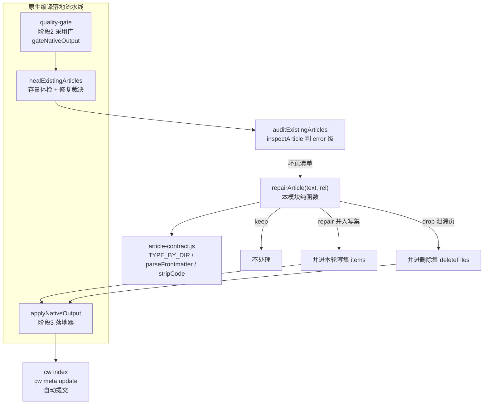
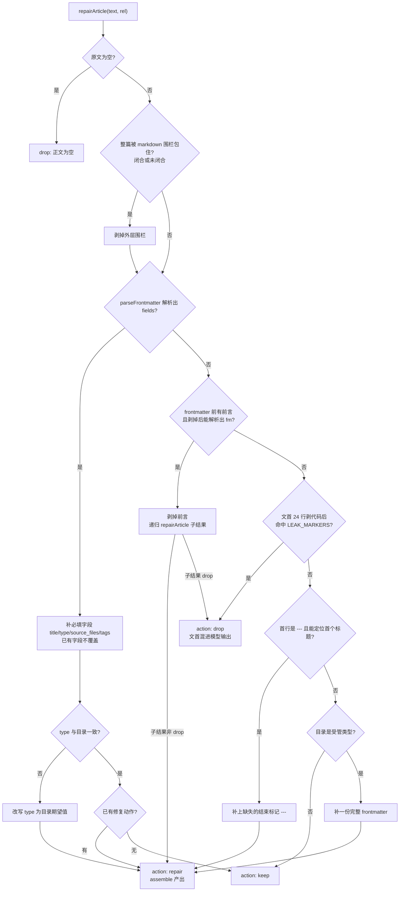
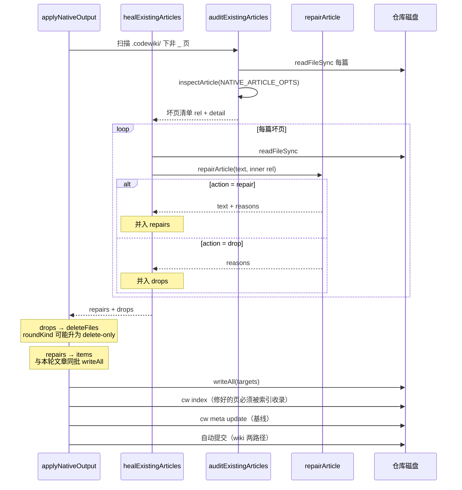

# 存量文章修复（Article_Repair）

!!! info "Generated documentation"
    This page was written by CodeWiki from the source code at commit [`bbcf9332`](https://github.com/ikliml666/dsh-codewiki/commit/bbcf933285594340a19465219b5bf37d28b4c956) on 2026-11-06 with `doubao-seed-2.1-lite`. Check the code before relying on details.

## 简介

`Article_Repair` 是 wiki 存量坏页的**修复裁决层**，全部实现集中在单文件 `lib/article-repair.js`，核心导出是纯函数 `repairArticle(text, rel)`，另一个内部核心是组装器 `assemble(fmText, body)`（把修好的 frontmatter 与正文重新拼回合规形态）。

它存在的根本理由是：[`auditExistingArticles`](Engine_Apply_Plan.md)（位于 [Engine_Apply_Plan（原生产物落地器）](Engine_Apply_Plan.md) 模块）只用 [`inspectArticle`](Article_Contract.md) 判对错，判出问题后只有两种处置——留着不管（基线被永久否决）或直接删掉。真机五个仓库的统计证明这两种都不对：61 篇被判坏的页里真正内容有问题的只有 11 篇，其余 50 篇全是**纯格式**缺陷。删掉等于用格式问题销毁内容，留着等于让基线永远推不动。所以本层的口号是「先修，修不动才删」。

判删（`drop`）的唯一依据是「正文文首混进了模型的思考/提示原文」（输出泄漏）：那种页的内容本身就是错的，修掉开头也改变不了它描述的是一段不存在的对话。

整层是**纯函数，不碰文件系统**：修复结果由调用方（[`healExistingArticles`](Engine_Apply_Plan.md)）决定写回、并进写集、还是进删除集。

## 四类真实缺陷（设计依据）

真机五仓统计的 61 篇坏页分布，正是修复器逐条要覆盖的形态：

| 缺陷类别 | 真机数量 | 典型形态 | 修复手段 |
| --- | --- | --- | --- |
| 缺 frontmatter | 20 篇 | 手写的 `# 标题` 正文，从没人写 YAML 头 | 按目录补一份 frontmatter |
| 前言污染 | 8 篇 | 正文前粘一句「以下是基于当前源码重写的文章。」，或整篇包进 ```markdown 围栏 | 剥掉围栏/前言，递归修复剩余部分 |
| frontmatter 未闭合 | 9 篇 | 有 `title/type/source_files/tags`，只是少结尾 `---` | 定位正文标题行，补回结束 `---` |
| type 与目录不符 | 9 篇 | `learnings/` 下的页写成 `type: module` | 按 `TYPE_BY_DIR` 改写 type |

## 架构位置



`repairArticle` 被 [Engine_Apply_Plan（原生产物落地器）](Engine_Apply_Plan.md) 中的 `healExistingArticles` 调用（`lib/engine/apply-plan.js` 第 937 行起），后者在 `applyNativeOutput` 的**轮次判定之前**执行一次：判 drop 的页要先进删除集，而删除集决定本轮是 `idle` 还是 `delete-only`——顺序反了，库里只剩泄漏页的仓库会永远停在 idle。

## 依赖关系

### 上游依赖（本模块 import）

| 来源 | 符号 | 用途 |
| --- | --- | --- |
| `node:path` | `path.posix` | 从相对路径推标题 |
| [Article_Contract（文章契约闸门）](Article_Contract.md) | `TYPE_BY_DIR` | 目录 → 期望 type（`modules: 'module'`、`concepts: 'concept'`、`learnings: 'learning'`、`decisions: 'decision'`、`patterns: 'pattern'`、`queries: 'query'`） |
| [Article_Contract（文章契约闸门）](Article_Contract.md) | `parseFrontmatter` | 解析已有 frontmatter，拿到 `{ fields, body, endLine, closed }` |
| [Article_Contract（文章契约闸门）](Article_Contract.md) | `stripCode` | 把代码围栏/行内代码替换成等长占位，让泄漏判定不被正文里贴的日志带偏 |

### 下游调用方

| 调用方 | 位置 | 消费方式 |
| --- | --- | --- |
| [Engine_Apply_Plan（原生产物落地器）](Engine_Apply_Plan.md) `healExistingArticles` | `lib/engine/apply-plan.js:951` | `repairArticle(text, inner)`，返回 `{ action:'repair' }` 的进 `repairs`，返回 `{ action:'drop' }` 的进 `drops` |
| `applyNativeOutput` 主事务 | `lib/engine/apply-plan.js:1064`、`1190` | `repairs` 并进写集与本轮文章同批写盘、同批 `cw index`；`drops` 并进删除集 |

注意本模块**不**依赖 [Engine_Quality_Gate（原生引擎产物采用门）](Engine_Quality_Gate.md)：体检（`inspectArticle`）在 gate 与 apply-plan 两侧共用同一套 `NATIVE_ARTICLE_OPTS` 口径，而修复器只对「已被判坏」的页负责，不重新判契约。

## 核心组件

### `repairArticle(text, rel)` — 三态裁决主入口

签名：`repairArticle(text, rel) → { action: 'keep'|'repair'|'drop', text, reasons[] }`

- `keep`：页本身已经合规，不用动；
- `repair`：`text` 是修好的完整正文，`reasons` 列出每一步做了什么（进落地 notes）；
- `drop`：内容本身是模型输出泄漏，不可救，交由调用方删除。

`rel` 是**相对 wiki 根**的路径（如 `modules/foo.md`），不是相对仓库根——修复器要靠首段目录推 `type` 与补 frontmatter。

### `assemble(fmText, body)` — 组装器

把修好的 frontmatter 文本与正文拼回标准形态：

```
---
{fmText}
---

{body}
```

所有修复分支（未闭合补全、纯正文补头、type 改写）最终都经它产出统一格式，保证写回后 `parseFrontmatter` 必能闭合解析——否则修好的页过不了 `cw index` 的 serde_yaml 解析（[Engine_Apply_Plan（原生产物落地器）](Engine_Apply_Plan.md) 的 `findArticlesMissingFromIndex` 正是防这个「缺页静默成功」）。

## 修复流水线（决策顺序）



### 关键顺序约束（都是真机事故换来的）

1. **先剥围栏，再解析 frontmatter**：整篇被包进 ```markdown 时，围栏本身不是内容；未闭合围栏（末尾 ```` 丢了）单独剥首行，否则首个 `---` 会被算进正文。
2. **前言剥离优先于污染判定**：`以下是基于当前源码重写的文章。` 这类单句前言是可剥的，后面跟着合法 frontmatter 时它只是「模型在说话」。顺序反了会把整批只是粘了一句话的页（真机 8 篇）误判成不可救。
3. **`---` 起点要回退到代码围栏起点**：整篇被围栏包住、前面又粘前言时，从 `---` 硬切会把围栏开头留在前言里、正文只剩一个孤零零的结尾 ```，修完的文章反而过不了契约。
4. **泄漏判定只看文首 24 行且先 `stripCode`**：正文中间出现 `I will now` 可能是在引用日志，贴一段对话是正常写法；只有正文前的元话语才算泄漏。
5. **`fillFields` 已有字段一律不覆盖**：只补 `title`（取正文一级标题，取不到退化为文件名）、`type`（按目录推）、`source_files: []`、`tags: []`。

## 泄漏指纹（LEAK_MARKERS）

泄漏判定是一组文首正则，覆盖两类来源：

- **模型与用户对话的元话语**：`I will now update/rewrite…`、`Here is the updated…`、`以下是基于…`、`根据你提供的源码`、`你的任务要求` 等；
- **文章生成器的施工上下文泄漏**：`压缩对话范围：m01175–m01238 (CodeWiki Update)`、`TASK AS OF THIS BLOCK`、`### Compression of Compressed Context`、`The user wants to update an existing CodeWiki article…`。

其中「压缩块标题」与「TASK 行」是两个独立来源——缺一条就有整批只带这个标记的泄漏页漏过去；而 `Compression of Compressed Context` 这类页没有自己的 frontmatter、靠围栏夹一段，若不判 drop，修复器会把围栏前的前言剥掉、把围栏内容当正文留下，产出一篇「看着像文章、实际是施工说明」的页——比直接删更糟。

## 在落地事务中的数据流



两类例外值得单独说明：

- **idle 轮不修只记账**：格式坏了的页（`repairs`）若本轮无任何变化，不立即修——修完必须重跑 `cw index`，而 idle 轮刻意不碰索引（每次状态查询都跑一次 `cw index` 会制造无意义的 wiki 提交）。留给下一轮写盘时并进去，notes 里会点名「另有 N 篇只是格式坏了，等下一轮写盘时一并修好」。
- **本轮要删的页不参与修复**：给 orphan/残留页补 frontmatter 只会让它重新成为合法页、从删除集里被摘出去，残骸永远清不掉。所以 `healSkip` 同时排除本轮写集页与删除集页。

## 不变量与边界

1. **纯函数、零 I/O**：不 import fs，修复结果的写回/丢弃全部由调用方决定，因此可单测、可在 dryRun 预览。
2. **不改技术内容**：修复只动 frontmatter 与正文最外层前言/围栏，正文一字不改（`body` 原样保留）。这与原生通道「计划硬约束不改技术内容」一致。
3. **判删宁缺勿滥**：只有文首指纹命中才 drop；目录不受管（如 `learnings/`、`decisions/` 手写页）且无 frontmatter 时返回 `keep`，绝不自动补头覆盖人工内容。
4. **写回必过索引**：`assemble` 产出的形态保证 `parseFrontmatter` 闭合；缺页静默成功由 [Engine_Apply_Plan（原生产物落地器）](Engine_Apply_Plan.md) 的 `findArticlesMissingFromIndex` 兜底回滚。

## 相关模块

- [Article_Contract（文章契约闸门）](Article_Contract.md) — 契约闸门（`inspectArticle` / `parseFrontmatter` / `stripCode` / `TYPE_BY_DIR`），修复器的全部原料与判坏上游。
- [Engine_Apply_Plan（原生产物落地器）](Engine_Apply_Plan.md) — 落地事务，`healExistingArticles` 与 `applyNativeOutput` 的宿主，决定修复结果写回还是删除。
- [Engine_Quality_Gate（原生引擎产物采用门）](Engine_Quality_Gate.md) — 本轮新产物的采用门；修复器管的是「库里躺着的存量页」，与它管的「刚渲染出来的页」共用 `NATIVE_ARTICLE_OPTS` 口径，避免两套判据漂移。

??? abstract "Documented components (1)"
    - [`assemble`](https://github.com/ikliml666/dsh-codewiki/blob/bbcf933285594340a19465219b5bf37d28b4c956/lib%5Carticle-repair.js) — `lib\article-repair.js`

