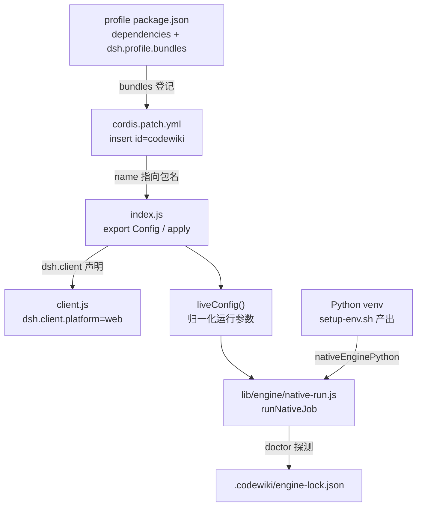
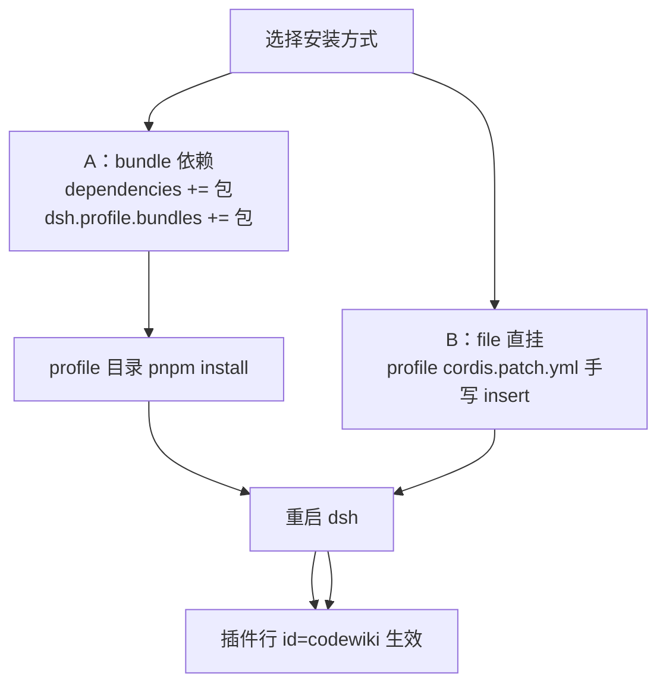
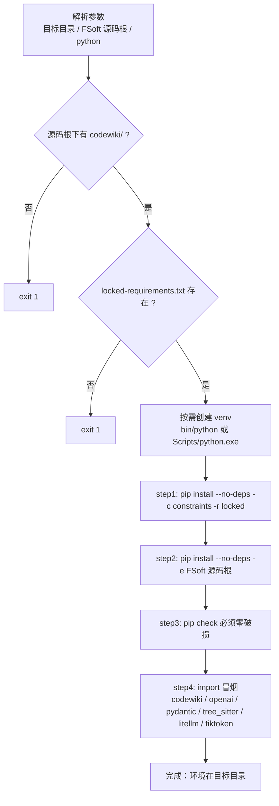
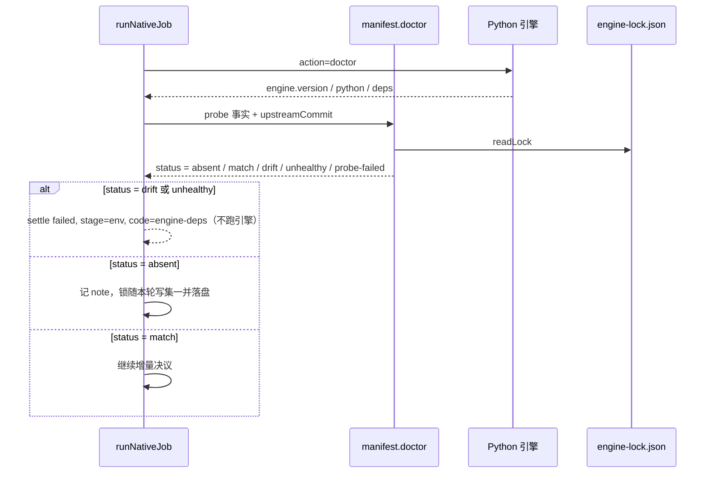
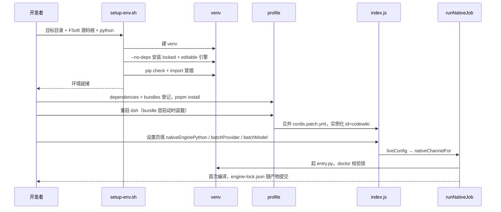

# 构建与配置（build-configuration）

!!! info "Generated documentation"
    This page was written by CodeWiki from the source code at commit [`d16751f5`](https://github.com/ikliml666/dsh-codewiki/commit/d16751f5dd58ee0741d861266965e322cbe7a60d) on 2026-11-09 with `deepseek-v4.1-flash`. Check the code before relying on details.

本模块是 `dsh-codewiki` 的**构建面与配置面**：它不含编译算法，只决定「这个包长什么样、怎么被宿主装载、装载后拿到哪些默认配置、以及运行原生引擎所需的 Python 环境怎么造出来」。三个工件构成完整闭环：

| 工件 | 角色 | 影响面 |
| --- | --- | --- |
| `package.json` | npm 清单 + DSH 插件声明（`dsh.client` / `dsh.bundle`） | 宿主如何发现入口、如何把 `client.js` 送进浏览器、发布时带哪些文件 |
| `cordis.patch.yml` | bundle 补丁：向 profile 注入 `id: codewiki` 的插件行 | 插件能否被加载、配置从哪来、两种安装形态的差异 |
| `tools/fsoft-engine/setup-env.sh` | FSoft Python 引擎的 venv 构建脚本 | 原生通道能否通过 `doctor` 的环境与锁校验 |

其余配置语义（`Config` 字段的运行时行为、`engine-lock.json` 的指纹比对、`liveConfig` 的归一化）分散在宿主半侧与引擎适配层，本文只做**指针与契约说明**，实现细节见文末的模块链接。

---

## 一、整体位置：从 profile 到引擎进程



关键点：`package.json` 与 `cordis.patch.yml` 是**成对**生效的。`package.json` 里的 `dsh.bundle.patch` 指向 `./cordis.patch.yml`，宿主在启动时把这份补丁合并进 profile；如果 profile 的 `bundles` 里没有本包，补丁文件不会被读取，插件也就不会被装载（bundle 层只在进程启动时装载）。

---

## 二、`package.json`：包清单与插件声明

### 2.1 入口与导出

```json
"type": "module",
"main": "index.js",
"exports": { ".": "./index.js", "./client": "./client.js" }
```

- 全仓库是 ESM（`"type": "module"`），因此源码里一律 `import`，不能用 `require`。
- 两个导出面分别对应宿主半侧（`index.js`，Node）与客户端半侧（`client.js`，浏览器）。
- `client.js` 的模块 id 必须等于包名 `@ikliml666/dsh-codewiki`，宿主 `client-modules` 按 `nearestPackage` 的 `name` 校验注册者；`id` 对不上，浏览器半侧不会注册成功。

### 2.2 DSH 专属声明

```json
"dsh": {
  "client": { "platform": "web" },
  "bundle": { "patch": "./cordis.patch.yml" }
}
```

| 字段 | 语义 |
| --- | --- |
| `dsh.client.platform` | 声明客户端半侧运行在 `web` 平台；宿主扫描到后自动把 `exports["./client"]` 送进浏览器（需一次重启） |
| `dsh.bundle.patch` | bundle 层要合并的补丁文件路径；这是「装法 A」无需手写 profile 条目的原因 |

### 2.3 运行时依赖与 engines

```json
"dependencies": { "@deepseek-ai/schemastery": "^3.18.4" },
"engines": { "node": ">=24.9.0", "dsh": ">=0.2.0-rc.0" }
```

- 只把 `@deepseek-ai/schemastery` 列为显式依赖：`Config` schema 直接由它构造。其余能力（`tools`、`agents`、`llm`、`webServer`、`configForms`）全部通过 cordis **注入服务**获得，不 import 宿主实现包——这样插件不会因为宿主内部包路径变化而失效。
- `engines.dsh` **刻意不写上界**：写死上界会让插件在新宿主的 bundle 层被整条跳过。

### 2.4 发布文件白名单（`files`）

```
index.js, client.js, cordis.patch.yml, lib, !lib/**/__pycache__,
bin/cw.exe, bin/cw, docs,
tools/fsoft-engine/setup-env.sh, tools/fsoft-engine/constraints.txt,
LICENSE, README.md, CHANGELOG.md, CodeWiki.md
```

白名单是**正向枚举**，新增运行期资源必须同时改这里，否则源码里存在、发布后消失。两个值得注意的点：

1. `!lib/**/__pycache__` 是负向排除：`lib/engine/python/` 下会因本地调试产生字节码缓存，不应进包。
2. `tools/fsoft-engine/setup-env.sh` 与 `constraints.txt` 在包内，但脚本实际读取的 `locked-requirements.txt` **不在** `files` 列表里。若从 npm 安装而非从仓库使用，脚本会以 `[1A] 缺少 <path>/locked-requirements.txt` 退出（脚本显式检查该文件）。从 git 仓库使用（`github:` 依赖或本地 link）不受影响。

### 2.5 版本号

`package.json` 的 `version` 与 `CHANGELOG.md` 的最新条目必须同步（当前为 `0.18.5`）。`cordis.patch.yml` 的注释里不重复声明默认值，默认值只存在于 `index.js` 的 `Config` schema —— 单一事实来源。

---

## 三、`cordis.patch.yml`：安装形态与配置入口

文件主体只有一条 `insert`：

```yaml
- insert:
    - id: codewiki
      name: "@ikliml666/dsh-codewiki"
      config: {}
```

其余内容全是注释形式的**安装说明与配置键目录**。

### 3.1 两种安装形态



| 形态 | 做法 | 适用场景 | 注意 |
| --- | --- | --- | --- |
| A（推荐） | profile `package.json` 的 `dependencies` 与 `dsh.profile.bundles` 各登记一次，再 `pnpm install` | 标准插件形态，配置零手写 | 补丁由本文件自动合并；要改配置写**同 id 覆盖条目** |
| B | profile 的 `cordis.patch.yml` 顶层手写 `insert` + `name: file:///<绝对路径>/index.js` | 改插件源码时的本地调试 | URL 中空格写 `%20`；**不要**同时在 `bundles` 里登记本包，否则同 id 出现两条 insert |

两种形态的 `id` 必须一致为 `codewiki`：它同时是设置命名空间（`configForms` 的 `NS`）、面板 key、以及 profile 覆盖条目的匹配键。

`name` 在 bundle 形态下必须是**裸 npm 包名**（不带 `/dsh` 子路径）——客户端半侧的激活扫描只认裸包名行。

### 3.2 覆盖语义：整对象替换

在 profile 自己的 `cordis.patch.yml` 写同 id 条目即可覆盖：

```yaml
- id: codewiki
  config: { batchModel: doubao-seed-2.1-lite }
```

覆盖是**整对象替换**，不与 bundle 层的 `config: {}` 深合并：没写的键回落到 `index.js` 的 `Config` 默认值，而不是保留 bundle 层写的值。这也是 `config: {}` 留在补丁里的原因——默认值只有一处定义。

### 3.3 配置键目录（注释里声明的子集）

`cordis.patch.yml` 只列常用项，完整字段以 `index.js` 的 `Config` 为准（共 29 项，全部 `.volatile()`，改完即生效、无需重启）。

| 分组 | 键 | 默认值 | 说明 |
| --- | --- | --- | --- |
| 运行 | `enabled` | `true` | 停用后工具立即报错 |
| 运行 | `binaryPath` | `''` | `cw` 路径；留空先查 PATH，再退到 `bin/cw(.exe)` |
| 运行 | `maxConcurrency` | `2` | LLM 请求并发（1–8，硬顶 8） |
| 运行 | `moduleConcurrency` | `0` | 模块生成并行度；`0` = 跟随 `maxConcurrency`，`1` = 上游严格串行 |
| 运行 | `requestLimit` | `100` | 单模块写作的 LLM 请求上限（硬顶 1000） |
| 运行 | `emptyStreakLimit` | `3` | 连续空产出熔断：上游连续这么多次返回 200 却无正文、无工具调用就停发（0 = 关闭，硬顶 20） |
| 运行 | `serialProjects` | `true` | 单项目串行；关闭后按 `parallelProjects`（默认 2）并行 |
| 运行 | `excludePaths` | `''` | 排除清单，换行/分号/逗号分隔的绝对路径 |
| 运行 | `workspaceOnly` | `true` | 任务页只显示已添加 dsh 工作区里的任务 |
| 模型 | `batchProvider` | `''` | 必须指向已注册 provider；**留空 = 提交失败** |
| 模型 | `batchModel` | `''` | 该 provider 下的模型 id；**留空 = 提交失败** |
| 模型 | `batchReasoningEffort` | `''` | 思考档位；留空 = 模型默认档 |
| 模型 | `effortByStage` | `{}` | 按阶段覆盖档位（`graph`/`cluster`/`articles`/`proofread`/`validate`/`index`/`baseline`/`commit`） |
| 原生引擎 | `nativeEngine` | `true` | 编译开关；关掉后不编译，没有替代通道 |
| 原生引擎 | `nativeEnginePython` | `''` | venv 解释器绝对路径；留空 → `DSH_CODEWIKI_PYTHON` → `python` |
| 原生引擎 | `nativeEngineEntry` | `''` | 入口脚本；留空用 `lib/engine/python/entry.py` |
| 原生引擎 | `nativeEngineTimeoutMs` | `0` | `0` = 默认 180 分钟 |
| 增量 | `updateRung` | `''` | `0`/`1`/`2`/`3`/`3b`；留空 = 上游默认 3 |
| 增量 | `updateTauNb` / `updateTauGrow` / `updateTauFull` / `updateTauTree` | `''` | 0–1 阈值；留空 = 上游默认 |
| 产物 | `articleLanguage` | `中文` | 文章书写语言 |
| 产物 | `updateReminder` | `true` | 会话系统提示注入维护提醒（仅当仓库根有 `CodeWiki.md`） |
| 产物 | `autoCommit` | `true` | 编译完成后由插件提交产物 |
| 产物 | `techdocs` | `false` | 导出 Backstage TechDocs 到 `.codewiki/_techdocs/`（每轮约多 37 个文件） |
| 产物 | `autoUpdate` / `autoUpdateMin` | `false` / `30` | 定时扫描并提交增量编译（最小 5 分钟） |

> **文档漂移提醒**：`cordis.patch.yml` 的注释与 `README.md` 的「设置」小节仍写着「默认 `volces-ark` / `glm-5.3-flash`」，但 `index.js` 的 `Config` 已改为**空串默认**（不替用户拍板模型：模型目录、凭证、上下文窗口随环境而异，猜错表现为上游 200 + 空内容静默空跑）。以 `Config` schema 为准，模型必须在设置页选定。

### 3.4 设置页与补丁的等价性

设置页保存走 `configForms.mutate`，与手改 `cordis.patch.yml` 等价、同样热生效。可保存字段由 `client.js` 的 `SAVE_KEYS` 白名单决定（29 个键，与 `Config` 字段一一对应）；新增配置项必须同时进 `Config` 与 `SAVE_KEYS`，否则要么在面板上改不了，要么改了静默丢值。`techdocs` 曾经进过 `Config` 却没进 `SAVE_KEYS`、也没在表单里渲染（CHANGELOG 0.18.2 记录的缺口），现在它已接到「运行」分组的 `workspaceOnly` 之后，两侧对齐；`emptyStreakLimit` 则是新增字段同时补齐了 `Config`、`SAVE_KEYS`、表单渲染与词典的一例。自动保存策略：字段变更后 500ms 串行提交一次，校验不过的字段不提交。设置卡片本身见 [ui-client（浏览器半侧客户端）](../ui-client.md)。

---

## 四、`tools/fsoft-engine/setup-env.sh`：原生引擎环境构建

### 4.1 为什么需要专用脚本

FSoft 上游的依赖树里 `openai` / `pydantic-ai-slim` / `pydantic` 的版本约束互相冲突，走正常解析必然 `ResolutionImpossible`。因此这里**不重解析依赖**，而是把一个「已解析完成的完整环境快照」原样落盘：

- `locked-requirements.txt`：完整快照（约 160 个 `name==version`）；
- `constraints.txt`：约束文件，防止清单里未钉死的间接依赖被 pip 升级跑偏（故意 `--no-deps -c` 组合使用）。

### 4.2 执行流程



脚本以 `set -euo pipefail` 运行：任一步非零立即退出，不会留下「看起来装好了但缺依赖」的环境。`step2` 单独安装引擎本体是必需的——editable 安装在 `pip freeze` 里只体现为依赖清单，快照中不含 `codewiki` 自身。

### 4.3 使用方式与边界

```sh
bash tools/fsoft-engine/setup-env.sh <目标目录> <FSoft 源码根> [python 可执行文件]
# 例：bash tools/fsoft-engine/setup-env.sh ../.probe-fsoft/venv ../.probe-fsoft/src
```

- 目标目录参数被显式要求（`${1:?}`），脚本**只在插件仓库之外**建环境：不把 venv 提进 git，也不碰 DSH 进程自己的 Python。
- 脚本产出的解释器路径要写回 `nativeEnginePython`（绝对路径），或用环境变量 `DSH_CODEWIKI_PYTHON` 指定。
- 脚本只负责「造环境」，不负责「判环境」：判定由 `lib/engine/manifest.js` 的 `doctor` 完成（见 [engine-state-manifest：引擎清单与跨轮受管状态](../Documentation_Generation_Engine/engine-core/engine-state-manifest.md)）。

### 4.4 与运行时的契约：`doctor` 与引擎锁

`doctor` 只做只读诊断（不装依赖、不修环境、不联网），结果落 `.codewiki/engine-lock.json`。指纹只吃**决定产物内容**的三项：引擎版本、Python 版本、上游源码 commit（`UPSTREAM_COMMIT` 常量）。`pip check` 的 ok **不进指纹**——它是「能不能跑」的闸门，不是「产物是什么」的输入。



这条链上的硬不变量（实现见 [engine-core 模块概览](../Documentation_Generation_Engine/engine-core.md) 与 [engine-orchestration 模块概览](../Documentation_Generation_Engine/engine-core/engine-orchestration.md)）：

1. 锁不一致或依赖不闭合 → 直接 `failed`，**不跑引擎**（跑出来的产物不可信）。
2. 首次运行（`absent`）**不在 `env` 阶段写锁**：提前创建 `.codewiki/` 会让落地器把「有目录但没有 `_meta.yaml`」判成人工破坏的半截库。锁正文由 `buildLockBody()` 构造，进本轮写集，与产物同事务落盘。
3. 环境问题一律以 `engine-deps` / `engine-missing` 明确失败，**不自动 pip install**、不降级到其它实现。

---

## 五、端到端：一次「新机器上线」的构建时序



---

## 六、开发工作流与验证

| 动作 | 命令 / 做法 |
| --- | --- |
| 语法检查 | `node --check index.js client.js`，以及 `for f in lib/*.js lib/engine/*.js; do node --check $f; done` |
| 设置页实测 | 改 `client.js` 后必须重启 dsh（client bundle 只在启动时装载），再在插件页操作 |
| 配置一致性对账 | `Config` 字段数 == `SAVE_KEYS` 长度；两侧差集必须为空（CHANGELOG 0.18.2 的验收格式即此） |
| 引擎环境复核 | `pip check` 零破损；`probe-no-llm-graph.py` 输出 `"ok": true` 且 R1–R5 全 `true`（不花模型费） |
| 上游升级 | 改 `lib/engine/manifest.js` 的 `UPSTREAM_COMMIT` + 重建 venv + 跑契约测试，`doctor` 会报 `drift` 直到重新落锁 |
| 回滚 | `git rm -r .codewiki/_native-state .codewiki/_techdocs .codewiki/engine-lock.json`，下一轮按首次编译处理 |

仓库没有 CI 配置、没有 `scripts` 字段、也没有测试目录：验证靠上面这些手工命令 + CHANGELOG 里记录的实测输出。`vendor/codewiki/` 改动后需重编 `bin/cw.exe`（git 跟踪的 release 产物，随包分发以免用户装 Rust 工具链）。

---

## 七、相关模块

| 主题 | 页面 |
| --- | --- |
| 引擎核心（doctor/锁/质量门/落地器的编排） | [engine-core 模块概览](../Documentation_Generation_Engine/engine-core.md) |
| 一次编译的裁决链与增量决议 | [engine-orchestration 模块概览](../Documentation_Generation_Engine/engine-core/engine-orchestration.md) |
| 引擎锁、指纹与受管状态 | [engine-state-manifest：引擎清单与跨轮受管状态](../Documentation_Generation_Engine/engine-core/engine-state-manifest.md) |
| Python 运行时入口与阶段映射 | [engine-python-runtime：FSoft 原生引擎的 Python 侧运行时](../Execution_Runtime___Vendored_Engine/engine-python-runtime.md) |
| `cw` 的 vendored 源码与 CLI | [codewiki-vendor（仓库内 vendored `cw` CLI）](../Execution_Runtime___Vendored_Engine/codewiki-vendor.md) |
| 设置卡片与侧边栏面板 | [ui-client（浏览器半侧客户端）](../ui-client.md) |
| 环境探针、fixture 与图探针脚本 | [FSoft 引擎工具链（fsoft-engine-tools）](fsoft-engine-tools.md) |
| 任务队列、排队与自动调度 | [作业编排与状态管理（Job Orchestration & State Management）](../Job_Orchestration___State_Management.md) |

---

## 八、环境变量速查

| 变量 | 作用 | 出处 |
| --- | --- | --- |
| `DSH_CODEWIKI_PYTHON` | `nativeEnginePython` 留空时的解释器回退 | `index.js` `resolveNativePython` |
| `DSH_CODEWIKI_LOG_DIR` | 引擎 NDJSON 日志目录（默认 `%TEMP%/dsh-codewiki-logs`） | `lib/job-logs.js` |
| `DSH_CODEWIKI_LOG_MAX_BYTES` | 单日志文件上限（默认 2MB） | `lib/job-logs.js` |
| `DSH_CODEWIKI_ENGINE_SILENCE_MS` | 判「引擎卡死」的静默阈值（默认 10 分钟） | `lib/engine/client.js` |
| `DSH_CODEWIKI_AUTO_SCAN_MS` | 自动更新扫描心跳（默认 60s） | `index.js` `apply` |
| `DSH_CODEWIKI_JOBS_FILE` / `DSH_CODEWIKI_REPOS_FILE` | 任务与仓库清单落盘位置（测试/多实例隔离） | `lib/job-store.js` |

子进程环境由 `nativeEnginePlan()` 固定：`PYTHONIOENCODING=utf-8`、`PYTHONUTF8=1`、`CODEWIKI_NO_KEYRING=1`，模型通道只用桥生成的占位 key（`CODEWIKI_BASE_URL` / `CODEWIKI_API_KEY` / `CODEWIKI_MAIN_MODEL` / `CODEWIKI_CLUSTER_MODEL`），真实凭证从不进入子进程环境或日志。

??? abstract "Documented components (3)"
    - [`cordis.patch.yml`](https://github.com/ikliml666/dsh-codewiki/blob/d16751f5dd58ee0741d861266965e322cbe7a60d/cordis.patch.yml) — `cordis.patch.yml`
    - [`package.json`](https://github.com/ikliml666/dsh-codewiki/blob/d16751f5dd58ee0741d861266965e322cbe7a60d/package.json) — `package.json`
    - [`setup-env.sh`](https://github.com/ikliml666/dsh-codewiki/blob/d16751f5dd58ee0741d861266965e322cbe7a60d/tools/fsoft-engine/setup-env.sh) — `tools/fsoft-engine/setup-env.sh`

