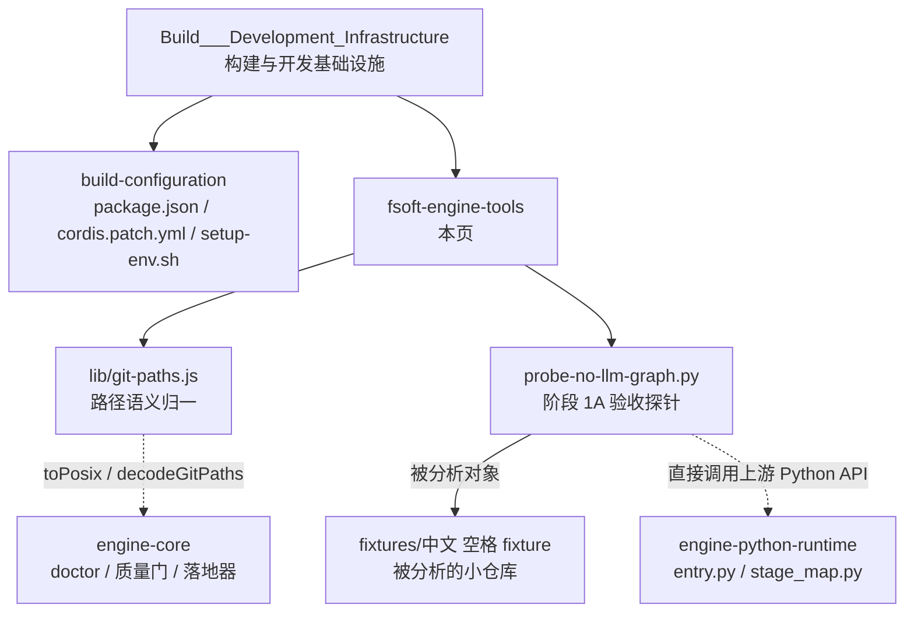
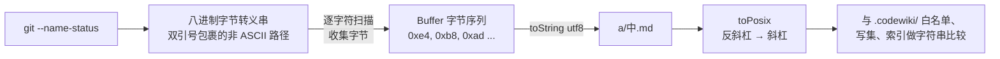
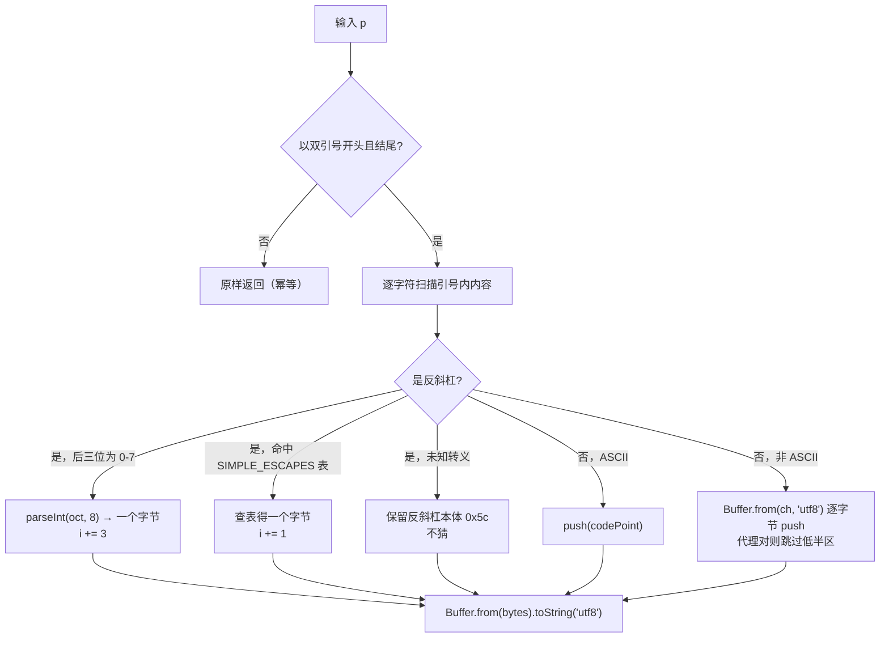
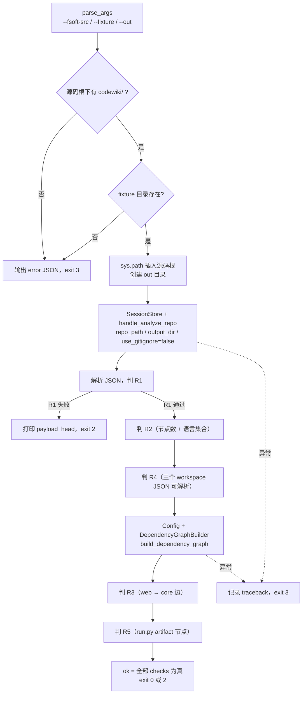
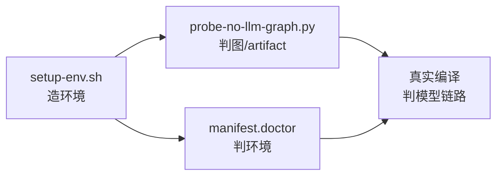
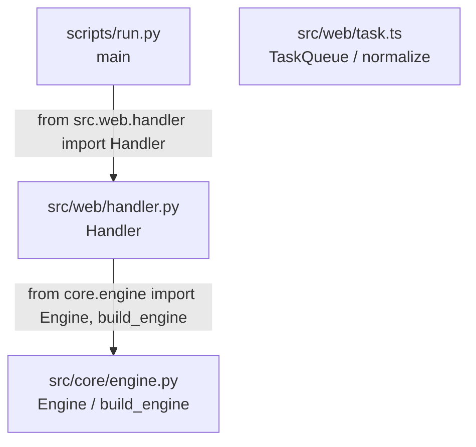
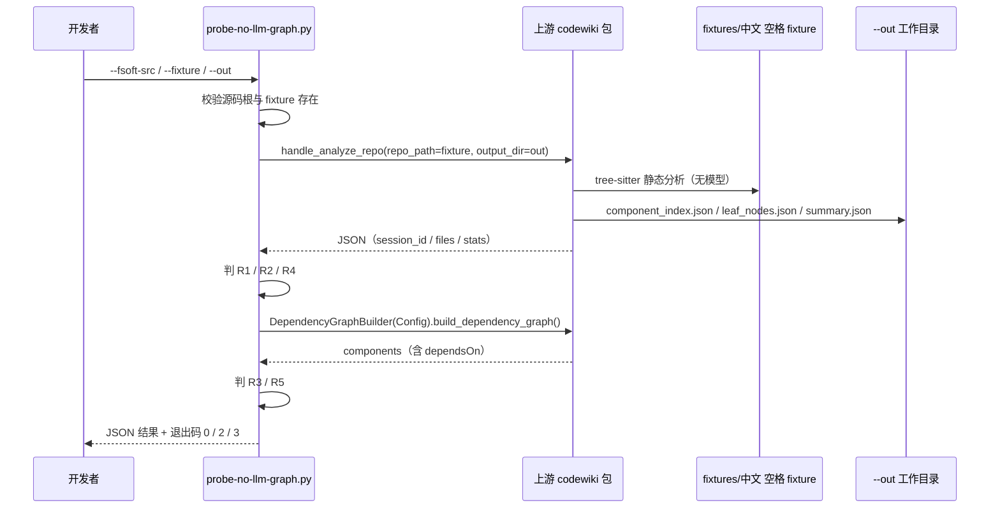

# FSoft 引擎工具链（fsoft-engine-tools）

!!! info "Generated documentation"
    This page was written by CodeWiki from the source code at commit [`d16751f5`](https://github.com/ikliml666/dsh-codewiki/commit/d16751f5dd58ee0741d861266965e322cbe7a60d) on 2026-11-09 with `deepseek-v4.1-flash`. Check the code before relying on details.

本模块是 `dsh-codewiki` 在**构建期与验收期**使用的「引擎工具层」：它不参与一次编译的裁决链，也不写 `.codewiki/` 产物，而是提供两样东西——一套**路径语义归一**的共享工具（`lib/git-paths.js`），和一套**不花模型费**就能验证原生引擎是否跑通的验收资产（`tools/fsoft-engine/probe-no-llm-graph.py` + `tools/fsoft-engine/fixtures/中文 空格 fixture/`）。

它回答的问题是：**「在真正调用模型之前，我能不能确定引擎这一侧是对的？」** 上游 FSoft 引擎的 `handle_analyze_repo` 走 tree-sitter 静态分析，是整条迁移链路里唯一完全无模型的一环，所以先用它把「图 / artifact 链路」跑通，之后模型链路上的故障才能被单独定位，而不是混在「图没出来」里。

---

## 一、在模块树中的位置



两条边值得注意：

- `lib/git-paths.js` 是**被依赖方**：`apply-plan` / `manifest` / `mapping` / `native-state` / `output` / `quality-gate` / `change-set` / `workspace-snapshot` 都从这里取路径归一与转义解码。它属于构建/工具面，但影响的是运行期的每一次路径比较。
- 探针与 fixture 是**被验收方无关**的：它们直接 `import` 上游 `codewiki` 包，不经过插件的引擎适配层（`lib/engine/client.js`），所以探针失败一定不是插件接线的问题。

---

## 二、组件清单

| 组件 | 文件 | 角色 |
| --- | --- | --- |
| `decodeGitPath` | `lib/git-paths.js` | 解开 git 的八进制路径转义（幂等） |
| `decodeGitPaths` | `lib/git-paths.js` | 整份路径清单解码，保序、丢空行 |
| `toPosix` | `lib/git-paths.js` | 反斜杠 → `/` 的唯一实现 |
| `withQuotepathOff` / `GIT_QUOTEPATH_OFF` | `lib/git-paths.js` | 从源头关闭 git 的 quotepath 转义 |
| `main` | `tools/fsoft-engine/probe-no-llm-graph.py` | 无 LLM 的原生依赖图验收，输出 JSON + 退出码 |
| `Engine` | `fixtures/中文 空格 fixture/src/core/engine.py` | fixture 的被依赖方（core 层） |
| `Handler` | `fixtures/中文 空格 fixture/src/web/handler.py` | fixture 的依赖方（web 层），产生 `web → core` 依赖边 |
| `TaskQueue` / `TaskQueue.push` | `fixtures/中文 空格 fixture/src/web/task.ts` | 验证 TS/JS 分析器在中文空格路径下仍能出节点 |
| `main` | `fixtures/中文 空格 fixture/scripts/run.py` | artifact 类入口脚本，验证 artifact 节点被采集 |

---

## 三、`lib/git-paths.js`：把 git 的路径输出铲平

### 3.1 问题：两层落差

git 输出的路径与「同一件事」之间有两层落差，两层都必须处理，而且**各自独立成立**：

1. **`core.quotepath`（默认 `true`）**：非 ASCII 路径在 `--name-only` / `--name-status` 输出里被写成 `"a/\344\270\255.md"`——八进制字节转义 + 双引号包裹。任何按字面量比较路径的代码（白名单、`startsWith('.codewiki/')`）会当场失配。
2. **转义是按字节做的**：一个中文字符是三个 `\NNN`，所以「解开转义」不能逐字符还原，必须把字节重新拼成 `Buffer` 再按 UTF-8 解码。



### 3.2 双保险设计

| 手段 | 作用 | 覆盖的输入 |
| --- | --- | --- |
| `GIT_QUOTEPATH_OFF` = `['-c', 'core.quotepath=false']` | 让**新发起**的 git 调用不再转义（首选，省一次解码） | 本模块自己发起的 git 调用 |
| `withQuotepathOff(args)` | 把上面两个参数前置到参数表，已是关闭状态则不重复加 | 调用方自建参数表 |
| `decodeGitPath(p)` | 兜住**已经被转义**的输入，幂等 | 旧记录、外部传入的清单、调用方自己的 git 调用没带参数 |
| `decodeGitPaths(list)` | 批量版，保序、丢空行 | `ls-files --others` 之类的行流 |

为什么两件都要：**只加参数挡不住已经写进历史记录的清单；只解码则每次都要多绕一层**，而且 `--name-status` 的 `R100` 行按 tab 切分时，引号包裹的路径仍可能带内嵌转义。

### 3.3 `decodeGitPath` 的解码规则



保守性设计：**解不开的一律原样返回**（宁可让上层看到一个陌生的字面量，也不吐出半个路径）；未知转义保留反斜杠本体而不是丢弃。

### 3.4 `toPosix`：唯一实现

```js
export function toPosix(p) {
  return String(p ?? '').replace(/\\/g, '/')
}
```

这个三行函数的存在理由写在源码注释里：`String(p ?? '').replace(/\\/g, '/')` 曾在 `apply-plan` / `manifest` / `mapping` / `native-state` / `output` / `quality-gate` **六个模块里各抄一份**，于是「Windows 反斜杠要不要归一」有六个可能各自跑偏的地方——任何一处漏改，同一条路径在两份报告里就不相等，而比较报告的人只会看到「文件名看起来一样却判不等」。

刻意**不做**的三件事：

| 不做 | 原因 |
| --- | --- |
| `trim()` | 前导/尾随空格在合法文件名里是内容，不是噪声 |
| 去掉 `./` | 会改变调用方显式写出的路径语义 |
| `path.posix.normalize` | 会吃掉 `.` / `..`，而「上跳」是安全判据，必须由调用方显式判定后再动 |

> 与 `lib/change-set.js` 的 `normChangePath()` 是**分工关系**而非重复：`toPosix` 只换分隔符；`normChangePath` 在换分隔符之外还做越界判定（绝对路径、盘符、`..` 上跳一律丢弃），因为它面向的是「可能不可信的 git 输出」。

### 3.5 使用方

| 使用方 | 用途 |
| --- | --- |
| `lib/engine/apply-plan.js` | 写集路径归一、索引收录校验、删除集与写集比对 |
| `lib/engine/manifest.js` | 指纹里的 `engineRoot` 归一 |
| `lib/engine/mapping.js` / `output.js` | 页路径与 `source_files` 归一 |
| `lib/engine/quality-gate.js` | 死链与页集合比较 |
| `lib/engine/native-state.js` | 受管状态文件的相对路径归一 |
| `lib/change-set.js` / `lib/engine/workspace-snapshot.js` | 变更集与快照路径 |

这些运行期细节见 [engine-core 模块概览](../Documentation_Generation_Engine/engine-core.md)、[engine-state-manifest：引擎清单与跨轮受管状态](../Documentation_Generation_Engine/engine-core/engine-state-manifest.md) 与 [engine-orchestration 模块概览](../Documentation_Generation_Engine/engine-core/engine-orchestration.md)，本页不重复。

---

## 四、阶段 1A 验收探针：`probe-no-llm-graph.py`

### 4.1 它验证什么

探针直接调用上游 MCP 工具 `handle_analyze_repo`（以及 `DependencyGraphBuilder`），在**中文 + 空格**的路径下检查依赖图与 artifact 采集是否成立。它**不碰 DSH 插件、不需要模型或凭证**，因此可以在任何 FSoft 源码树上反复重跑。

### 4.2 判据（全部必须为真）

| 判据 | 内容 | 失败的含义 |
| --- | --- | --- |
| `R1_analyze_returned` | 返回非 `error` JSON，含 `session_id` 与 `files` | 上游 MCP 入口不可用 / 参数不兼容 |
| `R2_nodes_and_languages` | 组件数 > 0、叶子节点数 > 0，语言集合同时含 python 与 typescript | 分析器在该路径下没出节点 |
| `R3_dependency_edge` | 存在 `web → core` 方向的依赖边（`handler` 的 `dependsOn` 含 `engine`） | 依赖图建了但边没建出 |
| `R4_workspace_files` | `component_index.json` / `leaf_nodes.json` / `summary.json` 真实存在且可解析 | 落盘产物缺失或损坏 |
| `R5_artifact_node` | 组件里有 `run.py` 相关节点 | artifact 类文件未被采集 |

R3 做了**两级判定**：先扫一遍全部 `dependsOn`（`dependsOn` 与 `depends_on` 两种命名都接受，因为上游属性命名不保证），再看 `handler` 组件自身是否声明了 `core` 依赖作为兜底。

### 4.3 执行流程



注意 `Config` 里 `llm_base_url` / `llm_api_key` / `main_model` / `cluster_model` 都填了 `not-needed` / `unused` 这类占位值——这是「无模型」这一判据的**可读证据**：这条链路根本不读它们。

### 4.4 用法与退出码

```sh
python tools/fsoft-engine/probe-no-llm-graph.py \
    --fsoft-src <FSoft 仓库根，含 codewiki/ 包> \
    --fixture <被测小仓库> \
    --out <工作目录>
```

| 退出码 | 含义 |
| --- | --- |
| `0` | 五条判据全过 |
| `2` | 判据未过（JSON 里逐条写明哪条为 `false`） |
| `3` | 前置条件不满足或抛异常（`--fsoft-src` 下无 `codewiki/`、fixture 不存在、运行期异常） |

参数默认值：`--fixture` 缺省指向仓库内 `fixtures/中文 空格 fixture`，`--out` 缺省 `tools/fsoft-engine/out-1a`。`out` 目录会被创建，其中的 `temp/dependency_graphs/` 是上游自己建的图缓存位置。

stdout 只输出一份 JSON（`ensure_ascii=False`，所以中文路径可读），包含 `checks`、`stats`、`workspace_files`、`edge_sample`（前 20 条边）、`edge_count`、`artifact_ids`；失败时附 `exception`（完整 traceback）或 `payload_head`（前 2000 字符原始返回）。

### 4.5 与其它验证手段的关系



`setup-env.sh` 负责「造环境」，`doctor` 负责「判环境」，探针负责「判图」。三者都不消耗模型额度，因此可以在改动引擎侧代码后按此顺序快速回归。环境构建脚本本身的流程见 [构建与配置（build-configuration）](build-configuration.md)，`doctor` 的指纹与锁语义见 [engine-state-manifest：引擎清单与跨轮受管状态](../Documentation_Generation_Engine/engine-core/engine-state-manifest.md)。

---

## 五、fixture：`fixtures/中文 空格 fixture`

### 5.1 目录意图

fixture 的**路径本身**就是被测对象：目录名含中文与空格。它要证明的不是「引擎能分析 Python」，而是「引擎在 Windows 上、在非 ASCII 且带空格的路径下，仍能出节点、建边、采 artifact」。

| 文件 | 提供的证据 |
| --- | --- |
| `src/core/engine.py` | `Engine` 类 + `build_engine()` 工厂；依赖图的**被依赖端** |
| `src/web/handler.py` | `Handler` 通过 `from core.engine import Engine, build_engine` 依赖 core；R3 的**依赖端** |
| `src/web/task.ts` | TS 分析器样本（`TaskQueue` / `normalize`）；R2 的 typescript 语言来源 |
| `scripts/run.py` | 可执行入口脚本；R5 的 artifact 节点来源 |

### 5.2 依赖关系



`handler.py` 里有一行 `sys.path.insert(0, str(Path(__file__).resolve().parents[1]))`：因为 `src/` 下没有 `__init__.py`，它把 `src/` 塞进搜索路径才能 `from core.engine import ...`。上游分析器把这条 import 解析成 `web → core` 的依赖边，正是 R3 检查的对象。

### 5.3 一处需要留意的写法

`src/web/task.ts` 首行是 Python 风格的三引号文档串（`"""TypeScript fixture：..."""`），并非合法 TypeScript。tree-sitter 以错误恢复方式仍能从该文件产出节点（因此 R2 的 typescript 判据依然成立），但这也意味着**探针不校验 fixture 自身的语法合法性**——它是「节点是否被采集」的验收，不是「分析器语法正确性」的验收。修改 fixture 时不要误以为它经过了语法检查。

---

## 六、端到端数据流



这条链路**不经过** `lib/engine/client.js`、不经过 `entry.py`、不写 `.codewiki/`。因此它通过之后，插件侧如果仍然失败，问题范围就落在「进程/协议/模型/落地」而不是「引擎算不算得出图」。协议与进程层见 [engine-runner：原生引擎执行与裁决编排](../Documentation_Generation_Engine/engine-core/engine-orchestration/engine-runner.md)，Python 入口见 [engine-python-runtime：FSoft 原生引擎的 Python 侧运行时](../Execution_Runtime___Vendored_Engine/engine-python-runtime.md)。

---

## 七、边界与已知限制

| 限制 | 说明 |
| --- | --- |
| 探针不覆盖模型链路 | `R1`–`R5` 全部是静态分析判据；模型链路要靠真实编译与质量门验证（见 [文章流水线（article-pipeline）](../Documentation_Generation_Engine/article-pipeline.md)） |
| 探针依赖上游内部模块路径 | `codewiki.mcp.tools.analysis`、`codewiki.src.be.dependency_analyzer`、`codewiki.src.config` 都是上游内部路径；升级 `UPSTREAM_COMMIT` 后探针本身也需要复核 |
| `--fsoft-src` 需含 `codewiki/` 包 | 探针显式检查，缺失时直接 `exit 3`（与 `setup-env.sh` 的同一检查一致） |
| `toPosix` 不做安全判定 | 越界路径的拒绝在 `normChangePath` 与落地器的写集校验里，不在本模块 |
| `decodeGitPath` 对未知转义保守 | 保留反斜杠本体而非报错；遇到陌生输出时表现为「路径看起来带反斜杠」，需要回到原始输出排查 |

---

## 八、相关模块

| 主题 | 页面 |
| --- | --- |
| 包清单、bundle 补丁、`setup-env.sh` 环境构建 | [构建与配置（build-configuration）](build-configuration.md) |
| 引擎核心（doctor / 质量门 / 落地器） | [engine-core 模块概览](../Documentation_Generation_Engine/engine-core.md) |
| 一次编译的裁决链与增量决议 | [engine-orchestration 模块概览](../Documentation_Generation_Engine/engine-core/engine-orchestration.md) |
| 引擎锁、指纹与受管状态 | [engine-state-manifest：引擎清单与跨轮受管状态](../Documentation_Generation_Engine/engine-core/engine-state-manifest.md) |
| Python 入口、阶段映射、树覆盖补齐 | [engine-python-runtime：FSoft 原生引擎的 Python 侧运行时](../Execution_Runtime___Vendored_Engine/engine-python-runtime.md) |
| `cw` 的 vendored 源码与索引规则 | [codewiki-vendor（仓库内 vendored `cw` CLI）](../Execution_Runtime___Vendored_Engine/codewiki-vendor.md) |
| 文章契约闸门与变更采集 | [文章流水线（article-pipeline）](../Documentation_Generation_Engine/article-pipeline.md) |
| 任务队列、排队与自动调度 | [作业编排与状态管理（Job Orchestration & State Management）](../Job_Orchestration___State_Management.md) |

??? abstract "Documented components (7)"
    - [`decodeGitPath`](https://github.com/ikliml666/dsh-codewiki/blob/d16751f5dd58ee0741d861266965e322cbe7a60d/lib%5Cgit-paths.js) — `lib\git-paths.js`
    - [`main`](https://github.com/ikliml666/dsh-codewiki/blob/d16751f5dd58ee0741d861266965e322cbe7a60d/tools%5Cfsoft-engine%5Cfixtures%5C%E4%B8%AD%E6%96%87%20%E7%A9%BA%E6%A0%BC%20fixture%5Cscripts%5Crun.py) — `tools\fsoft-engine\fixtures\中文 空格 fixture\scripts\run.py`
    - [`Engine`](https://github.com/ikliml666/dsh-codewiki/blob/d16751f5dd58ee0741d861266965e322cbe7a60d/tools%5Cfsoft-engine%5Cfixtures%5C%E4%B8%AD%E6%96%87%20%E7%A9%BA%E6%A0%BC%20fixture%5Csrc%5Ccore%5Cengine.py) — `tools\fsoft-engine\fixtures\中文 空格 fixture\src\core\engine.py`
    - [`Handler`](https://github.com/ikliml666/dsh-codewiki/blob/d16751f5dd58ee0741d861266965e322cbe7a60d/tools%5Cfsoft-engine%5Cfixtures%5C%E4%B8%AD%E6%96%87%20%E7%A9%BA%E6%A0%BC%20fixture%5Csrc%5Cweb%5Chandler.py) — `tools\fsoft-engine\fixtures\中文 空格 fixture\src\web\handler.py`
    - [`TaskQueue`](https://github.com/ikliml666/dsh-codewiki/blob/d16751f5dd58ee0741d861266965e322cbe7a60d/tools%5Cfsoft-engine%5Cfixtures%5C%E4%B8%AD%E6%96%87%20%E7%A9%BA%E6%A0%BC%20fixture%5Csrc%5Cweb%5Ctask.ts) — `tools\fsoft-engine\fixtures\中文 空格 fixture\src\web\task.ts`
    - [`TaskQueue.push`](https://github.com/ikliml666/dsh-codewiki/blob/d16751f5dd58ee0741d861266965e322cbe7a60d/tools%5Cfsoft-engine%5Cfixtures%5C%E4%B8%AD%E6%96%87%20%E7%A9%BA%E6%A0%BC%20fixture%5Csrc%5Cweb%5Ctask.ts) — `tools\fsoft-engine\fixtures\中文 空格 fixture\src\web\task.ts`
    - [`main`](https://github.com/ikliml666/dsh-codewiki/blob/d16751f5dd58ee0741d861266965e322cbe7a60d/tools%5Cfsoft-engine%5Cprobe-no-llm-graph.py) — `tools\fsoft-engine\probe-no-llm-graph.py`

