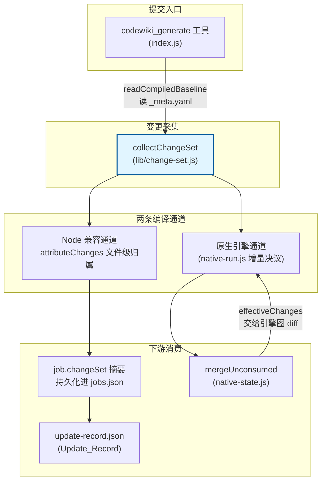
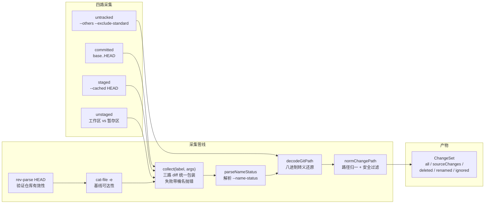
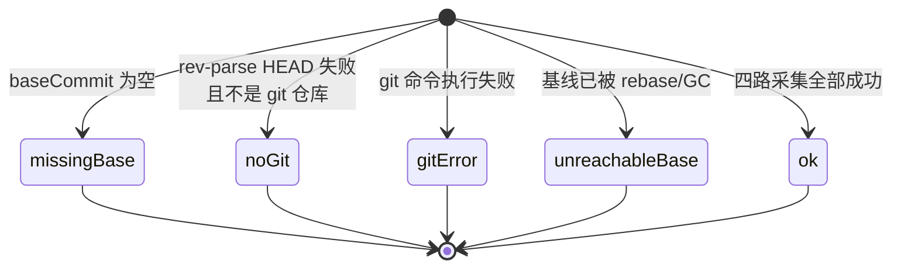
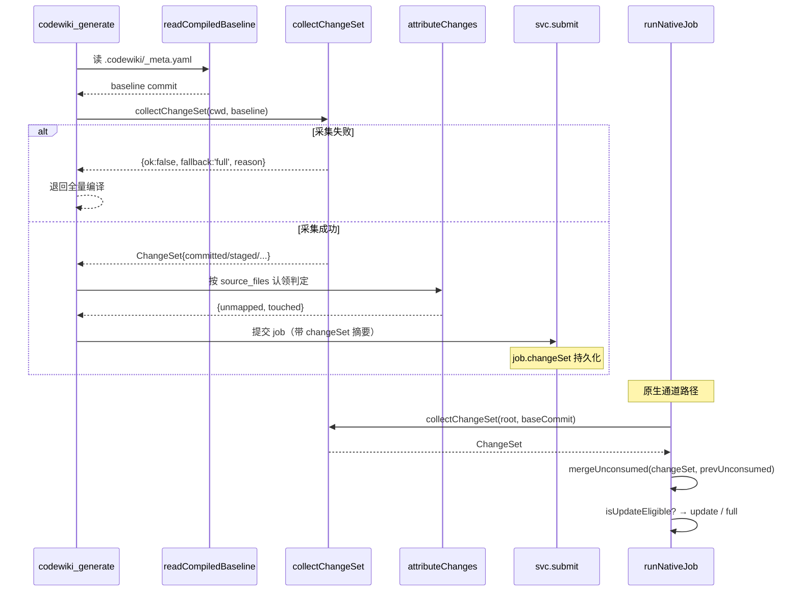
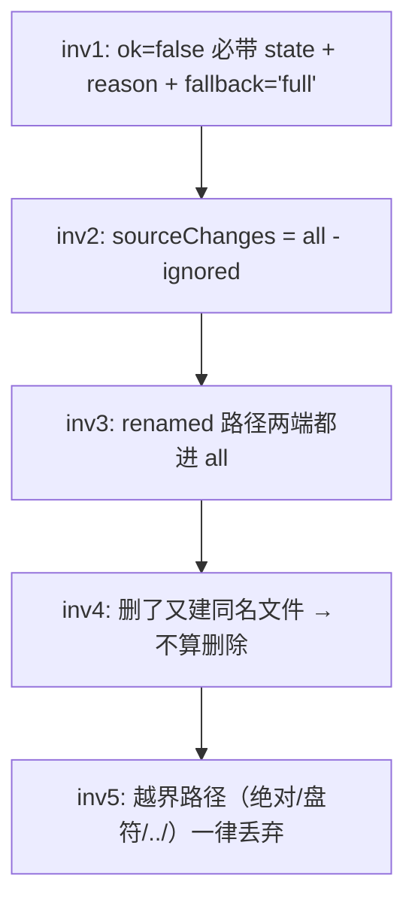

# Change_Set 变更集采集模块

!!! info "Generated documentation"
    This page was written by CodeWiki from the source code at commit [`df743bda`](https://github.com/ikliml666/dsh-codewiki/commit/df743bda12b693793139b00990016d9a63536736) on 2026-11-07 with `doubao-seed-2.1-lite`. Check the code before relying on details.

## 简介

`Change_Set`（[lib/change-set.js](lib/change-set.js)）是 dsh-codewiki 插件的**变更采集底座**。它把一次编译「应该看见」的全部 git 改动——已提交、已暂存、未暂存、未跟踪——四路合一，收成一个规范化、可序列化的 `ChangeSet` 对象，并在「采不全」时**明确暴露降级信号**（`state` + `fallback='full'`），让调用方退回全量编译，而不是假装工作区干净。

它要修的是一类审计确认的缺陷：旧 `cw status` 只跑 `git diff <last_compiled_commit>..HEAD`，于是「改完代码还没提交」「只 `git add` 没 commit」「新建文件未跟踪」三类改动对它完全隐形——「改完代码就编译」会把未消化的变化当成已消化，文章与源码脱节却一路绿到底。

## 在系统中的位置

## 核心职责

`Change_Set` 的职责只有一件事：**把四路 git 改动收成一个可信的 ChangeSet**。它不做归属判定、不做增量规划、不做终态裁决——那些是 [Job Orchestration（编译任务编排服务）](Job_Orchestration.md) 的 `attributeChanges` 与 [Engine_Native_State（原生引擎跨轮受管状态）](Engine_Native_State.md) 的事。

## 导出组件

### `collectChangeSet(cwd, baseCommit, opts)`

模块唯一的主入口。输入仓库工作目录与上次成功编译的基线 commit（来自 `.codewiki/_meta.yaml:last_compiled_commit`），返回 `ChangeSet`。

**注入式执行器**：`opts.execFile(cmd, args)` 可替换真实 git 调用，离线单测给假执行器；默认实现用 `execFileSync`（16MB 输出上限）。

**内部包装 `collect(label, args)`**：三路 `git diff --name-status -M`（committed / staged / unstaged）统一经过这个闭包——先跑 git 再喂 `parseNameStatus`，任何一路抛错都带上桶名重新抛出（如 `staged 采集失败：...`），统一被外层接住降级为 `state='git-error'`。

**返回结构**（成功路径）：

| 字段 | 类型 | 含义 |
|------|------|------|
| `version` | `1` | ChangeSet 结构版本（`CHANGE_SET_VERSION`） |
| `ok` | `true` | 采集成功 |
| `state` | `'ok'` | 状态码 |
| `baseCommit` / `headCommit` | `string` | 本次采集的基线与当前 HEAD |
| `committed` | `Entry[]` | `base..HEAD` 的改动（已过滤 wiki 产物） |
| `staged` | `Entry[]` | 暂存区改动 |
| `unstaged` | `Entry[]` | 工作区未暂存改动 |
| `untracked` | `string[]` | 未跟踪文件 |
| `deleted` | `string[]` | 删除路径集合（去重后） |
| `renamed` | `{from, path, bucket}[]` | 改名记录（含来源路径） |
| `all` | `string[]` | 全量路径并集（含改名两端，排序） |
| `sourceChanges` | `string[]` | `all` 中排除 `.codewiki/` 的部分——真正的源码变更 |
| `ignored` | `string[]` | `all` 中被判为 wiki 产物的路径 |

### 降级状态机（`ok=false`）

任何一路失败都**绝不**返回「空 ChangeSet」冒充 clean，而是显式降级：

每种降级都带 `fallback='full'` 与人类可读 `reason`，调用方据此退回全量编译。

### `parseNameStatus(out)`

解析 `git diff --name-status -M` 的输出。`R`（改名）/`C`（复制）两列路径都过 `decodeGitPath` 与 `normChangePath`；`D` 记删除，其余记修改。导出供单测直接钉住解析行为。

### `normChangePath(p)`

路径归一与安全过滤：

- 反斜杠统一成 `/`（Windows 兼容）
- 去掉 `./` 前缀
- **丢弃**绝对路径、盘符路径（`C:`）、`../` 越界路径——它们不该出现在变更集里

### `isWikiProduct(relPath)`

判据：路径等于 `.codewiki` 或以 `.codewiki/` 开头。wiki 产物每次编译都会被重写，把它算成源码变更会让增量永远 dirty、「未映射变更」永远无法清零。README/CHANGELOG/CodeWiki.md 这类被文章 `source_files` 引用的文档不在此列。

## 关键设计决策

### 1. 为什么必须四路合一，而不是只跑 committed？

旧 `cw status` 的盲区直接导致「基线前移后未提交改动永久失明」。原生通道（[Engine_Native_Run（原生编译裁决编排层）](Engine_Native_Run.md)）的注释明确写道：

> cw status 只看 committed，工作区未提交变化与「受管状态缺失」它一概看不见，直接短路会让这些变化永远进不了引擎（丢变化）。

### 2. 为什么要开 `-M` 改名检测？

不开的话，一次 `git mv a.js b.js` 会被拆成「删 a.js + 加 b.js」两路。下游 planner 就看不出「同一份内容换了位置」，会把改名源路径算成 unmapped（无文章认领），无意义地退回全量。

### 3. 为什么「删了又新建同名文件」不算删除？

代码里专门处理：`deletedSet` 中的路径若同时出现在 `untracked` 里，就从删除集合移除——否则 planner 会为一篇还在的文件安排 delete action。

### 4. 为什么 wiki 产物要单独过滤？

`.codewiki/` 是编译自己的产物。基线落在产物提交**之前**（提交内容里写着 `last_compiled_commit`，无法自指），于是 `git diff 基线..HEAD` 永远会把整批 `.codewiki/` 算成变更。不过滤的话，编译刚跑完工作区明明是干净的，面板上还是「有变更」。

### 5. 为什么依赖注入 execFile？

真实链路用 `execFileSync` 同步阻塞；单测给假执行器喂固定字符串，就能钉住 `parseNameStatus` 与降级分支，不必真的 spawn git。

## 与其它模块的协作

### 上游：基线从哪来？

- Node 兼容通道：`readCompiledBaseline(wikiPath)` 从 `.codewiki/_meta.yaml` 的 `last_compiled_commit` 字段读出（[Job Orchestration（编译任务编排服务）](Job_Orchestration.md)）。
- 原生通道：`readCommittedBaseline`（[Engine_Quality_Gate（原生引擎产物采用门）](Engine_Quality_Gate.md)）从同一文件读取，但额外校验基线是否已进 HEAD——未提交的 wiki 产物不算基线。

### 下游：ChangeSet 被谁消费？

1. **[Job Orchestration（编译任务编排服务）](Job_Orchestration.md)**（`index.js`）：
   - `runStaleUpdate()`：拿到 ChangeSet 后喂给 `attributeChanges(changeSet, articles)`，按每篇文章 frontmatter 的 `source_files` 做文件级归属。`unmapped`（无文章认领的源码变更）非空时**拒绝推进基线**。
   - 第二条调用路径：`status.state === 'stale'` 但 `staleArticles` 为空且 `changedFiles` 非空时，补一次归属判定。
   - `submit()` 把 ChangeSet 的关键字段（version/state/baseCommit/各桶路径）摘要进 `job.changeSet`，持久化到 `jobs.json`。

2. **[Engine_Native_Run（原生编译裁决编排层）](Engine_Native_Run.md)**（`lib/engine/native-run.js` 1.5 段）：
   - 增量决议的第一步：`changeSetImpl(root, baseCommit)`。
   - `changeSet.ok=false` → `fallbackReason = '变化集不可信'` → resolution=full。
   - `changeSet.ok=true` → 继续走 `isUpdateEligible`（受管状态齐全？）决定 update 还是 full。

3. **[Engine_Native_State（原生引擎跨轮受管状态）](Engine_Native_State.md)**（`lib/engine/native-state.js`）：
   - `mergeUnconsumed({changeSet, prevUnconsumed})`：把本轮 staged/unstaged/untracked 并入上一轮遗留的 `unconsumed` 清单，算出 `effectiveChanges`——这是「未提交改动被引擎读进产物、但基线停在 HEAD」那类账的闭环。

4. **[Update_Record（编译更新记录）](Update_Record.md)**（`lib/update-record.js`）：
   - `buildUpdateRecord({changeSet, ...})` 把 ChangeSet 的 state、ok、fallback、各桶计数、`sourceChanges`、`ignored` 摘要进 `temp/update-record.json`，供事后复盘「这一轮看见了什么变化」。

### 横向依赖：[Job_Logs](Job_Logs.md) 的 git-paths

`decodeGitPath` / `decodeGitPaths` 来自 [Job_Logs](Job_Logs.md) 模块的 `lib/git-paths.js`。git 默认 `core.quotepath=true`，会把非 ASCII 路径输出成 `"a/\344\270\255.md"`（八进制字节转义 + 双引号）。不还原的话 `isWikiProduct` 匹配不上 `.codewiki/`，中文名的 wiki 产物会被当成源码变更塞进 `sourceChanges`——增量 planner 每轮都以为产物是新源码。

## 数据不变量

- **inv1**：不许把「采不到」当「没变化」。这是整个模块存在的理由。
- **inv2**：`ignored` 是 `all` 的真子集，`sourceChanges` 是补集。下游只读 `sourceChanges` 做归属。
- **inv3**：改名的旧路径从「被谁引用」角度同样是变化，必须进 `all`。
- **inv4**：见上文「删了又新建同名文件」处理。
- **inv5**：安全边界，防止路径穿越。

## 配置与构建

本模块不读插件配置（`Config` schema 在 [Job Orchestration（编译任务编排服务）](Job_Orchestration.md) 的 `index.js` 顶部）。它只依赖：

- `node:child_process` 的 `execFileSync`（Node >= 24.9.0，见 [Package_Manifest 包清单](Package_Manifest.md) 的 `engines.node`）
- `./git-paths.js` 的两个解码函数

打包形式见 [Package_Manifest 包清单](Package_Manifest.md) 的 `package.json`：`"type": "module"`，纯 ESM，无外部依赖（唯一依赖 `@deepseek-ai/schemastery` 在编排层）。

??? abstract "Documented components (1)"
    - [`collect`](https://github.com/ikliml666/dsh-codewiki/blob/df743bda12b693793139b00990016d9a63536736/lib%5Cchange-set.js) — `lib\change-set.js`

