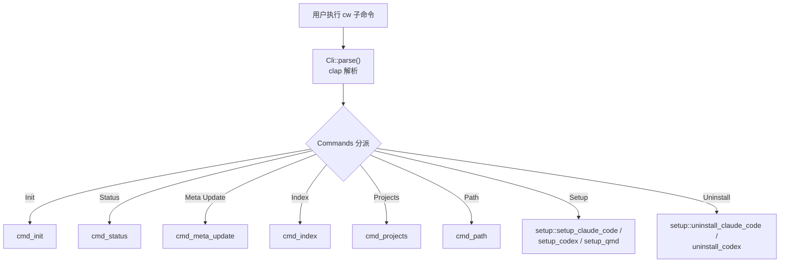
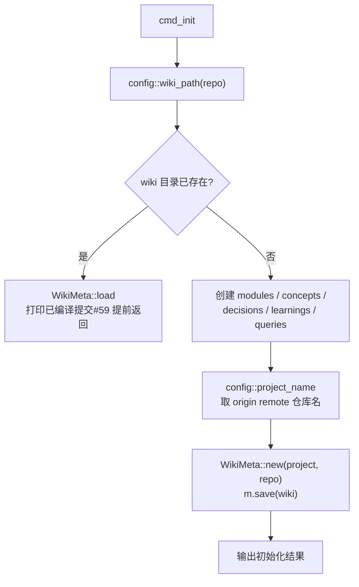
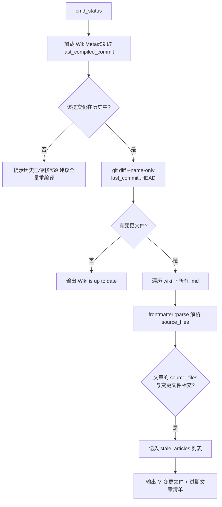
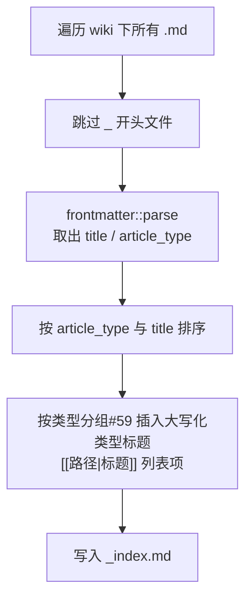
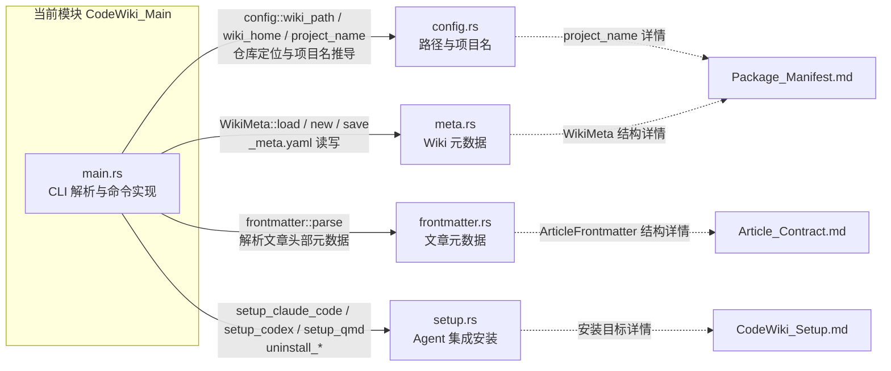
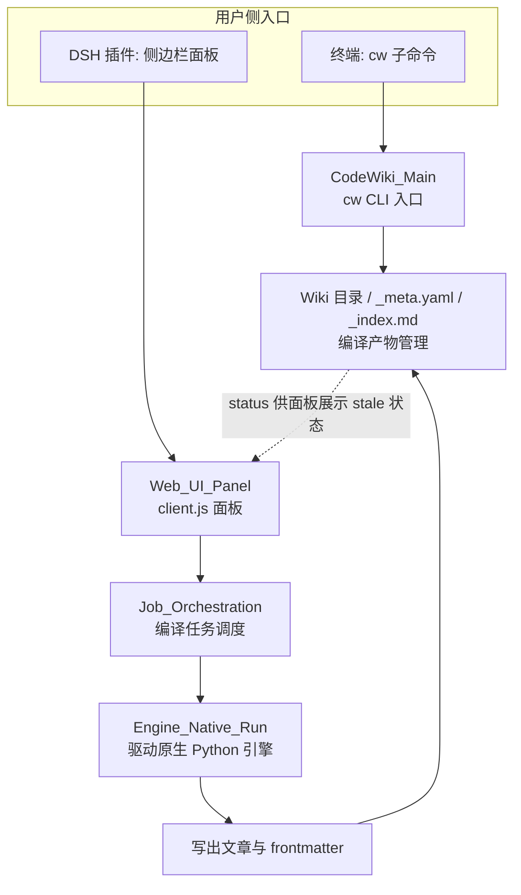

# CodeWiki 主入口（cw CLI）

!!! info "Generated documentation"
    This page was written by CodeWiki from the source code at commit [`2533fb69`](https://github.com/ikliml666/dsh-codewiki/commit/2533fb6946992ba6bf0d8498ebc395c8a01900e2) on 2026-11-06 with `doubao-seed-2.1-lite`. Check the code before relying on details.

## 简介

`CodeWiki_Main` 是 `cw` 命令行工具的 Rust 入口层，位于 `vendor/codewiki/src/main.rs`。它基于 [clap](https://docs.rs/clap) 构建命令解析框架，负责把用户键入的 `cw` 子命令路由到对应的实现函数，并完成各子命令的核心逻辑：初始化仓库 Wiki、检查编译后源码的变动、更新编译元数据、重建索引、列出全部 Wiki 项目、输出当前仓库的 Wiki 路径，以及把 codewiki 集成安装到外部 Agent 或工具（Claude Code、Codex、QMD）。

该模块本身不负责 Wiki 的**编译**过程（编译由 Node 侧的 [Job Orchestration（编译任务编排服务）](Job_Orchestration.md) 与原生引擎 Engine_Native_Run 完成），它管理的是编译产物（Wiki 目录、`_meta.yaml`、`_index.md`、各篇文章）的生命周期与可观测状态。整体插件的定位见 `package.json`：`@local/dsh-codewiki`，即「cw CLI + 全仓库 Wiki 编译流水线 + 侧边栏面板」。

## CLI 命令结构

`Cli` 结构是 clap 的顶层解析器，程序名为 `cw`；`Commands` 枚举声明了全部子命令，`main` 函数依据解析结果分派到 `cmd_*` 实现或 `setup` 模块。

| 子命令 | 实现函数 | 作用 |
| --- | --- | --- |
| `cw init` | `cmd_init` | 在当前仓库下初始化 Wiki 目录与 `_meta.yaml` |
| `cw status` | `cmd_status` | 对比上次编译提交，列出变更文件与过期文章 |
| `cw meta update` | `cmd_meta_update` | 把当前 HEAD 写回 `_meta.yaml` 的编译记录 |
| `cw index` | `cmd_index` | 依据文章 frontmatter 重建 `_index.md` |
| `cw projects` | `cmd_projects` | 列出全局 Wiki 根目录下的所有项目 |
| `cw path` | `cmd_path` | 打印当前仓库对应的 Wiki 存储路径 |
| `cw setup <target>` | `setup::setup_*` | 安装到 Claude Code / Codex / QMD |
| `cw uninstall <target>` | `setup::uninstall_*` | 从 Claude Code / Codex 移除集成 |

## 命令执行流程

### 1. `cw init`：初始化 Wiki

`cmd_init` 从当前工作目录定位仓库路径，经 `config::wiki_path` 算出 Wiki 存储目录。若目录已存在，则加载 [WikiMeta](Package_Manifest.md) 并打印上次编译提交（截取前 7 位）后直接返回，保证幂等；不存在时创建固定的五个子目录：

### 2. `cw status`：增量变动检查

`cmd_status` 是评估「是否需要重新编译」的关键只读命令，其结论直接驱动上层的增量编译决策：

注意两点细节：

- 提交不存在（例如分支 rebase 后历史漂移）时，`status` 只输出提示，不做任何写入；
- 过期文章的判定完全依赖文章 frontmatter 中的 `source_files` 字段，这与 [Article_Contract（文章契约闸门）](Article_Contract.md) 定义的文章契约保持一致。

### 3. `cw meta update`：回写编译元数据

编译流水线在完成一轮写入后调用该命令，把当前 HEAD 提交与 UTC 时间戳写入 `_meta.yaml`，使下一轮 `status` 可以以这次提交为基准做 diff。若 Wiki 不存在则直接报错退出。

### 4. `cw index`：重建索引文件

`cmd_index` 扫描 Wiki 下全部 `.md` 文件（跳过以下划线 `_` 开头的文件，如 `_index.md` 自身），解析每篇文章的 `title` 与 `article_type`，按「类型 → 标题」排序后生成分组式的 `_index.md`：

其中 `capitalize` 是本模块提供的本地工具函数，把文章类型字符串的首字母大写（例如 `module` → `Module`）作为分组标题。

### 5. `cw projects` 与 `cw path`：项目发现

- `cmd_projects` 读取全局 Wiki 根目录（`config::wiki_home`），逐个加载含 `_meta.yaml` 的子目录，按项目名排序并打印「项目名 - 仓库路径 - 编译状态」；
- `cmd_path` 仅打印当前仓库对应的 Wiki 绝对路径，通常被脚本或其他工具（如索引器）消费。

## 与模块内部组件的协作关系

`main.rs` 在文件顶部声明了四个本地模块（`mod config; mod frontmatter; mod meta; mod setup;`），它们与当前模块的职责切分如下：

`rel_path_string` 是本模块内置的 Windows 路径兼容补丁：Rust 的 `Path::display` 在 Windows 上会输出反斜杠，而文章路径（frontmatter 的 `source_files`、插件解析逻辑）在全平台统一使用 `/` 分隔，因此该函数把 `\` 全部替换为 `/`，用于过期文章列表与 `_index.md` 链接，避免跨平台污染。

## 在整体系统中的位置

`cw` CLI 是本仓库（`@local/dsh-codewiki`）的用户侧入口之一，另一个入口是 DeepSeek Harness 的插件运行时（见 `package.json` 中 `"dsh"` 配置与 [Cordis_Patch_Config（插件装配配置）](Cordis_Patch_Config.md)）。两者关系如下：

- **编译产物的读写方**：[Job Orchestration（编译任务编排服务）](Job_Orchestration.md) 与各 Engine 模块负责生成文章、frontmatter 与 `_meta.yaml`，本模块负责对这些产物做初始化、状态查询与索引重建；
- **面板消费方**：[Web_UI_Panel](Web_UI_Panel.md) 展示的仓库与会话视图，依赖本模块定义的 Wiki 目录结构与 `_meta.yaml` 约定；
- **Agent 集成安装**：`cw setup` 系列命令把 codewiki 的 skill / 指令写入 Claude Code、Codex 或 QMD，安装细节见 [CodeWiki 安装配置（CodeWiki_Setup）](CodeWiki_Setup.md)。

## 错误处理与返回约定

全部 `cmd_*` 函数与 `main` 均返回 `anyhow::Result<()>`：

- Wiki 尚未初始化时：`status` 仅打印提示并正常返回，`meta update` 则 `anyhow::bail!` 报错；
- `git` 调用失败（如不在仓库内、无 remote）时：`config::project_name` 回退到使用目录名作为项目名；
- 文章解析失败的条目被静默跳过（`filter_map(|e| e.ok())` 与 `if let Ok(...)`），保证单个坏文件不阻断 `status` / `index` 的整体执行。

??? abstract "Documented components (3)"
    - [`Cli`](https://github.com/ikliml666/dsh-codewiki/blob/2533fb6946992ba6bf0d8498ebc395c8a01900e2/vendor%5Ccodewiki%5Csrc%5Cmain.rs) — `vendor\codewiki\src\main.rs`
    - [`capitalize`](https://github.com/ikliml666/dsh-codewiki/blob/2533fb6946992ba6bf0d8498ebc395c8a01900e2/vendor%5Ccodewiki%5Csrc%5Cmain.rs) — `vendor\codewiki\src\main.rs`
    - [`main`](https://github.com/ikliml666/dsh-codewiki/blob/2533fb6946992ba6bf0d8498ebc395c8a01900e2/vendor%5Ccodewiki%5Csrc%5Cmain.rs) — `vendor\codewiki\src\main.rs`

