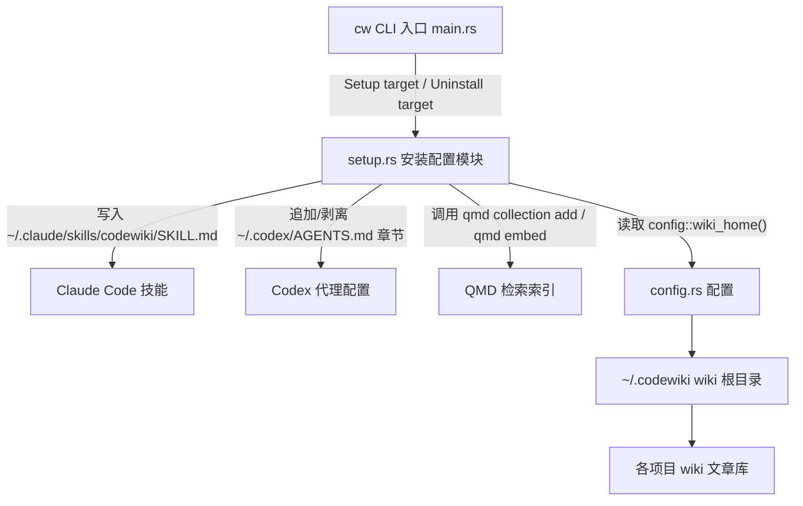
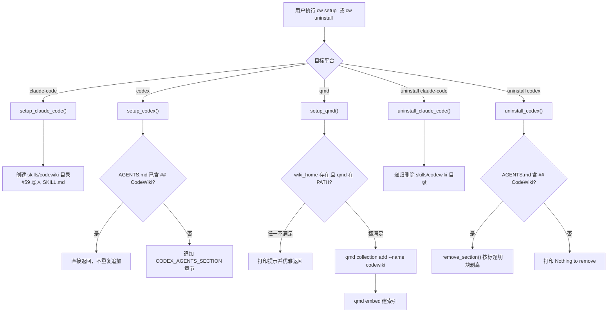

# CodeWiki 安装配置（CodeWiki_Setup）

!!! info "Generated documentation"
    This page was written by CodeWiki from the source code at commit [`70bf6404`](https://github.com/ikliml666/dsh-codewiki/commit/70bf6404241bf06b48f7d49b81a98c3ce74d2f90) on 2026-11-06 with `doubao-seed-2.1-lite`. Check the code before relying on details.

## 简介

`CodeWiki_Setup` 是 Rust 版 `cw` CLI（详见 [CodeWiki 主入口（cw CLI）](CodeWiki_Main.md)）中的安装配置模块，源码位于 `vendor/codewiki/src/setup.rs`。它负责把 CodeWiki 的“会话规约”接入到外部代理工具与检索工具中，使这些工具能够在编码会话开始时自动检查 wiki 新鲜度、在工作结束前自动更新 wiki 文章。

模块的核心动作是两种：

- **安装（setup）**：把嵌入编译产物的规约文本写入 Claude Code、Codex 或 QMD 的对应位置。
- **卸载（uninstall）**：从这些位置移除 CodeWiki 写入的内容，且不破坏用户已有的其他配置。

被安装的规约内容有两份，都在编译期通过 `include_str!` 嵌入二进制：

- `SKILL_MD`：来自 `vendor/codewiki/skills/codewiki-session.md` 的完整会话技能文件。
- `CODEX_AGENTS_SECTION`：面向 Codex `AGENTS.md` 的精简章节（会话开始/结束强制检查、文章格式与规则）。

## 在系统中的位置

`setup.rs` 本身不参与 wiki 内容的生成（文章生成由 Node.js 侧的流水线负责，参见 [Job Orchestration（编译任务编排服务）](Job_Orchestration.md)），它只负责“把规约注入工具链”这一前置环节。其上下游关系如下：

## 核心组件

### 路径助手

| 函数 | 作用 |
|------|------|
| `claude_home()` | 返回 `~/.claude`；主目录不可用时回退到当前目录 `.` |
| `codex_home()` | 返回 `~/.codex`；回退策略同上 |

`claude_home()` 是模块导出的核心组件之一，`setup_claude_code()` 与 `uninstall_claude_code()` 都复用它来定位 Claude Code 的配置目录，保证安装路径与卸载路径严格一致。

### 安装函数

| 函数 | 目标 | 写入位置 | 幂等性 |
|------|------|----------|--------|
| `setup_claude_code()` | Claude Code | `~/.claude/skills/codewiki/SKILL.md` | 已存在时覆盖更新并打印提示 |
| `setup_codex()` | Codex | `~/.codex/AGENTS.md`（追加章节） | 通过检测 `## CodeWiki` 标题避免重复追加 |
| `setup_qmd()` | QMD | 外部命令 `qmd collection add --name codewiki`，再执行 `qmd embed` | 对 “already exists” 类错误视为已配置 |

### 卸载函数

| 函数 | 目标 | 行为 |
|------|------|------|
| `uninstall_claude_code()` | Claude Code | 递归删除 `~/.claude/skills/codewiki/` 整个技能目录 |
| `uninstall_codex()` | Codex | 从 `AGENTS.md` 中剥离 CodeWiki 章节，保留其余内容 |

## 安装与卸载流程

## 关键设计点

### 1. 编译期嵌入的规约内容

`SKILL_MD` 通过 `include_str!("../skills/codewiki-session.md")` 在编译时内联进二进制，因此 `cw` 单文件分发后无需再携带技能文件。技能文件本身定义了会话全流程规约（会话开始 `cw status`、全文编译的五步法、每完成一个任务立即更新文章、会话结束 `cw index`），其完整内容见仓库文件 `vendor/codewiki/skills/codewiki-session.md`。

### 2. 幂等与非破坏性

- `setup_codex()` 以 `## CodeWiki` 标题作为存在性判据，重复执行不会造成内容重复叠加。
- `uninstall_codex()` 使用私有函数 `remove_section()` 按行扫描：遇到目标标题行开始跳过，直到遇到下一个 `## ` 二级标题为止，从而精准剥离 CodeWiki 章节而不影响用户手写的其他代理指令。
- `uninstall_claude_code()` 采用“整目录删除”策略，因为该目录由 CodeWiki 独占创建，不存在用户混放文件的风险。

### 3. QMD 集成的防御性设计

`setup_qmd()` 不假设运行环境完备，按顺序做两层检查：

1. `config::wiki_home()`（即 `~/.codewiki`）下是否已有任何 wiki；没有则提示先运行 `cw init`。
2. 外部 `qmd` 可执行文件是否存在于 PATH；不存在则给出安装链接提示。

两步检查通过后才执行 `qmd collection add` 与 `qmd embed`，并对 `already exists` 类输出做兼容处理（视为已配置，不报错）。

### 4. 错误处理

所有文件创建与写入都使用 `anyhow::Context` 附加目标路径，失败时输出形如 `Failed to create <path>` 的可定位错误；外部命令调用（`qmd`）失败时会打印 stdout/stderr 供诊断，但不中断整体流程。

## 与其他模块的关系

- [CodeWiki 主入口（cw CLI）](CodeWiki_Main.md)：CLI 入口，把 `cw setup {claude-code|codex|qmd}` 与 `cw uninstall {claude-code|codex}` 子命令路由到本模块的函数。
- 文章格式约定：安装到 Codex 的 `CODEX_AGENTS_SECTION` 要求文章带 YAML frontmatter（`title` / `type` / `source_files` / `tags`），该约定的运行时校验在 [Article_Contract（文章契约闸门）](Article_Contract.md) 中实现。
- wiki 根目录定位依赖 `config::wiki_home()`（`~/.codewiki`），`setup_qmd()` 用它判断是否已有 wiki 可供索引。
- 实际的 wiki 编译流水线（被本模块安装的规约所驱动的那套流程）由 Node.js 侧的 [Job Orchestration（编译任务编排服务）](Job_Orchestration.md) 与 [Article Agentic Pool 文章智能体执行池](Article_Agentic_Pool.md) 承担，本模块只负责把“何时该跑流水线”的规则讲给代理工具听。

??? abstract "Documented components (1)"
    - [`claude_home`](https://github.com/ikliml666/dsh-codewiki/blob/70bf6404241bf06b48f7d49b81a98c3ce74d2f90/vendor%5Ccodewiki%5Csrc%5Csetup.rs) — `vendor\codewiki\src\setup.rs`

