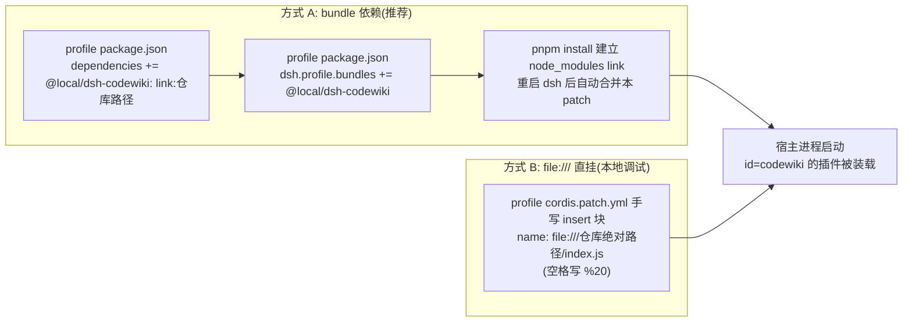
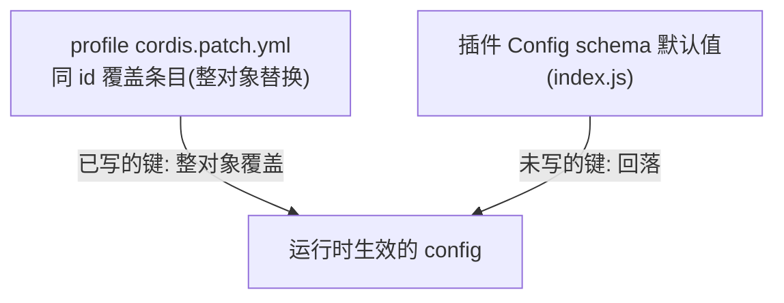
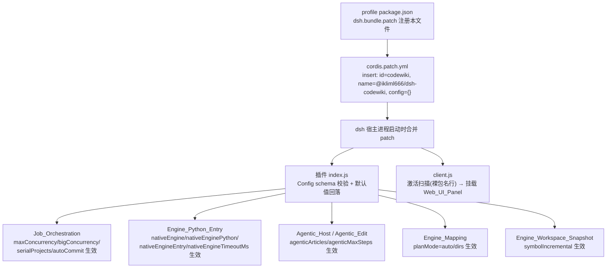

# Cordis_Patch_Config（插件装配配置）

!!! info "Generated documentation"
    This page was written by CodeWiki from the source code at commit [`57d63569`](https://github.com/ikliml666/dsh-codewiki/commit/57d635690667fc2f481ab95078e1a65fd6db9555) on 2026-11-07 with `doubao-seed-2.1-lite`. Check the code before relying on details.

## 简介

`Cordis_Patch_Config` 是 dsh-codewiki 插件向 dsh（DeepSeek Harness）宿主声明自身存在的**装配层**：它告诉宿主「有一个 id 为 `codewiki` 的插件要被装进 Cordis 运行时，入口是 `@ikliml666/dsh-codewiki`，运行参数放在 `config` 命名空间里」。本模块唯一的实体文件是 [`cordis.patch.yml`](../cordis.patch.yml)——一段 YAML patch，随包自动合并到 profile，无需用户手工追加条目。

它在系统中的定位是**桥接**：向上对接 dsh 的 bundle/补丁装载机制（[Package_Manifest 包清单](Package_Manifest.md) 中 `package.json` 的 `dsh.bundle.patch` 字段把本文件注册为 bundle patch），向下把运行期开关（模型选择、并发档位、原生引擎通道等）传递给插件主体 [Job Orchestration（编译任务编排服务）](Job_Orchestration.md)、[Engine_Python_Entry](Engine_Python_Entry.md) 等执行模块。

## 装配机制

### patch 文件的装载路径

`cordis.patch.yml` 不是插件运行时读取的配置文件，而是 **dsh 宿主在进程启动时消费的补丁清单**。其核心载荷是一个 `- insert:` 块：

- `id: codewiki` —— 插件在宿主中的唯一身份；两种安装方式（bundle 依赖与 file:/// 直挂）必须保持同 id。
- `name: "@ikliml666/dsh-codewiki"` —— bundle 形态下必须是裸 npm 包名（不带 `/dsh` 子路径），因为 client 半边的激活扫描只认裸包名行；[Web_UI_Panel](Web_UI_Panel.md) 的挂载依赖这一条。
- `config: {}` —— 刻意留空：默认值不在这里重复声明，全部回落到插件 `index.js` 的 Config schema 默认值。想改哪项就填哪项。

### 两种安装方式



### 配置覆盖优先级

当用户在 profile 自己的 `cordis.patch.yml` 里写同 id 的覆盖条目时，遵循**整对象替换**语义：覆盖条目里写出的字段替换默认值，未写出的键回落到插件 Config schema，而不是与 bundle 的默认值做深合并。



## 配置项参考（config 命名空间 = codewiki）

下表按功能分组列出全部设置项。所有默认值均由插件 Config schema 定义，本文件不重复声明。

### 二进制与模型

| 设置项 | 说明 | 默认 |
| --- | --- | --- |
| `binaryPath` | `cw` 可执行文件路径；留空优先用 `PATH` 里的 `cw`，找不到再用插件自带 `bin/cw.exe` | 空（走 PATH） |
| `batchProvider` | 编译模型提供商，必须是模型设置里已注册的 provider；留空=提交失败 | `volces-ark` |
| `batchModel` | 编译模型 id（512k 上下文） | `glm-5.3-flash` |
| `batchReasoningEffort` | 思考程度档位，取值来自模型目录 `reasoning.efforts`；留空=模型默认档 | 空 |

### 并发与调度

| 设置项 | 说明 | 默认 |
| --- | --- | --- |
| `maxConcurrency` | 默认档并发上限（1–8） | 2 |
| `bigConcurrency` | 大档并发上限（1–8）；与默认档各自独立限流、同时推进 | 0（跟随默认档） |
| `serialProjects` | 单项目串行：同一时刻只推进一个仓库的编译任务，其余排队 | 开 |

### 文章生成行为

| 设置项 | 说明 | 默认 |
| --- | --- | --- |
| `articleLanguage` | 文章语言 | 中文 |
| `planMode` | 模块划分：`auto` = AST 符号 + LLM 语义聚类；`dirs` = 顶层目录分组（旧行为） | `auto` |
| `agenticArticles` | 文章写作走 agentic 工具循环：模型自己 `read_code`/`edit_article`，不整包内联 | 开 |
| `agenticMaxSteps` | agentic 单篇步数上限（1–100） | 30 |
| `symbolIncremental` | 增量按 AST 符号级判定：只重写接口真变了的模块，注释/空白改动跳过 | 开 |
| `updateReminder` | 会话系统提示注入 wiki 维护提醒（仅当会话仓库存在 `.codewiki/`） | 开 |
| `autoCommit` | 编译完成后自动提交 wiki 产物 | 开 |

### 原生引擎通道（0.15.0 引入，0.16.0 起默认开启）

| 设置项 | 说明 | 默认 |
| --- | --- | --- |
| `nativeEngine` | `true` = 编译交给上游 FSoft Python 引擎；`false` = 走内置 Node 兼容通道 | `true` |
| `nativeEnginePython` | venv 解释器绝对路径；留空 → 环境变量 `DSH_CODEWIKI_PYTHON` → `python` | 空 |
| `nativeEngineEntry` | 入口脚本路径 | `lib/engine/python/entry.py` |
| `nativeEngineTimeoutMs` | 单次引擎调用上限 | 2700000（45 分钟） |

> 设计约束：不做「找一个能用的解释器」的启发式——猜错会把环境不闭合伪装成引擎坏了。两条通道并存、**互不回退**：原生通道环境不闭合时以 `engine-deps` 明确失败，不会悄悄改用 Node 通道。

## 运行时数据流：从配置文件到执行模块



## 与其他模块的关系

- [Package_Manifest 包清单](Package_Manifest.md) —— `package.json` 中 `dsh.bundle.patch: "./cordis.patch.yml"` 是本文件被宿主发现的唯一注册点。
- [Web_UI_Panel](Web_UI_Panel.md) —— `name: "@ikliml666/dsh-codewiki"` 的裸包名形式是 client 半边激活扫描的匹配依据；bundle 装法下写成带 `/dsh` 子路径会导致面板不激活。
- [Job Orchestration（编译任务编排服务）](Job_Orchestration.md) —— `maxConcurrency`、`bigConcurrency`、`serialProjects`、`autoCommit` 等调度配置在此落地为实际的任务池行为。
- [Engine_Python_Entry](Engine_Python_Entry.md) —— `nativeEngine*` 系列配置决定子进程解释器、入口脚本与超时边界。
- [FSoft 引擎环境搭建脚本（FSoft_Engine_Setup_Script）](FSoft_Engine_Setup_Script.md) —— 原生引擎通道所需的闭合 Python venv 由 `tools/fsoft-engine/setup-env.sh` 构建；`nativeEnginePython` 应指向该脚本产出的解释器。
- Engine_LLM_Bridge / Engine_OpenAI_Bridge —— `batchProvider`、`batchModel`、`batchReasoningEffort` 在 LLM 桥接层被消费。
- [Agentic_Host（agentic 工具循环 ↔ 宿主 llm 服务适配层）](Agentic_Host.md) / [Agentic_Edit 模块](Agentic_Edit.md) —— `agenticArticles`、`agenticMaxSteps` 决定文章写作走工具循环还是整包内联。
- Engine_Mapping —— `planMode` 控制模块划分策略。

## 版本沿革要点（来自 package.json）

- **0.16.0**：原生引擎通道（`nativeEngine: true`）成为默认；Node 侧的 FSoft 算法重实现（symbols/cluster/graph-diff/incremental/update-planner）已退役删除，`nativeEngine: false` 仅保留为最小兼容通道（顶层目录分组 + 文件级 source_files 归属，不再加新特性）。
- **0.17.34**：不再内置默认编译模型——提交任务时未选 provider/model 会以显式错误失败，而不是对着猜测的模型静默运行；大档并发默认关闭。
- 当前版本 `0.17.64`：零 subagents、单项目串行。

## 使用示例

在 profile 的 `cordis.patch.yml` 中追加同 id 覆盖条目，换编译模型、调并发、关掉 agentic 写作：

```yaml
- id: codewiki
  config:
    batchProvider: volces-ark
    batchModel: glm-5.3-flash
    maxConcurrency: 2
    agenticArticles: true
    agenticMaxSteps: 30
```

或指向自建的 FSoft 原生引擎 venv：

```yaml
- id: codewiki
  config:
    nativeEngine: true
    nativeEnginePython: /abs/path/to/.probe-fsoft/venv/bin/python
    nativeEngineTimeoutMs: 2700000
```

??? abstract "Documented components (2)"
    - [`cordis.patch.yml`](https://github.com/ikliml666/dsh-codewiki/blob/57d635690667fc2f481ab95078e1a65fd6db9555/cordis.patch.yml) — `cordis.patch.yml`
    - [`__file__`](https://github.com/ikliml666/dsh-codewiki/blob/57d635690667fc2f481ab95078e1a65fd6db9555/_addcase2.py) — `_addcase2.py`

