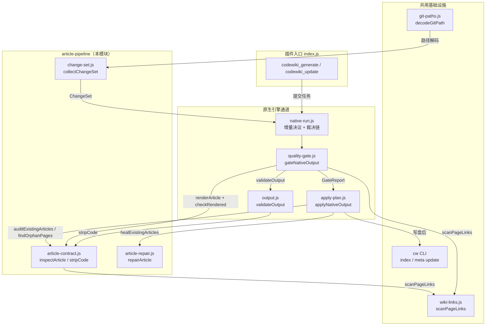
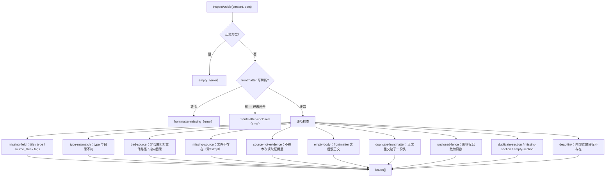
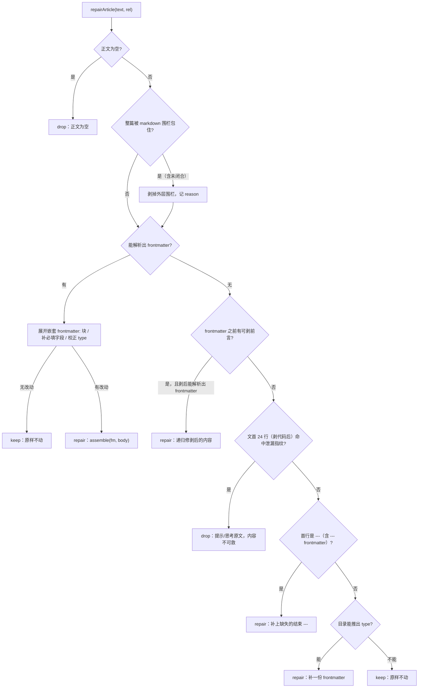
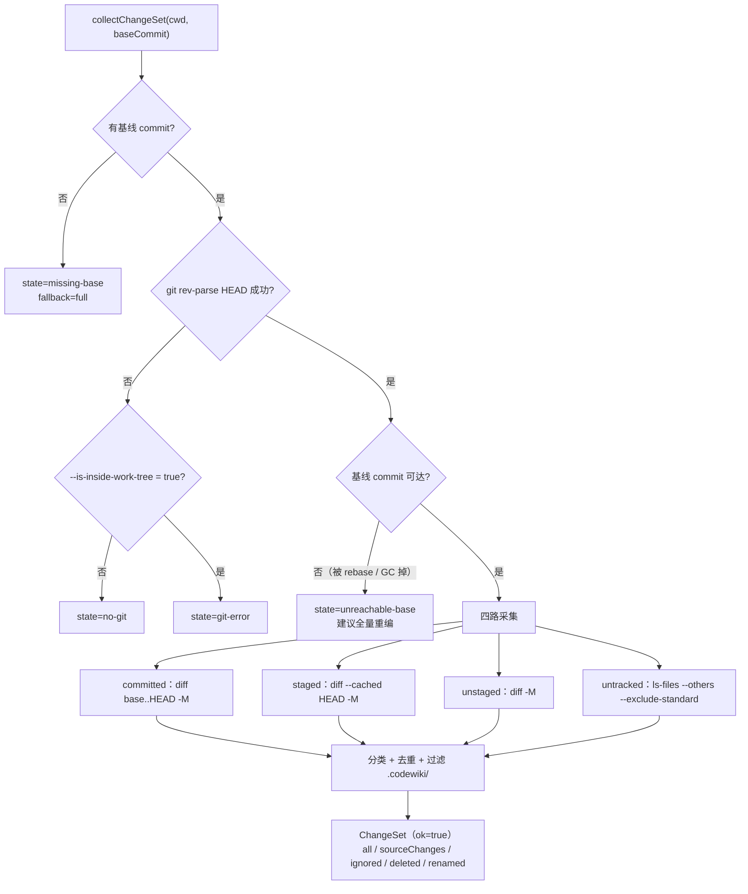
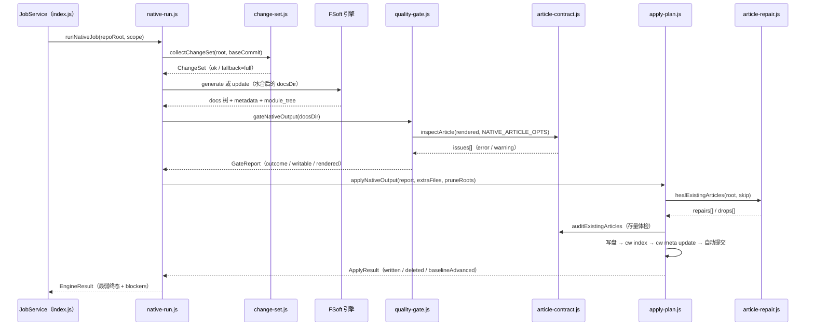

# 文章流水线（article-pipeline）

!!! info "Generated documentation"
    This page was written by CodeWiki from the source code at commit [`d16751f5`](https://github.com/ikliml666/dsh-codewiki/commit/d16751f5dd58ee0741d861266965e322cbe7a60d) on 2026-11-09 with `deepseek-v4.1-flash`. Check the code before relying on details.

`article-pipeline` 是 `Documentation_Generation_Engine` 里**最靠近磁盘的那一层**：它不生成内容、不调用模型、不编排阶段，只回答三个问题——「这一轮到底有哪些改动」「这篇文章能不能写进 wiki」「库里已经躺着的坏文章该修还是该删」。三个问题各由一个纯函数模块承担，合起来构成「产物落盘前的最后一道闸门」与「落盘时的变更依据」。

| 文件 | 职责 | 是否碰文件系统 |
|------|------|----------------|
| `lib/article-contract.js` | 文章结构契约：frontmatter、必填字段、章节、围栏、死链、`source_files` 证据 | 否（`fsImpl` 由调用方注入） |
| `lib/article-repair.js` | 存量页修复器：格式坏了但内容还在的页就地修好，只有内容本身是模型输出泄漏才判删 | 否（纯字符串变换） |
| `lib/change-set.js` | 变更采集：把 committed / staged / unstaged / untracked 四路 git 改动合成一个可序列化的 ChangeSet | 是（`execFileSync` 调 git，可注入替身） |

三者的共同设计取向是**可证伪**：契约判据是纯函数（能单测、能被门与落地器共用）、修复器的每个动作都带 `reasons`（能解释「为什么改了这一行」）、变更采集「采不到」时显式 `fallback='full'`（绝不假装干净）。

---

## 一、在整体架构中的位置

原生通道（FSoft Python 引擎）的一次编译是一条固定直线：`env → 增量决议 → 引擎 → 质量门 → 落地器`。`article-pipeline` 横跨其中三段：变更采集喂给增量决议，文章契约被质量门与落地器共用，修复器只在落地阶段被调用。



要点：

- **契约只有一份实现**。质量门判「刚渲染出来的页」、落地器判「库里躺着的存量页」必须用同一套口径，否则会出现「门说 defects=0、存量体检说这篇坏了」同时挂在同一个终态里的自相矛盾。两边都 `import` `article-contract.js` 的 `inspectArticle`，并用同一个 `NATIVE_ARTICLE_OPTS`。
- **链接扫描只有一份规则**。`scanPageLinks` 来自 `lib/engine/wiki-links.js`（见 [engine-contract-quality：引擎契约与质量裁决层](engine-core/engine-contract-quality.md)），契约、校对（`proofread.js`）、门与改写器共用，避免「门判它是死链、改写器却认不出这条链接」。
- **路径归一只有一份实现**。`toPosix` / `decodeGitPath` 来自 `lib/git-paths.js`（见 [FSoft 引擎工具链（fsoft-engine-tools）](../Build___Development_Infrastructure/fsoft-engine-tools.md)）。

---

## 二、文章契约（`lib/article-contract.js`）

### 2.1 为什么需要它

旧闸门 `validateArticleEnvelope` 只查「frontmatter 有没有开头、有没有闭合」，于是下面这些都能入库：同一篇里贴了两份 frontmatter 与两段正文；必需章节存在但正文只有标题；`source_files` 列着不存在的文件或列着目录；`[[链接]]` 指向早已删掉的文章；代码围栏没闭合导致后半篇全被当成代码块。

本模块把这些判据统一成一个**纯函数** `inspectArticle(content, opts)`，返回 `issues[]`（空数组 = 通过）。因为不碰文件系统，它能被逐条单测；真正的落盘闸门在 `quality-gate.js`（判刚渲染出来的页）与 `apply-plan.js`（判库里躺着的存量页）里调用它。

### 2.2 类型与目录的对应

`type` 与所在目录不匹配会让 `cw index` 的分类错乱，所以目录即期望类型：

| 目录 | 允许的 `type` |
|------|---------------|
| `modules/` | `module` |
| `concepts/` | `concept` |
| `patterns/` | `pattern` |
| `queries/` | `query` |
| `learnings/` | `learning`（0.17.49 起不再产出，读取侧仍认） |
| `decisions/` | `decision`（同上） |

根目录另有三个特殊文章：`_architecture.md → architecture`、`_index.md → index`、`_patterns.md → pattern`。调用方也可用 `expectedType` 覆盖目录推断。

### 2.3 判据清单



判据细节：

- **frontmatter**：只认文首第一个 `---` 块，用极简 YAML 解析（`key: value` 与 `key:` 后跟 `- item` 列表），不引依赖。双引号标量优先按 `JSON.parse` 解（YAML 1.2 是 JSON 超集，能正确还原 `\n` 与 `C:\\src\\a.py`），失败才回退「切引号」，以免存量文章里的 YAML 专有转义被判坏。
- **`tags` 与 `source_files` 的空列表语义不同**：`tags: []` 合法（很多模块文章确实没有标签，但字段必须写出来）；`source_files: []` 默认**不合法**——文章没有任何代码依据必须拒写。唯一例外是原生 whole-repository 通道，见 2.5。
- **`source_files` 只判格式，不猜类型**：绝对路径、盘符、`..` 上跳、尾斜杠一律 `bad-source`。**不**用「有没有扩展名」判文件——`Dockerfile` / `Makefile` / `LICENSE` 是合法文件名，按扩展名判会把它们全判坏。`src/util` 这种不带尾斜杠的目录只能靠调用方提供的 `fsImpl.isDirectory` 发现。
- **章节**：`## 标题` 提取时跳过代码围栏（围栏里的 `##` 是示例）。必需章节按类型配置——`module` / `architecture` 要求 `Overview` 与 `Key Components`，其余类型只要 `Overview`，`index` 不要求。**`missing-section` 与 `empty-section` 必须分开**：「压根没写这一章」与「写了标题却空着」是两种缺陷。
- **重复 frontmatter**：只判围栏外、且成对 `---` 之间 40 行内出现 `title:` / `type:` / `source_files:` 的情形。文章里用 ```` ```yaml ```` 演示 frontmatter 契约是常见写法，围栏里的 `---` 是示例不是文档自己的头。
- **死链**：`collectWikiLinks` 同时收集 `[[target]]` 与 `[文字](链接目标)`，且**先剥代码**——文章里写 `[[target]]` 往往是在讲链接语法，那是字面量而不是引用。不剥就会得到「文档在解释契约、却被契约判违规」的荒谬结论。目标解析支持「原样名 / 加 `.md` / 相对当前文章目录 / 相对目录加 `.md`」四种写法。

### 2.4 问题分级：error 与 warning 是行为分界

| 严重级 | 类别 | 行为 |
|--------|------|------|
| `error` | `empty`、`frontmatter-missing`、`frontmatter-unclosed`、`missing-field`、`type-mismatch`、`bad-source`、`missing-source`、`source-not-evidence`、`empty-body`、`duplicate-frontmatter`、`duplicate-section`、`unclosed-fence`、`dead-link`、`empty-section` | 结构已破坏，落盘即污染 wiki，**拒写** |
| `warning` | `missing-section`、`empty-section-optional` | 内容不达标但结构完整，**放行但记账**，使本轮终态降为 `partial`、阻止基线前移 |

「放行 warning」不是宽松，而是必要：旧通道的整包装填产出天然是「一段正文」，硬拒会把存量文章全判死；但「装绿」同样不允许，所以 warning 会进 `qualityIssues` 并压住基线。

对外只暴露 `inspectArticle` 这一个判据入口（外加 `parseFrontmatter` / `stripCode` / `fencesBalanced` / `collectWikiLinks` 等纯字符串助手）。**「这批 issues 里有没有阻塞项」「压成一行文案」不再由本模块提供封装**：`severity` 已经逐条挂在每个 issue 上，消费方按需自行过滤——`quality-gate.js` 按 `issue.severity ?? 'error'` 把 error 分流进 defects、其余进 degradations；`apply-plan.js` 的 `auditExistingArticles` 同样只取 `(i.severity ?? 'error') === 'error'` 的条目并拼成 detail。写集白名单判定（`allowedWritePaths` 那类）也不在本模块：落地器有自己的一套写集/删除集共用尺子（见 [apply-plan 落地器](engine-core/engine-orchestration/apply-plan.md)），`index.js` 的增量通道另按 `source_files` 做归属判定。

### 2.5 `NATIVE_ARTICLE_OPTS`：两处共用的一口径

```js
export const NATIVE_ARTICLE_OPTS = Object.freeze({
  cwd: null, readableSources: null, fsImpl: null,
  requiredSections: Object.freeze([]),
  allowEmptySourceFiles: true,
})
```

这三项每一项都对应一类「按本仓库 agentic 通道口径判原生产物」会产生的伪缺陷：

- `requiredSections: []` —— 原生正文的章节名由上游 prompt 决定（`## 1. Purpose`…），用 `Overview` / `Key Components` 去判它，产出的全是**不可修复**的 warning（计划硬约束是「不改技术内容」），闸门会退化成噪声。
- `allowEmptySourceFiles: true` —— whole-repository 模式下 `module_tree.json` 就是 `{}`，空 `source_files` 是**诚实记录**，由上层降级成 `partial` 阻止基线推进，而不是在这里拒写。
- `fsImpl: null` —— `source_files` 的存在性由 `output.js` 的 `source-missing` 单独判，这里再判一次只会把同一条缺陷翻倍上报。

注释里明确记录了「两处各写一遍时已经漂过一次」，因此这个常量是**唯一一处定义**。

### 2.6 `stripCode` 的等长契约

`stripCode(text)` 把围栏块与行内代码替换成**等长**空白占位。等长是硬契约：`quality-gate.js` 的 `rewritePageLinks` 用 `scanPageLinks` 在掩码文本上取得的匹配偏移回到原文做替换，长度一变就会错位、把正文改坏。任何修改 `stripCode` 的改动都必须先确认所有消费方仍按偏移对齐（`output.js::relativeLinks`、`proofread.js`、`article-repair.js` 也都依赖这一性质）。

---

## 三、存量修复（`lib/article-repair.js`）

### 3.1 问题：只判对错，处置只有「留着」或「删掉」

真机五个仓库的统计：61 篇被判坏的页里，真正内容有问题的只有 11 篇，其余是四类**纯格式**缺陷——缺 frontmatter（手写的 `# 标题` 正文）、前言污染（正文前粘了一句「以下是基于当前源码重写的文章。」或整篇被包进 ```` ```markdown ```` 围栏）、frontmatter 未闭合（有字段但少了结尾 `---`，于是整篇被当成没有 frontmatter，连正文都读不出来）、`type` 与目录不符（`learnings/` 下的页写成 `type: module`）。

这些页删掉等于用格式问题销毁内容，留着等于让基线永远推不动。所以策略是**先修再删**，判删的唯一依据是「正文里混进了模型的思考/提示原文」——那种页的内容本身就是错的。

### 3.2 决策流程



关键顺序说明：

- **「剥前言」优先于「判泄漏」**。`以下是基于当前源码重写的文章。` 这种单句前言是可剥的，后面跟着合法 frontmatter 时它只是「模型在说话」。顺序反了会把整批只粘了一句话的页判成不可救（真机 8 篇）。
- **泄漏指纹只看文首第一块**（frontmatter 之前或正文头几行，且先 `stripCode`）。正文中间出现 `I will now` 可能是在引用日志，不该据此删整篇。
- **`--- frontmatter` 也算分隔符**。真机上见过分隔符后跟了一个词的写法，语义上仍是分隔符，不该因此把整篇当成没有 frontmatter。
- **`cw index` 的静默跳过是这条链路的存在理由**：`cw index` 逐篇解析 frontmatter，**解析失败就 continue**，退出码仍为 0。所以「补上结束 `---`」不只是格式美化，它直接决定这篇页能不能进索引。

辅助实现细节：

| 函数 | 作用 |
|------|------|
| `dirTypeOf(rel)` | 目录 → 类型（`modules/a.md → module`） |
| `headingOf(body)` | 取正文 H1 当标题 |
| `titleFromRel(rel)` | 文件名推标题（`android-settings-ia-reorg.md → android settings ia reorg`） |
| `firstHeadingLine(lines)` | 定位「frontmatter 到哪里结束」——未闭合的 fm 没有结束标记，但后面一定跟着正文标题 |
| `unwrapNestedFm(fmLines)` | 把 `frontmatter:\n  type: x` 展开成顶层字段 |
| `fillFields(fmText, {rel, body})` | 补 `title` / `type` / `source_files: []` / `tags: []`，**已有字段一律不覆盖** |
| `assemble(fmText, body)` | 拼回 `---\n<fm>\n---\n\n<body>\n` |

调用方是 `apply-plan.js` 的 `healExistingArticles` / `auditExistingArticles`（见 [apply-plan 落地器](engine-core/engine-orchestration/apply-plan.md)）：修好的页并进本轮写集（因此与文章同一次 `cw index`、同一份 pre-image、同一个 commit），判 drop 的页进删除集。给「本轮要删的页」补 frontmatter 只会让它重新成为合法页、从删除集里被摘出去，所以 heal 会跳过删除集里的路径。

---

## 四、变更采集（`lib/change-set.js`）

### 4.1 问题：`cw status` 只看得见已提交的改动

`cw status` 只跑 `git diff <last_compiled_commit>..HEAD`，于是三类改动完全隐形：改完代码**还没提交**、只 `git add` 到暂存区没提交、新建文件还没被跟踪。结果是「改完代码就编译」会把未消化的变化当成已消化（基线被前移），文章与源码脱节却一路绿到底。

### 4.2 采集流程



### 4.3 返回结构与降级

`collectChangeSet` 返回的 ChangeSet 带版本号 `CHANGE_SET_VERSION`，字段固定：`state` / `fallback` / `reason` / `baseCommit` / `headCommit` / `committed` / `staged` / `unstaged` / `untracked` / `deleted` / `renamed` / `all` / `sourceChanges` / `ignored`。

**`ok=false` 时一定带 `state`、`reason` 与 `fallback='full'`**，调用方据此退回全量编译。状态取值：`missing-base`、`no-git`、`git-error`、`unreachable-base`。核心不变量：**「采不到」绝不能被当成「没变化」**。

分类规则：

- `isWikiProduct(p)`：`.codewiki/` 前缀（含 `.codewiki` 本身）算 wiki 自身产物，从 `sourceChanges` 里剔除、进 `ignored`——否则每次编译都会把自己重写一遍的产物算成「源码变更」，增量永远处于 dirty 状态、未映射变更永远清不零。`README.md` / `CHANGELOG.md` / `CodeWiki.md` 这类被文章 `source_files` 引用的文档仍是合法源码，**不**在此列。
- `-M` 打开改名检测：否则改名会被拆成「删一个 + 加一个」，下游 planner 看不出「同一份内容换了位置」。改名两端都进 `all`（旧路径从「被谁引用」角度同样是变化）。
- 同一路径既删又重建（删了又新建同名文件）：`untracked` 里还有它就不算删除，否则 planner 会为一篇还在的文件安排 delete。
- `normChangePath` 把路径归一成仓库相对 POSIX 路径，**越界路径（绝对路径 / `../`）直接丢弃**——它们不该出现在变更集里。

### 4.4 中文路径：`decodeGitPath` 的两层落差

`git` 默认 `core.quotepath=true`，非 ASCII 路径会被输出成 `"a/\344\270\255.md"`（八进制字节转义 + 双引号）。不还原的话 `isWikiProduct` 匹配不上 `.codewiki/`，中文名的 wiki 产物会被当成源码变更塞进 `sourceChanges`，增量 planner 每轮都以为产物是新源码。转义是按**字节**做的，所以「解开转义」必须把字节重新拼成 Buffer 再按 UTF-8 解码（一个中文字符是三个 `\NNN`）。实现见 `lib/git-paths.js`（[FSoft 引擎工具链（fsoft-engine-tools）](../Build___Development_Infrastructure/fsoft-engine-tools.md)）；解码对未转义串是幂等的，所以「调用方已关 quotepath」与「这里再解一层」不冲突。

### 4.5 可测性

`opts.execFile(cmd, args) -> stdout` 是依赖注入点：生产用 `execFileSync`（`maxBuffer` 16MB），单测给假执行器即可离线覆盖四路采集、改名解析、降级分支。

---

## 五、三条链路如何串起来

### 5.1 一轮编译的调用时序



### 5.2 谁读谁写

| 消费方 | 使用的导出 | 用途 |
|--------|-----------|------|
| `index.js` | `collectChangeSet` | 文件级增量归属判定（变更集里每个源码路径是否被某篇文章的 `source_files` 认领） |
| `quality-gate.js` | `inspectArticle`、`parseFrontmatter`、`fencesBalanced`、`stripCode`、`NATIVE_ARTICLE_OPTS` | 渲染后逐篇契约检查（`checkRendered`）、入口页围栏检查 |
| `output.js` | `stripCode` | `relativeLinks` 跳过代码里的链接示例 |
| `proofread.js` | `stripCode` | 校对时只改正文里的真链接 |
| `apply-plan.js` | `inspectArticle`、`NATIVE_ARTICLE_OPTS`、`parseFrontmatter`、`repairArticle` | 存量体检、孤儿页判定、修复器调用 |
| `native-run.js` | `collectChangeSet`（经注入） | 增量决议的「变化是什么」 |

---

## 六、不变量与已知陷阱

1. **契约唯一**。新增判据只允许加在 `article-contract.js` 里，不允许在门或落地器里另写一份。`quality-gate.js` 与 `apply-plan.js` 对同一批页必须给出同一结论——历史教训是「两处各写一遍，漂了一次」。
2. **`stripCode` 等长**。任何「把代码块换成占位」的实现都必须保持长度不变，否则基于偏移的原文替换会错位。
3. **不猜证据**。`source_files` 只能来自真实组件→文件映射，拿不到就是空数组 + warning，绝不按目录名猜。编造它会让未消化的变化被静默基线化。
4. **不静默吞掉**。变更采不到 → `fallback=full`；页映射不到 → `unmapped-page`；章节没写 → `missing-section`。任何「看起来差不多就放过」的降级都是把缺陷挪到下游、且更难发现。
5. **`warning` 不等于放行终态**。warning 允许落盘，但必须进 `qualityIssues` 并压住基线——「装绿」是不允许的。
6. **判删要保守，删前留痕**。修复器只在正文本身是模型输出泄漏时判 `drop`；落地器删页前把每个被删页在 notes 里点名，内容仍在 git 历史里。

## 七、扩展指南

- **新增一个问题类别**：先在 `SEVERITY` 里登记（未登记的 kind 会默认按 `error` 处理），再确认 `quality-gate.js` 的 `GATE_DEFECT_KINDS` / `GATE_DEGRADATION_KINDS` 里有对应分流——门对未映射的产物问题会记成 `article-contract` 并逼你补映射，不会静默吞掉。
- **新增一个必需章节**：改 `REQUIRED_SECTIONS`，注意只对 agentic 通道生效；原生通道走 `NATIVE_ARTICLE_OPTS`（`requiredSections: []`）。
- **新增一类可修缺陷**：在 `article-repair.js` 里加一个分支并**必须**写入 `reasons`（notes 会把它报给用户），同时保证修完的文本能过 `inspectArticle`。
- **新增一种 git 采集来源**：在 `collectChangeSet` 里加一路，并同步进 `all` / `deleted` / `renamed` 与 `sourceChanges` 的分类，别忘了 `isWikiProduct` 过滤。

## 八、相关页面

- 上级模块：[Documentation_Generation_Engine 模块概览](../Documentation_Generation_Engine.md)
- 引擎核心总览：[engine-core 模块概览](engine-core.md)
- 契约与质量闸门（`contract.js` / `quality-gate.js` / `wiki-links.js` / `proofread.js`）：[engine-contract-quality：引擎契约与质量裁决层](engine-core/engine-contract-quality.md)
- 落地器与孤儿页清理：[apply-plan 落地器](engine-core/engine-orchestration/apply-plan.md)
- 原生编译编排与增量决议：[engine-runner：原生引擎执行与裁决编排](engine-core/engine-orchestration/engine-runner.md)
- 受管状态与清单（`_native-state`、`engine-lock.json`）：[engine-state-manifest：引擎清单与跨轮受管状态](engine-core/engine-state-manifest.md)
- 任务与状态管理（job 记录、`update-record` 终态判定）：[作业状态与持久化层（job-and-state）](../Job_Orchestration___State_Management/job-and-state.md)
- `cw index` 的 frontmatter 解析语义：[codewiki-vendor（仓库内 vendored `cw` CLI）](../Execution_Runtime___Vendored_Engine/codewiki-vendor.md)
- `git-paths.js` 路径归一与解码：[FSoft 引擎工具链（fsoft-engine-tools）](../Build___Development_Infrastructure/fsoft-engine-tools.md)

??? abstract "Documented components (6)"
    - [`hasBlockingIssue`](https://github.com/ikliml666/dsh-codewiki/blob/d16751f5dd58ee0741d861266965e322cbe7a60d/lib%5Carticle-contract.js) — `lib\article-contract.js`
    - [`isWritable`](https://github.com/ikliml666/dsh-codewiki/blob/d16751f5dd58ee0741d861266965e322cbe7a60d/lib%5Carticle-contract.js) — `lib\article-contract.js`
    - [`issueSummary`](https://github.com/ikliml666/dsh-codewiki/blob/d16751f5dd58ee0741d861266965e322cbe7a60d/lib%5Carticle-contract.js) — `lib\article-contract.js`
    - [`makeWriteSet`](https://github.com/ikliml666/dsh-codewiki/blob/d16751f5dd58ee0741d861266965e322cbe7a60d/lib%5Carticle-contract.js) — `lib\article-contract.js`
    - [`assemble`](https://github.com/ikliml666/dsh-codewiki/blob/d16751f5dd58ee0741d861266965e322cbe7a60d/lib%5Carticle-repair.js) — `lib\article-repair.js`
    - [`collect`](https://github.com/ikliml666/dsh-codewiki/blob/d16751f5dd58ee0741d861266965e322cbe7a60d/lib%5Cchange-set.js) — `lib\change-set.js`

