# apply-plan 落地器

!!! info "Generated documentation"
    This page was written by CodeWiki from the source code at commit [`bc7e15a2`](https://github.com/ikliml666/dsh-codewiki/commit/bc7e15a2499b5c4f334d4c0611eace4ad97c1c26) on 2026-11-09 with `deepseek-v4.1-flash`. Check the code before relying on details.

`lib/engine/apply-plan.js` 是原生（FSoft）编译通道的**落地层**：它把质量门给出的「采用裁决」（`GateReport`）变成仓库里真实存在、已建索引、已推进基线、已自动提交的产物；任何一步失败，都按不变量把磁盘恢复原状并如实上报。

一句话概括它的职责边界：**裁决说「这批页可以入库」，落地器回答「入库这件事真的成立了吗」**。二者是两件事——中间还隔着写盘、`cw index`、`cw meta update`、`git commit` 四个各自会失败的环节。

---

## 1. 在编译流水线中的位置

落地器处于整条裁决链的最末端，是唯一允许修改 `.codewiki/` 与 `CodeWiki.md` 的模块。

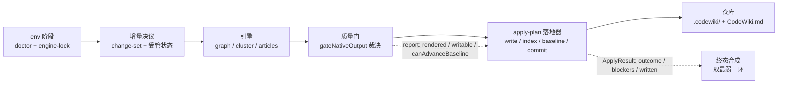

关键点：落地器**不重判产物质量**。它只认 `report.writable`、`report.outcome`、`report.rendered`、`report.entry`、`report.canAdvanceBaseline` 这几个字段，把它们当作输入事实；质量判定归 [engine-contract-quality：引擎契约与质量裁决层](../engine-contract-quality.md)，整条编排链归 [engine-runner：原生引擎执行与裁决编排](engine-runner.md)。

---

## 2. 三条硬不变量

这是本模块唯一的验收标准，其余实现细节都服务于它们。

| # | 不变量 | 失败时的处置 | 反例（本模块要消灭的缺陷） |
|---|--------|--------------|--------------------------|
| 1 | **写集封闭** | 整批拒写（不是跳过该条） | 相信渲染结果里的路径 = 把「引擎能写仓库任意文件」写进契约 |
| 2 | **索引 / 基线失败即回滚** | 恢复 pre-image，`applied=false`、`rolledBack=true` | 库里留下「文章在、索引没有」或「文章在、基线已推进」的脏库，且永不自愈 |
| 3 | **提交失败不回滚** | 记 `commit-failed` 阻塞，产物保留 | 因为一次提交失败删掉有价值的文章 |

第 3 条与第 2 条方向相反，原因是语义不同：`cw index` / `cw meta update` 失败说明「这批产物还没被库接受」；提交失败说明「产物是对的，只是没进版本库」，此时删除只是二次损失。

此外还有一条**终态不洗白**规则：即使 `applied=true`，只要 `problems` 非空，`outcome` 一律降为 `partial`；提交未成立（且不是「无改动可提交」）时永远不可能是 `done`。

---

## 3. 公开 API

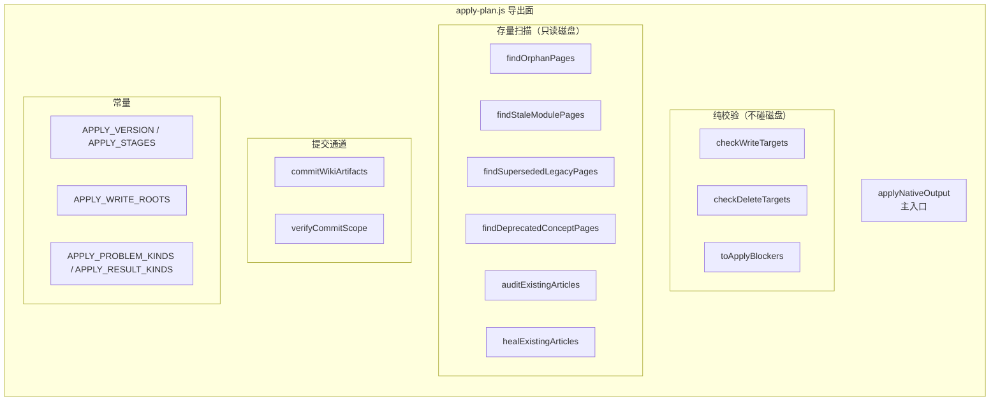

| 导出 | 类型 | 作用 |
|------|------|------|
| `applyNativeOutput(o)` | async 函数 | 主入口：写盘 → 索引 → 基线 → 提交，失败按不变量回滚 |
| `checkWriteTargets(items)` | 纯函数 | 写集校验：路径归一、白名单、去重、内容类型 |
| `checkDeleteTargets(rels, {repoRoot})` | 纯函数 | 删除集校验：与写集共用同一把尺子，额外拒绝目录 |
| `toApplyBlockers(problems)` | 纯函数 | 落地问题 → 契约 `BLOCKER_KINDS` |
| `verifyCommitScope(repoRoot, sha, opts)` | 函数 | 反查提交内容，断言只动了 wiki 两个路径 |
| `commitWikiArtifacts(cwd, opts)` | 函数 | 内置提交器（默认实现，边界对齐 `autoCommitWiki`） |
| `findOrphanPages(o)` | 只读扫描 | `source_files` 全部失效的模块页 |
| `findStaleModulePages(o)` | 只读扫描 | 页名已不属于当前模块树的残留页 |
| `findSupersededLegacyPages(o)` | 只读扫描 | 源码已被新树接手的旧模块页 |
| `findDeprecatedConceptPages(root, keep)` | 只读扫描 | `concepts/` 整目录下线清理 |
| `auditExistingArticles(root, skipRels)` | 只读扫描 | 存量文章体检，返回 error 级问题 |
| `healExistingArticles(root, skipRels)` | 只读扫描 | 存量坏页分流：`repairs`（可修）/ `drops`（判删） |
| `APPLY_STAGES` | 常量 | `['write','index','baseline','commit']`，面板步骤条与日志按它对齐 |
| `APPLY_WRITE_ROOTS` | 常量 | `['.codewiki', 'CodeWiki.md']`，写集/删除集/裁剪根共用的白名单 |

`APPLY_PROBLEM_KINDS`（写集校验问题）：`empty-target`、`absolute-target`、`escaping-target`、`out-of-scope`、`duplicate-target`、`bad-content`。
`APPLY_RESULT_KINDS`（落地结果问题）：`write-failed`、`index-failed`、`baseline-failed`、`commit-failed`、`commit-scope`、`not-writable`、`wiki-missing`、`gate-partial`。两个枚举都只允许追加，不允许改名——调用方按 kind 分派。

---

## 4. 主流程

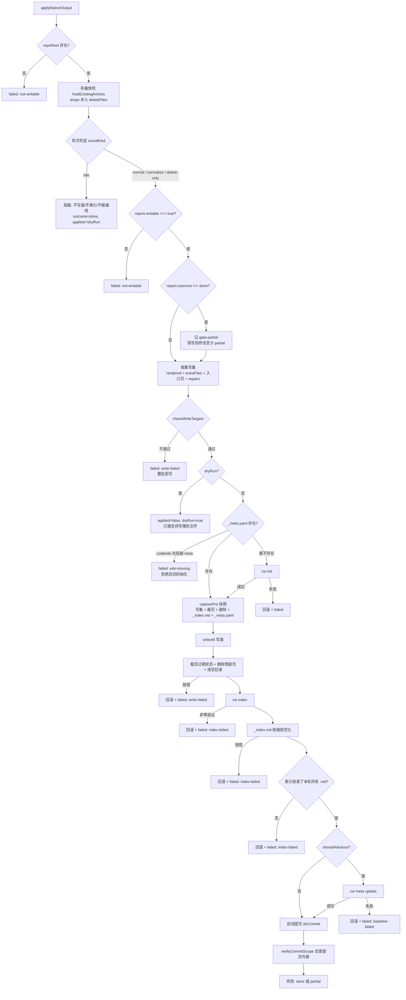

### 4.1 入参

| 参数 | 默认 | 说明 |
|------|------|------|
| `repoRoot` | — | 仓库根绝对路径，缺失直接失败 |
| `report` | — | `gateNativeOutput` 的返回值 |
| `docsDir` | `null` | 引擎产物目录，仅用于读入口页正文 |
| `advanceBaseline` | `null` | `null` 表示听裁决（`report.canAdvanceBaseline`），`false` 强制不推进 |
| `entryMode` | `'keep'` | 仓库根已有入口时的处置：`keep` / `overwrite` / `skip` |
| `dryRun` | `false` | 只算写集与判定，不写盘、不跑 cw、不提交 |
| `noChanges` | `false` | 引擎与四路变化集均无变化（进入 `idle` / `normalize` / `delete-only` 分支） |
| `extraFiles` | `[]` | 附加写集（受管状态、engine-lock、TechDocs 站点），与文章同事务 |
| `pruneRoots` | `[]` | 受管状态目录，本轮写集之外的存量文件会被删除 |
| `deleteFiles` | `[]` | 显式删除集（孤儿页/残留页/泄漏页） |
| `deps` | `{}` | 注入点：`runCw` / `commit` / `verifyCommit` / `normalizeIndexLinks` / `cwBinary` / `jobId` |

> `wikiPath` 与 `beforeCommit` 是保留参数，当前实现未参与逻辑；wiki 目录固定由 `mapping.js` 的 `WIKI_DIR` 决定。

### 4.2 出参 `ApplyResult`

`applied`、`outcome`（`done` / `partial` / `failed`）、`written`、`unchangedFiles`、`pruned`、`deleted`、`entry`、`index`、`baseline`、`commit`、`rolledBack`、`problems`、`blockers`、`notes`、`baselineAdvanced`、`canAdvanceBaseline`、`ok`、`startedAt` / `finishedAt`。

其中 `baselineAdvanced` 是**落地事实**（`cw meta update` 真的成功了），`canAdvanceBaseline` 是兼容字段，语义为 `applied && baselineAdvanced`；`written` 只认实际写盘数，0 就是 0（不允许用引擎自报值兜底）。

---

## 5. 轮次模型：四种互斥状态

早先这里是三个布尔（`noChanges` / `deleteOnly` / `normalizeOnly`）散落在五处组合判断中，每加一种例外都要改五处，且存在非法组合。现在收成单一枚举：

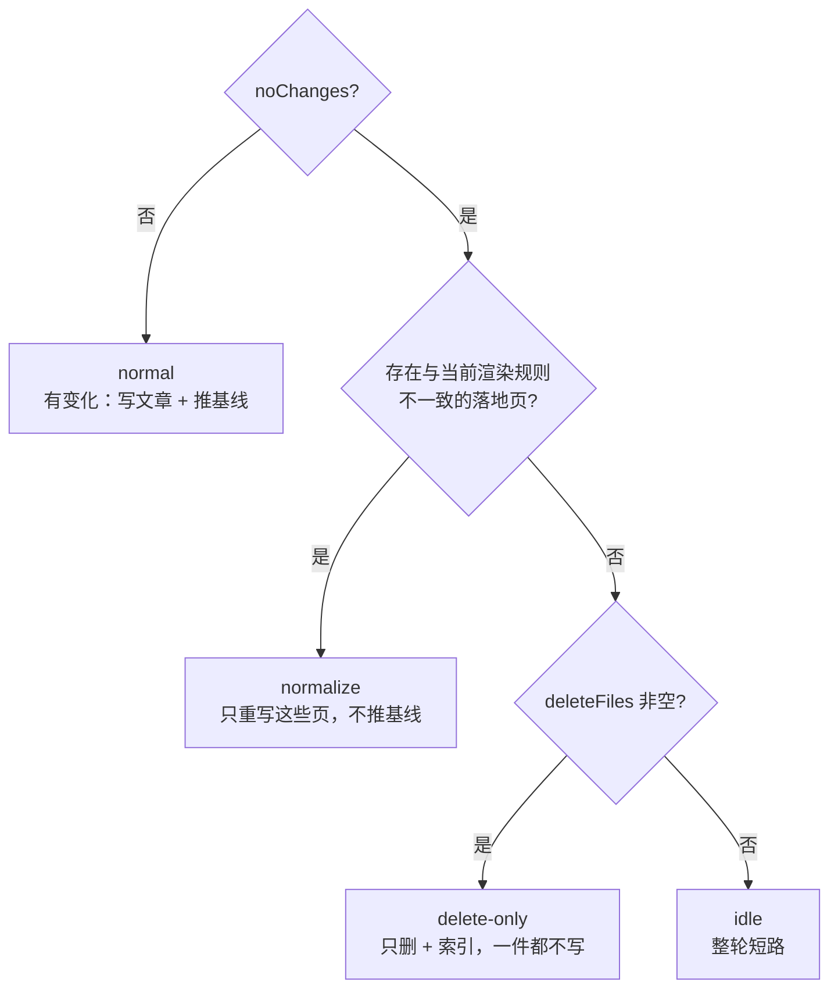

| 轮次 | 写文章 | 删除 | `cw index` | 推进基线 | 提交 |
|------|--------|------|-----------|----------|------|
| `normal` | 只写 `defects === 0` 的页 | 是 | 是 | 由裁决决定 | 是 |
| `normalize` | 全写（含缺陷页） | 是 | 是 | 否 | 是 |
| `delete-only` | 否 | 是 | 是 | 否 | 是 |
| `idle` | 否 | 否 | 跳过 | 否 | 否 |

两条非显然的设计：

- **`noChanges` 不能无条件短路**。源码没变不等于库里没有残骸：`delete-only` 与 `normalize` 正是「无变化但仍需动手」的两个例外。真机上五个仓库里四个都是 `no_change` 轮，残留页一个都没清掉，原因就是这里曾无条件 return。
- **`normalize` 的存在理由**：引擎报 `no_change` 只说明源码自基线以来没变，不说明库里文章符合**当前渲染规则**。页名别名、跨页链接改写等规则改进后，旧落地页不重写就永远是错的，而死链只存在于库里、不在源页里，下一轮 `no_change` 又会短路回去（真机 `dsh-hindsight-on-demand` 曾因此残留 363 条跨页死链）。

内容等价比较 `sameContent` 忽略行尾差异（`\r\n` → `\n`），且这条口径**同时**用于 `findStaleLanded`（判断哪些页需要重写）与 `writeAll`（判断某文件可否跳过重写）。只在比对侧归一会导致「单篇真 stale 触发规范化时把整批仅行尾不同的页翻成 LF」，制造无意义 diff。

---

## 6. 写集封闭校验

### 6.1 同一把尺子

`checkTargetPath(original, {scopeLabel})` 是写集、删除集、裁剪根三处**共用**的判据函数。收口成一个纯函数不是为了去重，而是为了消除**不对称**：某一侧补了判据、另一侧没补，会造出「写不许越界但删可以越界」这种靠肉眼看不出来的缺陷，而删错比写错更不可逆。

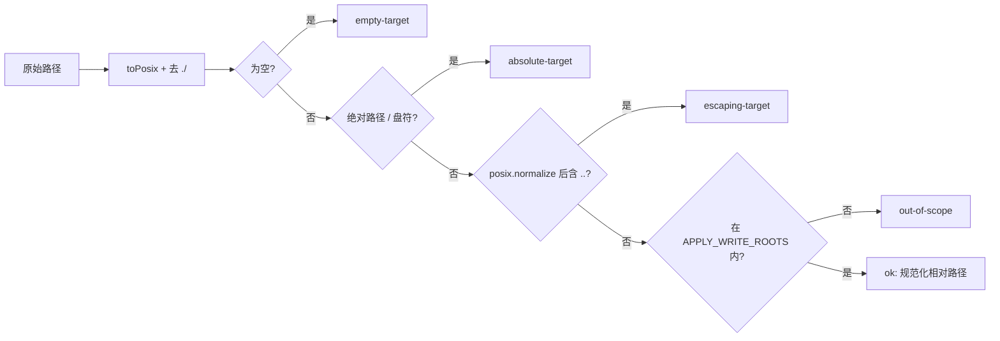

### 6.2 写集校验

`checkWriteTargets` 额外检查 `content` 必须为字符串，并对重复路径去重：内容相同视为重复投递（无害），内容不同记 `duplicate-target`（保留哪一份都是猜）。

写集不完整时**整批拒写**。逐条跳过坏路径会让报告显得「大部分成功」，而缺的那几篇没人知道缺。

### 6.3 删除集校验

`checkDeleteTargets` 复用 `checkTargetPath`，但语义是「删」：不要求 `content`，额外拒绝**目录**（`unlink` 会抛 `EPERM`/`EISDIR`，而「删一个目录」的回滚粒度无法定义，必须由调用方显式列出文件）。目标本来不存在时按幂等处理：不报错、不进 targets。

写集与删除集冲突时**写优先**：同时出现在两侧的路径从删除集剔除，并记一条 note。

---

## 7. 事务与回滚

### 7.1 pre-image 覆盖范围

回滚对象不只是本次写的文件——`cw index` 会重写 `_index.md`，`cw meta update` 会重写 `_meta.yaml`，这两份才是「库是否干净」的判据；裁剪与删除的文件同样必须可恢复。

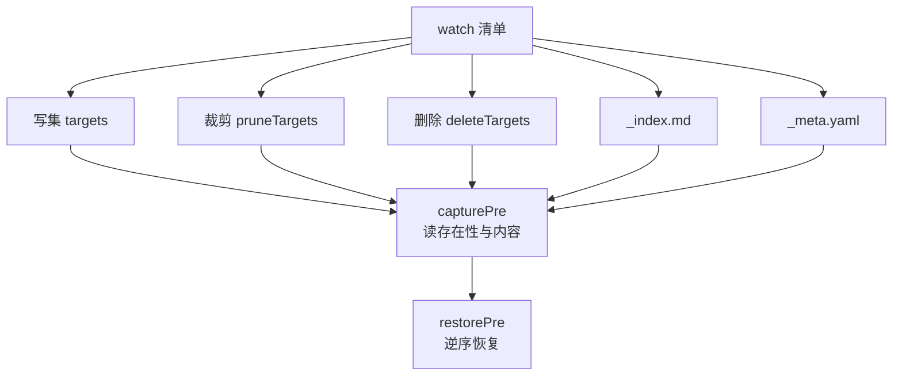

`capturePre` 严格区分「读不到」与「不存在」：只有 `ENOENT`（以及目录的 `EISDIR`）才记为 `exists=false`；`EBUSY` / `EPERM` 直接抛错。若把权限错误记成「不存在」，回滚时 `restorePre` 会 `unlink` 掉一份真实存在的文件。

`restorePre` 逆序恢复（后写的先撤），pre-image 不存在的新建文件直接删除。若整个 `.codewiki/` 是本次才出现的，回滚连目录一起删掉，避免留下一个「有 wiki 但没有文章」的空壳。

### 7.2 回滚时序

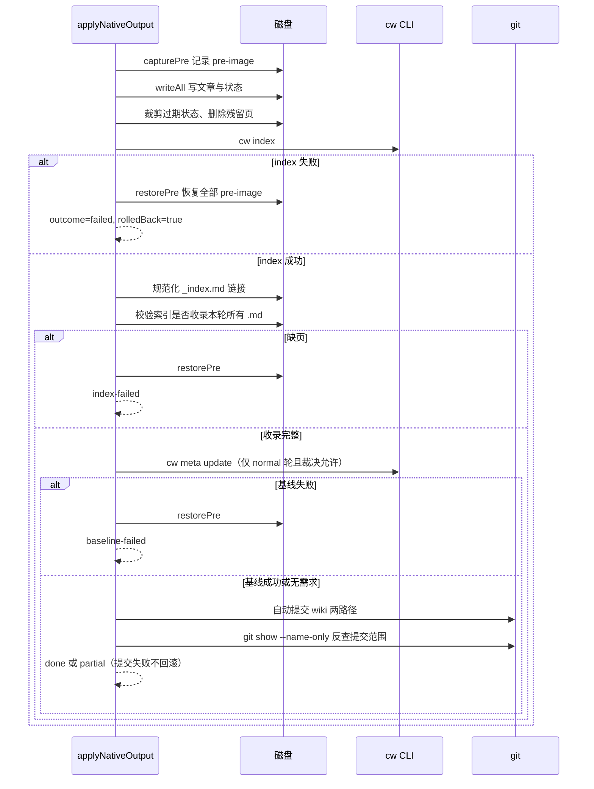

**为什么基线失败要连文章一起回滚**：索引成功说明库结构没问题，失败的是「记账」。此时留下文章、不动基线，库里就会出现「文章比基线新」，下一轮编译会把同一批变化重新消化一次（重复消费）。整体回滚是唯一干净的选择：要么这批算数，要么一步都没动。

---

## 8. 索引校验：退出码 0 不等于收录成功

`cw index` 的实现是逐篇 `frontmatter::parse`，**解析失败就 continue**，最后照样写索引并返回 0。于是 frontmatter 写坏的文章会静默缺席，而落地器拿到 exit 0 会判 done——这就是「缺页静默成功」。

`findArticlesMissingFromIndex` 用「相对 `.codewiki/` 的路径去掉 `.md`」作为比对口径（与 `main.rs` 的 `strip_prefix` + `trim_end_matches(".md")` 一致，与 title 无关），并跳过相对路径首段以 `_` 开头的文件（`cw index` 自己也跳过）。

三个实现细节值得注意：

1. **比对基准是本轮写集 `targets`，不是实际落盘的 `written`**。`writeAll` 会把与磁盘等价的项归入 `unchanged` 而不重写；若拿 `written` 比，这些页恰好逃过校验，而「此前 frontmatter 已坏、所以在索引里缺席」正是它们最常见状态。
2. **解析 `[[link|title]]` 只取 `[[` 到 `|` 或 `]` 之间的路径段**。标题里出现 `]`（如 `数组下标 [i] 详解`）时，任何「title 部分不含 `]`」的模式都会整条漏掉，于是一篇合法文章被判缺页 → 整批回滚，且标题不改就每次重试都失败。
3. **`_index.md` 链接规范化不是美化**。`cw index` 在 Windows 上可能写出 `[[modules\a|x]]`，而 stale 判定、链接校验、下一轮增量比较用的都是 `/` 形式。规范化失败按 `index-failed` 同等处置（整体回滚），绝不吞掉错误继续走。读失败时只有 `ENOENT` 视为「没有索引可规范化」。

---

## 9. 存量文章体检与修复

`cw index` 会递归收集 `.codewiki/` 下**所有**非 `_` 开头的 `.md`，包括历史遗留的坏页；而本轮写集校验只看本轮写出来的页。所以落地层必须自己扫存量。

### 9.1 体检口径

`auditExistingArticles` 使用 `inspectArticle(content, { ...NATIVE_ARTICLE_OPTS, articlePath })`，与质量门判「刚渲染出来的页」**完全同一套口径**（见 [engine-contract-quality：引擎契约与质量裁决层](../engine-contract-quality.md)）。`NATIVE_ARTICLE_OPTS` 的三个关键设置：

- `requiredSections: []` —— 原生页章节名由上游 prompt 决定，不按章节名判；
- `allowEmptySourceFiles: true` —— whole-repository 模式的空 `source_files` 是诚实记录；
- `fsImpl: null` —— `source_files` 存在性由 `output.js` 的 `source-missing` 单独判，这里再判一遍只会把同一条缺陷翻倍。

只取 `error` 级（warning 不列，否则历史文章会把每次编译都拖成 partial）。跳过规则与 `cw index` 逐字一致：判的是相对 `.codewiki/` 的**完整路径前缀**，不是每一段。

### 9.2 先修再删

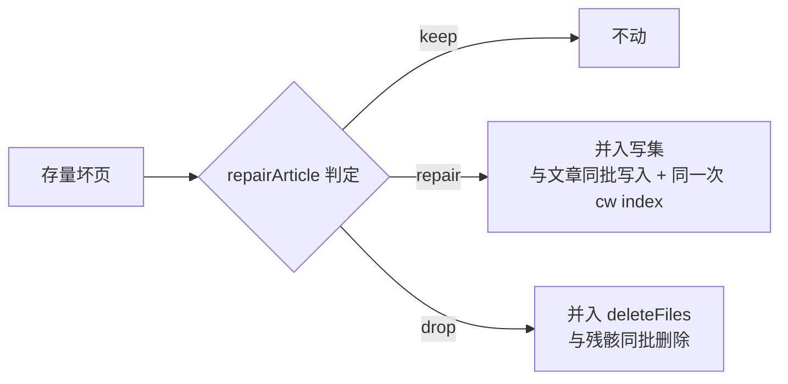

判删的唯一依据是「正文里混进了模型的思考/提示原文」（见 `lib/article-repair.js` 的 `LEAK_MARKERS`），其余四类纯格式缺陷（缺 frontmatter、前言污染、frontmatter 未闭合、type 与目录不符）一律修复。删掉的原文仍在 git 历史里，且会在 notes 里点名。

两条顺序约束：

- **体检在轮次判定之前**。判 drop 的页要进删除集，而删除集决定轮次；放在之后的话，库里只剩泄漏页的仓库会永远停在 `idle`，每次只记一笔阻塞、一页都不删。
- **本轮要删的页不参与修复**（`healSkip`）。给孤儿页补 frontmatter 只会让它重新成为合法页、从删除集里被摘出去，残骸就永远清不掉。

`idle` 轮只把可修页记进 notes，留给下一轮写盘时一并修好——因为修完必须重跑 `cw index`，而 idle 轮刻意不碰索引（每次状态查询都跑一次 `cw index` 会制造无意义的 wiki 提交）。

---

## 10. 删除集：四类残留页

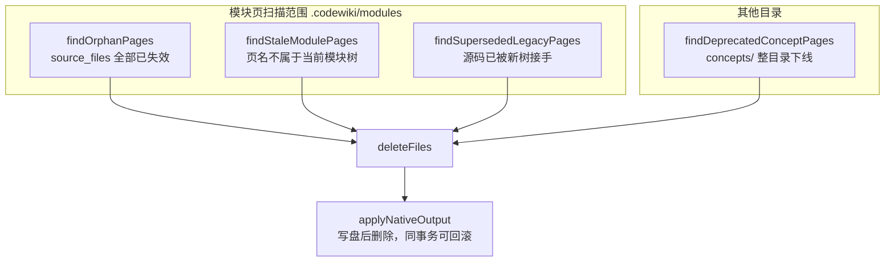

| 扫描器 | 判据 | 保守性设计 |
|--------|------|-----------|
| `findOrphanPages` | `source_files` 非空，且**每一个**在仓库里都不存在 | 空 `source_files` = 「没有归属证据」而非「全部失效」，跳过；只要有一个文件存在就不算孤儿（部分失效由 gate 的 `source-missing` 报）；frontmatter 缺失/坏掉的页不动 |
| `findStaleModulePages` | `module_tree` 非空时，模块页的 slug 对不上当前树任一模块；或落在子目录里（原生页永远 flat） | 整仓模式（`module_tree = {}`）直接返回 `[]`——没有权威模块名，凭名字删页会删掉全部正文 |
| `findSupersededLegacyPages` | 页名不在当前树 + 无 `fsoft_page` + `type: module` + **至少一个** `source_files` 已被当前树某模块认领 | 取「任一命中」而非「全部」：模块拆分/合并后旧页常留着新树不收录的附属文件，要求全量覆盖等于永远扫不到 |
| `findDeprecatedConceptPages` | `.codewiki/concepts/` 下的全部 `.md` | 原生通道从不写 `concepts/`，整目录清理；`learnings/`、`decisions/` 不在自动清理范围（删别人的手写内容是数据损失） |

`findStaleModulePages` 的判据刻意**只有一条**：「不是本轮写的就删」。每多一条可证特征，就多一类旧页能绕过它——真机上先后漏掉过三批（描述性 title、平铺在 `modules/` 根下、`source_files` 部分幸存）。`modules/` 是引擎的专属产物目录，不承载人工维护内容；删掉的原文见 git 历史，`findSupersededLegacyPages` 还会在 notes 里带上「接手它的源码路径」，便于事后按路径从历史里捞回。

所有删除都走 `deleteFiles` 进落地事务，**不在扫描器里直接 `rm`**：索引/基线失败时要能一起回滚，提交时才会记进同一个 commit。

---

## 11. 受管状态裁剪

`pruneRoots` 指向受管状态目录（如 `.codewiki/_native-state/docs`）。写盘之后，这些根下「本次写集里没有」的文件全部删除——因为受管状态是**下一轮引擎的输入**：上一轮有、本轮删掉的文章若留在状态里，下一轮水合会把它原样搬回 docs（已删的页复活、旧依赖图覆盖新图）。增量的正确性依赖「状态目录 == 上一轮引擎的最终产物」，这份等价关系只能靠裁剪维持。

实现要点：

- 裁剪根同样过 `checkTargetPath`。曾只做字符串前缀比较：`.codewiki/../src` 的前缀是 `.codewiki/`，白名单放行，`path.join` 之后解析成 `<repo>/src`，整棵源码目录被当成「多余状态文件」删掉。**删除通道绕过写集边界是最贵的一种走样**。
- 非法裁剪根必须可见（记 `write-failed` 并带 `prune-` 前缀），静默 `continue` 会让「本来该裁剪的目录没裁」与「裁了但没报」长得一样。
- 删除后 `pruneEmptyDirs` 自底向上收掉空目录；目录不进 pre-image（`restorePre` 会按文件路径重建父目录）。

裁剪的时机由调用方决定（见 [engine-runner：原生引擎执行与裁决编排](engine-runner.md)）：`idle` 轮与「受管状态不完整」时传空数组，否则会把上一轮完好的增量凭据按「本轮没写」整批删掉。

---

## 12. 自动提交

### 12.1 默认提交器 `commitWikiArtifacts`

本模块**不 import `index.js`**（那里是插件主入口，加载会连带拉起宿主服务与 webServer）。但「可注入」不等于「默认什么都不做」：默认必须自带一个同语义的提交器，否则产物只落盘不入库，而报告看起来仍是 done——那正是「自动提交失败被改写成成功」的前身。

提交前的前置检查（任一不满足即拒绝并返回 `reason`）：

1. 是 git 工作树（`rev-parse --is-inside-work-tree`）；
2. 有 HEAD（首次提交前拒绝）；
3. 不在 `MERGE_HEAD` / `REBASE_HEAD` / `CHERRY_PICK_HEAD` 中（否则会把 wiki 产物夹进别人的合并提交）；
4. 目标路径无未解决冲突（`ls-files -u`）；
5. 目标路径未被 `.gitignore` 忽略（`.codewiki/` 常被忽略，必须显式认出来，否则误报「无改动」并静默丢产物）；
6. 有未提交改动（`status --porcelain`）；
7. 仓库已配置 `user.name` / `user.email`。

提交时只 add `APPLY_WRITE_ROOTS` 中**磁盘上真实存在**的路径（固定 pathspec 在文件不存在时会让 `git add` 直接 fatal），使用 `commit --no-verify`（自动提交不该被 husky/lint-staged 卡住或改写），不 amend、不 push、不建主题分支（分支合并式留给阶段 4 注入的 `autoCommitWiki`）。

错误信息优先取 `error:` / `fatal:` 行：git 会把大量 CRLF/LF 警告写进 stderr，直接截前 200 字会把真正的错误挤到看不见的地方。

### 12.2 提交范围反查 `verifyCommitScope`

pathspec 只能约束「命令想提交什么」，不能证明「提交里真的只有这些」。所以提交成立后用 `git show --name-only --pretty=format: --first-parent <sha>` 反查实际内容：

- `--first-parent` 不可省：自动提交若走「主题分支 → merge 回原分支」，`git show --name-only` 对 merge commit 默认不输出与父提交的 diff，**空清单会被当成「没有越界路径」**，越界检查被洗白成 ok；
- 配合 `withQuotepathOff` + `decodeGitPaths`：中文模块名在默认 `core.quotepath=true` 下会被输出成八进制转义串，导致合法产物被判成「混进 wiki 之外的路径」，整轮被拉成 partial（详见 [引擎运行时工具层（engine-runtime-utils）](../engine-runtime-utils.md)）。

越界时记 `commit-scope`（映射到契约 `commit-failed`），但**不回滚**：文章与提交都真的存在，如实报出来让人处理。

---

## 13. 问题到阻塞原因的映射

`toApplyBlockers` 把落地问题翻成 `contract.js` 的 `BLOCKER_KINDS`（面板与终态判定共用一套词表）：

| 落地问题 kind | 契约 kind |
|---------------|-----------|
| `write-failed` | `quality-gate` |
| `index-failed` | `index-failed` |
| `baseline-failed` | `baseline-failed` |
| `commit-failed` | `commit-failed` |
| `commit-scope` | `commit-failed` |
| `not-writable` | `quality-gate` |
| `wiki-missing` | `index-failed` |
| `gate-partial` | `quality-gate` |

映射后还会校验 kind 是否落在 `BLOCKER_KINDS` 枚举内，写错直接抛错——契约测试会枚举全表，写错的 kind 会让面板与终态判定同时失明。

写集校验问题（`APPLY_PROBLEM_KINDS`）不单独进落地结果词表，统一记 `write-failed`，原子类别保留在 `detail` 前缀 `[kind]` 里（机读靠前缀，人读靠 detail）。

---

## 14. 初始化与 `entryMode`

`cw meta update` 要读 `.codewiki/_meta.yaml`，文件不在就 exit 1。所以落地器在写盘前会检查：

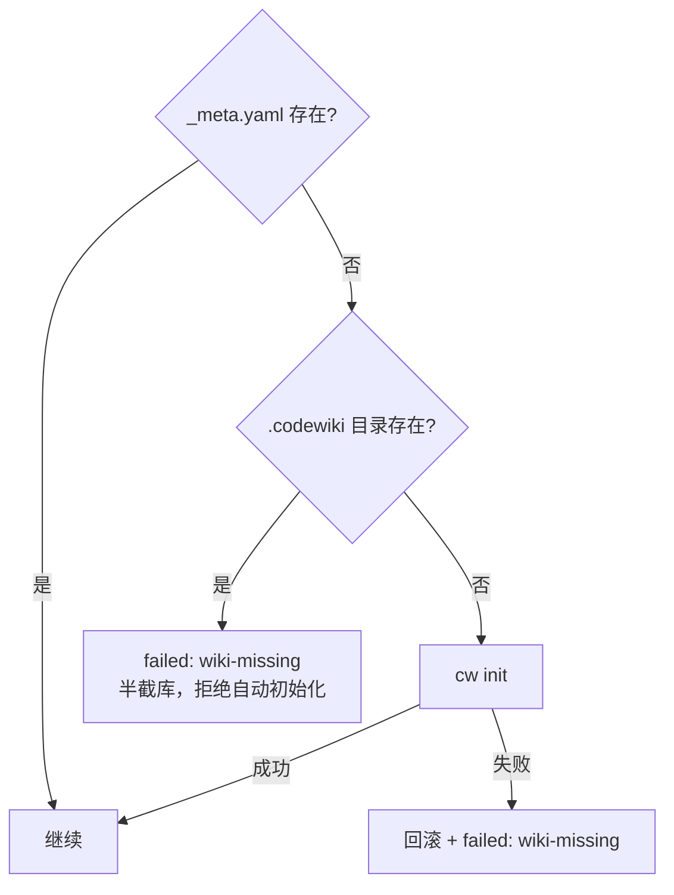

「有 `.codewiki` 却没有 `_meta.yaml`」是人工破坏的半截状态：`cw init` 在这里也会失败（它要先 load meta 才能说「已存在」），所以不猜、不手写配置文件、更不搬目录。

入口页 `CodeWiki.md` 的三种处置由 `entryMode` 决定：`keep`（已有则保留人工入口）、`skip`（不写）、`overwrite`（覆盖）。写入前会剥掉产物自带的 frontmatter（仓库级入口不参与 cw 索引，带 frontmatter 只是噪音），正文为空则直接失败。

---

## 15. 依赖与协作

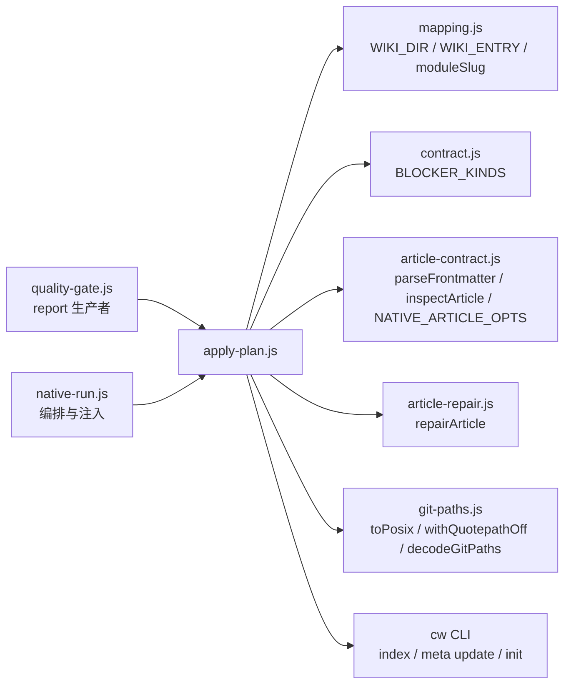

| 依赖 | 用途 | 相关文档 |
|------|------|----------|
| `mapping.js` | 写集白名单根、`_meta.yaml` 路径、模块页目录、`moduleSlug` | [engine-state-manifest：引擎清单与跨轮受管状态](../engine-state-manifest.md) |
| `contract.js` | `BLOCKER_KINDS` 枚举校验 | [engine-contract-quality：引擎契约与质量裁决层](../engine-contract-quality.md) |
| `article-contract.js` | frontmatter 解析、存量页体检口径 | [文章流水线（article-pipeline）](../../article-pipeline.md) |
| `article-repair.js` | 存量坏页「修 or 删」分流 | [文章流水线（article-pipeline）](../../article-pipeline.md) |
| `git-paths.js` | POSIX 归一、quotepath 关闭、转义解码 | [引擎运行时工具层（engine-runtime-utils）](../engine-runtime-utils.md) |
| `quality-gate.js` | `report` 的生产者，落地器的唯一裁决输入 | [engine-contract-quality：引擎契约与质量裁决层](../engine-contract-quality.md) |
| `native-run.js` | 编排调用方：注入 `extraFiles` / `pruneRoots` / `deleteFiles` / `advanceBaseline` | [engine-runner：原生引擎执行与裁决编排](engine-runner.md) |
| `cw` 可执行文件 | `init` / `index` / `meta update` | [codewiki-vendor（仓库内 vendored `cw` CLI）](../../../Execution_Runtime___Vendored_Engine/codewiki-vendor.md) |

### 环境与构建约束

- `cw` 二进制解析顺序：`deps.cwBinary` → 环境变量 `DSH_CODEWIKI_CW` → 裸命令 `cw`（依赖 `PATH`）。`package.json` 的 `files` 里同时打包了 `bin/cw` 与 `bin/cw.exe`，Windows 与 POSIX 各自可用。
- 包本身是纯 ESM（`"type": "module"`，`engines.node >= 24.9.0`），本模块只用 `node:fs`、`node:path`、`node:child_process` 的标准 API，无第三方依赖。
- 默认 `cw` 通道是同步 `spawnSync`（`timeoutMs` 默认 120000）；生产由编排层注入异步 `runCw`，签名一致地返回 `{exitCode, stdout, stderr, timedOut}`。

---

## 16. 设计取舍与已知边界

| 取舍 | 理由 | 代价 |
|------|------|------|
| 写集不完整就整批拒写 | 部分写入等于制造一份没人在意的半成品 | 一个坏路径会拖掉整轮落地 |
| 提交失败不回滚 | 文章本身是对的，删掉是二次损失 | 需要人处理 `commit-failed` 阻塞 |
| 提交失败但 `applied=true` | 事实是「写盘/索引/基线都成立」 | 调用方必须同时看 `applied` 与 `outcome` |
| `gate-partial` 照写 | `writable=true` 是「能写一部分」的合法状态 | 终态必须继续报 partial，基线不推进 |
| `modules/` 不兼容旧产物 | 判据越少越不容易漏删 | 人工补过的内容只剩 git 历史 |
| 默认内置提交器 | 「没注入就不提交」会把未入库写成成功 | 与 `autoCommitWiki` 需保持边界对齐 |
| 不 import `index.js` | 单测不该为了测一个写盘函数启动整个插件 | 索引链接规范化等能力需在本层另写一份 |
| `idle` 轮 `applied = !dryRun` | 「无需动作」不等于「已交付」 | 预览与实跑必须靠 `dryRun` 字段区分 |

延伸阅读：整条裁决链与终态合成见 [engine-runner：原生引擎执行与裁决编排](engine-runner.md)，上层编排模块概览见 [engine-orchestration 模块概览](../engine-orchestration.md)，编译任务与状态管理见 [作业编排与状态管理（Job Orchestration & State Management）](../../../Job_Orchestration___State_Management.md)。

??? abstract "Documented components (24)"
    - [`applyNativeOutput`](https://github.com/ikliml666/dsh-codewiki/blob/bc7e15a2499b5c4f334d4c0611eace4ad97c1c26/lib%5Cengine%5Capply-plan.js) — `lib\engine\apply-plan.js`
    - [`defaultRunCw`](https://github.com/ikliml666/dsh-codewiki/blob/bc7e15a2499b5c4f334d4c0611eace4ad97c1c26/lib%5Cengine%5Capply-plan.js) — `lib\engine\apply-plan.js`
    - [`findDeprecatedConceptPages`](https://github.com/ikliml666/dsh-codewiki/blob/bc7e15a2499b5c4f334d4c0611eace4ad97c1c26/lib%5Cengine%5Capply-plan.js) — `lib\engine\apply-plan.js`
    - [`findOrphanPages`](https://github.com/ikliml666/dsh-codewiki/blob/bc7e15a2499b5c4f334d4c0611eace4ad97c1c26/lib%5Cengine%5Capply-plan.js) — `lib\engine\apply-plan.js`
    - [`findStaleModulePages`](https://github.com/ikliml666/dsh-codewiki/blob/bc7e15a2499b5c4f334d4c0611eace4ad97c1c26/lib%5Cengine%5Capply-plan.js) — `lib\engine\apply-plan.js`
    - [`findSupersededLegacyPages`](https://github.com/ikliml666/dsh-codewiki/blob/bc7e15a2499b5c4f334d4c0611eace4ad97c1c26/lib%5Cengine%5Capply-plan.js) — `lib\engine\apply-plan.js`
    - [`parseFrontmatter`](https://github.com/ikliml666/dsh-codewiki/blob/bc7e15a2499b5c4f334d4c0611eace4ad97c1c26/lib%5Carticle-contract.js) — `lib\article-contract.js`
    - [`parseYamlLite`](https://github.com/ikliml666/dsh-codewiki/blob/bc7e15a2499b5c4f334d4c0611eace4ad97c1c26/lib%5Carticle-contract.js) — `lib\article-contract.js`
    - [`unquote`](https://github.com/ikliml666/dsh-codewiki/blob/bc7e15a2499b5c4f334d4c0611eace4ad97c1c26/lib%5Carticle-contract.js) — `lib\article-contract.js`
    - [`extractSections`](https://github.com/ikliml666/dsh-codewiki/blob/bc7e15a2499b5c4f334d4c0611eace4ad97c1c26/lib%5Carticle-contract.js) — `lib\article-contract.js`
    - [`fencesBalanced`](https://github.com/ikliml666/dsh-codewiki/blob/bc7e15a2499b5c4f334d4c0611eace4ad97c1c26/lib%5Carticle-contract.js) — `lib\article-contract.js`
    - [`collectWikiLinks`](https://github.com/ikliml666/dsh-codewiki/blob/bc7e15a2499b5c4f334d4c0611eace4ad97c1c26/lib%5Carticle-contract.js) — `lib\article-contract.js`
    - [`stripCode`](https://github.com/ikliml666/dsh-codewiki/blob/bc7e15a2499b5c4f334d4c0611eace4ad97c1c26/lib%5Carticle-contract.js) — `lib\article-contract.js`
    - [`blank`](https://github.com/ikliml666/dsh-codewiki/blob/bc7e15a2499b5c4f334d4c0611eace4ad97c1c26/lib%5Carticle-contract.js) — `lib\article-contract.js`
    - [`hasDuplicateFrontmatter`](https://github.com/ikliml666/dsh-codewiki/blob/bc7e15a2499b5c4f334d4c0611eace4ad97c1c26/lib%5Carticle-contract.js) — `lib\article-contract.js`
    - [`isRepoRelativeFile`](https://github.com/ikliml666/dsh-codewiki/blob/bc7e15a2499b5c4f334d4c0611eace4ad97c1c26/lib%5Carticle-contract.js) — `lib\article-contract.js`
    - [`inspectArticle`](https://github.com/ikliml666/dsh-codewiki/blob/bc7e15a2499b5c4f334d4c0611eace4ad97c1c26/lib%5Carticle-contract.js) — `lib\article-contract.js`
    - [`push`](https://github.com/ikliml666/dsh-codewiki/blob/bc7e15a2499b5c4f334d4c0611eace4ad97c1c26/lib%5Carticle-contract.js) — `lib\article-contract.js`
    - [`logFileOf`](https://github.com/ikliml666/dsh-codewiki/blob/bc7e15a2499b5c4f334d4c0611eace4ad97c1c26/lib%5Cjob-logs.js) — `lib\job-logs.js`
    - [`serialize`](https://github.com/ikliml666/dsh-codewiki/blob/bc7e15a2499b5c4f334d4c0611eace4ad97c1c26/lib%5Cjob-logs.js) — `lib\job-logs.js`
    - [`appendLog`](https://github.com/ikliml666/dsh-codewiki/blob/bc7e15a2499b5c4f334d4c0611eace4ad97c1c26/lib%5Cjob-logs.js) — `lib\job-logs.js`
    - [`trimIfNeeded`](https://github.com/ikliml666/dsh-codewiki/blob/bc7e15a2499b5c4f334d4c0611eace4ad97c1c26/lib%5Cjob-logs.js) — `lib\job-logs.js`
    - [`readLogTail`](https://github.com/ikliml666/dsh-codewiki/blob/bc7e15a2499b5c4f334d4c0611eace4ad97c1c26/lib%5Cjob-logs.js) — `lib\job-logs.js`
    - [`logStats`](https://github.com/ikliml666/dsh-codewiki/blob/bc7e15a2499b5c4f334d4c0611eace4ad97c1c26/lib%5Cjob-logs.js) — `lib\job-logs.js`

