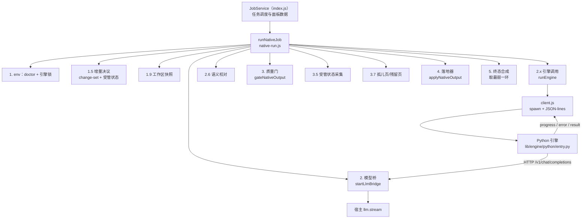
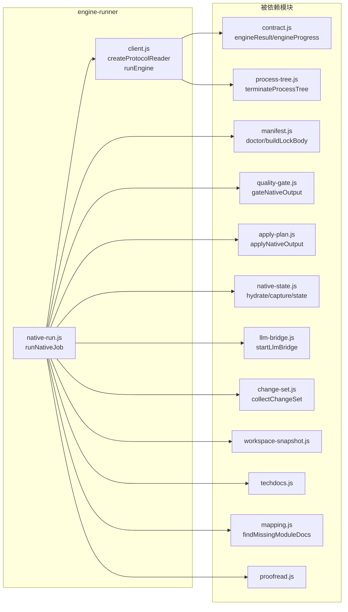
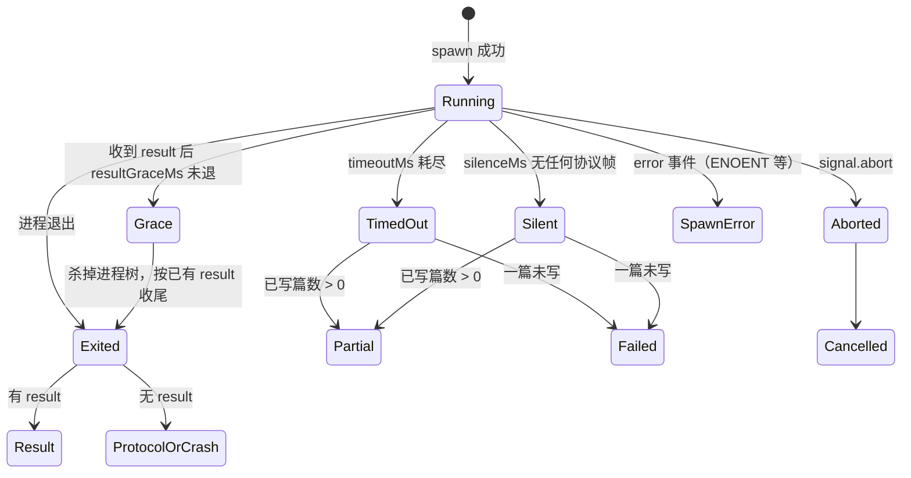
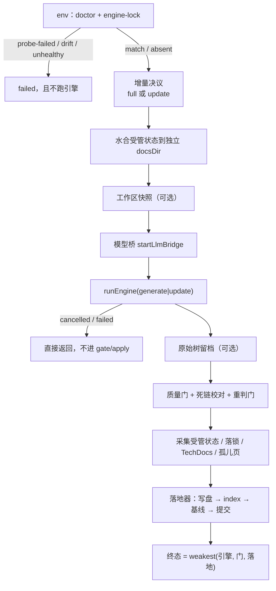
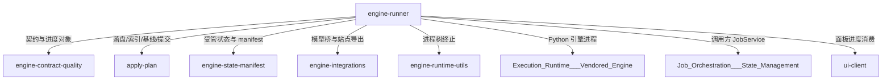
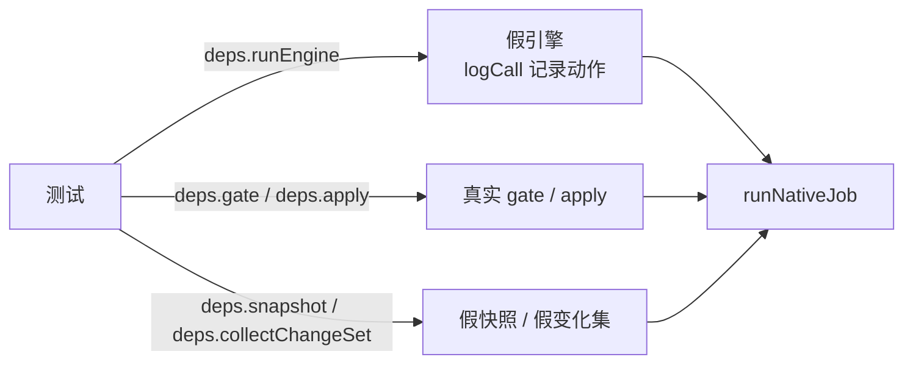

# engine-runner：原生引擎执行与裁决编排

!!! info "Generated documentation"
    This page was written by CodeWiki from the source code at commit [`eea7ea80`](https://github.com/ikliml666/dsh-codewiki/commit/eea7ea80bdb6b5c9a429ba0978f0b9ccc8885a96) on 2026-11-08 with `deepseek-v4.1-flash`. Check the code before relying on details.

`engine-runner` 是 `Documentation_Generation_Engine/engine-core/engine-orchestration` 下的执行层，负责把「一次 CodeWiki 编译」从一句请求变成**可机读的终态结论**。它只包含两个文件，却承担两类完全不同性质的职责：

| 文件 | 职责 | 性质 |
| --- | --- | --- |
| `lib/engine/client.js` | Node ↔ Python 的**唯一跨语言边界**：起子进程、写一行 JSON 请求、读回 JSON-lines、把消息翻译成契约对象 | 传输层（协议 + 进程生命周期） |
| `lib/engine/native-run.js` | 一次原生编译的**裁决链**：环境 → 增量决议 → 引擎 → 质量门 → 落地器 → 终态合成 | 编排层（业务裁决） |

两者被刻意分开，是为了避免「传输层长成第二个编译器」，也为了避免「裁决散落在调用方（`index.js` 的 JobService）里各自猜引擎到底成功了没有」。设计注释里反复出现的同一句话是：**每一步的结论都不能被下一步洗白**。

对外暴露的符号很少：`client.js` 导出 `runEngine`（另有纯函数 `createProtocolReader` 供逐字节测试）与 `ENGINE_PROTOCOL_VERSION`；`native-run.js` 导出 `runNativeJob`、`DEFAULT_ENGINE_ENTRY`（`lib/engine/python/entry.py`）与 `DEFAULT_ENGINE_TIMEOUT_MS`（180 分钟），其中的 `noop` 只是 `onProgress` / `onLog` 的默认空回调，保证调用方不传回调时行为确定、不必到处判空。

上游调用方是 `index.js` 的 JobService（见 [作业编排与状态管理（Job Orchestration & State Management）](../../../Job_Orchestration___State_Management.md)），下游依赖是契约、质量门、落地器、状态持久化、模型桥等模块（见下文「依赖关系」）。

---

## 1. 架构总览

三条清晰的边界：

1. **进程边界**：只有 `client.js` 会 `spawn`，只有它认识 stdout 的 JSON-lines 格式。`native-run.js` 通过 `runEngineImpl` 注入调用，测试可整体替换成假引擎。
2. **语义边界**：所有跨层数据都必须是 `contract.js` 的 `EngineResult` / `EngineProgress` / `EngineError`，非法构造会抛错（见 [engine-contract-quality：引擎契约与质量裁决层](../engine-contract-quality.md)）。
3. **落盘边界**：`native-run.js` 自己**不写** `.codewiki/`，一切写、删、裁剪、索引、基线、提交都交给落地器，从而共享同一份 pre-image 与回滚语义（见 [apply-plan 落地器](apply-plan.md)）。

### 组件关系

---

## 2. 子模块文档

本模块按「传输层 / 编排层」拆成两页：

| 子模块 | 覆盖内容 | 文档 |
| --- | --- | --- |
| `engine-runner_process-protocol` | `createProtocolReader` 的增量 JSON-lines 解析、协议不变量、违规分类、`runEngine` 的竞速与收尾（超时 / 静默 / 取消 / 结果宽限 / 崩溃） | [engine-runner/engine-runner_process-protocol.md](engine-runner/engine-runner_process-protocol.md) |
| `engine-runner_native-pipeline` | `runNativeJob` 的完整裁决链、增量决议、状态水合与采集、无变化轮、终态「取最弱」合成、依赖注入面 | [engine-runner/engine-runner_native-pipeline.md](engine-runner/engine-runner_native-pipeline.md) |

---

## 3. 核心机制速览

以下各小节只给结论与关键不变量；完整推导、真实事故记录、字段表与排障对照分别在两篇子模块文档中：协议与进程生命周期见 [engine-runner/engine-runner_process-protocol.md](engine-runner/engine-runner_process-protocol.md)（第 3.1、3.2 节展开），裁决链与增量/状态机制见 [engine-runner/engine-runner_native-pipeline.md](engine-runner/engine-runner_native-pipeline.md)（第 3.3–3.7 节展开）。

| 本页小节 | 详见 |
| --- | --- |
| 3.1 协议、3.2 兜底竞速 | [engine-runner 进程与协议层](engine-runner/engine-runner_process-protocol.md) |
| 3.3 裁决链、3.4 增量决议、3.5 无变化轮与状态完整性、3.6 工作区快照、3.7 可观测性 | [engine-runner 原生编译流水线](engine-runner/engine-runner_native-pipeline.md) |

### 3.1 协议：一行 JSON 请求，回一组 JSON-lines

请求：`{"requestId": "...", "action": "doctor|generate|update|cancel", ...payload}` + 换行，随后关闭 stdin（引擎读到 EOF 开始干活）。

响应帧类型：

| 类型 | 含义 | 是否影响终态 |
| --- | --- | --- |
| `hello` | 协议版本握手（`ENGINE_PROTOCOL_VERSION = 1`） | 版本不符记违规，但不改变语义 |
| `progress` | 阶段/百分比/计数快照 | 只用于面板与「超时但已写 N 篇」的抢救判定 |
| `error` | 引擎主动报的语义错误 | 记录，后续可能还有 `result` |
| `result` | 唯一权威的语义结论 | 是 |

关键不变量（由 `test-engine-client.mjs` 断言，详见子模块页）：

- stdout **只**允许 JSON-lines；非 JSON 行记 `not-json`，但**不丢弃**已收结果；
- 每条消息必须带匹配的 `requestId`，不匹配记 `unknown-request`，绝不参与本次结果；
- **没有 `result` 消息 = 协议破坏**，即使退出码为 0 也判失败（`engine-protocol`）；
- 退出码只表达**进程层**结果；语义以 `result` 为准（退出码 0 + 语义 failed 是失败；语义 done + 非 0 退出保留 done 并记 `nonzero-exit`）；
- 取消后到达的 result 记 `late-result` 并丢弃——取消是终态，不能被迟到的成功洗白；
- 重复 result 先到的赢。

### 3.2 三种「不死不活」的兜底

`runEngine` 用 `Promise.race` 同时等待六件事：`exited` / `timeout` / `silence` / `abort` / `spawn-error` / `result-grace`。

三条兜底各自的理由（源码注释里的真实事故）：

- **`silence`（默认 10 分钟，可用 `DSH_CODEWIKI_ENGINE_SILENCE_MS` 覆盖，下限 30 秒）**：`timeoutMs` 只兜「跑太久」，兜不住「已经卡死」。真机事故里引擎进程 CPU 52 分钟只涨 14 秒、主线程停在 asyncio 空转，180 分钟超时被完整占满，调度闸门（`parallelLimit` 默认 1）因此被锁死。判据是「多久没收到任何协议帧」，引擎在长阶段由 `entry.py` 的心跳线程按 `_HEARTBEAT_SEC = 10s` 补帧，正常运行的引擎不会静默这么久（阈值与心跳相差 60 倍，避免心跳自己被判成卡死）。
- **`result-grace`（默认 2000ms）**：语义结论已经由 `result` 给出，若进程卡在收尾（僵死线程、未关 pipe），不该让一轮**已确定成功**的编译被改判成卡死/超时——那会让产物白写、基线不推进、下一轮重跑。
- **超时/静默的 partial 抢救**：`writtenCount > 0` 时返回 `partial` 并带 `engine-timeout` blocker，允许上层保住已写文章并（在门与落地器都许可时）推进基线，从而打破「永远超时 ⇒ 永远不推进 ⇒ 永远重跑」的死循环。

### 3.3 裁决链：一条直线，最弱的一环说了算

`runNativeJob` 把一次编译固定成一条直线，且**终态取各环节的最弱者**：

合成规则（`RANK = { cancelled: 0, failed: 1, partial: 2, done: 3 }`，`weakest` 取小者），并叠加三条收口：

- `done` 不许带 blockers：若三者都说 done 却仍有阻塞原因，**降级为 `partial`**（宁可降级也不掩盖）；
- `partial` 必须带 blockers：缺失时补一条 `quality-gate`，写明引擎/门/落地各自结论；
- `failed` 必须带 `error`，优先取落地器第一条 blocker 的 detail。

硬不变量（与 `contract.js` / `quality-gate.js` / `apply-plan.js` 的不变量叠加）：

1. 锁不一致 / 依赖不闭合 → 直接 failed，**不跑引擎**（跑出来的产物不可信，且会让用户看到一堆无意义的失败文章）；
2. 引擎 `done` **不能**替代质量门：门说 `partial`，终态就是 `partial`；
3. 落地器说 `partial`/`failed`，终态不许是 `done`：产物没入库就是没交付；
4. `failed`/`cancelled`/`partial` 一律不推进基线（已写出的合格文章可保留，但不能据此把整批变化记为已消费）；
5. 取消是终态：取消后不再 gate/apply；但落地器**不接 signal**，若落地事务已跑完并给出结论，就按真实结果收尾，只把「取消来晚了」记进 notes——否则已提交、已推进基线的一轮会在终态里变成「未落地」，下一轮重复消费。

### 3.4 增量决议：由证据决定，而不是由调用方的字面量决定

`scope` / `kind` 只是**意图**，「这一轮到底全量还是组件级增量」由三个可查事实决定：

| 问题 | 判据 | 不成立时的处置 |
| --- | --- | --- |
| 变化是什么？ | 四路变化集（committed/staged/unstaged/untracked）+ 上轮 `unconsumed` 携带 | 变化集不可信（`git-error`）→ 显式 full |
| 能不能增量？ | 受管状态齐全（`module_tree.json` / `metadata` / 依赖图）、引擎版本一致、cw 基线可达（`_meta.yaml` 在 HEAD 里）、有独立的 `docsDir` | 任一不成立 → 显式 full，并记 `incremental-fallback` |
| 消费成立吗？ | 引擎真的做了组件级增量（`updateOutcome ∈ {incremental, no_change}`）**且** gate/apply 全部 done | 否则不推进基线，下一轮仍从旧基线算起，变化不丢 |

两个容易踩错的细节：

- **`rung=0` 不是降级**：用户显式选「按文件失效全量重写」，因此不挂 `incremental-fallback` blocker（`rungLegacyFull` 把它从 `degradedToFull` 里摘出去）。
- **「变化集为空」不是跳过引擎的理由**：FSoft 的「有没有变」由图 diff 决定，重命名/跨文件重构能让路径集非空而图不变，反之亦然。

增量决议还带一个「缺页修复凭据」`missingRepair`：若水合后的模块树里有从未写过页面的模块（或 `overview.md` 含指向已消失页面的陈链），即使源码无变化也必须转全量修复；若同一棵基线树上同一批缺口已经试过一次全量仍补不上，则**不再重复全量**（避免每轮白跑几十分钟），但缺口仍如实计入终态。

### 3.5 无变化轮（idleRound）与受管状态完整性

`idleRound` 的判据是三者同时成立：引擎报 `no_change`、变化集为空、没有跨轮未消费路径。

- idle 轮**不重写**受管状态（否则每次状态查询都产生一次纯记账提交），也不裁剪、不推进基线、不提交；
- `stateIncomplete`（缺 `module_tree` / `metadata` / 依赖图，或采集异常）是**blocker 级**缺陷：文章可照写，但这一轮没为下一轮留下增量凭据，因此终态不得为 `done`，也不裁旧状态、不推进基线。

### 3.6 工作区快照：让「文章反映的内容」与「账本指向的提交」对齐

FSoft 只从 `<old_commit>..<new_commit>` 取 diff，读的却是工作区文件。若工作区有未提交改动，就会出现「文章反映了工作区、账却指向 HEAD」，下一轮把 HEAD 当 `old_commit` 就把这些改动当成已消化——这是「变化悄悄丢」的入口。因此在引擎启动前用独立 `GIT_INDEX_FILE` 造一个含全部未提交改动的临时 commit（**不挂任何 ref**，gc 后自然消失），让本轮 `commitId` 指向它。造不出快照**不算失败**：退回 HEAD 记账并记 note（快照是对齐精度的改进，不是编译成立的前提）。

### 3.7 可观测性：三类「不许静默」的事实

源码里反复强调「沉默即缺陷」，实现上体现为：

- **进度帧不吞异常**：`engineProgress` 校验 stage 必须属于 `ENGINE_STAGES`，传契约外的阶段名是编程错误必须当场响（0.17.32 把校对帧写成 `proofread` 时被 try/catch 吞掉，面板「校对」格永不点亮而测试全绿）；
- **模型空产出计数**：`bridge.stats().emptyResponses` 记录「上游 200 但既无正文也无工具调用」的次数，这类调用会被引擎记成「这一页无需改动」，是假 done 的来源之一，因此必须进 notes；
- **状态自报与实际采集交叉核对**：引擎自报 `artifacts.stateFiles` 有、而 `captureDocsDir` 没采集到的项会被点名，避免悄悄当成「已持久化」。

进度帧经 `onProgress` 透出后同时驱动两件事：上层面板的阶段条（见 [ui-client（浏览器半侧客户端）](../../../ui-client.md)）与模型桥的阶段选档（`bridge.setStage`，按阶段选 `reasoningEffort`）。

---

## 4. 配置与运行环境

`runNativeJob` 的行为受插件配置驱动（`cordis.patch.yml` 的 `config` 命名空间 `codewiki`，默认值在 `index.js` 的 Config schema 中声明）：

| 配置键 | 影响 | 默认 |
| --- | --- | --- |
| `nativeEnginePython` | venv 解释器绝对路径；留空 → `DSH_CODEWIKI_PYTHON` → `python`（不做「找一个能用的解释器」的启发式） | 空 |
| `nativeEngineEntry` | 入口脚本，缺省 `DEFAULT_ENGINE_ENTRY = lib/engine/python/entry.py` | 内置 |
| `nativeEngineTimeoutMs` | 单次引擎上限；超时由 `client.js` 终止进程树兜底，不靠上层 tick | 180 分钟（`DEFAULT_ENGINE_TIMEOUT_MS`） |
| `moduleConcurrency` | 原生引擎同层模块并行度（1–8，0=跟随 `maxConcurrency`） | 1（严格串行） |
| `articleLanguage` | 文章语言，一路带到引擎 `payload.language`（不传即静默按英文写） | 中文 |
| `techdocs` | 导出 Backstage TechDocs 到 `.codewiki/_techdocs/` | 关 |
| `autoCommit` | 落地器自动提交 wiki 产物 | 开 |

180 分钟的来历：真机唯一一次跑完的编译分阶段实测 `articles 66.0min + crosscut 10.0min + review 68.9min + queued 29.2min ≈ 174 分钟`，早期 45 分钟预算会在阶段 3 刚开头（percent 54）被砍掉，一篇都写不出来——那不是编译失败，是预算低于物理耗时。

运行环境约束见 `package.json`：`node >= 24.9.0`、`dsh >= 0.2.0-rc.0`；原生通道需要本机 Python 3.10+ 与闭合依赖环境（修复脚本 `tools/fsoft-engine/setup-env.sh`，见 [构建与开发基础设施（Build___Development_Infrastructure）概述](../../../Build___Development_Infrastructure.md)）。依赖不闭合时以 `engine-deps` 明确失败，绝不「先跑起来再说」。

---

## 5. 依赖关系与相关文档

- 本模块内页：进程与协议层 [engine-runner 进程与协议层](engine-runner/engine-runner_process-protocol.md)、原生编译流水线 [engine-runner 原生编译流水线](engine-runner/engine-runner_native-pipeline.md)
- 契约、质量门、死链校对、wiki 链接判定：[engine-contract-quality：引擎契约与质量裁决层](../engine-contract-quality.md)
- 落地器（写集 / pre-image / 回滚 / 孤儿页判定）：[apply-plan 落地器](apply-plan.md)
- 受管状态、模块映射、工作区快照、引擎锁：[engine-state-manifest：引擎清单与跨轮受管状态](../engine-state-manifest.md)
- 模型桥、占位 key、TechDocs 导出：[引擎外部集成层（模型桥与 TechDocs 回读）](../engine-integrations.md)
- 进程树终止与输出工具：[引擎运行时工具层（engine-runtime-utils）](../engine-runtime-utils.md)
- Python 引擎侧（entry.py、并行运行时、stage_map）：[Execution_Runtime___Vendored_Engine 概览](../../../Execution_Runtime___Vendored_Engine.md)
- 任务调度、进度落账、面板数据源：[作业编排与状态管理（Job Orchestration & State Management）](../../../Job_Orchestration___State_Management.md)
- 上层模块概览：[engine-orchestration 模块概览](../engine-orchestration.md) / [engine-core 模块概览](../../engine-core.md) / [Documentation_Generation_Engine 模块概览](../../../Documentation_Generation_Engine.md)

---

## 6. 结果对象的关键字段

`runNativeJob` 返回的是一份「`EngineResult` + 现场证据」：

| 字段 | 语义 | 谁消费 |
| --- | --- | --- |
| `outcome` / `stage` / `blockers` / `error` | 契约终态 | JobService 终态判定、面板 |
| `writtenCount` / `keptCount` / `removedCount` / `unmappedCount` / `failedCount` | 只认落地器实际写入数与引擎自报计数，绝不互相冒充 | 面板「已写/删除/未映射」 |
| `baselineEligible` | 质量门**许可**（三类问题全空） | 上层解释「为何可推」 |
| `baselineAdvanced` | 落地器**事实**（`cw meta update` 真的成功） | 上层落账 |
| `canAdvanceBaseline` | 兼容字段，语义取落地事实 | 老调用方 |
| `incremental` | 决议现场：resolution / changeSet / hydrated / unconsumed / fallbackReason / updateOutcome / stateMissing | 排障与测试 |
| `gate` | 门的 outcome、writable、逐篇明细、counts | 面板逐篇「已写/失败」 |
| `apply` | 写/删/裁剪清单、index、baseline、commit | 交付审计 |
| `artifacts` | docsDir、引擎自报 rawTreeDir、updateRecord、我们自己的原始树留档、TechDocs 目录 | 取证 |
| `notes` | 人读的过程事实（快照、校对改写、清理、空产出…） | 面板日志 |

其中三个基线事实**分开记、不互相冒充**：`baselineEligible`（许可）、`baselineAdvanced`（事实）、`canAdvanceBaseline`（兼容别名）。历史上这里曾用「outcome=partial 且 rawTreeFiles>0 就当可推进」，等于拿产物数量猜基线许可，与门和落地器的判断各说各话。

---

## 7. 测试可替换面

`runNativeJob` 的全部外部依赖都可注入（`deps` 参数），因此测试可以用「假 `runEngine` + 真实 gate/apply」既覆盖接线又覆盖裁决：

可注入项：`doctor`、`runEngine`、`gate`、`apply`、`bridge`、`probe`、`engineFor`、`config`、`collectChangeSet`、`stateDir`、`snapshot`、`llm`、`onRequestStart`、`captureSite`、`proofreadPages`、`chat`、`findOrphanPages`、`findStaleModulePages`、`findSupersededLegacyPages`、`findDeprecatedConceptPages`、`updateOptions`、`applyDeps`。

单测还依赖 `client.js` 的两处纯函数式设计：`createProtocolReader` 不碰进程（可逐字节喂，模拟管道任意切分），以及 `DSH_CODEWIKI_ENGINE_SILENCE_MS` 允许把静默阈值压到 30 秒以上便于快速验证。

??? abstract "Documented components (2)"
    - [`runEngine`](https://github.com/ikliml666/dsh-codewiki/blob/eea7ea80bdb6b5c9a429ba0978f0b9ccc8885a96/lib%5Cengine%5Cclient.js) — `lib\engine\client.js`
    - [`noop`](https://github.com/ikliml666/dsh-codewiki/blob/eea7ea80bdb6b5c9a429ba0978f0b9ccc8885a96/lib%5Cengine%5Cnative-run.js) — `lib\engine\native-run.js`

