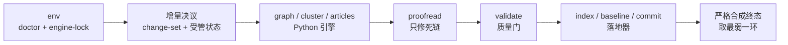
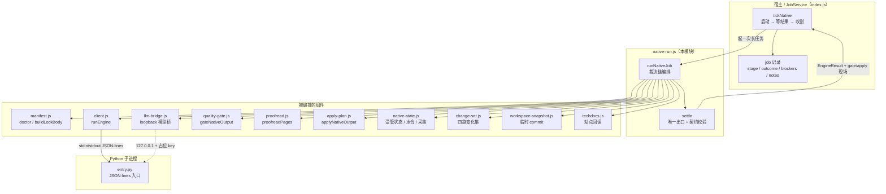
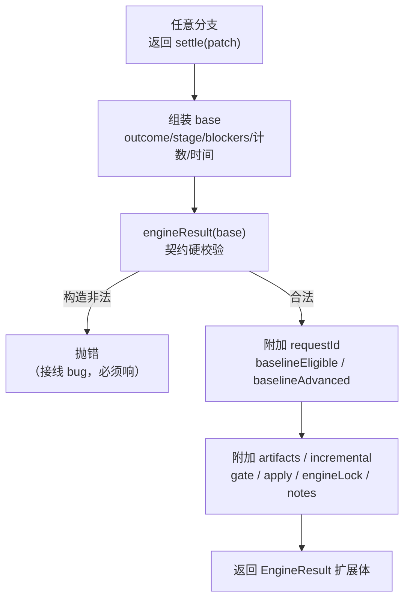
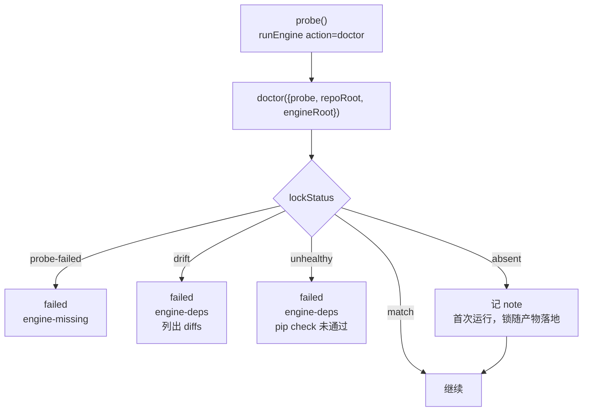
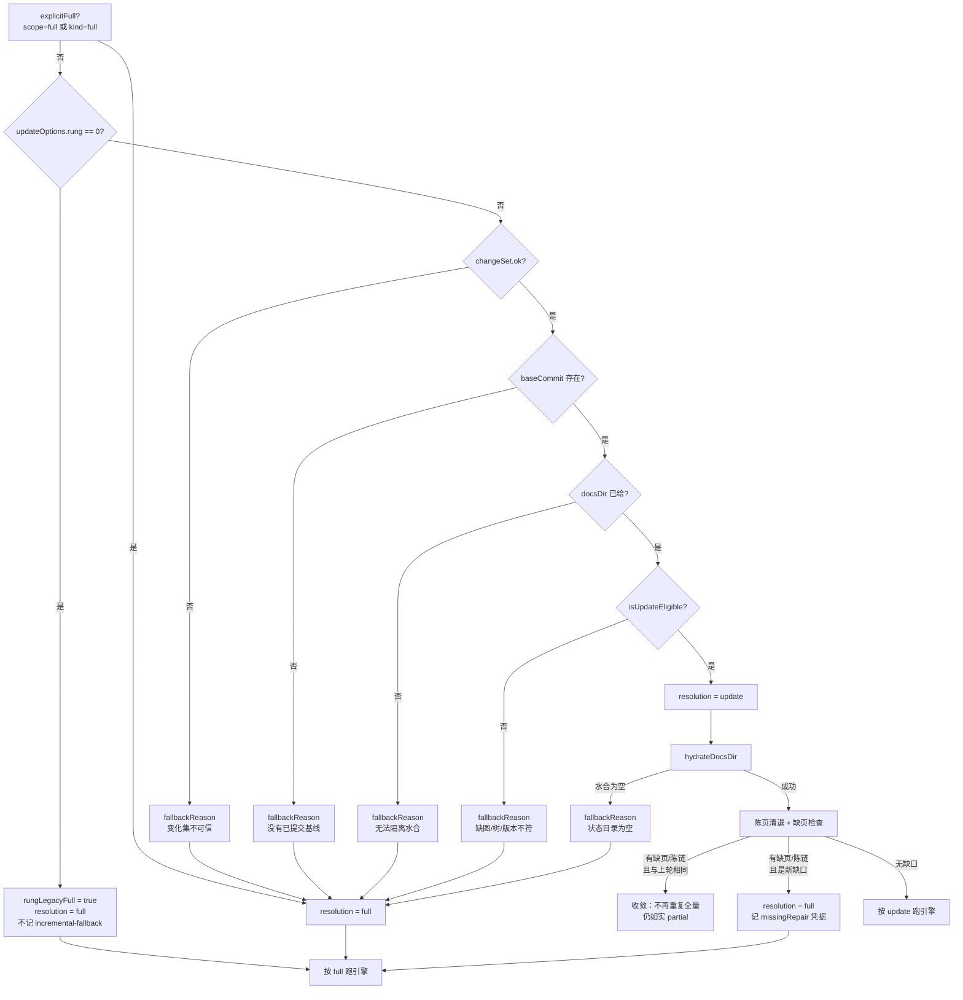
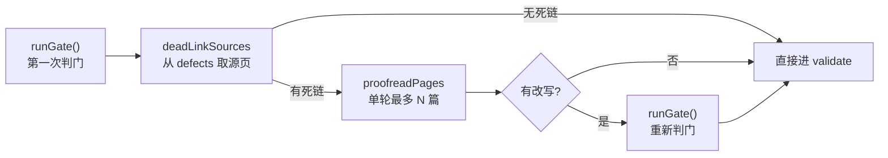
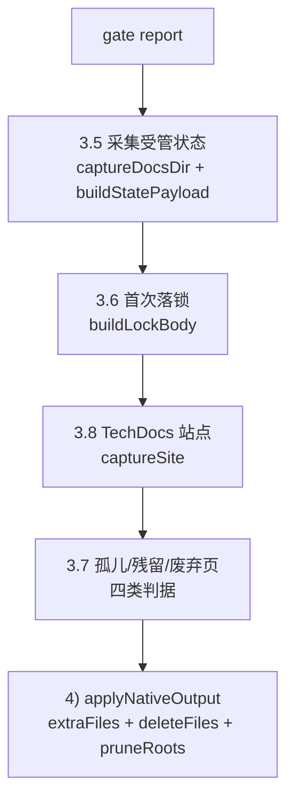
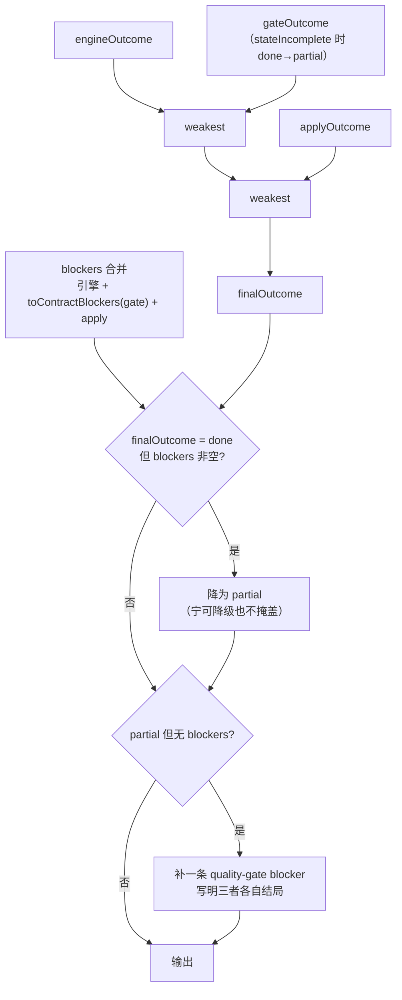
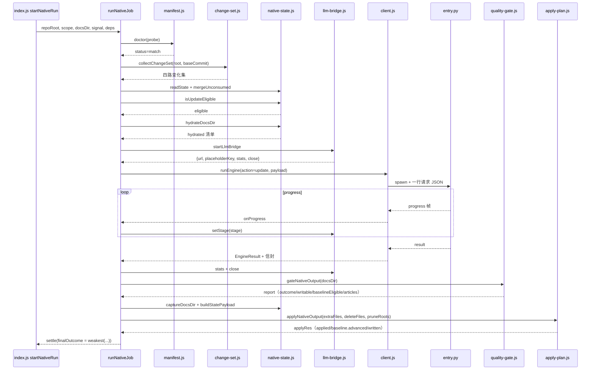

# engine-runner 原生编译流水线

!!! info "Generated documentation"
    This page was written by CodeWiki from the source code at commit [`d16751f5`](https://github.com/ikliml666/dsh-codewiki/commit/d16751f5dd58ee0741d861266965e322cbe7a60d) on 2026-11-09 with `deepseek-v4.1-flash`. Check the code before relying on details.

本页描述 `lib/engine/native-run.js` 的 `runNativeJob`：插件生产通道中**一次完整编译的编排与裁决**。它把分散在各层的组件（环境清单、Python 引擎、质量门、落地器、跨轮受管状态、模型桥）串成一条不可回退的直线，并给出一个**严格终态**——任何一环没走完，终态都不会被后续步骤洗白成 `done`。

一句话定位：`client.js` 负责「怎么跟引擎说话」（见 [engine-runner 进程与协议层](engine-runner_process-protocol.md)），`native-run.js` 负责「这一次编译到底算不算成立」。

---

## 1. 为什么需要独立一层

插件主入口 `index.js` 已超过 4800 行。如果把 `doctor` / 锁校验 / 模型桥 / `runEngine` / 质量门 / 落地器全塞进 tick，会让「终态到底由谁裁决」再次含糊——0.14.0 花一整轮修掉的缺陷正是这一类（引擎说 `done` 就 `done`，产物没入库也报完成）。

因此本层只做一件事：把裁决链固定成一条直线，每一步的结论都不能被下一步洗白。



### 1.1 五条硬不变量

| # | 不变量 | 违反后的行为 |
| --- | --- | --- |
| 1 | 锁不一致 / 依赖不闭合 → **不跑引擎** | 直接 `failed`，`stage: 'env'` |
| 2 | 引擎 `done` **不能**替代质量门 | gate 说 `partial`，终态就是 `partial` |
| 3 | 落地器说 `partial`/`failed`，终态不许是 `done` | 产物没入库即没交付 |
| 4 | `failed`/`cancelled`/`partial` 一律不推进基线 | 未完整消化的变化留到下一轮 |
| 5 | 取消是终态 | 取消后不再 gate/apply，也不覆盖已写好的终态 |

不变量 2/3 与 [engine-contract-quality：引擎契约与质量裁决层](../../engine-contract-quality.md) 中 `contract.js`、`quality-gate.js` 的语义不变量叠加；不变量 3 的实现细节属于 [apply-plan 落地器](../apply-plan.md)。

---

## 2. 在系统中的位置



调用方在 `index.js` 的 `startNativeRun` 里以**长任务**方式启动它（一次 `generate` 全跑完，不塞进 10s tick），结果通过 `nativeResults` Map 由 `tickNative` 收割。`docsDir`、`techdocsDir`、`rawTreeRoot` 全部指向**仓库外**的临时目录，理由见第 8 节。

---

## 3. 入口与依赖注入

### 3.1 函数签名

`runNativeJob(options)` 的完整参数面：

| 参数 | 默认 | 作用 |
| --- | --- | --- |
| `repoRoot` | 必填 | 仓库根（绝对路径），缺省抛错 |
| `scope` | `'full'` | `full` / `stale` / `auto`，与 `kind` 一起决定增量语义 |
| `kind` | `null` | 任务 kind，`full` / `stale` |
| `requestId` | 时间戳生成 | 协议关联键，同时用于留档目录命名 |
| `signal` | `null` | 取消信号，终止受管子进程树 |
| `timeoutMs` | `DEFAULT_ENGINE_TIMEOUT_MS` | 引擎单次超时 |
| `requireCommittedInput` | `true` | 传给质量门，要求产物对应已提交 HEAD 或本轮快照 |
| `docsDir` | `null` | 引擎产物目录；**增量必须给**（见 4.3） |
| `language` | `''` | 文章书写语言，透传引擎 `agent_instructions.language` |
| `moduleConcurrency` | `1` | 同层模块并行度，1 = 上游原始串行 |
| `requestLimit` | `0` | 单模块 LLM 请求上限，0 = 用引擎默认 |
| `emptyStreakLimit` | `3` | 连续空产出熔断阈值（0 = 关闭）；同一个值同时下发给模型桥与引擎侧 |
| `resume` | `false` | 断点续跑：水合时不覆盖已有产物 |
| `rawTreeRoot` | `null` | 原始树留档根（仓库外），留空不留档 |
| `techdocsDir` | `null` | TechDocs 站点目录（仓库外），留空不导出 |
| `deps` | `{}` | 依赖注入表（测试用） |
| `onProgress` | `noop` | 进度帧回调 |
| `onLog` | `noop` | 事件日志回调 |

`noop`（本模块在模块树中登记的符号）就是 `function noop() {}`——`onProgress` / `onLog` 的默认实现。它本身没有逻辑，但它保证了「不接回调」与「回调抛错」在语义上彻底分开：默认实现永不抛错，而调用方提供的实现抛错必须冒泡（见 9.2）。

### 3.2 依赖注入表

```js
const doctorImpl  = deps.doctor  ?? realDoctor
const runEngineImpl = deps.runEngine ?? realRunEngine
const gateImpl    = deps.gate    ?? realGate
const applyImpl   = deps.apply   ?? realApply
const bridgeImpl  = deps.bridge  ?? realBridge
```

其余可注入项：`probe`、`engineFor`、`config`、`collectChangeSet`、`stateDir`、`snapshot`、`llm`、`chat`、`proofreadPages`、`proofreadMaxPages`、`captureSite`、`findOrphanPages`、`findStaleModulePages`、`findSupersededLegacyPages`、`findDeprecatedConceptPages`、`applyDeps`、`onRequestStart`、`updateOptions`、`rawTreeRoot`。

注入的意义不是「可替换」，而是**可组合地测裁决**：用假 `runEngine` + 真实 `gate`/`apply`，既能覆盖接线（参数是否传对）又能覆盖裁决（结论是否被正确合成）。

### 3.3 `settle`：唯一出口

所有分支——包括最早的取消、环境校验失败——都必须经过 `settle(patch)`：



`engineResult` 在这里承担**兜底校验**：`done` 不许带 blockers、`partial` 必须带 blockers、`failed` 必须有 error、`updateOutcome` 必须是登记枚举。构造不合法会抛错——那说明接线错了，不允许静默归一。

一个实现细节值得记录：`settle` 定义在 `let result` 声明之前，因此早退分支（取消、环境失败）**不能读 `result`**（TDZ）。所以 `keptCount`/`removedCount`/`unmappedCount` 只认调用方显式传的值，成功路径才显式传这三个计数。

### 3.4 三个基线事实必须分开记

| 字段 | 来源 | 含义 |
| --- | --- | --- |
| `baselineEligible` | 质量门 | 「这一轮的变化都消化完了，**可以**推进」 |
| `baselineAdvanced` | 落地器 | 「`cw meta update` **真的**成功了」 |
| `canAdvanceBaseline` | 兼容字段 | 老调用方只认这个名字，语义取落地事实 |

曾经这里写成「`outcome === 'partial'` 且 `rawTreeFiles > 0` 就当可推进」——那是拿产物数量猜基线许可，与门和落地器的判断各说各话。`deliveryComplete` 由外层按 `stage + blockers` 判定，本模块**不产出**。

---

## 4. 阶段一：环境与增量决议

### 4.1 环境校验（stage `env`）



要点：

- 探测失败（解释器缺失 / entry 崩）被收集进 `probeError`，**不塞进 manifest 的 facts**——facts 描述环境事实，不是本次调用的事故。但它必须带出去，否则 doctor 只看到一个空指纹，上层分不清「引擎没装」与「装了但坏了」。
- `upstreamCommit` 由 `deps.config.upstreamCommit` 覆盖，缺省回落到 `manifest.js` 的显式常量。上游锁是**声明**而不是探测结果，不允许从引擎自报里「学到」。
- `unhealthy`（pip check 失败）不重试、不装包、不「先跑起来再说」——那是把环境问题伪装成模型问题。修复入口是 `tools/fsoft-engine/setup-env.sh`（见 [构建与配置（build-configuration）](../../../../Build___Development_Infrastructure/build-configuration.md)）。

### 4.2 首次落锁为什么不在 env 阶段写

写 `.codewiki/engine-lock.json` 会让 `.codewiki/` 目录在 `cw init` 之前就存在，而落地器把「`.codewiki` 存在却没有 `_meta.yaml`」判成人工破坏的半截库并拒绝自动初始化（`apply-plan.js` 的 `wiki-missing` 分支）——首次编译会因此在最后一步整批失败、还回滚掉所有文章。

所以 env 阶段只报状态（`lockNote`），真正落盘在 3.6 段进写集，由落地器与产物**同事务**写入并提交。

### 4.3 增量决议：全量还是组件级增量

决议排在 env 之后、引擎之前，因为「这一轮到底是全量还是增量」必须由**证据**决定，而不是由调用方的 `kind` 字面量决定。

决议要回答三个问题，每个都用可查的事实而不是猜测：

1. **变化是什么？** 四路（committed / staged / unstaged / untracked）+ 上轮未消费的携带；
2. **能不能增量？** 受管状态是否齐全（图 / 模块树 / metadata / 文章）、版本是否兼容、基线是否可达；
3. **消费成立吗？** 只有「引擎真的做了组件级增量」且 gate/apply 全部 `done` 才推进基线。



#### 4.3.1 `rung=0` 的特殊处置

上游 `rung=0` 的含义是「放弃组件级增量、按文件失效重写全部页面」（`_update_options()` 返回 `None` 直接跳过增量分支）。这里必须同口径地判成全量：若照发 `action=update`，引擎会拿 `None` 走全量路径，而 `updateOutcome` 拿不到 `incremental`/`no_change`，插件会把一次正常全量误报成 `incremental-fallback`（终态 `partial`）。

与其它 `fallbackReason` 的区别：这是用户显式选的档位，不是「增量不可用」，所以用 `rungLegacyFull` 把它从 `degradedToFull` 里摘出去——否则每轮都会挂一条增量降级的 blocker，而用户本就要的是全量。

#### 4.3.2 水合与完整性修复

- `hydrateDocsDir` 是**复制**而不是移动：源状态目录在仓库里（受 git 管理），`docsDir` 在临时目录（引擎的写盘目标）。任何一侧被写坏都不影响另一侧。
- 水合后必须检查「模块树里有从未写过页面的模块」：即使源码没有变化（`no_change`），也必须转全量修复——否则增量轮会永远跳过这些模块，质量门每轮都报缺页，形成永久 `partial`。
- 陈页清退（`staleDocPages`）与缺页判定独立：模块重聚类后，旧路径上的同名副本仍在 `docsDir` 里，即便模块树一页不缺，它们也会被判 `unmapped-page` / 文件名冲突，把一整轮拖成 `partial`。
- `overview` 陈链（`overviewStaleLinks`）：上游 `reusable_overview()` 只判「空页 / 未完成的 preamble」，链接正确性不在判据里。聚类重构后模块改名，旧 overview 的链接指向已消失的页，引擎每轮都判它可复用而跳过重建。处置与缺页一致：转全量，并把陈页删掉。

#### 4.3.3 缺口修复的收敛判据

判据用「**已提交的编译基线**」而不是 HEAD：`partial` 轮仍可能产生一次 wiki 提交，HEAD 每轮都变，拿它比对等于永远不收敛。基线只有 `done` 才推进，所以「基线没变 + 缺口清单没变 + 本轮无源码变化」= 同一棵树上的同一批缺口。

命中收敛时不再重复全量（每轮几十分钟、结果还是 `partial`），只把 `missingRepair.attempts` 递增并记 note。**缺页与陈链一条都不会被豁免**——质量门照旧判，终态照旧 `partial`。

#### 4.3.4 决议现场 `inc`

决议结果被组装成 `inc` 并随终态出去（所有分支都带，失败时也能看出「这一轮本来打算增量、卡在哪一步」）：

```js
{
  resolution, requestedScope, explicitFull, baseCommit, headCommit,
  changeSetState, changeSetOk,
  changes, changeCount,           // 有效变化集（截断 500 条）
  unconsumed, consumedNow, dropped, carried,
  hydrated, retained,             // 水合清单
  stateMissing, stateCaptured, statePersisted,
  fallbackReason, updateOutcome, stateDir,
  workspaceSnapshot, consumedCommit,
}
```

### 4.4 未提交改动的携带与丢弃

未提交改动的账由 `native-state.js` 的 `unconsumed` 携带：它们被引擎真实读到（引擎读的是工作区文件，不是 git 对象），但 `cw` 基线只能推进到 HEAD，所以它们在 `git diff base..HEAD` 里出现之前一直留在变化集里，不会被「基线前移」洗掉。

`mergeUnconsumed` 同时负责丢弃**死条目**：文件已被删掉、又从未提交过，按「只有 committed 才算消化」的规则会被永久携带。真机上 `dsh-subagent-auto-router` 积了 37 条 `.dsh-ops/panel/*.json`（目录早被清掉），结果那个仓库工作区明明干净，每轮仍判「有变化」跑完整一轮。判据是「git 看不见」，所以被 `.gitignore` 忽略的文件也会被丢——这是有意的。

### 4.5 工作区快照（`1.9` 段）

FSoft 只从 `<old_commit>..<new_commit>` 取 diff。它读的是工作区文件——内容是对的，可记账只能写 HEAD，于是「文章反映了工作区、账却指向 HEAD」：下一轮拿 HEAD 当 `old_commit` 就把这些改动当成已消化，正好是「变化悄悄丢」的入口。

`createWorkspaceSnapshot` 在引擎启动前造一个含全部未提交改动的临时 commit（用独立 `GIT_INDEX_FILE` 走 `read-tree → add -A → write-tree → commit-tree`，**不写任何 ref**），让本轮 `commitId` 指向它——内容与账本这才对齐。

- 用户的分支、HEAD、工作区、真实 index 一个字节都不动；
- 得到的 sha 是真实可达 commit，引擎写进 `metadata.generation_info.commit_id` 后，下一轮能拿它做 `old_commit`；
- 它不挂在任何 ref 上，因此**不能**作为已提交基线推进（gc 后自然消失）。

造不出快照**不算失败**：退回用 HEAD 记账并记 note。快照是「对齐精度」的改进，不是编译成立的前提。

`consumedCommit` 与 `baseCommit` 必须分成两个变量：前者是「本轮产物对应的内容状态」，后者是「增量起点（cw 基线）」。

---

## 5. 阶段二：引擎执行

### 5.1 模型桥（stage `cluster` 起步前）

`startLlmBridge` 在引擎启动**之前**建立，在引擎退出**之后**关闭（先关桥会让还在读流的引擎拿到 502）。

- 桥失败 → `failed` + `engine-model`，`stage: 'cluster'`；
- `onLog` 只记方法与状态码，绝不记请求头 / body / 占位 key；
- `onRequestStart` 把原生通道的模型请求接进面板「会话」视图（不接这个钩子面板就永远是空列表）；
- `emptyStreakLimit` 无条件下发给桥（`0` = 关闭熔断，缺省 `3`）。桥据此在上游连续空产出到阈值后进入熔断态，后续请求不再发往上游（回 400 `empty_response_breaker`；选 400 而非 502/503 是因为 openai SDK 只对 408/409/429/`>=500` 自动重试，`>=500` 还会被归进 `ModelUnavailableError` 的 fallback 分类），已发出的调用照常计费。
- 桥与引擎**两侧必须收同一个 `emptyStreakLimit`**：桥在转发口拒绝，引擎在模型调用出口独立计数并整轮中止。两边阈值不同会出现「引擎还认为通道健康、桥已经全部拒绝」的窗口，那一段的每次请求都以 `APIError` 记账，看起来像上游故障；引擎侧这一份也不能省——pydantic 的 `max_output_retries` 是 per-run 的，没有跨叶子预算时同一次上游故障会让每个叶子各烧满 3 次重试（真机 `job-mw80h05t-2` 的 27 次三空响应）。

桥的凭证边界与协议面见 [引擎外部集成层（模型桥与 TechDocs 回读）](../../engine-integrations.md)。

### 5.2 动作选择：`generate` vs `update`

```js
const action = resolution === RESOLUTION.UPDATE ? 'update' : 'generate'
```

**两者不能互换**：增量动作在空 `docsDir` 上会走 `missing_page` 全量重建（比 `generate` 还慢），而全量动作在带旧状态的 `docsDir` 上会覆盖旧图却仍按全量记账，让下一轮的「可比性」变成假象。

### 5.3 下发的 payload

| 字段 | 条件 | 说明 |
| --- | --- | --- |
| `repoPath` | 总是 | 仓库根 |
| `docsDir` | 总是（可为 null） | 仓库外临时产物目录 |
| `language` | 非空时 | 文章语言，不传则引擎按英文写 |
| `moduleConcurrency` | 总是 | `max(1, Number(moduleConcurrency) \|\| 1)` |
| `requestLimit` | `> 0` 时 | 单模块请求上限（0 不是合法预算） |
| `emptyStreakLimit` | 总是 | 连续空产出熔断阈值，与桥取同一个值；引擎在模型调用出口独立计数并整轮中止 |
| `updateOptions` | 仅 `update` | `{ ...DEFAULT_UPDATE_OPTIONS, ...deps.updateOptions, extra }` |
| `commitId` | 非空时 | 本轮记账，即下一轮 updater 的 `old_commit` |
| `techdocsDir` | 非空时 | TechDocs 站点输出（仓库外） |

`DEFAULT_UPDATE_OPTIONS = { rung: '3' }` 必须显式给：留空时 FSoft 自己也会默认 3，但「默认」是引擎内部的实现细节，哪天上游改默认值，我们的增量语义就跟着变了而没人知道。显式给出后，测试里 fake engine 的 `logCall` 能断言「调用方确实要求了组件级增量」。

`resume` 与 `resumeBaselineDocsDir` 只在增量轮下发，用于断点续跑。

### 5.4 超时预算

`DEFAULT_ENGINE_TIMEOUT_MS = 180 * 60 * 1000`（3 小时）。45 分钟是按小 fixture（约 1 分钟）估的，真机上不成立：本仓库唯一一次真正跑完的编译分阶段耗时 `articles 66.0min + crosscut 10.0min + review 68.9min + queued 29.2min ≈ 174 分钟`。按 45 分钟给预算，任何中等规模仓库都会在「阶段 3」刚开头（percent 54）被砍掉。

这仍是**上限**而非预期耗时：真跑得快就早结束；超时后靠 `client.js` 的 `partial` 抢救路径把已写出的文章救回来（见 [engine-runner 进程与协议层](engine-runner_process-protocol.md) 的 5.5 节）。

### 5.5 进度透传

```js
onProgress: (p) => {
  onProgress(p)            // 直接透出（契约阶段名）
  bridge?.setStage?.(p.stage)  // 桥按阶段选 reasoningEffort
}
```

进度帧**不吞异常**。`engineProgress` 会校验 `stage` 必须属于 `ENGINE_STAGES`，传了契约外的阶段名是编程错误，必须当场响。历史事故：0.17.32 把校对帧写成 `'proofread'`（当时不在契约里），那一帧被静默丢弃、面板「校对」格永不点亮，而全套测试依然全绿——因为没有任何一条用例给 `runNativeJob` 传 `onProgress`。

本模块自己的进度帧与百分比：

| 阶段 | percent | 时机 |
| --- | --- | --- |
| `env` | 3 | 开始校验环境 |
| `env` | 8 | 环境与锁定一致（或首次运行提示） |
| `graph` | 10 | 增量决议完成 |
| `graph` | 12 | 引擎启动（`generate`/`update`） |
| `proofread` | 88 | 开始语义校对 |
| `validate` | 92 | 质量门校验 |
| `index` | 95 | 写入 wiki、建索引、推进基线、自动提交 |
| `commit`/`baseline` | 99 | 落地收尾 |

### 5.6 引擎失败与取消的早退

| 引擎结局 | 本层处置 |
| --- | --- |
| `cancelled` | `settle({outcome:'cancelled', blockers:[cancelled]})`，保留 `writtenCount` 与引擎证据 |
| `failed` | `settle({outcome:'failed', error: result.error ?? engine-unknown})` |
| 无 `docsDir` | `failed` + `engine-output`，`stage: 'validate'` |
| 抛异常 | `failed` + `engine-crashed`，`stage: 'articles'` |

`finally` 块里取 `bridge.stats()` 再 `close()`：`emptyResponses` 是「上游 200 却什么也没产出」的次数，这类调用在引擎账本里会被记成「这一页无需改动」，是假 `done` 的来源之一；同一份统计里的 `tripped` / `emptyStreakMax` / `rejectedAfterBreak` 则说明桥是否已因连续空产出熔断（见 8.2）。取不到统计或关不掉就大声失败——吞掉只会让这类假 `done` 的成因永远不可见。

---

## 6. 阶段三：留档、校对、门

### 6.1 原始树留档（`2.9` 段）

之后每一步都在**同一棵 docs 树**上动手（采集受管状态会读它、落地器按映射改写它、裁剪会删它）。设计文档要求「保留 FSoft 输出原始树作为事实来源」，而引擎自报的 `artifacts.rawTreeDir` 只指向 `module_tree.json` 一个文件——那不是「整棵原始树」。没有它就无法回答「这一轮的产物差异是引擎给的，还是我们在落地时加工出来的」。

`archiveDocsTree` 把整棵 `docsDir` 复制到调用方给的 `rawTreeRoot/<requestId>`（**仓库外**：放进 `.codewiki/` 会被 `cw index` 收成第二份文章，放进仓库还会污染 git 状态）。留档失败只记 note，绝不让一次编译失败——它是证据，不是产物。

### 6.2 校对（stage `proofread`）

模型写作时会编造页面名（真机：`client_review_console/status_readouts.md`、漏 `_ui` 后缀的 `settings_and_logs.md`），质量门如实判 `dead-link`，于是这些仓库每轮都停在 `partial`。

这一层**修正文而不是放宽判据**：



- 先跑一次门只为拿到「哪几篇有失效链接」——门是纯读 `docsDir` 的，跑两次没有副作用。
- 校对只针对门报出的死链源页：门没报错就是「这轮产物没有问题」，不烧模型预算去逐页复查。
- 校对异常只记 note，不影响终态（门会如实上报死链）。
- 改完仍要重新判门，改不掉就照旧判 `partial`。

`deadLinkSources` 必须认两个来源：`output.js` 判的 `dead-link`，以及 `article-contract` 判落地后 wiki 页链接时被统一改名成 `article-contract`、真实类别留在 `issue` 字段里的那一类。只认前者会漏掉后者。

### 6.3 质量门（stage `validate`）

`gateNativeOutput` 返回的 `report` 是后续所有判断的输入。本层只用它的公开字段，并做两件事：

1. **把阻塞原因一律翻成契约 kind**：`toContractBlockers(report)`，不论真实实现还是注入实现都用同一个公开转换器。曾经写成「只有注入的 gate 才带 blockers」，等于真实 gate 拦下的死链/空正文在终态里消失——那正是「引擎 done 就 done」的老缺陷换个位置复发。
2. **把 `consumedInput` 记进 notes**：本轮把 N 个未提交源码改动一并写进产物必须可见。

门的三类问题（defect / degradation / stale）与 `baselineEligible = outcome === 'done'` 的语义见 [engine-contract-quality：引擎契约与质量裁决层](../../engine-contract-quality.md)。

---

## 7. 阶段四：受管状态、附加产物、残留清理

这一段都在 `apply` 之前完成，目的是把「要写的所有东西」收进**同一个写集**，从而共享同一份 pre-image、同一次回滚、同一个提交。



### 7.1 受管状态采集（`3.5` 段）

采集点是「gate 之后、apply 之前」：此时引擎已写完 `docsDir`，而 apply 还没动仓库。这些文件作为 `extraFiles` 与文章共享同一份 pre-image——index/基线失败时随文章一起回滚，提交时随文章一起进同一个 commit。这就是「图/模块树/metadata/update_record 与文章同事务」的**结构保证**，而不是约定。

`captureDocsDir` 的判据是「它是不是下一轮增量需要读的输入」：所有 `.md`、顶层 `.json`、`temp/` 下白名单（`reference_index.json`、`artifact_index.json`、`dependency_graphs/`）。非 utf8 文本（含 U+FFFD）直接跳过并记 `missing`，而不是写进去一份坏数据。

**交叉核对**：引擎自报的 `artifacts.stateFiles` 与实际采集结果比对，不一致就记 note——引擎说产出了图、我们却没采集到，说明文件名/布局与我们的判据不一致。

**`stateIncomplete`**：`module_tree.json`、`metadata.json` 或依赖图缺失时置位。它不是一句 note 而是一票否决：

- 保留上一轮状态，**不裁剪**；
- 终态不得为 `done`（`gateOutcome` 从 `done` 降为 `partial`）；
- 追加一条 `quality-gate` blocker，detail 前缀 `[native-state]`；
- 基线不推进。

采集抛异常同样置位：悄悄退化成「不持久化」会让下一轮白退全量而无人知道，更糟的是照旧裁掉旧状态、照旧推进基线——等于把唯一的增量凭据删掉再宣布已消化。

### 7.2 无变化轮（`idleRound`）

```js
const idleRound = resolution === RESOLUTION.UPDATE
  && result?.updateOutcome === 'no_change'
  && merged.effectiveChanges.length === 0
  && merged.unconsumed.length === 0
```

引擎在 `no_change` 时仍会把 `metadata`/`graph`/`update_record` 里的 `commit_id` 刷成本轮 HEAD，若照采就是**每次无变化都产生一次纯记账提交**。所以 `idleRound` 时不重写受管状态、不落锁、不导站点、不裁剪、不推进基线。

三个条件必须同时成立：只要还有一项未消化的账（哪怕只是未提交的源码改动），本轮就必须照常采集——那份状态是下一轮唯一能把它算进变化集的凭据，跳过等于丢变化。

`state.json` 还有一层「实质内容没变就不重写」：`updatedAt` 每轮都变，照写会让无变化的一轮也产生一次真实提交。指纹相同就沿用旧文本。

### 7.3 首次落锁（`3.6` 段）

```js
if (lockStatus === 'absent' && !idleRound && doc?.current?.fingerprint) {
  stateFiles = [...stateFiles, { rel: ENGINE_LOCK_REL, content: buildLockBody(doc.current) }]
}
```

旧实现在 `apply` 之后调 `writeLock` 直接写盘，结果是：产物提交里没有 `engine-lock.json`，文件留在工作区当未跟踪脏文件——下一轮的变化集因此永远不干净，真实仓库实测就是这么长出 `?? .codewiki/engine-lock.json` 的。

### 7.4 TechDocs 站点（`3.8` 段）

上游在引擎收尾后把 docs 树导成 mkdocs 站点，这一步是直接写盘。目标目录由 `entry.py` 指到仓库外，本段用 `captureSite` 把它读成写集项落进 `.codewiki/_techdocs/`。

- 只收 utf8 文本：落地器的 `extraFiles` 要求 `content` 是字符串，塞二进制等于写坏文件。图片因此被跳过并记 `skipped`。
- 无变化轮跳过：那轮引擎不重写产物，站点内容与上一轮逐字相同。
- 站点是**引擎原始产物**的可浏览版本（与 `_native-state/docs` 同源），不是 `.codewiki/modules/` 里那批过了门、链接改成小写 slug 的加工页。两者各有用途，不要指望它们逐字相同。

### 7.5 残留页清理（`3.7` 段）

四类判据覆盖不同原因下消失的页，全部走落地器写集（`deleteFiles`），不能在这里 `rm`——索引/基线失败时要能一起回滚，提交时才会记进同一个 commit。

| 判据 | 覆盖的消失原因 | 关键保守条件 |
| --- | --- | --- |
| `findOrphanPages` | 模块被删 → `source_files` 指向的文件全没了 | 本轮产物里的页一律不算孤儿 |
| `findStaleModulePages` | 聚类重构让模块改名/合并 → 文件全在，页名对不上当前树 | 需要本轮产物的 `module_tree.json`；`{}` 整仓模式直接返回 `[]` |
| `findSupersededLegacyPages` | 源码已被新树接手、页名对不上任何模块 | 无 `fsoft_page`、`type=module`、至少一个 `source_files` 已被当前树认领 |
| `findDeprecatedConceptPages` | `concepts/` 是已下线 Node 通道横切层的产物 | 不看模块树也要清（整仓模式下最没人管的时候） |

真机证据：`dsh-codewiki` 落地 92 页、树里只有 20 个模块，其余 72 页是历次重构的残骸，仍挂在 `_index.md` 上、正文链接大量 404。

`module_tree.json` 读不到时**只吞 ENOENT**（整仓模式本来就没有树），JSON 损坏必须抛——那是产物坏了，不是「没有树」。同理，4.3.2 段的同一个文件也遵守这条口径。

扫描失败只记 note（本轮不清理），但必须可见：沉默会让孤儿页永久堆积。

---

## 8. 阶段五：落地与严格合成终态

### 8.1 落地器调用

```js
applyRes = await applyImpl({
  repoRoot, report, docsDir: outDocsDir,
  advanceBaseline: (stateIncomplete || engineOutcome !== 'done') ? false : null,
  noChanges: idleRound,
  extraFiles: stateFiles,
  deleteFiles,
  pruneRoots: (idleRound || stateIncomplete) ? [] : [stateDir + '/docs', ...(siteCaptured ? [TECHDOCS_DIR] : [])],
  deps: deps.applyDeps ?? {},
})
```

三个参数承载了三条不变量：

- **`advanceBaseline`**：只由「裁决是否完整」决定，不接受调用方硬开。引擎自报 `partial` 同样是「没消化完」，必须一并否决——质量门只看产物质量（`baselineEligible` 只对已落地页成立），它不知道引擎有一批叶子失败了。曾只传 `stateIncomplete`，于是「引擎 partial + 门 done」时基线照常前移，终态却是 `partial`：下一轮从新基线算变化集，那批没写完的变化永久失明。
- **`pruneRoots`**：上一轮有、本轮没产出的状态文件要删掉，否则水合时会把过期图/旧页当成有效输入。`idleRound` 与 `stateIncomplete` 时**绝不能裁**——前者会按「写集里没有它们」把上一轮整批删掉，后者会把可能是完好的凭据按「本轮没写」删掉。
- **`deleteFiles`**：孤儿页与文章同批删、同批回滚、同批提交。

`_techdocs/` 只在**本轮真的读到站点**时才裁：站点页由模块树生成，模块合并/删除后旧页会永远留着；反过来，导出失败时裁它就变成「一次失败的附加产物把上一轮整个站点删光」。

### 8.2 空产出与熔断可见性

```js
if (emptyResponses > 0) {
  notes.push(`模型通道空产出 ${emptyResponses}/${bridgeRequests} 次 ...`)
}
if (bridgeStats?.tripped === true) {
  notes.push(`模型通道已熔断（连续 ${Number(bridgeStats.emptyStreakMax ?? 0)} 次空产出后停发，挡下 ${Number(bridgeStats.rejectedAfterBreak ?? 0)} 个后续请求）：本轮后续请求未再发往上游，已写文章照常落盘；请检查编译模型或上游额度后重跑`)
}
```

上游 200、只有 usage+finish、既没正文也没工具调用——引擎会把这类调用记成「这一页无需改动」，于是整轮看起来 `done` 却一篇文章没写。这条是插件侧**独立可观测**的证据，不参与裁决、只进 notes。

熔断同理只进 notes，但它是**必须报出来**的被动事实：连续空产出达到阈值（`emptyStreakLimit`，桥与引擎两侧取同一个值，默认 3）后桥停止转发上游、引擎侧也整轮中止，本轮后面的请求数量因此变少、部分叶子因此没写成；只写在桥日志里的话，面板上只会看到「写了 N 篇、失败 M 项」而无从知道是模型通道先挂了。note 里带上 `emptyStreakMax`（最大连续空产出游程）与 `rejectedAfterBreak`（被挡下的请求数），已写文章照常落盘。

### 8.3 终态合成：最弱的一环说了算

```js
const RANK = { cancelled: 0, failed: 1, partial: 2, done: 3 }
const weakest = (a, b) => (RANK[a] <= RANK[b] ? a : b)

let finalOutcome = weakest(weakest(engineOutcome, gateOutcome), applyOutcome)
```



规则：

- 终态强弱**只能取最弱的那一个**，绝不允许被后续步骤提升；
- `done` 不许带 blockers：若三者都说 `done` 却还有 blockers，说明某处判定自相矛盾 → 降为 `partial`；
- `partial` 必须带至少一条 blocker（契约硬要求）。

### 8.4 取消与迟到的取消

取消是终态，但**取消不得抹掉已经发生的事实**。落地器不接 `signal`（落地事务不可中断），走到这里说明落地事务已经跑完并给出了结论：

```js
if (signal?.aborted && applyRes?.applied !== true) → cancelled
// 否则按真实结果收尾，只把「取消来晚了」记进 notes
```

曾无条件报 `cancelled`，于是已提交、已推进基线的那一轮在终态里变成「产物未落地、基线未推进」，下一轮从旧基线重新消费一批已消化的变化。

### 8.5 增量降级的可见性

```js
const degradedToFull = !rungLegacyFull && wantsIncremental
  && resolution === RESOLUTION.FULL && Boolean(fallbackReason)
const engineRolledBack = resolution === RESOLUTION.UPDATE
  && updateOutcome && updateOutcome !== 'incremental' && updateOutcome !== 'no_change'

if ((degradedToFull || engineRolledBack) && finalOutcome !== 'done') → 加 incremental-fallback blocker
```

**只在产物已经不完整时**加这条 blocker。产物完整（gate/apply 都 `done`）时它只进 notes：那种情况下全量重建确实覆盖了当前全部源码，变化是消化掉的。强行降 `partial` 会让「每次都 `full_fallback`」的仓库永远绿不了，而基线也跟着永远不推进，那才是真正的重复消费。

### 8.6 返回结构

`settle` 的输出是 `EngineResult` 的扩展体：

| 区块 | 关键字段 |
| --- | --- |
| 契约字段 | `contractVersion` / `outcome` / `stage` / `blockers` / `error` / `writtenCount` / `failedCount` / `keptCount` / `removedCount` / `unmappedCount` / `updateOutcome` / `usage` / `engine` / `artifacts` |
| 基线事实 | `baselineEligible` / `baselineAdvanced` / `canAdvanceBaseline` |
| `incremental` | 决议 / 变化集 / 水合 / 受管状态 / 快照 |
| `gate` | `outcome` / `writable` / `stateCaptured` / `stateMissing` / `counts` / 逐篇 `articles` |
| `apply` | `outcome` / `applied` / `rolledBack` / `written` / `deleted` / `pruned` / `index` / `baseline` / `commit` |
| `engineLock` | `status` / `diffs` |
| `artifacts` | `docsDir` / `rawTreeDir` / `updateRecord` / `rawTree` / `rawTreeFiles` / `techdocsDir` / `techdocsFiles` |
| `notes` | 人读事实清单（上限约 20 条，落在 `state.json` 里） |

几个易被误解的字段：

- `writtenCount` **只认落地器的实际写入数**（0 就是 0）。曾写成 `written || 引擎自报值`，于是整批回滚的一轮在账上仍是「写入了 N 篇」——用户在面板上看到「写入 N 篇」而库一个字没变。
- `keptCount` / `removedCount` / `unmappedCount` 直接取引擎自报值（由 `update_record` 算出），不在这里重新推导：落地器删的页（`apply.deleted`）与引擎判定的 `removedCount` 语义不同，混用会让面板「删除 N 页」对不上真实产物。
- `artifacts.rawTreeDir` 是**引擎说的**指针（只有 `module_tree.json` 一个文件），`artifacts.rawTree` 是**我们留档的整棵原始树**。两者语义不同，不要合并。
- `gate.articles` 必须逐篇带出去：面板的「已写/失败」要么来自质量门的真实产物清单，要么只能靠引擎自报计数去猜（那会把「门拦下的页」显示成成功）。

---

## 9. 端到端时序

### 9.1 一次成功编译



### 9.2 早退分支一览

| 触发点 | `outcome` | `stage` | 关键证据 |
| --- | --- | --- | --- |
| 提交前已取消 | `cancelled` | — | `blockers[cancelled]` |
| doctor 抛异常 / probe 失败 | `failed` | `env` | `engine-missing` |
| 锁 drift | `failed` | `env` | `engine-deps` + `diffs` |
| pip check 失败 | `failed` | `env` | `engine-deps` |
| 环境校验后取消 | `cancelled` | — | `blockers[cancelled]` |
| `module_tree.json` 损坏 | `failed` | `graph` | `engine-output` |
| 模型桥建不起来 | `failed` | `cluster` | `engine-model` |
| 引擎抛异常 | `failed` | `articles` | `engine-crashed` |
| 引擎 `cancelled` | `cancelled` | 引擎末阶段 | `writtenCount` 保留 |
| 引擎 `failed` | `failed` | 引擎末阶段 | 原样透传 `error` |
| 无 `docsDir` | `failed` | `validate` | `engine-output` |
| 质量门抛异常 | `failed` | `validate` | `engine-output` |
| 质量门后取消 | `cancelled` | `validate` | 未落盘 |
| 落地器抛异常 | `failed` | `index` | `engine-output` |
| 落盘期间取消且未 applied | `cancelled` | `index` | `apply.rolledBack` |

**注意 `onProgress` 的异常不在上表**：它不被吞，会从 `client.js` 的 `data` 事件冒出来，由调用方的 `try/catch` 收成 `engine-crashed`。这是有意的——契约阶段名写错是编程错误，必须让「某一帧悄悄丢了」变成「整轮显式失败」。

---

## 10. 配置与运行时约定

### 10.1 插件配置面

`cordis.patch.yml` 中与本模块直接相关（经 `index.js` 的 `liveConfig` 透出）：

| 配置键 | 默认 | 影响 |
| --- | --- | --- |
| `nativeEngine` | `true` | 关闭后编译通道不可用（不再有旧流水线兜底） |
| `nativeEnginePython` | 空 → `DSH_CODEWIKI_PYTHON` → `python` | venv 解释器；**不做**「找一个能用的解释器」的启发式 |
| `nativeEngineEntry` | `lib/engine/python/entry.py` | 入口脚本 |
| `nativeEngineTimeoutMs` | 180 分钟 | 单次引擎调用上限 |
| `articleLanguage` | `中文` | 透传 `payload.language` |
| `moduleConcurrency` | `0` → 跟随 `maxConcurrency` | 同层模块并行度 |
| `requestLimit` | 100（硬顶 1000） | 单模块写作请求上限 |
| `emptyStreakLimit` | `3`（0 = 关闭，上限 20） | 连续空产出熔断阈值；同一个值既下发给桥也下发给引擎 |
| `techdocs` | `false` | 是否导出站点 |
| `updateRung` / `updateTau*` | 空 → 上游默认 | 增量档位与阈值 |
| `autoCommit` | `true` | 影响落地器注入的 `commit` 实现 |

`package.json` 声明 `engines.node >= 24.9.0`——本模块依赖 `fs.rmSync`、可选链、`Array.prototype.at` 等基线。

### 10.2 目录约定

| 路径 | 位置 | 为什么 |
| --- | --- | --- |
| `docsDir` = `os.tmpdir()/dsh-codewiki-native-<jobId>` | 仓库外 | 放进 `.codewiki/` 会让落地器把「`.codewiki` 存在却缺 `_meta.yaml`」判成半截库，首次编译整批失败 |
| `techdocsDir` = `os.tmpdir()/dsh-codewiki-techdocs-<jobId>` | 仓库外 | 上游导出直接写盘，写进仓库就绕过了落地器 |
| `rawTreeRoot/<requestId>` | 仓库外 | `.codewiki/` 下非 `_` 开头的目录会被 `cw index` 收成第二份文章 |
| `.codewiki/_native-state/` | 仓库内 | 首段 `_` 开头，`cw index` 与落地器的索引校验都跳过 |
| `.codewiki/_techdocs/` | 仓库内 | 同上 |
| `.codewiki/engine-lock.json` | 仓库内 | 随产物同事务提交 |

`index.js` 在任务 `finally` 里清理 `docsDir` 与 `techdocsDir`，但**不清** `rawTreeRoot`——留档存在的意义正是「消费之后还能回看引擎原样」。

---

## 11. 排障对照

| 现象 | 最可能原因 | 定位方法 |
| --- | --- | --- |
| `failed` + `stage: env` + `engine-missing` | 解释器 / 入口 / venv 不存在 | 检查 `nativeEnginePython` 与 `tools/fsoft-engine/setup-env.sh` 产物 |
| `failed` + `stage: env` + `engine-deps` | 锁 drift 或 pip check 未通过 | 看 `engineLock.diffs` 与 `notes` |
| 每轮都 `full_fallback` 但仍 `done` | 增量不可用（缺图/树/版本不符） | 看 `incremental.fallbackReason` 与 `changeSetState` |
| `partial` 且 `blockers` 含 `incremental-fallback` | 想增量没走成**且**产物不完整 | `incremental.resolution` + `gate.outcome` |
| 每轮 `partial`、缺页清单相同 | 缺口修复不收敛 | 看 `state.json` 的 `missingRepair.attempts` |
| `partial` + `[native-state]` blocker | 受管状态不完整，下一轮无法增量 | `gate.stateMissing` |
| `done` 却一篇文章没写 | 模型通道空产出 | `notes` 里的「模型通道空产出 N/M 次」 |
| 后半轮请求量骤减、若干叶子没写成 | 模型通道连续空产出触发熔断 | `notes` 里的「模型通道已熔断（连续 N 次空产出后停发，挡下 K 个后续请求）」；桥日志的 `empty-breaker` 事件 |
| 引擎大量报 `APIError`、看起来像上游故障 | 桥已熔断拒绝转发，而引擎侧阈值与之不同仍在继续请求 | 核对下发给桥与 `payload` 的 `emptyStreakLimit` 是否同值（`runNativeJob` 现在只用一个参数同时下发两侧） |
| 面板「校对」格不亮 | 进度帧 stage 不在 `ENGINE_STAGES` | 现在会当场抛错（`engine-crashed`），看 `onProgress` 实现 |
| 库里 404 链接多但每轮 `done` | 门判过、但跨页链接未重写 | 看 `gate.articles[].defects` 与 `proofread` notes |
| `writtenCount` 为 0 但引擎说写了 N 篇 | 落地器整批回滚 | 看 `apply.rolledBack` / `apply.outcome` |
| 首次编译末尾整批失败并回滚 | `.codewiki/` 早于 `cw init` 存在 | 检查是否有别的东西提前建了 `.codewiki/` |

---

## 12. 测试要点

本模块的设计目标是「接线与裁决可分别测试」，因此回归测试应覆盖：

1. **不变量层**：锁 drift / unhealthy 时**不调用** `runEngine`（用 spy 断言零调用）；引擎 `done` + gate `partial` → 终态 `partial`；gate `done` + apply `partial` → 终态 `partial`；`partial` 不推进基线。
2. **增量决议**：`rung=0` 判全量且**不**挂 `incremental-fallback`；`docsDir` 缺失 → 全量 + fallbackReason；水合为空 → 全量；同一棵树上同一批缺页第二轮**不再**重复全量。
3. **受管状态**：`captureDocsDir` 缺 `module_tree.json` → `stateIncomplete` → 终态非 `done` 且 `pruneRoots` 为空；`idleRound` 不写状态、不落锁、不裁剪、不提交。
4. **快照**：脏工作区造出快照时 `commitId` 指向快照、`gate.baseline.consumedInput` 非空；快照失败退回 HEAD 且仍能完成编译。
5. **`settle` 契约**：任何分支的返回值都能通过 `validateEngineResult`；`done` 带 blockers 会抛错（用注入 gate 构造矛盾）。
6. **进度**：给 `runNativeJob` 传 `onProgress`，断言帧阶段全部属于 `ENGINE_STAGES`（这正是 0.17.32 事故的缺口）。
7. **熔断可见性**：注入 `bridge` 使 `stats()` 返回 `tripped: true`、`emptyStreakMax` / `rejectedAfterBreak` 非零，断言 `notes` 里出现熔断条目（熔断不参与裁决，只要求可见）；同时断言 `emptyStreakLimit` 以同一个值同时到达桥与引擎 `payload`（两侧阈值必须一致）。

---

## 13. 与其它模块的关系

- 进程与协议层：[engine-runner 进程与协议层](engine-runner_process-protocol.md)（`client.js`、`createProtocolReader`）。
- 上层编排入口：[engine-runner：原生引擎执行与裁决编排](../engine-runner.md)；总览：[engine-orchestration 模块概览](../../engine-orchestration.md)。
- 结果契约、质量门、链接校验：[engine-contract-quality：引擎契约与质量裁决层](../../engine-contract-quality.md)。
- 模型桥与 TechDocs 集成：[引擎外部集成层（模型桥与 TechDocs 回读）](../../engine-integrations.md)。
- 受管状态、清单锁、工作区快照、映射：[engine-state-manifest：引擎清单与跨轮受管状态](../../engine-state-manifest.md)。
- 产物落盘与残留清理：[apply-plan 落地器](../apply-plan.md)。
- 文章契约与修复：[文章流水线（article-pipeline）](../../../article-pipeline.md)。
- Python 对端（`entry.py`、`stage_map.py`）：[engine-python-runtime：FSoft 原生引擎的 Python 侧运行时](../../../../Execution_Runtime___Vendored_Engine/engine-python-runtime.md)。
- 环境搭建脚本与插件配置：[构建与配置（build-configuration）](../../../../Build___Development_Infrastructure/build-configuration.md)。
- 面板与进度展示（消费 `jobSummary` 的 `nativeResult` / `nativeStage`）：[ui-client（浏览器半侧客户端）](../../../../ui-client.md)。
- 任务存储与终态落账：[作业状态与持久化层（job-and-state）](../../../../Job_Orchestration___State_Management/job-and-state.md)。

??? abstract "Documented components (1)"
    - [`noop`](https://github.com/ikliml666/dsh-codewiki/blob/d16751f5dd58ee0741d861266965e322cbe7a60d/lib%5Cengine%5Cnative-run.js) — `lib\engine\native-run.js`

