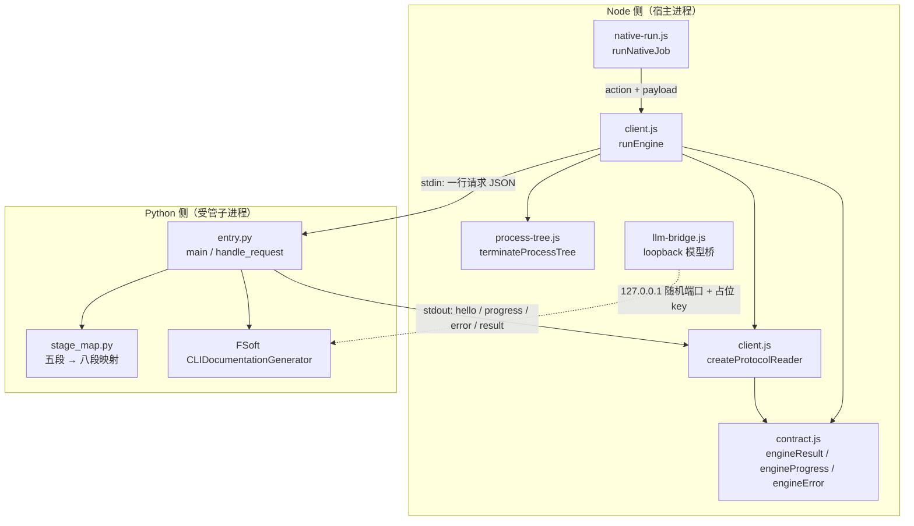
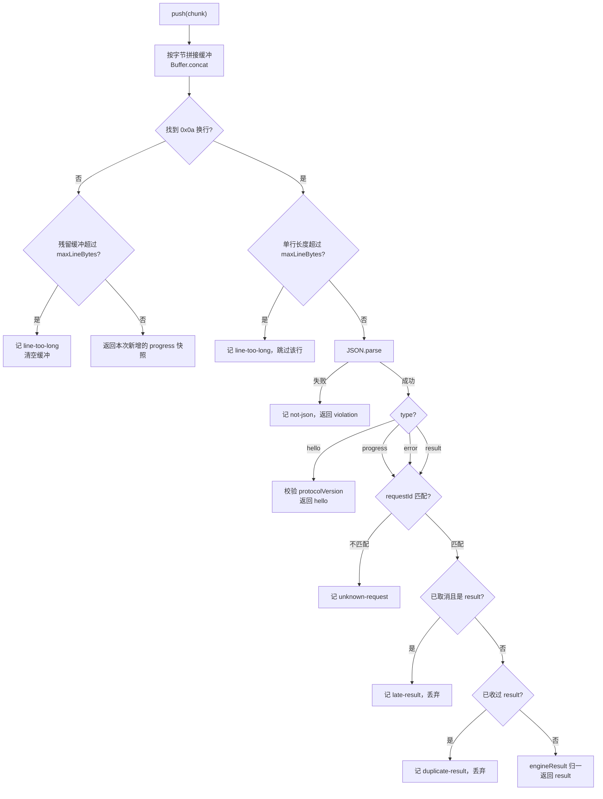
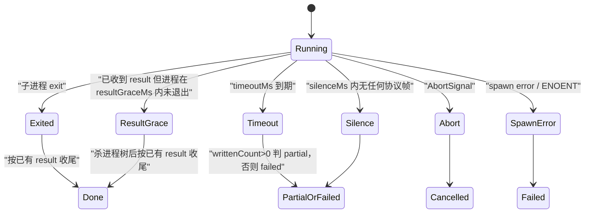
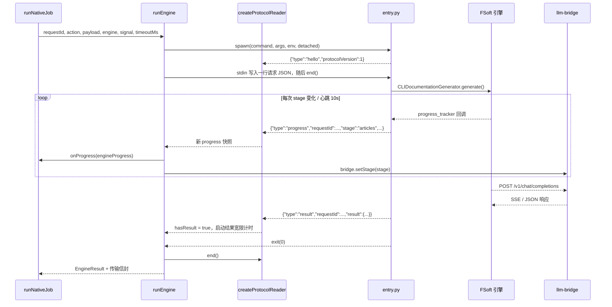
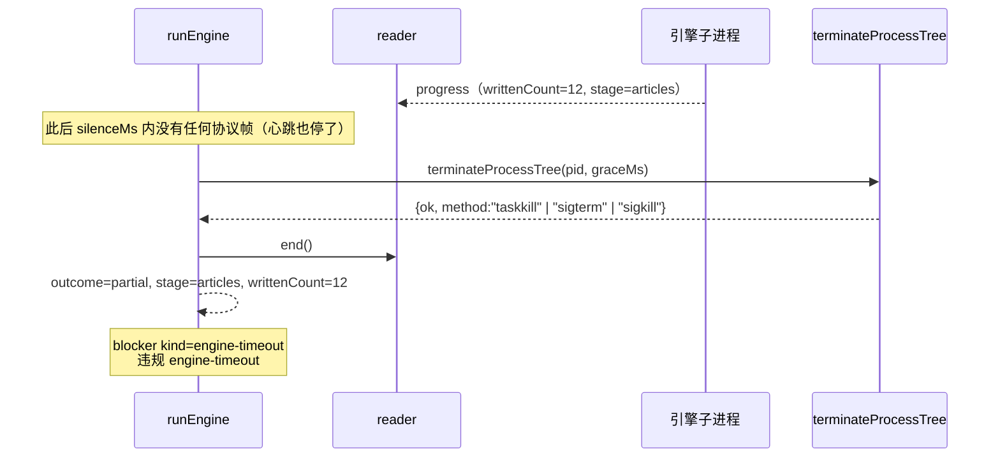
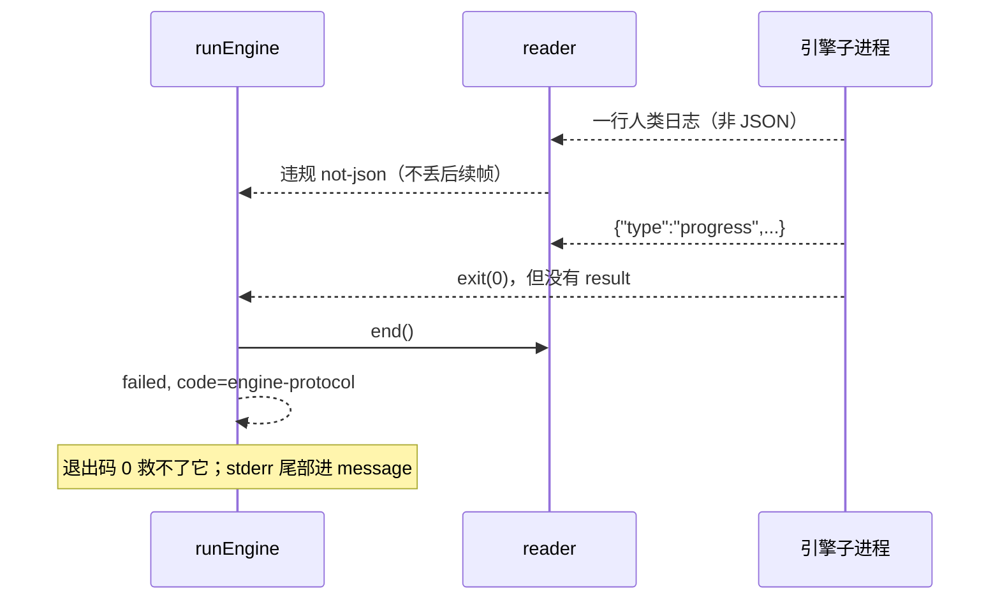

# engine-runner 进程与协议层

!!! info "Generated documentation"
    This page was written by CodeWiki from the source code at commit [`cc1116c4`](https://github.com/ikliml666/dsh-codewiki/commit/cc1116c4ad9e359fc739203aed18b8ba6fd73e7a) on 2026-11-08 with `deepseek-v4.1-flash`. Check the code before relying on details.

本页描述 `lib/engine/client.js`：DSH 插件与 FSoft 原生 Python 引擎之间**唯一的跨语言边界**。它只做两件事——启动一个受管子进程，并按「一行 JSON 请求 / JSON-lines 响应」的协议收发消息，再把引擎消息归一成 `contract.js` 定义的 `EngineResult` / `EngineProgress` / `EngineError`。

算法（依赖图、聚类、文章写作、增量 diff）全部在 Python 侧；本层**刻意不实现任何业务逻辑**，也不读凭证、不连模型、不写 `.codewiki`。这种「窄」是设计目标：它是整条编译链路上唯一会同时面对超时、取消、崩溃、协议破坏的地方，一旦这里开始长业务，失败语义就会重新变得模糊。

---

## 1. 职责边界

| 本层负责 | 本层不负责（由谁负责） |
| --- | --- |
| 启动 / 终止受管子进程树 | 进程树的具体终止策略 → [引擎运行时工具层（engine-runtime-utils）](../../engine-runtime-utils.md) 的 `process-tree.js` |
| 解析 stdout 的 JSON-lines，做帧级校验 | 结果字段的语义校验与硬不变量 → [engine-contract-quality：引擎契约与质量裁决层](../../engine-contract-quality.md) 的 `contract.js` |
| 把超时 / 取消 / 崩溃 / 协议破坏归一成**可机读**失败 | 一次编译的裁决链（doctor → 引擎 → gate → apply）→ [engine-runner 原生编译流水线](engine-runner_native-pipeline.md) |
| 进度帧的增量透传与异常不吞 | 模型通道 → [引擎外部集成层（模型桥与 TechDocs 回读）](../../engine-integrations.md) 的 `llm-bridge.js` |
| 静默（卡死）检测与结果宽限 | 产物落盘与映射 → [apply-plan 落地器](../apply-plan.md)、`output.js` / `mapping.js` |

调用方是 `native-run.js` 的 `runNativeJob`，它把 `runEngine` 当成可注入依赖（`deps.runEngine`），因此测试可以用假引擎覆盖接线，同时保留真实的 `contract.js` 校验。

---

## 2. 架构与组件关系



关键点：模型调用**不经过本层**。引擎通过 `CODEWIKI_BASE_URL` 指向宿主内的 loopback 桥，本层只负责把 `bridge.url` / `bridge.placeholderKey` 等环境变量随 `engine.env` 一起下发给子进程（见 `index.js` 的 `nativeEnginePlan`）。

---

## 3. 协议规范

### 3.1 传输形状

- **请求**：向子进程 stdin 写**一行** JSON，然后立即 `end()`（引擎读到 EOF 即开始工作）。
- **响应**：子进程 stdout **只允许**是 JSON-lines，每行一帧；`stderr` 是日志通道，只用于诊断尾部（`stderrTail`）。

请求行的字段是**平铺**的：

```json
{"requestId":"...","action":"generate","repoPath":"...","docsDir":"...","commitId":"...","language":"中文","moduleConcurrency":2,"updateOptions":{"rung":"3"}}
```

> Python 侧 `handle_request` 同时兼容平铺与 `{payload:{...}}` 嵌套两种形状，且**平铺优先**（`payload = {**nested, **flat}`）。历史上入口只读嵌套形状，导致真机上 `repoPath` / `docsDir` / `commitId` 全部丢失：`docsDir` 丢失会让增量轮把水合过的状态目录写回 `repo/.codewiki`，长出 `_native-state/docs/_native-state/docs/...` 自嵌套。本层必须按平铺发送。

`action` 只允许四个值：`doctor`、`generate`、`update`、`cancel`；非法值在 `runEngine` 入口即抛错，不落到子进程。

### 3.2 帧类型

| `type` | 是否带 `requestId` | 作用 |
| --- | --- | --- |
| `hello` | 否（唯一例外） | 握手，携带 `protocolVersion` 与 `engine` 名 |
| `progress` | 是 | 阶段 / 百分比 / 已写篇数快照，经 `engineProgress()` 归一 |
| `error` | 是 | 引擎主动报错（语义失败，后面可能仍有 `result`） |
| `result` | 是 | 终态，经 `engineResult()` 归一 |

`progress` 的字段：`stage`、`percent`、`message`、`writtenCount`、`failedCount`、`totalCount`（另有 `contractVersion`、`at`）。`stage` 必须属于 `ENGINE_STAGES`（`env / graph / cluster / articles / proofread / validate / index / baseline / commit`），否则 `engineProgress()` 抛错并被记为 `bad-shape` 违规。

`cancel` 动作的响应**不是** `EngineResult`，而是 `{cancelled: true}`——它是控制面应答，不是一次编译的结果。

### 3.3 六条协议不变量

这些不变量是 `client.js` 文件头的正式契约，也是 `test-engine-client.mjs` 的断言口径：

1. stdout **只**是 JSON-lines；非 JSON 行记 `not-json` 违规，但**不丢弃**已收到的结果。
2. 每条消息必须带匹配的 `requestId`；不匹配记 `unknown-request`，**绝不参与**本次结果（缺失也算不匹配，不能靠「只有一条消息」蒙对）。
3. 没有 `result` 消息 = 协议破坏，**即使退出码是 0 也判失败**。
4. 退出码只表达**进程层**结果，语义以 `result` 为准：退出码 0 + 语义 `failed` 是失败；语义 `done` + 退出码非 0 保留 `done` 并记 `nonzero-exit` 违规（让人去看 stderr）。
5. 取消后到达的 `result` 记 `late-result` 并丢弃——取消是终态，不能被迟到的成功洗白。
6. 重复 `result` 先到的赢（后到的是引擎 bug，不是我们的）。

---

## 4. `createProtocolReader`：增量式 JSON-lines 解析器

纯逻辑、不碰进程，所以可以被逐字节喂入，用于模拟管道任意切分。构造时只接受一个 `requestId`，返回对象暴露 `push(chunk)`、`progress`、`hasResult`、`markCancelled()`、`end()`。



设计要点：

- **按字节缓冲**而非按字符串拼接，多字节 UTF-8 跨 chunk 不会被切坏。
- **两级长度防护**：完整单行超限跳过；无换行的残留超限直接丢弃缓冲，防止引擎失控吐一行 8MB 时把 Node 侧内存吃光。默认上限 `DEFAULT_MAX_LINE_BYTES = 4 MiB`。
- **`end()` 幂等**：把残留在缓冲里的半行记成 `not-json`（截断的 JSON 不能当结果），返回 `{result, progress, errors, violations, cancelled, endedWithResult, ended}`。
- 返回的 `progress` 快照用于增量推送：`runEngine` 维护 `reported.count` 游标，只把新增项交给 `onProgress`。

---

## 5. `runEngine`：进程生命周期与竞态裁决

### 5.1 启动

`spawnPlan()` 把 `{command, args, env, cwd}` 规范成 spawn 参数，环境变量合并顺序为 `process.env` → `engine.env` → 调用方 `env`（后者覆盖前者）。实际启动参数：

- `stdio: ['pipe','pipe','pipe']`、`windowsHide: true`
- POSIX 上 `detached: true`，让子进程自成进程组，取消时可整组打掉；Windows 走 `taskkill /T /F`
- `command` 为空或 `engine` 描述缺失 → 直接返回 `engine-missing` 的 `failed` 结果（不抛异常）

### 5.2 竞态

主循环等待**六个**互斥事件中的第一个：



各自的处置：

| 事件 | 处置 | 终态 |
| --- | --- | --- |
| `exit` | 等 stdout `end`（带 2s 保险）后按已收帧收尾 | 取决于 `result` |
| `timeout` | `killTree('timeout')` → 判 partial / failed | `partial` 或 `failed`（`engine-timeout`） |
| `silence` | `killTree('silence')` → 判 partial / failed | 同上 |
| `abort` | `markCancelled()` → `killTree('abort')` | `cancelled` |
| `spawn-error` | 直接 `engine-missing` | `failed` |
| `result-grace` | `killTree('result-grace')`，保留已到 `result` | 取决于该 `result` |

### 5.3 结果宽限（result grace）

不变量 4 说「语义以 `result` 为准」，但退出检测原本只等 `'exit'`。若引擎发出 `result(done)` 后卡在收尾（僵死线程、未关闭 pipe、忘了 return 的事件循环），一轮**已经确定成功**的编译会被静默/超时改判成卡死，产物早已写完却按 partial 交付、基线不推进，下一轮再跑一遍。

因此：`result` 到达后启动 `resultGraceMs`（默认 `DEFAULT_RESULT_GRACE_MS = 2000`）计时器；进程在窗口内未自行退出即杀掉，并**按已收到的 `result` 收尾**。日志事件 `kind: 'result-grace'` 记录这一事实。

### 5.4 静默检测（卡死兜底）

`timeoutMs` 只兜「跑太久」，兜不住「已经卡死」。默认超时是 180 分钟，僵死的引擎会把这段时间全占满，同时把调度闸门（`parallelLimit` 默认 1）锁死，其它仓库一条都推不动。

判据是「**多久没收到任何协议帧**」：Python 侧 `entry.py` 的心跳线程按 `_HEARTBEAT_SEC = 10s` 补帧，正常在跑的引擎绝不会静默这么久。

- 默认阈值：`DEFAULT_SILENCE_MS = max(30_000, Number(process.env.DSH_CODEWIKI_ENGINE_SILENCE_MS) || 10 * 60 * 1000)`
- 检查间隔：`max(1000, min(30000, silenceMs / 4))`
- 仅在 `child.exitCode === null`（引擎仍存活）时判定，已退出走 `exited` 分支

### 5.5 超时 / 静默的 partial 抢救口径

两个分支口径**完全一致**：看最后一条 `progress` 的 `writtenCount`。

- `writtenCount > 0` → `outcome: 'partial'`，`stage` 取最后进度帧的阶段，附一条 `engine-timeout` blocker（`blockers[0].kind = 'engine-timeout'`，这是 `contract.js` 中专门为此登记的类别），保住已写文章并允许基线推进以打破死循环。
- `writtenCount === 0` → `failed`，错误码 `engine-timeout`。

注意这条抢救路径**依赖 Python 侧每帧都带真实 `writtenCount`**；若进度帧恒为 0，「已写 20 篇后超时」会被误判成「一篇没写」。

### 5.6 取消

`abort` 分支先 `reader.markCancelled()`，再杀进程树。写入数只取**已确认的进度**（`partial.progress.at(-1)`），绝不取迟到的 `result`——取消是终态。结果附 `{kind:'engine-cancelled'}` 违规。

### 5.7 收尾与归一

`finish()` 是唯一出口（`finished` 标志保证幂等），把 `runEngine` 的返回包成「契约结果 + 传输信封」：

```js
{
  ...EngineResult,                 // outcome / stage / blockers / error / writtenCount / ...
  contractVersion, requestId, action,
  protocolViolations: [...],       // reader 违规 + 附加违规
  exitCode, exitSignal, terminated,
  stderrTail,                      // 尾部截断至 4000 字符
  durationMs, startedAt, finishedAt,
}
```

`stderrTail` 的累积上限为 `DEFAULT_STDERR_TAIL * 4`（保留尾部 `* 2`）。崩溃时 stderr 尾部会被拼进错误 `message`（最多 1200 字符）：崩溃现场只有引擎自己吐得出来，让运维再去翻日志等于把可机读失败变成人工排查。

### 5.8 `nonzero-exit` 只对「非我们终止」的进程记录

我们主动终止的进程（超时 / 静默 / 取消 / 结果宽限）退出码是终止方式的产物，不是引擎语义，因此 `terminated === true` 时**不**追加 `nonzero-exit` 违规，避免污染已经明确的结果。

---

## 6. 违规类型速查

| `kind` | 触发条件 | 是否影响终态 |
| --- | --- | --- |
| `not-json` | stdout 出现非 JSON 行 / `end()` 时缓冲残留半行 | 不影响已收结果，但暴露引擎日志污染 |
| `bad-shape` | 消息不是对象、未登记 `type`、`engineProgress`/`engineError` 归一失败 | 丢弃该帧 |
| `protocol-version` | `hello.protocolVersion !== ENGINE_PROTOCOL_VERSION`（当前为 1） | 仅记录 |
| `unknown-request` | `requestId` 缺失或不匹配 | 丢弃该帧 |
| `late-result` | 取消之后到达 `result` | 丢弃 |
| `duplicate-result` | 收到第二条 `result` | 丢弃后到的 |
| `bad-result` | `engineResult()` 抛错（例如 `done` 带 blockers、`partial` 无 blockers） | 丢弃 |
| `line-too-long` | 单行或未终结缓冲超过 `maxLineBytes` | 跳过该行 |
| `engine-timeout` | 超时 / 静默分支 | 决定 `partial` 或 `failed` |
| `engine-cancelled` | `abort` 分支 | 决定 `cancelled` |
| `nonzero-exit` | 非我们终止且退出码非 0，但已有 `result` | 仅记录，不改语义 |

---

## 7. 与 Python 入口的跨语言契约

`lib/engine/python/entry.py` 是本层的对端，两侧必须逐条对齐：

| 契约点 | Node 侧 | Python 侧 |
| --- | --- | --- |
| 协议版本 | `ENGINE_PROTOCOL_VERSION = 1` | `PROTOCOL_VERSION = 1` |
| 结果契约版本 | `ENGINE_CONTRACT_VERSION = 3` | `CONTRACT_VERSION = 3` |
| 请求形状 | 平铺 `{requestId, action, ...payload}` + `\n` | `flat` 覆盖 `nested`，兼容两种形状 |
| 退出码语义 | 只看进程层，语义以 `result` 为准 | `main()` 恒返回 0；协议破坏也用 `0 + failed result` 表达 |
| stdout 纯净 | 非 JSON 记 `not-json` | `_ProtocolOnly` 在 import `codewiki` **之前**接管 `sys.stdout`，普通 `write`/`flush` 改道 stderr |
| 心跳 | `silenceMs` 需远大于心跳间隔 | `_HEARTBEAT_SEC = 10s` 补帧 |
| 编码 | 一律 UTF-8 收发 | 三条流 `reconfigure(encoding='utf-8')`，并给 `subprocess.Popen` 打 text 模式 UTF-8 补丁 |
| 凭证 | 只下发占位 key 与 loopback URL | `CODEWIKI_NO_KEYRING=1`，不读 `ConfigManager` / keyring |

**心跳与静默阈值的关系是硬约束**：`silenceMs` 必须显著大于心跳间隔（默认 10 分钟 vs 10 秒，100 倍余量），否则心跳自己会被判成卡死。

`entry.py` 的 `main()` 生命周期极短：`emit_hello()` → 读一行 stdin → `handle_request()` → `emit_result()` → `return 0`。它**不复用进程**，一个 `requestId` 对应一次进程。

---

## 8. 端到端时序

### 8.1 正常完成



### 8.2 静默卡死但已写出文章



### 8.3 协议破坏



---

## 9. 配置项与默认值

| 参数 / 环境变量 | 默认值 | 说明 |
| --- | --- | --- |
| `options.timeoutMs` | `600000`（本层）；`native-run.js` 传 `180 * 60 * 1000` | 单次引擎调用上限 |
| `options.silenceMs` | `max(30s, DSH_CODEWIKI_ENGINE_SILENCE_MS \|\| 10min)` | 无协议帧判定卡死的阈值 |
| `options.resultGraceMs` | `2000` | `result` 到达后等进程自行退出的宽限 |
| `options.graceMs` | `3000` | 传给 `terminateProcessTree` 的 SIGTERM 宽限 |
| `options.maxLineBytes` | `4 * 1024 * 1024` | 单行上限，防失控输出吃内存 |
| `engine.command` / `engine.args` / `engine.env` / `engine.cwd` | 无 | 由 `index.js` 的 `nativeEnginePlan` 生成 |

`nativeEnginePlan` 下发的环境变量（`index.js`）：

```
PYTHONIOENCODING=utf-8       # Windows 默认 cp936 会把中文文章写成乱码
PYTHONUTF8=1
CODEWIKI_NO_KEYRING=1        # 引擎绝不该自己翻本机凭证库
CODEWIKI_BASE_URL=http://127.0.0.1:<随机端口>/v1
CODEWIKI_API_KEY=<占位 key>
CODEWIKI_MAIN_MODEL / CODEWIKI_CLUSTER_MODEL
```

插件配置面（`cordis.patch.yml`）中与本层直接相关的是 `nativeEnginePython`（venv 解释器绝对路径）、`nativeEngineEntry`（默认 `lib/engine/python/entry.py`）与 `nativeEngineTimeoutMs`（默认 180 分钟）。`package.json` 声明 `engines.node >= 24.9.0`，本层用到的 `Buffer.subarray`、`Array.prototype.at`、`AbortSignal.addEventListener({once:true})` 均依赖该基线。

---

## 10. 与其它模块的关系

- 上层裁决链：[engine-runner 原生编译流水线](engine-runner_native-pipeline.md)（`native-run.js` 的 `runNativeJob`）与 [engine-runner：原生引擎执行与裁决编排](../engine-runner.md)。
- 结果契约与校验：[engine-contract-quality：引擎契约与质量裁决层](../../engine-contract-quality.md)（`contract.js`、`quality-gate.js`）。
- 进程树终止：[引擎运行时工具层（engine-runtime-utils）](../../engine-runtime-utils.md)（`process-tree.js` 的 `isAlive` / `terminateProcessTree`）。
- 模型通道：[引擎外部集成层（模型桥与 TechDocs 回读）](../../engine-integrations.md)（`llm-bridge.js`、`openai-bridge.js`）。
- 产物落盘：[apply-plan 落地器](../apply-plan.md)（`applyNativeOutput` 等）。
- Python 对端实现：[engine-python-runtime：FSoft 原生引擎的 Python 侧运行时](../../../../Execution_Runtime___Vendored_Engine/engine-python-runtime.md)（`entry.py`、`stage_map.py`）。
- 环境搭建脚本：[构建与配置（build-configuration）](../../../../Build___Development_Infrastructure/build-configuration.md)（`tools/fsoft-engine/setup-env.sh`）。

---

## 11. 排障提示

| 现象 | 最可能原因 | 定位方法 |
| --- | --- | --- |
| `failed` + `engine-protocol`，退出码 0 | 引擎把人类日志写进了 stdout，或压根没发 `result` | 看 `protocolViolations` 里的 `not-json`，再看 `stderrTail` |
| `failed` + `engine-missing` | 解释器 / 入口 / venv 不存在（`spawn` ENOENT 或 `engine.command` 为空） | 检查 `nativeEnginePython` 与 `tools/fsoft-engine/setup-env.sh` 产物 |
| `partial` + `engine-timeout` | 超时或静默被判卡死，但已有产物 | 看 `writtenCount` 与最后一条 progress 的 `stage`；`durationMs` 可区分「跑太久」与「静默」 |
| `unknown-request` 违规 | 引擎回帧的 `requestId` 与本次不一致（可能是复用了进程或拼错 id） | 每个 `requestId` 必须对应一次独立进程 |
| `late-result` 违规 | 取消后引擎仍然发出了 `result` | 正常现象，取消语义不受影响 |
| 进度条长时间不动 | 心跳未生效或 `silenceMs` 被调到低于心跳间隔 | 检查 `DSH_CODEWIKI_ENGINE_SILENCE_MS` 是否被人为调小 |
| `done` 却带 `nonzero-exit` 违规 | 引擎收尾阶段异常退出，但语义已 `done` | 语义保留，去读 `stderrTail` 定位收尾问题 |

---

## 12. 验证要点

本层的行为可以用 `createProtocolReader` 做纯函数级测试（逐字节喂入，覆盖任意管道切分），用假引擎做进程级测试（覆盖超时 / 静默 / 取消 / 协议破坏 / 结果宽限）。回归测试必须覆盖的断言就是第 3.3 节的六条不变量，尤其是：

- 退出码 0 但没有 `result` → `failed`；
- `done` + 非零退出码 → 保留 `done`，附 `nonzero-exit`；
- 取消后到达 `result` → 丢弃，终态仍是 `cancelled`；
- 超时但 `writtenCount > 0` → `partial` 且带 `engine-timeout` blocker；
- `onProgress` 抛出的异常**必须**冒泡（`runEngine` 不吞），否则契约阶段名写错会变成「某一帧悄悄丢了、任务照样报成功」。

??? abstract "Documented components (1)"
    - [`runEngine`](https://github.com/ikliml666/dsh-codewiki/blob/cc1116c4ad9e359fc739203aed18b8ba6fd73e7a/lib%5Cengine%5Cclient.js) — `lib\engine\client.js`

