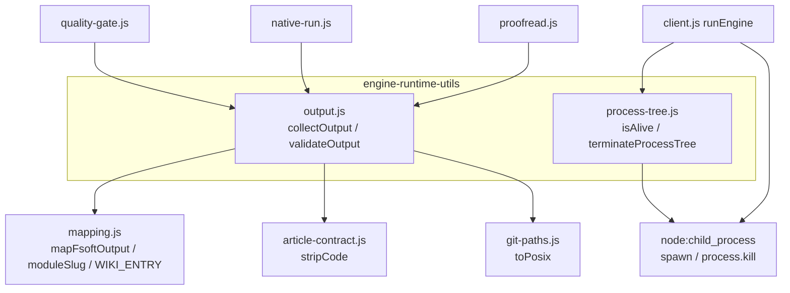
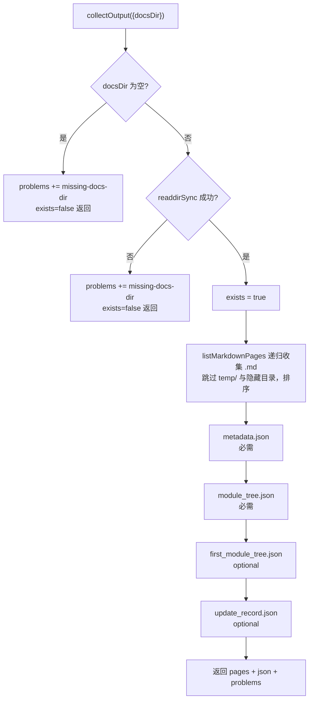
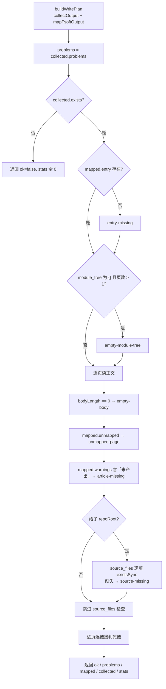
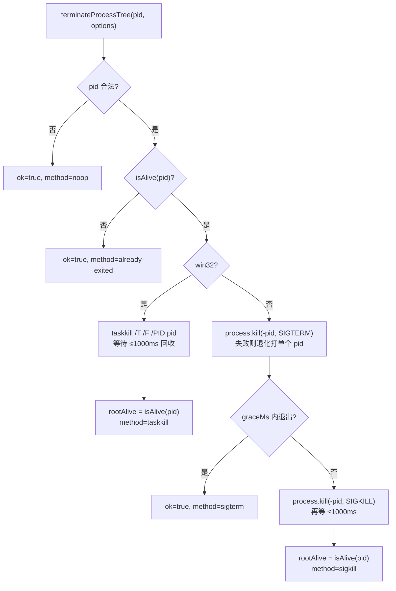
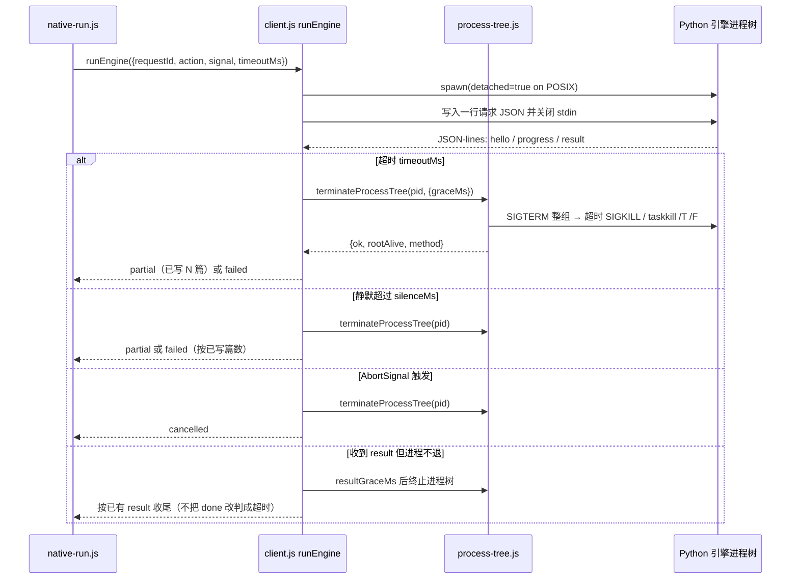
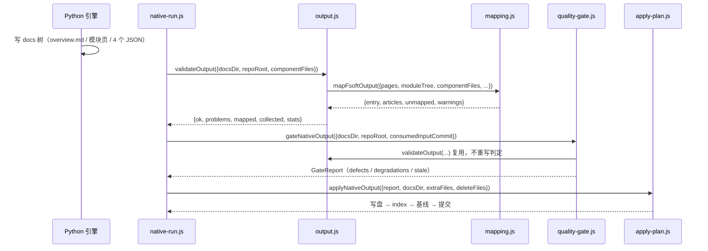

# 引擎运行时工具层（engine-runtime-utils）

!!! info "Generated documentation"
    This page was written by CodeWiki from the source code at commit [`eea7ea80`](https://github.com/ikliml666/dsh-codewiki/commit/eea7ea80bdb6b5c9a429ba0978f0b9ccc8885a96) on 2026-11-08 with `deepseek-v4.1-flash`. Check the code before relying on details.

本模块是 `Documentation_Generation_Engine/engine-core` 下的**最小公共底座**，只包含两个文件、两类完全不相干的能力：

- `lib/engine/output.js`：把引擎产出的 `docs` 树读成**结构化事实**，并判「这批产物自身是否自洽」；
- `lib/engine/process-tree.js`：终止一棵**受管子进程树**，保证取消/超时不会留下孤儿 Python 进程。

两者共同点是「**纯工具、无业务裁决**」：它们不决定终态、不推进基线、不写仓库。终态裁决在 [engine-contract-quality：引擎契约与质量裁决层](engine-contract-quality.md) 与 [apply-plan 落地器](engine-orchestration/apply-plan.md)，进程与协议在 [engine-runner：原生引擎执行与裁决编排](engine-orchestration/engine-runner.md)。把它们抽成独立一层，是为了让「产物读取判定」和「进程树回收」这两件最容易出错、又最容易被业务代码顺手复制的事情各自只有一处实现。

> 所属层级：[Documentation_Generation_Engine 模块概览](../../Documentation_Generation_Engine.md) → [engine-core 模块概览](../engine-core.md) → 本页。

---

## 1. 组件清单

| 文件 | 导出 | 职责 | 是否有副作用 |
| --- | --- | --- | --- |
| `lib/engine/output.js` | `collectOutput` | 读 `docsDir`：页清单 + 四个 JSON，坏文件转成 `problems` | 只读文件系统，**不抛异常** |
| | `validateOutput` | 产物自洽性校验，返回 `{ok, problems, mapped, collected, stats}` | 只读文件系统 |
| | `buildWritePlan` | `collectOutput` + `mapping.mapFsoftOutput` 的组合入口 | 只读文件系统 |
| | `bodyLength` | 去掉首个标题行后的正文字符数（判「空壳页」） | 纯函数 |
| | `relativeLinks` | 收集正文里的相对 markdown 链接目标（剥代码块后扫描） | 纯函数 |
| | `pageAliases` | 由页名推导「正文写法 → 真实页」的唯一命中别名表 | 纯函数 |
| | `overviewStaleLinks` | 找出 overview 正文里指向不存在页面的链接 | 纯函数 |
| | `OUTPUT_PROBLEM_KINDS` | 问题类别枚举（稳定、机读、只追加） | 常量 |
| `lib/engine/process-tree.js` | `isAlive` | `kill(pid, 0)` 探测 pid 是否存活 | 只发送信号 0，无实际信号 |
| | `terminateProcessTree` | Windows 用 `taskkill /T /F`，POSIX 先 SIGTERM 整组再 SIGKILL | 会杀进程 |

> 说明：模块树把 `output.js` 的核心组件标注为 `add`，这是提取产物中的聚合标签；该文件源码实际导出的是一组以 `collectOutput` / `validateOutput` / `buildWritePlan` 为入口的函数集合，并没有名为 `add` 的导出。
>
> 另一个容易踩的坑：`output.js` 的 `default` 导出**只**包含 `OUTPUT_PROBLEM_KINDS`、`collectOutput`、`buildWritePlan`、`validateOutput`、`bodyLength`、`relativeLinks`。`pageAliases` 与 `overviewStaleLinks` 仅有具名导出——用默认导入解构它们会得到 `undefined`，而 `undefined is not a function` 在编译链路里表现为「质量门异常」而不是「导入写错了」。

`package.json` 声明 `engines.node >= 24.9.0`，本模块用到的 `Array.prototype.at`、`String.prototype.matchAll`、`node:` 前缀导入都依赖这个下限。

---

## 2. 架构与依赖关系

`output.js` 依赖 `mapping.js`（格式映射）、`article-contract.js`（`stripCode`）与 `git-paths.js`（`toPosix`）；`process-tree.js` 只依赖 `node:child_process`，是整个引擎层里依赖最少的文件。

关键点：

- `output.js` **不** import `quality-gate.js`，方向是单向的（门依赖工具，工具不知道门的存在），避免「判定」与「读取」互相耦合。
- `process-tree.js` 不 import 任何本仓库模块，只依赖 Node 内置能力，因此可以独立单测（任何取消语义的 bug 都会在这里暴露，而不是散落在业务里）。
- `quality-gate.js` 直接复用 `validateOutput`、`bodyLength`、`pageAliases` 三处（见 [engine-contract-quality：引擎契约与质量裁决层](engine-contract-quality.md)），不重写任何判定。
- `native-run.js` 使用 `overviewStaleLinks` 判 overview 陈链（见 [engine-orchestration 模块概览](engine-orchestration.md)）。
- `client.js::runEngine` 在超时、静默、取消三条路径上都调用 `terminateProcessTree`（见 [engine-runner：原生引擎执行与裁决编排](engine-orchestration/engine-runner.md)）。

---

## 3. `output.js`：产物读取与自洽性校验

### 3.1 职责边界（写进代码注释的安全边界）

这一层刻意只做三件事，且三件事都必须可被测试逐条钉死：

1. **读**：把 `docs` 目录读成结构化事实（页清单 + 四个 JSON），坏文件变成 `problem` 而不是异常；
2. **映射**：交给 `mapping.js`（阶段 0 冻结的四条硬规则），这里不重复实现任何规则；
3. **校验**：把「能不能算成功」判成可机读的 `problems` 列表。

明确**不做**的事：

- 不重新聚类、不做图 diff、不改写文章正文——FSoft 已经算完了；
- 不臆造 `source_files`（沿用 `mapping.js` 的证据规则）；
- 不因为「产物看起来差不多」就把 `problem` 降级成 `warning`。缺页就是缺页，上层据此判 `partial`；把缺失静默吞掉会让 wiki 少一篇而没人知道；
- frontmatter、锚点、写集冲突这类**目标格式**闸门属于阶段 3（[engine-contract-quality：引擎契约与质量裁决层](engine-contract-quality.md) 与 [apply-plan 落地器](engine-orchestration/apply-plan.md)）。

### 3.2 `collectOutput`：读取流程

几个容易踩的细节：

- **页必须递归收集**：`hierarchical` 布局把子模块页放在子目录里（`doc_layout.py:module_doc_relpath`），只扫根目录会把整棵子树的页漏掉。
- `temp/` 是工作目录（依赖图、引用索引、artifact 索引），**不算页**；隐藏目录同理。
- 可选文件（`first_module_tree.json`、`update_record.json`）缺失不是问题——全量首轮本来就没有 `update_record`。但**存在却坏了永远要报 `bad-json`**：文件可选，写坏了不能吞。
- 读取前统一 `stripBom`，避免 BOM 让 `JSON.parse` 失败。

### 3.3 `validateOutput`：问题类别与判定顺序

问题类别是**稳定、机读**的，上层按 `kind` 分派，**不要靠 message 文本匹配**：

| `kind` | 含义 | 典型来源 |
| --- | --- | --- |
| `missing-docs-dir` | 引擎没产出 docs 目录 | 引擎失败 / 路径传错 |
| `missing-metadata` | 缺 `metadata.json`（无法确定 commit/layout） | 引擎未写 |
| `missing-module-tree` | 缺 `module_tree.json`（无法确定归属与 source_files） | 引擎未写 |
| `empty-module-tree` | `module_tree.json` 是 `{}`：归属证据整体缺失 | whole-repository 模式 |
| `bad-json` | JSON 存在但不可解析（也用于页文件不可读） | 引擎写坏 |
| `entry-missing` | 没有 `overview.md`，即没有 `CodeWiki.md` 入口 | 引擎未写入口 |
| `empty-body` | 页面除标题外没有正文 | 空壳页 |
| `article-missing` | 模块树里有模块，但没有对应页 | 引擎漏写 |
| `unmapped-page` | 页在 docs 里，但映射不到 wiki 任何位置 | slug 冲突 / 页名不匹配 |
| `source-missing` | `source_files` 指向的文件在仓库里不存在 | 组件 id 指向已删文件 |
| `dead-link` | 正文里的相对链接指向计划外的页 | 模型编造页名 |

`validateOutput` 的判定顺序：

**链接命中判定**是这里最容易出错的逻辑，只认「本次真的会落地」的页，两种写法都合法：

- 引擎原始页名（正文原样写法，渲染期由 `rewritePageLinks` 改成落地名）；
- 落地页名（正文里已经写成 slug 之后的名字），按 `basename` 认，因为落地目录是扁平的（`.codewiki/modules/*.md` 与根 `CodeWiki.md`）。

三类豁免，都是真机事故倒逼出来的：

1. **根页别名**：上游把入口页叫 `README.md` / `overview.md`，本仓库入口是 `CodeWiki.md`。只豁免**根目录**下这两个名字，`sub/README.md` 仍按真实目标校验。入口缺页由单独的 `entry-missing` 负责，不该在这里再报一次死链。
2. **`pageAliases` 别名**：只在别名**唯一命中**且目标真的在落地方案里时才成立。否则会把「别名指向一篇没进落地方案的页」也放过，而那正是真死链。
3. **仓库源文件链接**（`../src/x.py`）不在 docs 内，交给阶段 3 的 source 校验，这里跳过。

另一个易错点：**代码块里的相对链接写法（`[文字](…)` 形态）是语法示例，不是引用**。本仓库自己的文章就在讲链接形态，真机 `job-mw32wsci-h` 因此把示例判成死链、整轮从 `done` 掉成 `partial`。`relativeLinks` 先 `stripCode`（等长替换，偏移与原文一一对应）再扫描。

### 3.4 `pageAliases`：三条固定命名分歧

引擎给页文件命名用三条固定约定，而正文里的跨页链接写的是「模块名」，两者对不上时链接看起来像死链，其实是同一页：

| 约定 | 引擎页名 | 正文常见写法 |
| --- | --- | --- |
| 模块名带扩展名时保留扩展名 | `X.ts.md` | `X.md` |
| 子模块页加父模块前缀 | `<dir>/<dir>_Y.md` | `<dir>/Y.md` |
| 落地文件名是 kebab-case | `llama-and-llm-management.md` | `llama_and_llm_management.md` |

**只在唯一命中时给出别名**：同一目录同时有 `X.ts.md` 与 `X.js.md` 时无法判定 `X.md` 指哪一篇，猜一个会把「链接断了」静默改写成「连接到另一篇」，比报死链更糟。名字只是相近（`client_interface_layer.md` 与 `worktree_client_interface_layer.md`）不构成别名——那是上游真的写了不存在的页，必须如实报出来。

### 3.5 `overviewStaleLinks`：可证伪的 overview 陈链判据

上游 `reusable_overview()` 只判「空页 / 未完成的 reading preamble」，**链接正确性不在判据里**。聚类重构后模块改名，旧 overview 的链接会指向已经消失的页，引擎却每轮都判它「可复用」而跳过重建（真机 `dsh-git-worktree` 的 overview 有 6 条指向树外模块的链接，Git 史证明那些页在上一版聚类里真实存在过，此后再没被重建）。

判据可证伪：每个 `.md` 链接目标都要落在当前页集合里（含 `pageAliases` 认的命名别名）。**空模块树时返回空数组**——whole-repository 模式没有权威模块名，判不出对错，不能凭猜测删页。

### 3.6 `bodyLength` 与 `relativeLinks`

- `bodyLength`：跳过**第一个**标题行，剩余文本去掉所有空白后的字符数。用于判「这页其实只有个标题」。注意它只跳过一个标题，所以质量门在判渲染后文章时会先 `parseFrontmatter` 剥掉合成的 frontmatter 再调用，否则 8 行 frontmatter 会被当成正文（`# Web` 这种空壳页 `bodyLength` 反而 ≈ 100）。
- `relativeLinks`：跳过外链（`http:` / `mailto:` / `data:` 等协议前缀）、锚点（`#...`）、以及代码区域内的示例链接；反斜杠统一成 `/`。

---

## 4. `process-tree.js`：受管子进程树终止

### 4.1 为什么需要单独一层

FSoft 的 Python 进程自己也会派生子进程（`flake8`、`find`，以及某些后端会 fork `claude` / `codex`）。只 kill 直接子进程的 pid，孙进程会变成孤儿继续跑——在 DSH 里表现为「任务已取消，但机器上还挂着一个 python 在烧 token」。

这个模块**只做「终止」一件事**：不做进程启动、不做协议、不碰 stdout。

### 4.2 平台差异

| 平台 | 手段 | 理由 |
| --- | --- | --- |
| Windows | `taskkill /T /F /PID <pid>` | 没有进程组信号；`/T` 递归整棵树，`/F` 强制（不加 `/F` 时 GUI 进程与无控制台进程常常不响应） |
| POSIX | `process.kill(-pid, ...)` | `client.js` 用 `detached: true` 起的子进程自成进程组，负 pid 一次打整组；先 SIGTERM 让它收尾，超时再 SIGKILL |

`graceMs` 默认 `3000`；`onLog` 是诊断日志回调，会把实际执行的命令与信号写进引擎日志。

### 4.3 返回值语义

`{ ok, rootAlive, method }`：

- `ok=false` 表示**根进程在超时后仍活着**，调用方应当据此报错，而不是假装取消成功；
- `method` 取值：`noop` / `already-exited` / `taskkill` / `sigterm` / `sigkill`，便于在日志里区分「温和退出」与「强杀」。

### 4.4 `isAlive` 的语义

`process.kill(pid, 0)` 不发送信号、只做存在性探测：

| 结果 | 含义 | 返回值 |
| --- | --- | --- |
| 不抛错 | 活着（僵尸进程仍需视为占用） | `true` |
| 抛 `ESRCH` | 已退出 | `false` |
| 抛 `EPERM` | 存在但无权限 | `true` |

`pid` 非正整数一律返回 `false`（防止 `kill(0)` 误伤整个进程组这类灾难性误用）。

---

## 5. 运行时数据流与组件交互

### 5.1 取消 / 超时 / 静默三条路径都汇到 `terminateProcessTree`

`client.js` 的 `spawn` 显式设置 `detached: process.platform !== 'win32'`，正是为了让 POSIX 侧的负 pid 打整组成立；`process-tree.js` 里的 `try/catch` 退化分支（只打单个 pid）兜住「子进程不是用 detached 起的」这种调用方误用。协议层细节见 [engine-runner：原生引擎执行与裁决编排](engine-orchestration/engine-runner.md)。

### 5.2 产物从「引擎写盘」到「落地」的读取链路

这里有一条重要的**单向数据流约束**：`collected` 被原样带出 `validateOutput`，供阶段 3 质量门读 `metadata.generation_info.commit_id` 判「产物对应哪个 commit」。让门自己再读一遍 `docs` 目录，等于把「一次读」变成「两次读」，两次之间目录可能被改，判据就漂移了。

---

## 6. 与其它模块的关系

| 关系 | 模块 | 说明 |
| --- | --- | --- |
| 上层编排 | [engine-orchestration 模块概览](engine-orchestration.md) | `native-run.js` 调用 `validateOutput` 与 `overviewStaleLinks`；`client.js` 调用 `terminateProcessTree` |
| 进程与协议 | [engine-runner：原生引擎执行与裁决编排](engine-orchestration/engine-runner.md) | `runEngine` 的 spawn / 协议读取 / 超时与静默检测，终止动作委托本模块 |
| 契约与质量门 | [engine-contract-quality：引擎契约与质量裁决层](engine-contract-quality.md) | `gateNativeOutput` 复用 `validateOutput` / `bodyLength` / `pageAliases`，并把 `OUTPUT_PROBLEM_KINDS` 映射成 defect/degradation |
| 落地器 | [apply-plan 落地器](engine-orchestration/apply-plan.md) | 只消费 `GateReport` 与渲染结果，不直接读 `output.js` |
| 状态与清单 | [engine-state-manifest：引擎清单与跨轮受管状态](engine-state-manifest.md) | 受管状态（图/树/metadata）与本模块读取的是同一批文件，但由 `native-state.js` 负责跨轮持久化 |
| 模型桥 | [引擎外部集成层（模型桥与 TechDocs 回读）](engine-integrations.md) | 无直接依赖 |
| 上游引擎 | [Execution_Runtime___Vendored_Engine 概览](../../Execution_Runtime___Vendored_Engine.md) | `docs` 树的目录布局（`hierarchical` / `flat`）由 Python 侧 `doc_layout.py` 决定，本模块按 `metadata.layout` 与页名约定读取 |
| 构建/环境 | [构建与开发基础设施（Build___Development_Infrastructure）概述](../../Build___Development_Infrastructure.md) | `package.json` 的 `engines.node >= 24.9.0` 是本模块的运行时下限；环境脚本 [FSoft 引擎工具链（fsoft-engine-tools）](../../Build___Development_Infrastructure/fsoft-engine-tools.md) 决定引擎侧 Python 是否闭合 |

---

## 7. 设计不变量（改动时必须守住）

1. **不抛异常，只报问题**：`collectOutput` / `validateOutput` 把坏输入变成 `problems`。异常会逼调用方写 `try/catch`，而 `catch` 一吞，问题就变成「静默成功」。
2. **问题类别只追加不改名**：`OUTPUT_PROBLEM_KINDS` 是机读契约；新增类别时 `quality-gate.js` 里未映射的分支会兜底成 `article-contract` defect，逼调用方补映射，而不是静默吞掉。
3. **不静默降级**：`empty-module-tree` 在 `output.js` 里是 `problem`，在门里被**显式**映射成 `degradation`（而不是被忽略），因为「页是真的、只是没法归属」与「产物坏了」必须区分。
4. **不臆造 `source_files`**：只能来自真实组件→文件证据（`componentFiles` / `module_tree.components`），拿不到就是空数组 + `no-source-evidence` 降级。
5. **别名只在唯一命中时成立**：多义别名宁可报死链，也不猜。
6. **终止必须可验证**：`terminateProcessTree` 返回 `ok=false` 时调用方不得报取消成功；`method` 让日志能区分温和退出与强杀。
7. **代码区域不参与链接判定**：`stripCode` 做等长替换，扫描偏移与原文一致，改写可以原位应用。

---

## 8. 已知边界

- **不查外链**：`http` 链接的可达性不是本层的责任（网络状态不稳定会把编译判成 partial）。
- **不查仓库源码链接**：`../src/x.py` 这类目标交给阶段 3 的 source 校验（[engine-contract-quality：引擎契约与质量裁决层](engine-contract-quality.md)）。
- **不校验 frontmatter**：`output.js` 只判「页在不在、正文空不空、链接指向的东西在不在计划内」；frontmatter 的唯一闭合、围栏、类型与位置匹配属于 `article-contract.js`。
- **`hierarchical` 布局依赖递归扫描**：任何「只扫根目录」的改动都会让子模块页整批消失。
- **`isAlive` 无法区分僵尸进程**：僵尸仍返回 `true`，这是刻意的保守选择（仍视为占用，避免在回收未完成时提前判定成功）。

??? abstract "Documented components (2)"
    - [`add`](https://github.com/ikliml666/dsh-codewiki/blob/eea7ea80bdb6b5c9a429ba0978f0b9ccc8885a96/lib%5Cengine%5Coutput.js) — `lib\engine\output.js`
    - [`isAlive`](https://github.com/ikliml666/dsh-codewiki/blob/eea7ea80bdb6b5c9a429ba0978f0b9ccc8885a96/lib%5Cengine%5Cprocess-tree.js) — `lib\engine\process-tree.js`

