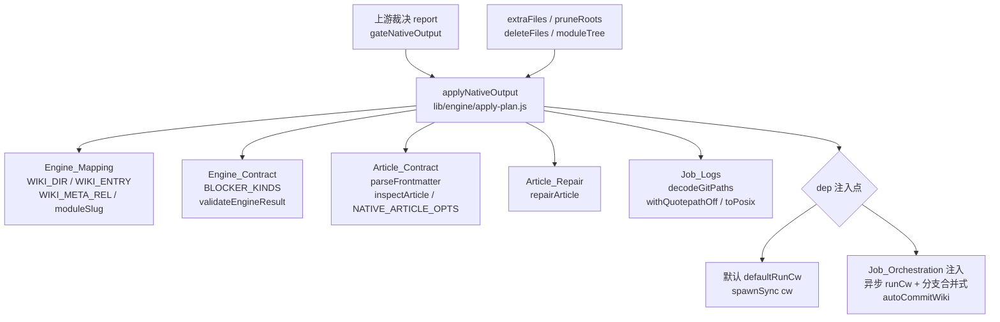
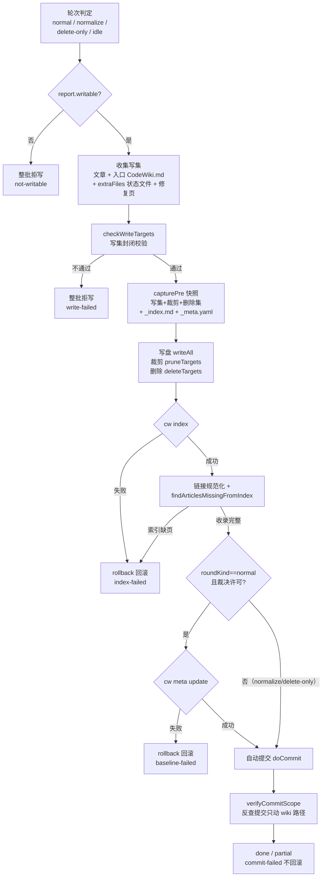
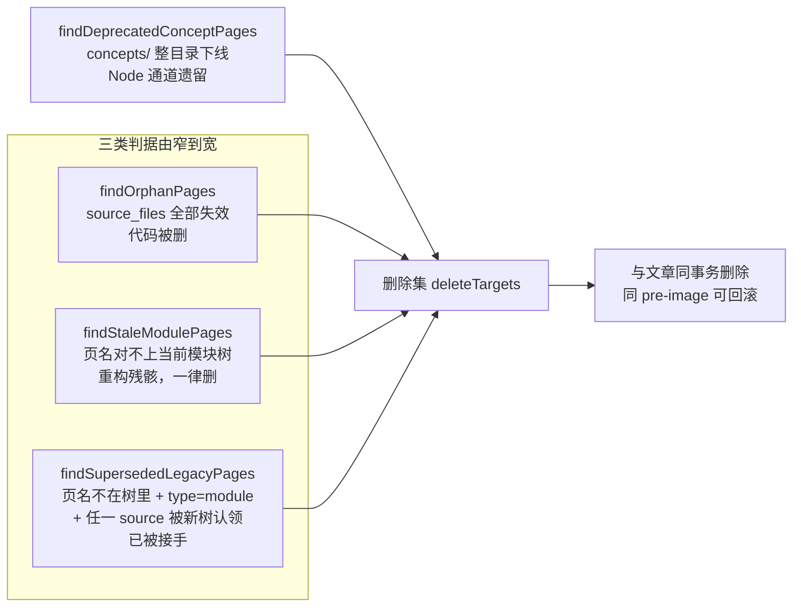

# Engine_Apply_Plan（原生产物落地器）

!!! info "Generated documentation"
    This page was written by CodeWiki from the source code at commit [`df743bda`](https://github.com/ikliml666/dsh-codewiki/commit/df743bda12b693793139b00990016d9a63536736) on 2026-11-07 with `doubao-seed-2.1-lite`. Check the code before relying on details.

阶段 3 的**原生产物落地器**：把 [Engine_Quality_Gate（原生引擎产物采用门）](Engine_Quality_Gate.md) 给出的采用裁决（report）原子地应用到仓库里——写盘 → `cw index` → 基线推进（`cw meta update`）→ 自动提交。本模块只服务原生引擎通道（`nativeEngine: true`，见 [Package_Manifest 包清单](Package_Manifest.md) 中 `package.json` 的说明），单文件实现于 `lib/engine/apply-plan.js`。

## 为什么必须单独一层

「这批页可以入库」（裁决）和「入库这件事真的成立了」是两回事。中间还有四步各自会失败：

1. **写盘**：路径越界 / 权限 / 磁盘满；
2. **`cw index`**：索引建不起来就是坏库；
3. **`cw meta update`**：基线推进 = 宣布「这些变化已消化」，写不成就是记账错误；
4. **自动提交**：产物没入库，别人拉下来看不到。

0.14.0 的教训正是把「写成几篇」当成「成立」——1 篇成功 + 19 篇失败也报 done。落地层的职责就是让这类失败**永远不可能被洗成成功**。

## 三条硬不变量（本模块唯一的验收标准）

| # | 不变量 | 含义 | 实现位置 |
|---|--------|------|----------|
| 1 | **写集封闭** | 只允许写 `.codewiki/` 子树与仓库根 `CodeWiki.md`；绝对路径、盘符、`..` 上跳、白名单外路径一律**整批拒写**（不是跳过该条） | `checkTargetPath` / `checkWriteTargets` / `checkDeleteTargets` |
| 2 | **索引/基线失败即回滚** | 文章写盘之后 `cw index` 或 `cw meta update` 失败，磁盘必须回到应用前：旧文章内容写回、新建文件删除、`_index.md` 与 `_meta.yaml` 恢复 pre-image | `capturePre` / `restorePre` / `rollback()` |
| 3 | **提交失败不回滚** | 自动提交失败时文章本身是好的、有用的——只记 `commit-failed` 阻塞并如实返回，绝不因提交失败删掉有价值的文章 | `applyNativeOutput` 第 7 步 |

## 模块定位与依赖关系

关键设计：本模块**不 import `index.js`**（插件主入口）——加载它会连带拉起宿主服务与 webServer，单测就变成「为了测一个写盘函数启动整个插件」。`runCw` / `commit` 仍由调用方注入，默认自带**同语义**实现：默认走内置 `commitWikiArtifacts`（直接提交，不建主题分支），分支合并式提交器留给阶段 4 注入（见 [Job Orchestration（编译任务编排服务）](Job_Orchestration.md)）。索引链接规范化则完全内置（`normalizeIndexLinksIn`）：index.js 里曾经的同名实现已整体删除，不再有「阶段 4 注入版」，该步恒走内置默认实现。

## 阶段流水线与回滚边界

`APPLY_STAGES = ['write', 'index', 'baseline', 'commit']`——面板步骤条与日志按此顺序对齐。

**回滚口径**：`index` 与 `baseline` 阶段失败 → `restorePre` 逆序恢复全部 pre-image（后写的先撤），`.codewiki/` 若本轮才创建则连目录一起删除；`commit` 阶段失败 → 产物保留，仅记阻塞。

## 轮次生命周期（roundKind）

早先此处是三个布尔（`noChanges` / `deleteOnly` / `normalizeOnly`）散在多处组合判断，每加一种例外都得改多处、且组合存在非法态。收成四种互斥枚举后每个分支只读一次：

| 取值 | 触发条件 | 行为 | 基线 |
|------|----------|------|------|
| `normal` | 有变化 | 写文章（仅 defects=0 的页）、推进基线 | 推进 |
| `normalize` | 无变化但落地页与当前渲染规则不一致 | 重写全部 stale 页（含 defect 页），让库与渲染规则对齐 | 不推进 |
| `delete-only` | 无变化但有残留页待清 | 一件不写，只删 + 索引 | 不推进 |
| `idle` | 无变化也无事可做 | 整轮短路，不写盘、不索引、不提交 | 不推进 |

「无变化」不等于「库是干净的」：渲染规则改进（页名别名、跨页链接改写）后，旧落地页不重写就永远是错的，死链只存在于库里、不在源页里。真机 dsh-hindsight-on-demand 就是这样卡住的——质量门报 done、42 篇全可写，落地器 written=0，363 条跨页链接继续指向改名前的旧页名。

## 核心组件

### 入口：`applyNativeOutput`

把一次采用裁决落地的主事务。输入：`repoRoot`、`report`（gate 的返回值）、`docsDir`、`entryMode`（`keep` / `overwrite` / `skip`）、`dryRun`、`extraFiles`（引擎原始状态：模块树 / 元数据 / 依赖图 / 增量凭据——与文章同一份 pre-image、同一次回滚、同一个提交）、`pruneRoots`（受管状态目录裁剪）、`deleteFiles`、`deps`（注入点）。返回可 JSON 序列化的 `ApplyResult`：`outcome`（`done` / `partial` / `failed`）、`written` / `pruned` / `deleted`、`index` / `baseline` / `commit`、`rolledBack`、`problems`、`blockers`、`notes`。

两个终态硬规则：

- 裁决是 `partial` 但 `writable=true` 时照写，但落地器**不许把 partial 洗成 done**（记 `gate-partial`）；
- 提交没成立（且不是「无改动可提交」）时绝不 done——产物没入库就是没交付，兜底 `pushProblem('commit-failed', '产物未入库')`。

### 写集与删除集校验

- `checkTargetPath(original, { scopeLabel })`：写集 / 删除集 / 裁剪根共用的**同一把尺子**——空路径、绝对路径 / 盘符、`..` 上跳、白名单外。两侧共用判据是刻意的：某一侧补了判据另一侧没补，「写不许越界但删可以越界」这类不对称缺陷肉眼看不出来，而删错比写错更不可逆。
- `checkWriteTargets(items)`：纯函数，不碰磁盘。同一路径写两次且内容不同 = `duplicate-target`；任一问题 → 整批拒写（残缺写集落盘后调用方只会看到「大部分成功」）。
- `checkDeleteTargets(rels, { repoRoot })`：目录本身不许当删除目标（`unlink` 抛 EPERM/EISDIR，回滚粒度会丢）；目标本来不存在则幂等跳过。

### 提交器与提交边界

- `commitWikiArtifacts(cwd, { jobId, writtenCount })`：内置小提交器，安全边界逐条照抄阶段 4 的 `autoCommitWiki`——只 `git add -- .codewiki CodeWiki.md`、`--no-verify`、不 amend 不 push；拒绝无 HEAD、merge/rebase/cherry-pick 进行中、未解决冲突、路径被 `.gitignore` 忽略、缺 `user.name/user.email`。
- `verifyCommitScope(repoRoot, sha)`：用 `git show --name-only --first-parent` 反查实际提交内容——「命令带了 pathspec」和「提交里真的只有这两个路径」是两件事（仓库钩子、并发暂存都可能跑偏），这里把边界变成可断言的事实。加 `--first-parent` 是因为主题分支提交 merge 回原分支会合成真 merge commit，merge commit 下 `git show` 默认不输出 diff——空清单会被当成「没有越界路径」，越界检查被洗白成 ok。中文页名则靠 `core.quotepath=false` + `decodeGitPaths` 双重处理（见 [Job_Logs](Job_Logs.md) 的 `git-paths.js`）。

### 索引可信性三件套

`cw index` 的退出码只表示「索引文件写成功了」，不表示「文章被收录」——vendor 实现是逐篇解析 frontmatter，**解析失败就 `continue`**，最后照样写索引并返回 0。因此落地器自带三道闸：

1. `normalizeIndexLinksIn`：把 `_index.md` 里 `[[link|title]]` 的 `\` 规范成 `/`（cw 在 Windows 上可能写出反斜杠链接），失败按索引失败同等处置并整体回滚；
2. `findArticlesMissingFromIndex`：比对**本轮写集**（不是实际落盘的 `written`——`writeAll` 会把仅行尾不同的项归入 unchanged，拿 written 比会让这些页恰好逃过校验），缺页 → 回滚；
3. `auditExistingArticles`：体检**存量**坏页，口径逐字对齐质量门的 `checkRendered`（`requiredSections: []`、`allowEmptySourceFiles`、`fsImpl: null`），只取 error 级，本轮裁决判过的页跳过避免重复记账。

### 存量清理扫描（本模块四个导出的扫描器）

| 函数 | 判据 | 为什么必须由落地层扫 |
|------|------|----------------------|
| `findOrphanPages` | `source_files` 非空且**每一个**都已不存在 | 删模块时引擎可能回 `pages_removed: []`，库页永久滞留还挂在 `_index.md` 上 |
| `findStaleModulePages` | 页名 slug 对不上当前 moduleTree 任一模块；嵌套页一律算旧产物 | 聚类重构后模块改名/合并，旧页的 source_files **全都还在**，孤儿判据扫不到——真机 dsh-codewiki 落地 92 页、树里只有 20 个模块，其余 72 页是历次重构残骸且正文大量 404 |
| `findSupersededLegacyPages` | 无 `fsoft_page` + `type=module` + 至少一个 source_file 被当前树组件覆盖 | 唯一能覆盖「title 是描述性名字、平铺在 modules/ 根下」那批旧页的最宽判据（真机 Wxxy-CampusHub 11 篇） |
| `findDeprecatedConceptPages` | `.codewiki/concepts/` 整目录 | 原生通道从不写 `concepts/`，全是 Node 通道遗留且内容与模块页重复；`learnings/` 与 `decisions/` 不自动清理（人工内容） |

判据刻意保守：空 `source_files` = 没有归属证据（不是孤儿证据）；只要还有一个文件存在就不是孤儿；整仓模式（`module_tree={}`）没有权威模块名，一律返回 `[]`。

### `healExistingArticles`：先修再删

`existing-bad-article` 原本只记账，代价是**基线永久不推进**——下一轮从同一旧基线算起，同一批文件被反复判成未消化（真机五仓六库卡在这个状态，最长落后 71 个提交）。处置顺序必须「先修再删」：[存量文章修复（Article_Repair）](Article_Repair.md) 的 `repairArticle` 保证改写后可过同一套契约，只有它判 `drop`（正文是模型输出泄漏）才真删。修好的页并进写集（必须进同一次 `cw index`），判 drop 的页并进 `deleteFiles`。

### `toApplyBlockers`

落地问题类别 → 契约 `BLOCKER_KINDS` 的映射表（`write-failed` / `not-writable` / `gate-partial` → `quality-gate`；`index-failed` / `baseline-failed` / `commit-failed` 同名直达）。kind 必须落在契约枚举里——契约测试会枚举全表，写错的 kind 会让面板与终态判定同时失明。映射不通过时直接抛错（见 [Engine_Contract 引擎契约](Engine_Contract.md)）。

## 问题类别词表

| 词表 | 取值 |
|------|------|
| `APPLY_PROBLEM_KINDS`（写集校验，机读） | `empty-target`、`absolute-target`、`escaping-target`、`out-of-scope`、`duplicate-target`、`bad-content` |
| `APPLY_RESULT_KINDS`（落地结果） | `write-failed`、`index-failed`、`baseline-failed`、`commit-failed`、`commit-scope`、`not-writable`、`wiki-missing`、`gate-partial` |

新增类别只允许**追加**，不允许改已有项——面板步骤条、日志、旧 job 记录都按这些名字对齐。

## 依赖注入与默认实现对照

| 注入点 | 默认实现 | 阶段 4 注入（[Job Orchestration（编译任务编排服务）](Job_Orchestration.md)） |
|--------|----------|------|
| `deps.runCw` | `defaultRunCw`：`spawnSync` 同步通道，120s 超时 | 异步 `runCw`，签名一致返回 `{exitCode, stdout, stderr, timedOut}` |
| `deps.commit` | `commitWikiArtifacts`：直接提交 | 分支合并式 `autoCommitWiki`（主题分支提交 → merge 回原分支） |
| `deps.verifyCommit` | `verifyCommitScope` | 可替换为注入版 |
| `deps.normalizeIndexLinks` | `normalizeIndexLinksIn`（其余读写错误抛出，不当作「无需规范化」） | 无：index.js 里的同语义版本已整体删除；注入分支仍保留（测试可替换），生产路径恒回落到内置实现 |
| `deps.cwBinary` | `process.env.DSH_CODEWIKI_CW ?? 'cw'` | 同左 |

## 上游与下游

- **上游**：[Engine_Quality_Gate（原生引擎产物采用门）](Engine_Quality_Gate.md) 的 `gateNativeOutput` 产出 report（`writable` / `outcome` / `rendered` / `canAdvanceBaseline`）；[Job Orchestration（编译任务编排服务）](Job_Orchestration.md) 的 `apply` 在编译收尾阶段调用本模块，并传入 `extraFiles`（引擎原始状态）、`pruneRoots`、`deleteFiles`（孤儿页 / 残留页扫描结果）与注入依赖。
- **下游影响**：基线是否真的推进（`baselineAdvanced`）直接决定下一轮 [Change_Set 变更集采集模块](Change_Set.md) 的增量起点；`ApplyResult.blockers` 经 [Engine_Contract 引擎契约](Engine_Contract.md) 的 `validateEngineResult` 校验后进入终态与面板展示（[Web_UI_Panel](Web_UI_Panel.md) 的步骤条按 `APPLY_STAGES` 对齐）。

??? abstract "Documented components (9)"
    - [`applyNativeOutput`](https://github.com/ikliml666/dsh-codewiki/blob/df743bda12b693793139b00990016d9a63536736/lib%5Cengine%5Capply-plan.js) — `lib\engine\apply-plan.js`
    - [`defaultRunCw`](https://github.com/ikliml666/dsh-codewiki/blob/df743bda12b693793139b00990016d9a63536736/lib%5Cengine%5Capply-plan.js) — `lib\engine\apply-plan.js`
    - [`findDeprecatedConceptPages`](https://github.com/ikliml666/dsh-codewiki/blob/df743bda12b693793139b00990016d9a63536736/lib%5Cengine%5Capply-plan.js) — `lib\engine\apply-plan.js`
    - [`findOrphanPages`](https://github.com/ikliml666/dsh-codewiki/blob/df743bda12b693793139b00990016d9a63536736/lib%5Cengine%5Capply-plan.js) — `lib\engine\apply-plan.js`
    - [`findStaleModulePages`](https://github.com/ikliml666/dsh-codewiki/blob/df743bda12b693793139b00990016d9a63536736/lib%5Cengine%5Capply-plan.js) — `lib\engine\apply-plan.js`
    - [`findSupersededLegacyPages`](https://github.com/ikliml666/dsh-codewiki/blob/df743bda12b693793139b00990016d9a63536736/lib%5Cengine%5Capply-plan.js) — `lib\engine\apply-plan.js`
    - [`walkFiles`](https://github.com/ikliml666/dsh-codewiki/blob/df743bda12b693793139b00990016d9a63536736/lib%5Cengine%5Ctechdocs.js) — `lib\engine\techdocs.js`
    - [`walk`](https://github.com/ikliml666/dsh-codewiki/blob/df743bda12b693793139b00990016d9a63536736/lib%5Cengine%5Ctechdocs.js) — `lib\engine\techdocs.js`
    - [`captureSite`](https://github.com/ikliml666/dsh-codewiki/blob/df743bda12b693793139b00990016d9a63536736/lib%5Cengine%5Ctechdocs.js) — `lib\engine\techdocs.js`

