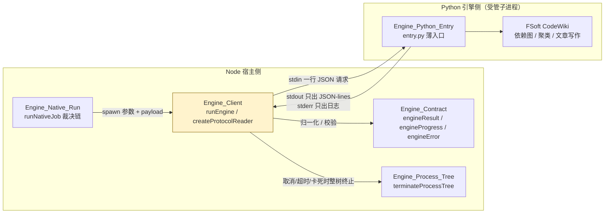
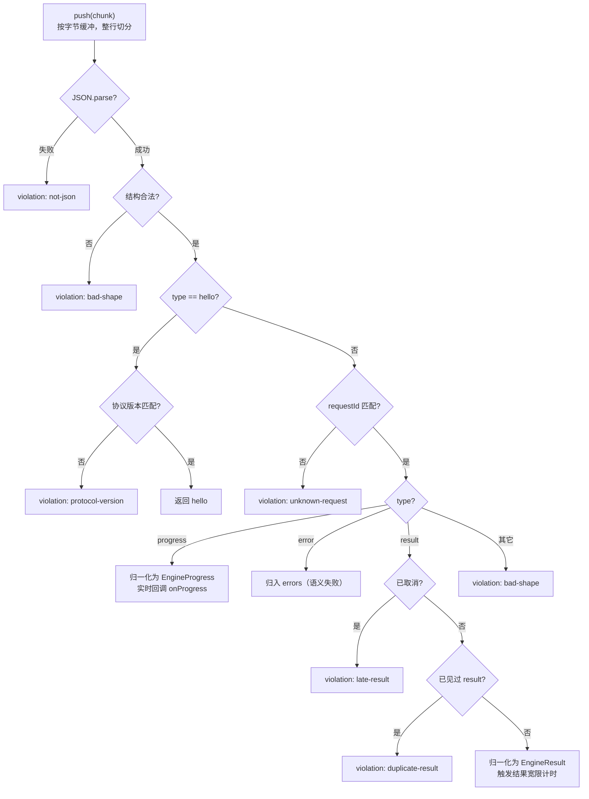
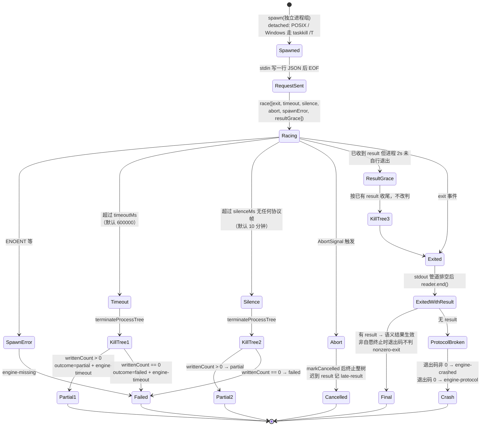
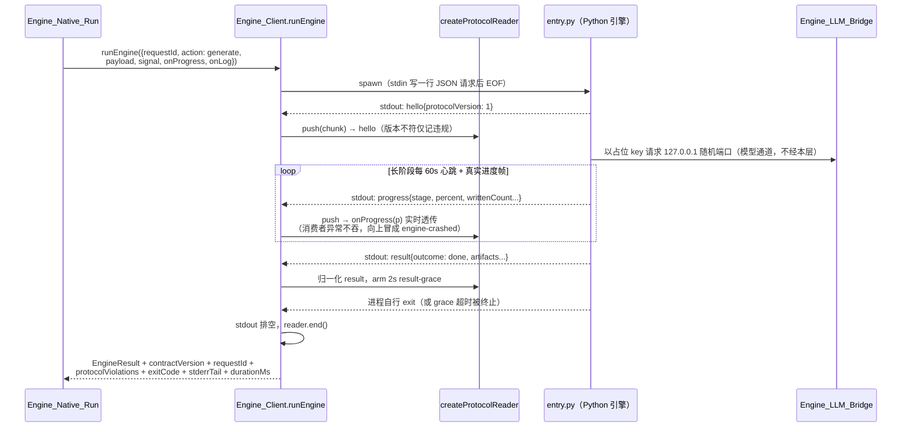

# Engine_Client（引擎进程客户端）

!!! info "Generated documentation"
    This page was written by CodeWiki from the source code at commit [`fd3ef771`](https://github.com/ikliml666/dsh-codewiki/commit/fd3ef771f9b84b535086711edf2e6fc0b62c6940) on 2026-11-07 with `doubao-seed-2.1-lite`. Check the code before relying on details.

`Engine_Client` 是 Node 宿主与 Python 原生引擎（FSoft CodeWiki）之间的**薄适配层**，是整个迁移架构里唯一的跨语言边界。它只做四件事：起一个受管子进程、写一行请求 JSON、按 JSON-lines 读回引擎消息、把消息翻译成契约规定的 `EngineResult` / `EngineProgress` / `EngineError`，并在超时、取消、崩溃、协议破坏时给出**可机读**的失败。

核心实现位于 `lib/engine/client.js`，对外暴露两个函数：

| 组件 | 职责 |
| --- | --- |
| `createProtocolReader(options)` | 增量式 JSON-lines 解析器，纯逻辑、不碰进程，可被逐字节喂入（模拟管道任意切分），接收并归类 `hello` / `progress` / `error` / `result` 四类协议帧 |
| `runEngine(options)` | 跑一次引擎动作（`doctor` / `generate` / `update` / `cancel`）并归一化成 `EngineResult`，负责进程生命周期、超时/静默/取消/结果宽限四类裁决 |
| `ENGINE_PROTOCOL_VERSION` | 协议版本常量（当前为 `1`）。注意它与结果契约版本 `ENGINE_CONTRACT_VERSION`（`contract.js`，当前为 `3`）是**两个独立版本**：前者管「行怎么长」，后者管「结果字段」 |

---

## 1. 模块定位与职责边界

`client.js` 的职责被刻意压窄（文件头注释明确写下了「不做什么」）：

**不做什么（防止本层长成第二个编译器）：**

- 不实现聚类、图 diff、文章写作——那是引擎的活；
- 不读凭证、不连模型——模型通道由 [引擎 LLM 桥（Engine_LLM_Bridge）](Engine_LLM_Bridge.md) 的 loopback 桥单独提供，引擎侧只能拿到占位 key 与 `127.0.0.1` 随机端口；
- 不写 `.codewiki`——产物落盘与模块映射在 [Engine_Output 模块文档](Engine_Output.md) / [Engine_Mapping：FSoft 产物到 CodeWiki 的格式映射层](Engine_Mapping.md)。

**上游调用方**：生产环境唯一编排器是 [Engine_Native_Run（原生编译裁决编排层）](Engine_Native_Run.md) 的 `runNativeJob`，它先跑 [引擎清单（Engine_Manifest）](Engine_Manifest.md) 的 `doctor` 与引擎锁校验，再经本模块驱动引擎，最后由 [Engine_Quality_Gate（原生引擎产物采用门）](Engine_Quality_Gate.md) 与 [Engine_Apply_Plan（原生产物落地器）](Engine_Apply_Plan.md) 裁决终态。

---

## 2. 协议不变量

协议不变量由 `test-engine-client.mjs` 的断言钉死，也是本模块一切行为的依据：

1. **stdout 只**是 JSON-lines；任何非 JSON 行记 `not-json` 违规，但**不丢弃**已收结果；
2. 每条消息必须带匹配的 `requestId`；不匹配记 `unknown-request`，绝不参与本次结果——`requestId` 是唯一关联键，缺失也算不匹配，不能靠「只有一条消息」蒙对；
3. 没有 `result` 消息 = 协议破坏，即使退出码是 0 也判失败；
4. 退出码只表达**进程层**结果。语义以 `result` 为准：退出码 0 + 语义 failed 仍是失败；语义 done + 退出码非 0 则保留 done 并记 `nonzero-exit` 违规（让人去看 stderr）；
5. 取消后到达的 result 记 `late-result` 并丢弃——取消是终态，不能被迟到的成功洗白；
6. 重复 result 先到的赢，后到的记 `duplicate-result`（那是引擎 bug，不是我们的）。

违规清单（`protocolViolations`）会原样附在返回结果上，供面板与日志取证，但不改变已确定的语义结局。

---

## 3. 进程生命周期与裁决分支

`runEngine` 用 `Promise.race` 同时等待六类事件，谁先到谁裁决，随后立即清理计时器：

### 四个关键计时设计

| 计时 | 默认值 | 解决的问题 |
| --- | --- | --- |
| `timeoutMs` | 600000（上层 [Engine_Native_Run（原生编译裁决编排层）](Engine_Native_Run.md) 会覆盖为 180 分钟） | 兜「跑太久」。超时但已有进度（`writtenCount > 0`）时判 `partial` 交付，保住已写文章、允许基线推进打破死循环 |
| `silenceMs` | `max(30s, 10 分钟)`，可用 `DSH_CODEWIKI_ENGINE_SILENCE_MS` 覆盖 | 兜「已经卡死」。静默阈值必须显著大于 Python 侧心跳间隔（`entry.py` 的 `_HEARTBEAT_SEC = 60s`），留约 10 倍余量才能区分「慢」与「死」。判据是「多久没收到任何协议帧」，与 timeout 分支同一口径决定 partial/failed |
| `resultGraceMs` | 2000ms | result 已到后的进程自行收场窗口。引擎发出 `done` 后若卡在收尾（僵死线程、没关的 pipe），已确定成功的编译不会被 10 分钟静默/180 分钟超时改判——超时即杀，按已有 result 收尾 |
| `maxLineBytes` | 4 MiB | 单行上限。引擎失控吐超长行（甚至一行 8MB）时拦住解析，防止内存暴涨；未终结的残留超限缓冲直接丢弃 |

### 为什么取消必须整树终止

FSoft 进程自己也会派生子进程（flake8、git 调用、甚至 fork 模型后端）。只杀直接子进程的 pid，孙进程会变成孤儿继续烧 token。因此 `runEngine` 的所有终止路径都委托给 [Engine_Process_Tree 模块文档](Engine_Process_Tree.md) 的 `terminateProcessTree`：POSIX 上 `detached: true` 起的子进程自成进程组，先 `SIGTERM` 整组、宽限后 `SIGKILL`；Windows 走 `taskkill /T /F`。只有「我们主动终止过的进程」其退出码不会被记成 `nonzero-exit`——终止方式的产物不是引擎自己的语义。

---

## 4. 一次典型调用的数据流

返回结果在 `finish()` 里统一封装：无论哪条裁决分支，都会带上 `contractVersion`、`requestId`、`action`、`protocolViolations`、`exitCode` / `exitSignal`、`terminated`、`stderrTail`（截断 4000 字符）、`startedAt` / `finishedAt` / `durationMs` 等现场证据。stderr 尾部会进入失败的 `message`——崩溃现场只有引擎自己吐得出来，不能让排障者再去翻日志。

---

## 5. 错误码与失败语义

本层产生的错误码全部取自 [Engine_Contract 引擎契约](Engine_Contract.md) 登记的 `ENGINE_ERROR_CODES`，`retryable` 由契约统一判定（`engine-timeout` / `engine-model` / `engine-unknown` 可重试，其余视为确定性失败）：

| 错误码 | 触发位置 | 含义 |
| --- | --- | --- |
| `engine-missing` | spawnPlan / spawn / spawn-error | 解释器、入口或 venv 不存在，无法启动引擎（含 ENOENT） |
| `engine-crashed` | 有 result 缺失分支 | 引擎非零退出或被信号杀死，stderr 尾部附进 message |
| `engine-protocol` | 有 result 缺失分支 | 进程正常退出但没有 result 消息——协议破坏，退出码 0 也救不了 |
| `engine-timeout` | timeout / silence 两分支 | 跑太久或判定卡死；已有 `writtenCount` 时整轮判 `partial` 并携带 `engine-timeout` blocker |
| `engine-cancelled` | abort 分支 | 用户取消（不是失败），终态 `cancelled`，计入终态判定 |

进度帧（`onProgress`）的消费者异常**故意不吞**：上层 `native-run.js` 在校验失败时会当场抛错，本层若吞掉，那类编程错误会变成「某一帧悄悄丢了、任务照样报成功」。异常会从 `data` 事件冒出来，由调用方的 try/catch 收成 `engine-crashed`。

---

## 6. 环境与配置

- **进程环境**：`spawnPlan` 把 `process.env`、`engine.env`、调用方 `env` 三层合并（后层覆盖前层）。模型相关变量（`CODEWIKI_BASE_URL` / `CODEWIKI_API_KEY` 等）由 [Engine_Native_Run（原生编译裁决编排层）](Engine_Native_Run.md) 在启动 LLM 桥后注入，密钥只活在子进程环境里。
- **静默阈值覆盖**：`DSH_CODEWIKI_ENGINE_SILENCE_MS`（主要供测试把 10 分钟压到秒级）。
- **Node 版本**：`package.json` 要求 `node >= 24.9.0`；`ENGINE_STAGES` 阶段枚举的任何增删都属契约变更，必须与 Python 侧 `entry.py` 的 `CONTRACT_VERSION` 同步升版。
- **协议版本**：`ENGINE_PROTOCOL_VERSION = 1` 与 `entry.py` 的 `PROTOCOL_VERSION` 一一对应；版本不符只记 `protocol-version` 违规而不中断——版本协商的责任在上层。

??? abstract "Documented components (1)"
    - [`runEngine`](https://github.com/ikliml666/dsh-codewiki/blob/fd3ef771f9b84b535086711edf2e6fc0b62c6940/lib%5Cengine%5Cclient.js) — `lib\engine\client.js`

