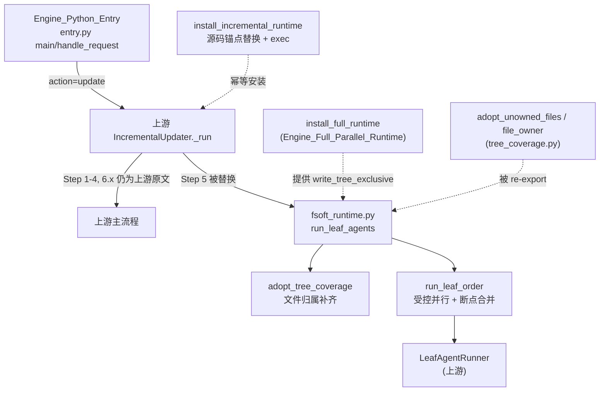
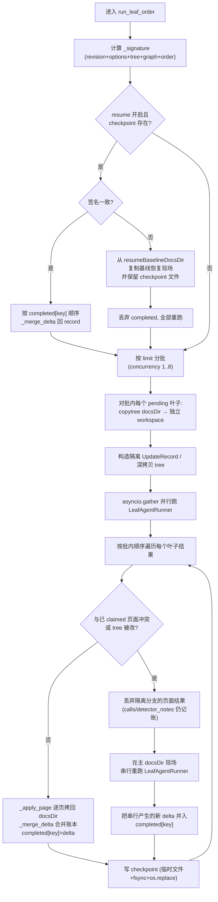
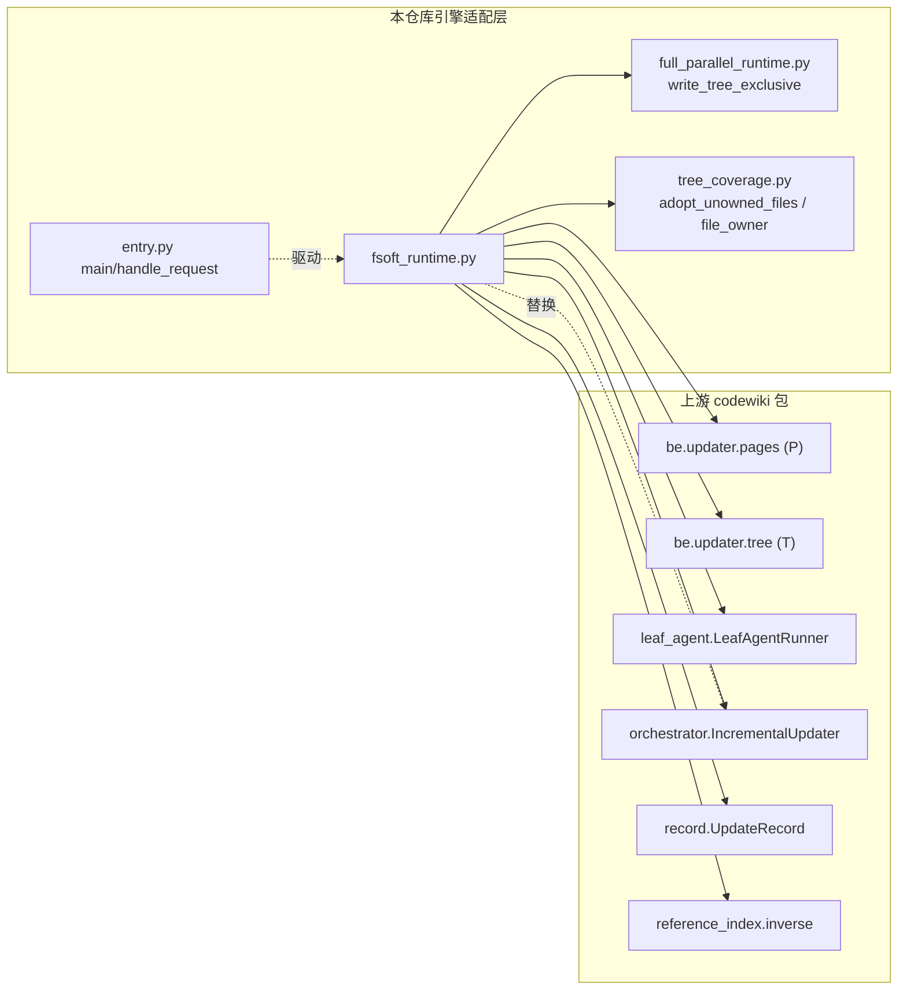

# Engine_FSoft_Runtime：增量 Step 5 的受控并行与断点运行时

!!! info "Generated documentation"
    This page was written by CodeWiki from the source code at commit [`d0adce52`](https://github.com/ikliml666/dsh-codewiki/commit/d0adce524f95d60d0bdb0d12ada263ed951b8fd9) on 2026-11-07 with `doubao-seed-2.1-lite`. Check the code before relying on details.

`Engine_FSoft_Runtime` 是对上游 FSoft-AI4Code/CodeWiki Python 引擎增量更新流程
（`IncrementalUpdater._run`）**Step 5「串行叶子代理」环节的适配器模块**，
核心实现位于 `lib/engine/python/fsoft_runtime.py`。

上游原本把本轮所有待更新叶子全部放在同一个 `docsDir` 里**串行**执行，简单但慢。
本模块只替换 Step 5 这一段：给每个叶子一个**独立的临时工作副本**并行跑模型调用，
再按原始顺序把真实页面变化**合并回主 `docsDir`**；如果某个叶子的页面写集与
已经合并的页面冲突，就在合并后的现场**串行重跑**该叶子，从而在保留上游串行
语义的前提下拿到并行速度。同时提供**增量断点（checkpoint）**能力：叶子级的
记账（调用、判定、写集、错误等）逐盘落盘，进程中断后可按签名恢复，跳过
已完成的叶子。

## 为什么存在这个模块

上游 Step 5 的保守写集里，多个叶子会共同修改同一个 `overview` 页，被上游当作
全局串行锁。本模块的做法：

1. **隔离**：每个叶子在独立临时目录里跑 `LeafAgentRunner`，互不干扰；
2. **合并**：按原顺序把叶子工作副本里的页面变化拷贝回主目录；
3. **冲突重跑**：同一页被后序叶子修改时，后序叶子在已合并现场串行重跑；
4. **断点**：逐叶子落盘 `dsh_leaf_checkpoint.json`，签名一致直接恢复进度。

> ⚠️ **安装策略约束**：本模块通过源码锚点（`_STEP5_START` / `_STEP5_END`）
> 对 `IncrementalUpdater._run` 的源码文本做替换并 `exec` 重新编译。
> **上游源码锚点变化时安装直接失败并抛 `RuntimeError`**，绝不静默退回另一套算法。
> 其余 Step（1–4、6.x）仍然执行上游原文。

## 模块在系统中的位置



## 核心组件

### `run_leaf_agents(updater, reports, new_tree, new_graph, leaf_nodes, ref_index)`

模块的顶层入口，替代上游 Step 5。流程：

1. `active_set(reports)` 取出本轮活跃更新单元；
2. `order_active(active, new_tree, new_graph)` 按依赖图确定执行顺序；
3. **整仓模式**短路：若 `updater.whole_repo` 且活跃单元 > 1，把它们**坍缩成一次
   overview 单页运行**，并在 `record.detector_notes` 里留痕；
4. `adopt_tree_coverage(...)` 先做文件归属补齐（见下）；
5. 把顺序交给 `run_leaf_order(...)` 真正执行。

### `run_leaf_order(updater, order, reports, new_tree, new_graph, leaf_nodes, ref_index)`

适配器与测试共用的公开 seam，真正干活的函数。**主流程**：



关键点：

- **`limit = max(1, min(moduleConcurrency, 8))`**：并行度被钳制在 1–8；
- **冲突判定**：`bool(changes & claimed) or tree_changed`；
- **冲突时不丢记账**：隔离分支的 `calls`（模型调用账本）与 `detector_notes`
  仍合并回主 `record`，随后在主现场串行重跑，并把串行产生的新记录并入
  `completed[key]`（注释里明确写了「模型调用仍计入本轮账本」）；
- **每完成一个叶子立即 `write_checkpoint`**，保证中断后可恢复。

### `install_incremental_runtime()`

安装器（幂等）。流程：

1. 检查 `IncrementalUpdater._run` 是否已带 `__dsh_runtime__` 标记，已装则直接返回；
2. 用 `inspect.getsource` 取上游源码，按 `_STEP5_START` / `_STEP5_END` 锚点切片；
3. 锚点找不到就抛 `RuntimeError("FSoft IncrementalUpdater Step 5 源码锚点不匹配…")`；
4. 把 Step 5 替换为两行新代码：
   ```python
   self._dsh_graph_diff = diff
   await _dsh_run_leaf_agents(self, reports, new_tree, new_graph, leaf_nodes, ref_index)
   ```
5. `exec(compile(transformed, ...), namespace)` 重新编译整个 `_run`，
   把新函数挂回 `IncrementalUpdater._run`，并打 `__dsh_runtime__ = True` 标记。

> 注意：除 Step 5 之外的所有源码段都**原样保留**在编译后的函数里执行。

### `adopt_tree_coverage(updater, new_tree, new_graph)`

解决「历史遗留未归属文件」问题。上游 Step 6.1 每次按全量组件校验叶子归属，
Step 2 的 repair 只处理本轮 `diff.added`，历史文件永远回不到树里，覆盖校验永远失败。

做法：通过 [全量并行运行时（Engine_Full_Parallel_Runtime）](Engine_Full_Parallel_Runtime.md) 暴露的
`write_tree_exclusive(path, mutate)` 在树锁内直接**读 → 改 → 覆盖写** `module_tree`：

- 为什么不能走上游的 `save_json` 合并语义：因为补挂结果旧值是新值的真子集，
  走合并会被叶子判据误判成「两个分支分给不同组件」而抛错；
- 为什么必须基于**磁盘最新树**而不是 Step 4 的 `new_tree` 快照：盘上可能已被
  本仓库历史轮次写下更多节点，快照会丢掉它们；
- 失败只往 `record.detector_notes` 记一条 warning，**不会让整轮增量崩掉**。

底层的 `adopt_unowned_files` / `file_owner` 来自
[Engine_Process_Tree 模块文档](Engine_Process_Tree.md) 的 Python 侧 `tree_coverage.py`，
本模块通过 `__all__` 直接 re-export。

### 断点（checkpoint）机制

| 函数 | 作用 |
| --- | --- |
| `checkpoint_path(docs_dir)` | 返回 `docsDir/dsh_leaf_checkpoint.json` |
| `write_checkpoint(docs_dir, signature, completed)` | 原子落盘：`{pid}.{nano}.tmp` → `fsync` → `os.replace` |
| `clear_checkpoint(docs_dir)` | 整批叶子完成后清理 |
| `_load_completed(updater, signature)` | 仅在 `opts.extra.resume` 开启时加载；签名不匹配且无
  `resumeBaselineDocsDir` 时**拒绝混用旧现场**并抛 `RuntimeError` |
| `_signature(updater, order, new_tree, new_graph)` | sha256(revision + options（剔除 `resume`）+ tree + graph + order + adapter 版本) |

断点 payload 形如：

```json
{
  "version": 2,
  "signature": "<sha256>",
  "completed": {
    "0": { "calls": [...], "verdicts": [...], "pages_written": [...], "...": "..." },
    "1": { "...": "..." }
  }
}
```

`ADAPTER_VERSION = 2` 变化或 `signature` 变化时，旧断点视为无效。

## 依赖关系



- 上游符号：`P`、`T`、`LeafAgentRunner`、`IncrementalUpdater`、`UpdateRecord`、
  `active_set`、`order_active`、`inverse`、`MODULE_TREE_FILENAME`；
- 同仓依赖：[全量并行运行时（Engine_Full_Parallel_Runtime）](Engine_Full_Parallel_Runtime.md) 的
  `write_tree_exclusive`、[Engine_Process_Tree 模块文档](Engine_Process_Tree.md) 的
  `adopt_unowned_files` / `file_owner`；
- 上游调用入口：由 [Engine_Python_Entry](Engine_Python_Entry.md) 的
  `handle_request(action="update")` 间接触发（`install_incremental_runtime` 在进程启动时安装）。

## 关键设计取舍

| 取舍 | 理由 |
| --- | --- |
| 只替换 Step 5，不替换其它 Step | 上游其余步骤仍是权威实现；改动面越小，上游升级越好跟进 |
| 用源码锚点替换而非继承/包装 | `IncrementalUpdater._run` 是一整个长函数，无法用子类化优雅重写 Step 5 |
| 隔离 `copytree` 而非共享 docsDir | 避免并行分支读写冲突；串行合并语义保留 |
| 冲突时**丢弃页面、保留调用账本、主现场重跑** | 页面结果在隔离分支不可信，但模型调用必须算钱；重跑保证最终页面一致 |
| checkpoint 用临时文件 + `fsync` + `os.replace` | 崩溃现场不会留下半截 JSON |
| 签名里剔除 `resume` 选项 | 恢复开关本身不该导致签名变化 |
| 整仓模式坍缩为单次 overview 运行 | 多叶子并行对整仓单页模式没有意义 |

## 运行期配置项

通过 `updater.opts.extra`（即 `updateOptions.extra`）读取：

| 键 | 默认 | 说明 |
| --- | --- | --- |
| `moduleConcurrency` | `1` | 叶子并行批大小，最终钳制到 1–8 |
| `resume` | 关闭 | 是否启用断点恢复 |
| `resumeBaselineDocsDir` | 无 | 签名漂移时的受管基线目录；缺失则拒绝混用旧现场 |

## 相关文档

- [Engine_Python_Entry](Engine_Python_Entry.md) — Python 子进程入口与协议
- [全量并行运行时（Engine_Full_Parallel_Runtime）](Engine_Full_Parallel_Runtime.md) — 全量模块并行与共享树 IO
- [Engine_Process_Tree 模块文档](Engine_Process_Tree.md) — 文件归属与覆盖校验的 Python 侧实现
- [Engine_Native_Run（原生编译裁决编排层）](Engine_Native_Run.md) / [Engine_Native_State（原生引擎跨轮受管状态）](Engine_Native_State.md) — Node 侧原生引擎驱动与状态目录
- [Update_Record（编译更新记录）](Update_Record.md) — `UpdateRecord` 的终端阶段与加载语义

??? abstract "Documented components (1)"
    - [`run_leaf_agents`](https://github.com/ikliml666/dsh-codewiki/blob/d0adce524f95d60d0bdb0d12ada263ed951b8fd9/lib%5Cengine%5Cpython%5Cfsoft_runtime.py) — `lib\engine\python\fsoft_runtime.py`

