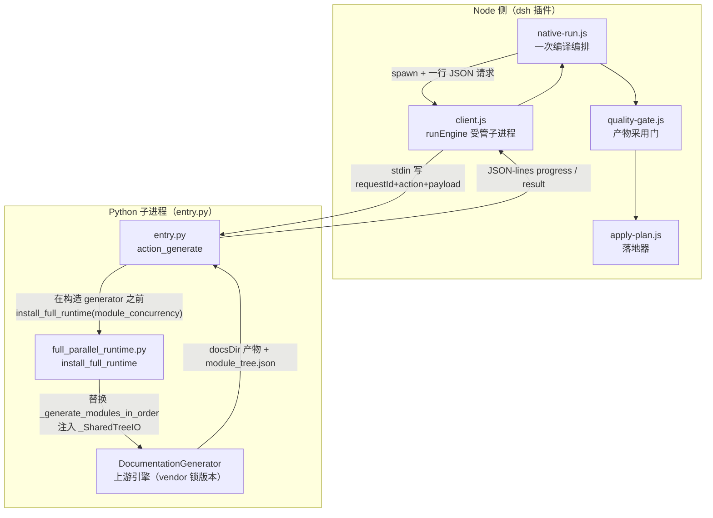
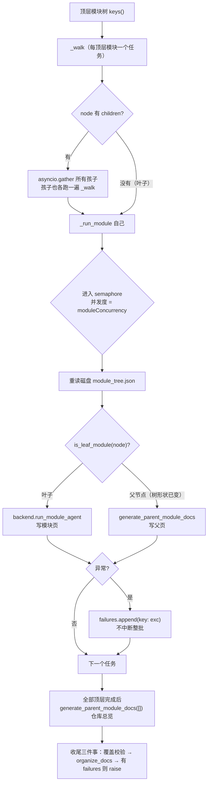
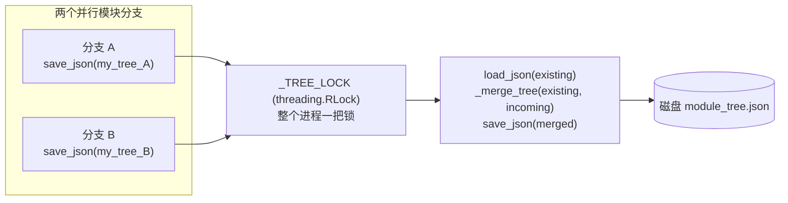
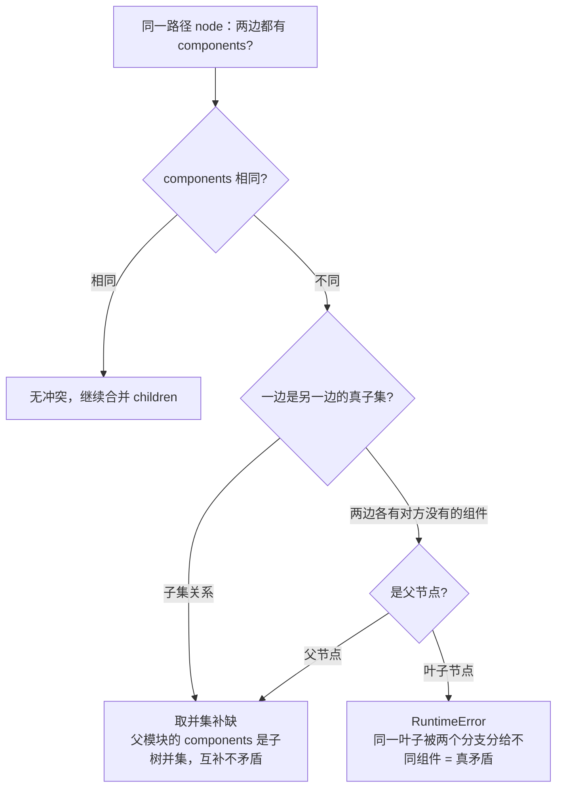
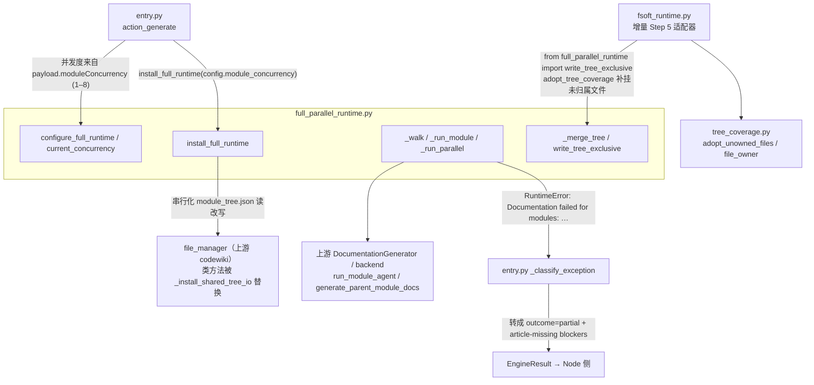
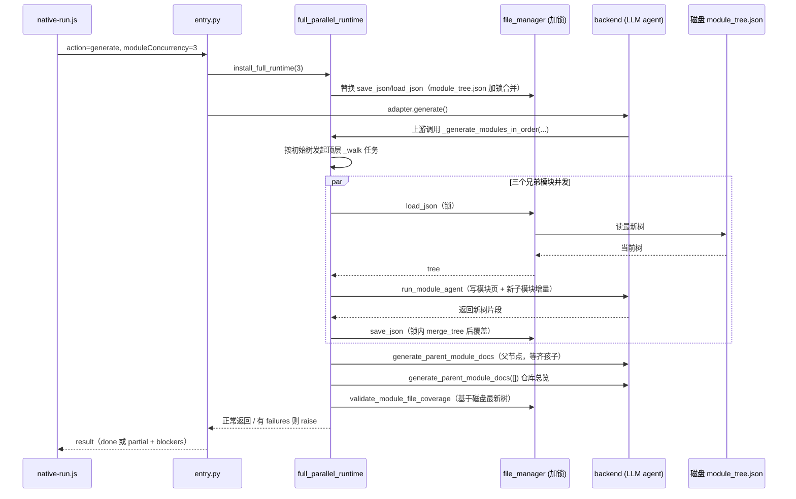

# 全量并行运行时（Engine_Full_Parallel_Runtime）

!!! info "Generated documentation"
    This page was written by CodeWiki from the source code at commit [`6809738d`](https://github.com/ikliml666/dsh-codewiki/commit/6809738d25eb24d2eac5d5da75a639b88b67e63e) on 2026-11-06 with `doubao-seed-2.1-lite`. Check the code before relying on details.

## 简介

`lib/engine/python/full_parallel_runtime.py` 是 FSoft 全量文档生成（`generate` 动作）的**受控并行适配器**。上游 `DocumentationGenerator._generate_modules_in_order` 是严格串行的逐模块循环：单篇文档约 12 分钟（15–20 次 LLM 请求），在中等仓库上会把 `native-run.js` 给的 180 分钟编译预算耗尽而只写出一部分页面（真机事故 `job-mvuf1c5b-5`）。本模块只替换这一个方法：把同一父节点下的**兄弟模块**并发执行，同时严格保证上游的四条语义不变量——拓扑顺序、模块树合并、失败上抛、磁盘可见性。适配器只在并发度 `moduleConcurrency > 1` 时生效；默认 `1` 就是上游原始的串行行为。

与之配对的增量路径适配器是 [增量并行运行时](Engine_FSoft_Runtime.md)（`fsoft_runtime.py`，替换增量更新 Step 5 的叶子写作），两者共享本模块提供的 `module_tree.json` 并发读写基础设施。

## 核心定位与系统位置

本模块位于原生引擎子进程内部：Node 侧通过 [引擎客户端](Engine_Client.md) 以 JSON-lines 协议拉起 [Python 入口](Engine_Python_Entry.md)，入口在构造 `CLIDocumentationGenerator` 之前调用 `install_full_runtime()` 完成猴子补丁，随后整个模块写作阶段就跑在并行调度器上。

上游源码锚点由 [引擎清单](Engine_Manifest.md) 的 `UPSTREAM_COMMIT`（`1b4af43…`）锁定；本模块对上游 `DocumentationGenerator._generate_modules_in_order` 的引用在锚点漂移时**直接失败**（拒装），不静默退回串行。环境本身的安装与依赖闭合由 [FSoft 引擎安装脚本](FSoft_Engine_Setup_Script.md)（`tools/fsoft-engine/setup-env.sh`）负责，与本模块正交。

## 设计目标：四条不可破坏的不变量

模块 docstring 与实现逐行对应地守住四条不变量，这也是评审本模块时的判据：

| # | 不变量 | 实现位置 | 被破坏的后果 |
|---|--------|----------|--------------|
| 1 | 父模块必须等所有子模块结束后再生成（拓扑顺序） | `_walk` 先 `asyncio.gather` 全部孩子、再 `_run_module` 自己 | 父页写到尚未生成的兄弟子模块链接/归属 |
| 2 | 并行分支各自新增的子模块必须合并回主树 | `_merge_tree` + `_TREE_LOCK` 保护的 `save_json` | 后写分支把先写分支的子模块整棵覆盖丢失 |
| 3 | 单模块失败不拖垮同批其它模块，但失败清单必须上抛 | `_run_module` 捕获异常记入 `failures`；`_run_parallel` 末尾 `raise RuntimeError` | 并行把「模块失败即显式失败」的上游判据吃掉，静默报成功 |
| 4 | 每个模块开始前从**磁盘**重读 `module_tree.json` | `_run_module` 在信号量内 `file_manager.load_json(module_tree_path)` | 用内存快照把刚被兄弟分支写进来的新子模块当不存在，走错分支 |

第四条的关键细节：调度本身是按**初始树**递归发起的，但每个 `_run_module` 在进入信号量之后、真正写页之前才读磁盘判断该节点是叶子还是父节点——兄弟分支并发期间新挂上来的子模块，会被父节点在下一次被调度时看到。

## 调度算法

### 递归下行 + 信号量限流

为什么「父等待时不占槽位」是安全的：父节点的 `_run_module` 只在**所有孩子 gather 完毕之后**才去抢信号量——父此时还没有占着槽位空等，所以不需要 AgentSlots 那种「父让出槽位」的机制，也就不会出现父子互相自锁。

并发度由 `configure_full_runtime(concurrency)` 设置（`max(1, n)`），`entry.py` 在构造 `CLIDocumentationGenerator` 之前按 payload 的 `moduleConcurrency`（1–8）下发；`current_concurrency()` 读取当前值。`install_full_runtime` 是幂等的（`_INSTALLED` 标志），且会检查目标方法仍是上游原方法——被其它适配器抢先替换时**拒绝重复安装**。

### 与上游顺序的兼容性

- 替换后的 `_generate_modules_in_order(self, components, leaf_nodes, working_dir, module_tree_path, module_tree, processing_order=None)` 签名保持兼容：上游调用点仍会传 `processing_order`，并行实现按树自己递归，直接 `del processing_order`。
- 仓库总览固定在所有顶层模块完成后统一生成，与上游「最后写 overview」的顺序一致。
- 空树分支（whole-repository 小仓库）与上游逐行一致：`run_module_agent` 以 `module_path=[]` 直接跑整仓，再 `validate_module_file_coverage` + `file_manager.save_json` + `overview.md` 归位，本模块不改写这条路径。

## module_tree.json 的并发读写协议

并行化最大的共享状态风险是：多个分支各自把「自己那部分子树」保存回同一个 `module_tree.json`，按 naive 的「内存对象整体覆盖写」语义，后写者会把先写者的子模块整棵抹掉。

### `_SharedTreeIO`：类方法级的读改写串行化

`_install_shared_tree_io()` 在**进程级、类方法**上替换 `file_manager.save_json / load_json`：只有文件名是 `module_tree.json` 时才走加锁合并路径，其它 JSON 文件（`metadata.json`、`update_record.json` 等）原样透传。必须打在 `file_manager.__class__` 上的原因写在源码注释里：各并行后端（`pydantic_ai_backend` / `caw_backend`）`from codewiki.src.utils import file_manager` 拿到的是**同一个类对象**，只替换 `documentation_generator` 模块里的名字拦不住它们。

`_SharedTreeIO` 类本身是同一套逻辑的包装形态（`__getattr__` 代理未拦截的方法），供需要注入式测试的场景使用。

### `_merge_tree`：补缺、并集、真冲突报错

合并语义刻意区分两类节点（这是真机事故沉淀出来的规则）：

注释里记录了为什么「子集不是矛盾」的真机教训：0.17.17 的补挂写盘撞过同一形态（树里 3 个组件、某分支看到 4 个——另一分支还没见到本轮新出现的符号），真机 `job-mw0rkcel-0` 因此整轮 articles 中断。真子集取并集；只有两边都有对方没有的组件且该节点是叶子时才判真冲突。

### `write_tree_exclusive`：跳过合并的覆盖写

`_merge_tree` 的合并语义**不适合**所有调用方。`write_tree_exclusive(filepath, mutate)` 提供另一条路径：在 `_TREE_LOCK` 内「读 → mutate → 直接覆盖写」，跳过合并。适用场景是调用方**已经**基于磁盘最新状态算出完整目标树（典型用户是 [增量并行运行时](Engine_FSoft_Runtime.md) 的 `adopt_tree_coverage`：把未归属文件补挂到已有叶子）。此时再走合并会被叶子判据误判——旧值恰好是新值的真子集——而整轮增量中断。本模块通过 `_ORIG_LOAD / _ORIG_SAVE` 两个模块级句柄保存原始函数，要求必须在 `install_full_runtime()` 之后调用（否则抛错）。

## 与上下游模块的关系

关键边界说明：

- **失败上抛的语义对接**：`_run_parallel` 末尾 `raise RuntimeError("Documentation failed for modules: " + "; ".join(failures))` 与上游 1b4af43 的措辞完全一致，`entry.py` 的 `_classify_exception` 正是靠这条前缀把它翻译成 `outcome=partial`、`blockers` 逐个点名失败模块（[Python 入口](Engine_Python_Entry.md)），而不是 `engine-crashed`。并行化没有改变这条契约——失败模块仍然「显式」、已写页面仍然交付。
- **收尾三件事必须保留**：`validate_module_file_coverage`（全量组件覆盖校验）→ `organize_docs`（按布局归位页面）→ `failures` 上抛。少任何一件，并行版都会比串行版少一层保证。
- **观测面**：`_run_module` 打的 `📄 Processing leaf module` / `📁 Processing parent module` 日志与上游原文一致，`entry.py` 的 `_DetailHandler` 旁路探针（见 [Python 入口](Engine_Python_Entry.md)）因此可以不改地把「正在写哪个模块」抽进进度帧。
- **终态裁决不在本模块**：产物能不能入库、基线能不能推进，由 [质量门](Engine_Quality_Gate.md) 与 [落地器](Engine_Apply_Plan.md) 按 `EngineResult` 逐条裁决，本模块只负责把全量写作阶段跑完。

## 数据流：一轮全量编译里树与页的流转

## 配置与运维要点

- **并发度下发路径**：`runNativeJob({ moduleConcurrency })`（[原生运行编排](Engine_Native_Run.md)）→ 请求 payload → `entry.py` `config["module_concurrency"] = max(1, min(n, 8))` → `install_full_runtime`。默认 `1` = 上游串行，行为零变化。
- **并发度的上限是 8**：这是 `entry.py` 里的硬顶，与增量叶子并行（`fsoft_runtime.py` 同样 `min(..., 8)`）对齐——并行度主要受模型通道的 RPM/成本约束，不是本地算力。
- **安装幂等与防重**：`_INSTALLED` 保证一轮编译内只装一次；`DocumentationGenerator._generate_modules_in_order is not _ORIGINAL_RUN` 检查防止与其它适配器互相覆盖。
- **上游锚点漂移**：引用 `DocumentationGenerator` / `file_manager` 的具体方法签名一旦与锁版本（`UPSTREAM_COMMIT`，见 [引擎清单](Engine_Manifest.md)）不符，安装或运行直接抛错——这是刻意设计，宁可编译失败也不静默跑错算法。
- **崩溃语义**：任意分支抛非 `CancelledError` 异常都被 `_run_module` 吞进 `failures`；只有 `CancelledError` 直接 re-raise，让取消信号（[进程树终止](Engine_Process_Tree.md)）能真正中断整轮。

## 相关模块索引

| 模块 | 关系 |
|------|------|
| [Python 入口](Engine_Python_Entry.md) | 调用方：`action_generate` 中安装本适配器、下发并发度、翻译失败异常 |
| [增量并行运行时](Engine_FSoft_Runtime.md) | 增量 Step 5 的并行适配器；复用本模块的 `write_tree_exclusive` 与树覆盖协议 |
| [进程树](Engine_Process_Tree.md) | 取消/超时如何终止整个引擎子进程树 |
| [引擎清单](Engine_Manifest.md) | 上游源码锁 `UPSTREAM_COMMIT` 与环境漂移判定 |
| [引擎客户端](Engine_Client.md) | Node↔Python 协议与静默/超时抢救（partial 交付） |
| [质量门](Engine_Quality_Gate.md) / [落地器](Engine_Apply_Plan.md) | 终态裁决与产物入库，不在本模块职责内 |
| [FSoft 引擎安装脚本](FSoft_Engine_Setup_Script.md) | venv 与依赖闭合，本模块运行的环境前提 |

??? abstract "Documented components (1)"
    - [`_SharedTreeIO`](https://github.com/ikliml666/dsh-codewiki/blob/6809738d25eb24d2eac5d5da75a639b88b67e63e/lib%5Cengine%5Cpython%5Cfull_parallel_runtime.py) — `lib\engine\python\full_parallel_runtime.py`

