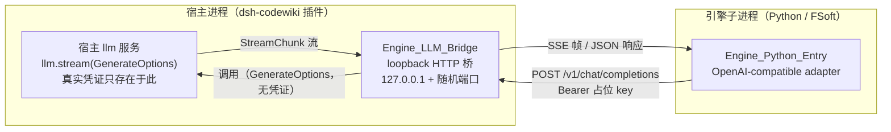
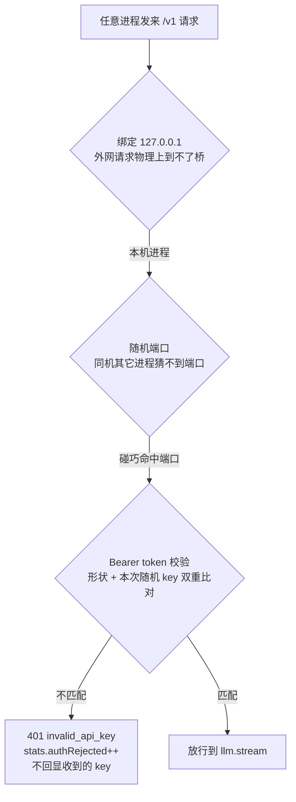
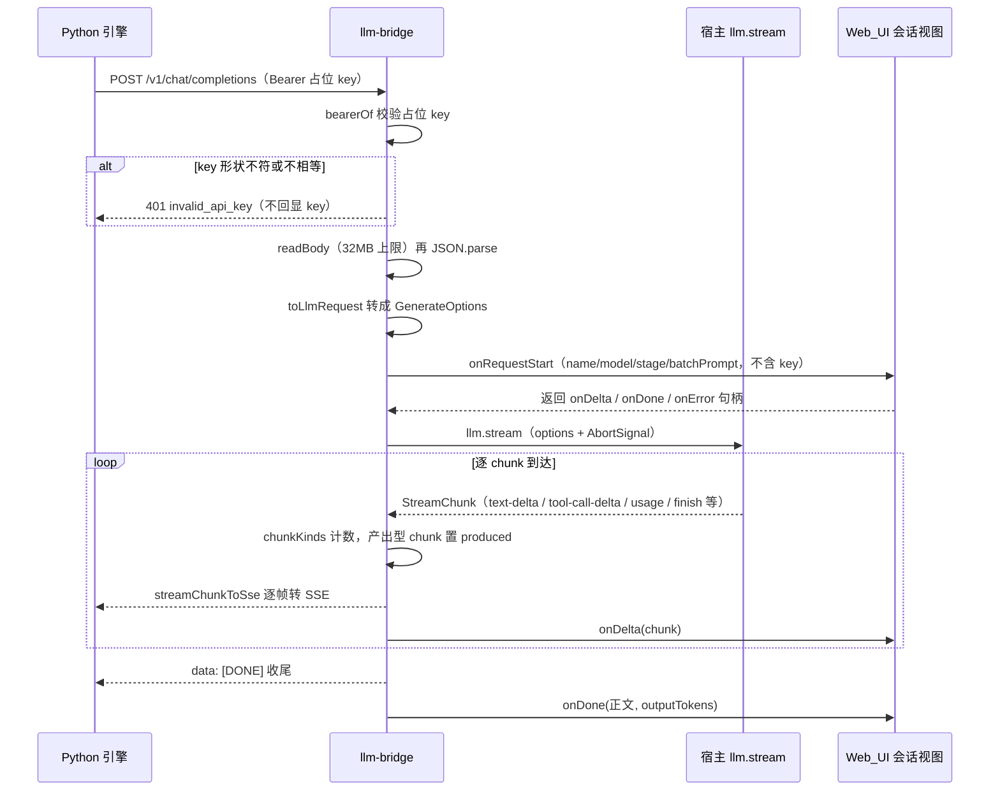
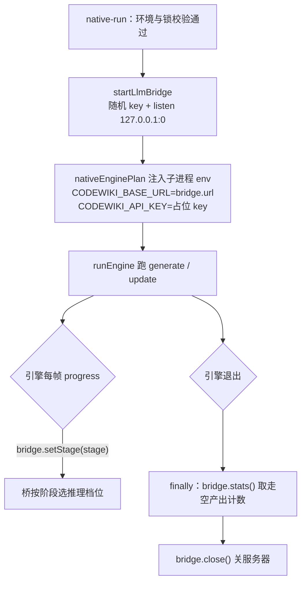

# 引擎 LLM 桥（Engine_LLM_Bridge）

!!! info "Generated documentation"
    This page was written by CodeWiki from the source code at commit [`6809738d`](https://github.com/ikliml666/dsh-codewiki/commit/6809738d25eb24d2eac5d5da75a639b88b67e63e) on 2026-11-06 with `doubao-seed-2.1-lite`. Check the code before relying on details.

## 简介

`Engine_LLM_Bridge`（`lib/engine/llm-bridge.js`）是 FSoft 原生引擎与宿主模型服务之间的 **loopback 薄桥**（阶段 1B）。它存在的根本原因是：**FSoft 引擎只认 OpenAI-compatible 的 `base_url` + `api_key`，而本插件（0.10.1 起）的硬约束是既不保存也不传递任何真实凭证**。真实凭证只存在于宿主 provider 内部，桥通过传入的 `llm` 对象间接触发模型调用，自己从头到尾看不见它。

桥的职责只有一件事：把引擎发来的 OpenAI-compatible 请求翻译成宿主的 `llm.stream(GenerateOptions)`，再把 chunk 流翻译回 OpenAI 响应（非流式 JSON / 流式 SSE）。

它在整体编译管线中的位置如下：

- 纯协议转换（OpenAI 请求体 ⇄ DSH StreamChunk）全部下沉到 [Engine OpenAI 桥转换层](Engine_OpenAI_Bridge.md)；本模块只负责 HTTP 服务、准入校验、超时/断连与观测记账。
- 桥的生灭、阶段同步与统计回收由 [Engine_Native_Run（原生编译裁决编排层）](Engine_Native_Run.md) 编排；引擎侧如何通过进程环境变量拿到桥地址，见 [Engine_Python_Entry](Engine_Python_Entry.md) 与 [Job Orchestration（编译任务编排服务）](Job_Orchestration.md) 的 `nativeEnginePlan`。

## 核心组件

### `startLlmBridge(opts)`

启动桥并返回一个 Promise，resolve 后得到句柄 `{ url, placeholderKey, port, stats(), setStage, close() }`。

入参：

| 参数 | 类型 | 说明 |
|---|---|---|
| `llm` | `{stream: Function}` | 宿主 llm 服务，**只用其 `stream` 方法**；缺它或无 `stream` 当场抛错 |
| `provider` | string | 宿主 provider id（如 `volces-ark`），参与路由与 `/v1/models` 响应 |
| `model` | string | 模型 id（如 `glm-5.3-flash`） |
| `reasoningEffort` | string? | 缺省推理档位兜底值 |
| `effortByStage` | object? | 按引擎阶段覆盖推理档位（`{stage: effort}`） |
| `timeoutMs` | number? | 单次模型调用超时，默认 10 分钟；[Engine_Native_Run（原生编译裁决编排层）](Engine_Native_Run.md) 会再夹到 `min(总超时, 10分钟)` |
| `onLog` | (entry)=>void? | 结构化日志回调，**不含 Authorization 与占位 key** |
| `onRequestStart` | (task)=>handle? | 会话记录钩子：每个 chat 请求开始时调用，入参 `task = {name, model, provider, stage, batchPrompt}`，返回 `{onDelta, onDone, onError}` |

服务实现要点：

- 监听 `127.0.0.1` 的随机端口（`server.listen(0, '127.0.0.1')`），对外只暴露 `http://127.0.0.1:<随机端口>/v1`。
- 占位 key 每次启动随机生成：`dsh-bridge-` + `randomBytes(32).toString('hex')`，不复用、不落盘、不进日志。
- 请求体上限 `MAX_BODY_BYTES = 32MB`，超限直接 413。
- 每次请求建立 `AbortController`：客户端断连（`res.on('close')`）或超时都会 `abort()` 上游 `llm.stream`，省 token 并让引擎的取消语义真正生效。

### `setStage(stage)`

由闭包返回、供编排层同步当前引擎阶段的函数。[Engine_Native_Run（原生编译裁决编排层）](Engine_Native_Run.md) 在每帧 `onProgress` 里调用 `bridge.setStage(p.stage)`，桥据此用 `effortOf(stage)` 选择本轮请求的推理档位：`effortByStage[stage]` 优先，缺省回落到 `reasoningEffort`——环节没单独配置时行为与之前完全一致。

## 安全边界（整条迁移最不能破的一条）

桥等于「用宿主凭证换任意模型调用」的开关，因此准入由三层防护构成，**三者缺一都等于把宿主凭证开放给本机任意进程**：

凭证边界的具体约束：

- 桥**不读**任何凭证文件、**不接收**真实 api_key、**不转发** Authorization 头给上游；`bearerOf(req)` 只在内存里取出 token 用于校验，取完即弃。
- 引擎侧拿到的 `api_key` 只是占位 key（唯一作用是让 OpenAI 客户端肯发请求），由 [Job Orchestration（编译任务编排服务）](Job_Orchestration.md) 的 `nativeEnginePlan` 以进程环境变量 `CODEWIKI_API_KEY` 注入，**只活在进程环境里，不落盘、不进 job 日志**。
- 访问日志与错误日志只记 method/path/status/耗时/chunk 计数/usage，**绝不记** Authorization；401 错误体也不回显收到的 key（避免把用户误配的真实 key 写进日志）。

## 协议面

只实现引擎真正用到的部分，不假装完整 OpenAI：

| 方法 | 路径 | 需占位 key | 说明 |
|---|---|---|---|
| GET | `/healthz` | 否 | 桥自身存活探测，返回 `{ok, provider, model}`，不含任何模型调用 |
| GET | `/v1/models` | 是 | 引擎/探针的连通性检查，返回当前路由的单一模型 |
| POST | `/v1/chat/completions` | 是 | 非流式（缺省/`stream:false`）与流式（`stream:true`） |
| 其它一切 | — | — | 404，错误体形如 `unsupported route: <path>` |

## 请求数据流（流式 chat 请求）

几个必须钉死的转换细节（出错即引擎层报错）：

- **流式逐帧必须用 `streamChunkToSse`**：它绝不补 `finish_reason`。若把入参当「一整条已结束的流」去折叠，每个 reasoning/tool-call 分片后都会紧跟一个假的 `finish_reason`，引擎会以为本轮已结束（既不执行工具也没拿到正文），最终报 pydantic-ai 的 "Please return text or call a tool" 并重试到上限。
- **非流式响应**由 `chunksToCompletion` 折同一条 chunk 流而成（正文 + 按 index 拼接的工具调用 + usage），流式路径的 `onDone` 也用同一个公开函数折叠，保证两条路径语义同源。
- **流已开始后才失败**：不能再回 JSON 错误体，只能写一个 `error` SSE 事件再补 `[DONE]` 收尾；未开始头的失败则回 502 `upstream_error`。

## 观测与记账

桥的统计句柄 `stats()` 在每次编译结束前被 [Engine_Native_Run（原生编译裁决编排层）](Engine_Native_Run.md) 的 `finally` 取走（然后再 `close()`），是「引擎为什么报这一页无需改动」的现场证据：

| 统计字段 | 含义 |
|---|---|
| `requests` | 已处理的 `/v1/chat/completions` 总数 |
| `streamRequests` | 其中 `stream:true` 的请求数 |
| `authRejected` | 占位 key 校验失败次数（准入闸门的计数器） |
| `failures` | 上游异常或桥内部错误次数 |
| `emptyResponses` | 上游 200 但**一个产出型 chunk 都没有**的调用次数——「引擎说这页无需改动」的唯一可量化源头（假 done 来源之一） |
| `lastError` | 最近一次失败的错误消息 |

每次请求还会在内存里统计 `chunkKinds`（各类型 chunk 的条数）：这是区分「模型真的返回空」与「桥丢包」的唯一手段（例如 tool-call 没被转出去），只记类型名与条数，正文一律不落日志。

会话记录钩子 `onRequestStart` 供 [Web_UI_Panel](Web_UI_Panel.md) 的「会话」视图使用：

- `task` 只含 `name`（`原生请求 · <model>`）、`model`、`provider`、`stage`、`batchPrompt`——后者由 `messagesToPrompt` 把 messages 摊平成可读文本（保留 role 前缀），超过 200k 字符显式截断并标注原长；`stage` 为当前引擎阶段（`currentStage || null`），供面板按「流程走到哪一步」给请求分类，记录本身不经过引擎，不在桥里带下去就只剩统一的请求名；**绝不**包含 Authorization 与占位 key。
- 会话回调外层有沙箱（`callSession`）：面板记账失败绝不影响正在跑的模型请求。

## 生命周期与协作关系

关键时序约束：

- **先开桥、后跑引擎**：桥起不来（如缺 `llm`/`provider`/`model`）native-run 直接以 `engine-model` 失败，stage 记 `cluster`。
- **引擎完全结束后再关桥**：先关桥会让还在读流的引擎拿到 502；因此 `stats()` 与 `close()` 都放在 `finally` 里执行。
- 引擎侧（[Engine_Python_Entry](Engine_Python_Entry.md)）只从进程环境读 `CODEWIKI_BASE_URL` / `CODEWIKI_API_KEY` / `CODEWIKI_MAIN_MODEL` / `CODEWIKI_CLUSTER_MODEL`，并显式禁用 keyring——缺任何一项如实报「缺少模型通道」，绝不回退去读本机凭证库。

## 相关模块

- [Engine OpenAI 桥转换层](Engine_OpenAI_Bridge.md) — 被本模块导入的纯转换层（`toLlmRequest` / `chunksToCompletion` / `streamChunkToSse` / `PLACEHOLDER_KEY_PATTERN`）。
- [Engine_Native_Run（原生编译裁决编排层）](Engine_Native_Run.md) — 桥的编排者：启动、`setStage` 同步、统计回收与关闭。
- [Engine_Python_Entry](Engine_Python_Entry.md) — 引擎子进程侧：经环境变量接入 OpenAI-compatible 通道。
- [Job Orchestration（编译任务编排服务）](Job_Orchestration.md) — `nativeEnginePlan` 把桥地址与占位 key 写进子进程环境。
- [Web_UI_Panel](Web_UI_Panel.md) — 「会话」视图通过 `onRequestStart` 钩子消费桥记录的模型调用。

??? abstract "Documented components (2)"
    - [`setStage`](https://github.com/ikliml666/dsh-codewiki/blob/6809738d25eb24d2eac5d5da75a639b88b67e63e/lib%5Cengine%5Cllm-bridge.js) — `lib\engine\llm-bridge.js`
    - [`startLlmBridge`](https://github.com/ikliml666/dsh-codewiki/blob/6809738d25eb24d2eac5d5da75a639b88b67e63e/lib%5Cengine%5Cllm-bridge.js) — `lib\engine\llm-bridge.js`

