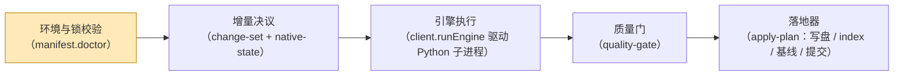
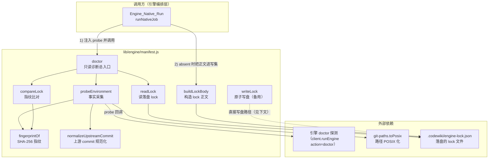
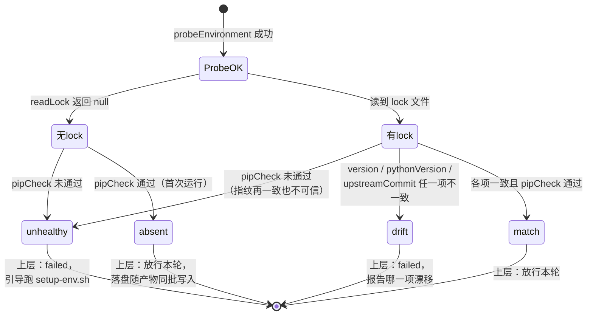
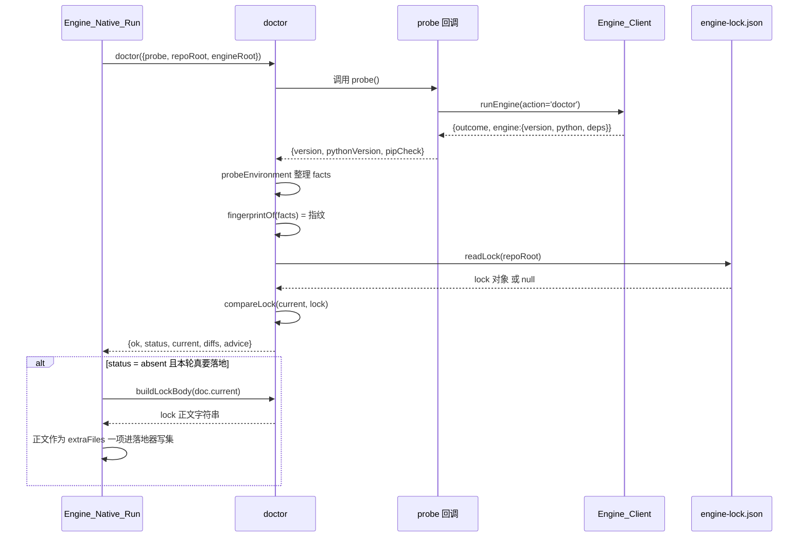

# 引擎清单（Engine_Manifest）

!!! info "Generated documentation"
    This page was written by CodeWiki from the source code at commit [`11e4224e`](https://github.com/ikliml666/dsh-codewiki/commit/11e4224e6128a4b770f42f9d65782b1fb3a0cef0) on 2026-11-06 with `doubao-seed-2.1-lite`. Check the code before relying on details.

## 简介

`Engine_Manifest` 是原生编译通道的**环境裁决层**，模块文件为 [`lib/engine/manifest.js`](../repo/lib/engine/manifest.js)。它回答一个问题：**「现在跑的是哪个引擎、哪个环境？」**

为什么需要这一层：FSoft（上游 CodeWiki Python 引擎）是**外部引擎**，它的版本与依赖都不由本仓库控制。没有清单的话，同一份 wiki 在不同机器、不同 pip 状态下会产出不同结果，而错误会表现为「模型不听话」——最难查的一类问题。本模块的职责因此被严格限定为三件事：

1. **指纹**：读引擎版本 + Python 版本 + 上游源码锁定 commit，算一个稳定 hash；
2. **比对**：把当前指纹与落盘的 `.codewiki/engine-lock.json` 相比，不一致就明确说出**哪一项**不一致；
3. **落盘**：把当前环境事实写成 lock 正文（实际写盘时机由落地器安排，见下文「落盘时机」）。

它**不做**的事同样重要：不装依赖、不修环境、不联网。`doctor` 是**只读诊断**——它只报告事实，由上层决定要不要重新 setup（那是 [FSoft 引擎环境搭建脚本（FSoft_Engine_Setup_Script）](FSoft_Engine_Setup_Script.md) 中 `tools/fsoft-engine/setup-env.sh` 的职责）。

---

## 架构定位

在原生编译的「裁决链」中，本模块位于最前端。整条链路（由 [Engine_Native_Run（原生编译裁决编排层）](Engine_Native_Run.md) 的 `runNativeJob` 固定为一条直线）如下：



**硬不变量**：锁不一致（`drift`）或依赖不闭合（`unhealthy`）时，链路在第 1 步就终止——**直接 failed，不跑引擎**。跑出来的产物不可信，而且「先跑再发现环境漂了」会让用户看到一堆无意义的失败文章。

## 组件关系图



### 为什么 probe 由调用方传入

`probeEnvironment` 不在这里 spawn 子进程，而是接收一个 `probe` 回调函数。这样这一层是**纯的、可单测**的：进程管理留在 [Engine_Client（引擎进程客户端）](Engine_Client.md)（`runEngine`）里，本模块只负责把探测结果整理成事实、算指纹、做比对。

---

## 核心概念

### 指纹的构成

指纹（`fingerprintOf`）是一个 16 位十六进制的 SHA-256 前缀，**只吃决定产物内容的因素**：

| 输入项 | 说明 |
| --- | --- |
| `manifest:1` | 清单协议版本（`MANIFEST_VERSION = 1`）——指纹算法本身变了也能被发现 |
| `version` | 引擎自报的版本号（如 `codewiki 2.0.0`） |
| `python` | 解释器版本 |
| `upstream` | 上游 FSoft 源码锁定 commit（40 位小写十六进制） |

**有意不进指纹的项**：`pipCheckOk`（依赖闭合状态）。依赖闭合是「能不能跑」的闸门，不是「产物会是什么」的输入；把它算进指纹会让每次修依赖都像换了引擎。

### 为什么上游 commit 必须进指纹

FSoft 的版本号（`codewiki 2.0.0`）是 `pyproject.toml` 里**写死的**——上游从 git 直接安装时，换了源码 commit 版本号根本不变。如果指纹只看版本号，「换了引擎」会被静默当成「环境没变」，产物差异再被误诊成模型不听话。

因此本模块把 **`UPSTREAM_COMMIT` 写成显式常量**（当前为 `1b4af43d6d20c8dbd758fe1d5f888cc6947ed11d`），而不是从运行时探测：

- 引擎自报的 `engine.commit` 取自 `_git_commit(repo_path)`——它是**被编译仓库的 HEAD**，不是 FSoft 源码自己的 commit，把它当上游锁会让「本仓库提交了一次」反而像换了引擎；
- 两个概念必须分开记：`upstreamCommit` 是本仓库声明的上游源码锁（审计与漂移判据的唯一来源），`engine.commit` 只作证据、不参与判定；
- 升级上游的契约是「改这个常量 + 跑契约测试」，而不是「pip install 到最新版然后祈祷」。

`normalizeUpstreamCommit` 负责把值规范成 40 位小写十六进制；认不出来返回 `''`（= 未知），而不是把半截/大写的串当合法值写进锁——那是「锁了但锁错了」。

## 比对状态机（compareLock）

`compareLock({current, lock})` 返回可机读的差异列表与四种状态之一：



各状态语义与上层处置：

| status | 含义 | `doctor.ok` | 上层处置（native-run） |
| --- | --- | --- | --- |
| `match` | 指纹与 lock 完全一致 | `true` | 放行 |
| `absent` | 没有 lock（首次运行） | `true` | 放行；本轮落地时把 lock 写进产物事务 |
| `drift` | 引擎版本 / Python 版本 / 上游 commit 变了 | `false` | 直接 failed（`engine-deps`），不跑引擎 |
| `unhealthy` | 指纹一致但 `pip check` 失败 | `false` | 直接 failed（`engine-deps`），建议先跑 `tools/fsoft-engine/setup-env.sh` |
| `probe-failed` | 探测本身抛错（解释器缺失 / 入口崩） | `false` | 直接 failed（`engine-missing`） |

> 历史教训：曾在比对任何字段之前就因「没有 lock」返回 `absent`，于是「pip check 失败」这条事实被整个吞掉——调用方看到 absent 只会以为「首次运行」照跑不误。现在 `unhealthy` 在没有 lock 时同样会被报出来。

## 数据流：doctor 一次调用的全过程



## lock 文件结构（.codewiki/engine-lock.json）

`buildLockBody` 构造的 JSON 正文（与文章、受管状态共享同一份 pre-image，由落地器同批写入并提交）：

```json
{
  "manifestVersion": 1,
  "fingerprint": "（16 位 sha256 前缀）",
  "version": "codewiki 自报版本",
  "pythonVersion": "解释器版本",
  "upstreamCommit": "40 位上游源码锁",
  "engineRoot": "引擎源码根（POSIX 路径，仅审计）",
  "pipCheckOk": true,
  "recordedAt": "ISO 时间戳"
}
```

`upstreamCommit` 必须落盘：否则「上游锁了 commit」只存在于代码常量里——下一次 doctor 比对的是**落盘的这份**，不落盘等于没锁。

## 落盘时机：为什么不直接 writeLock

模块虽然导出了 `writeLock`（原子写：先写 `.tmp` 再 `rename`），但原生通道的生产路径**刻意不在 doctor 阶段直接写盘**，原因有两层：

1. **不能在 doctor 阶段写**：写 `.codewiki/engine-lock.json` 会让 `.codewiki/` 目录在 `cw init` 之前就存在。而落地器（[Engine_Apply_Plan（原生产物落地器）](Engine_Apply_Plan.md)）把「`.codewiki` 存在却没有 `_meta.yaml`」判成人工破坏的半截库（`wiki-missing`）并拒绝自动初始化——首次编译会因此在最后一步整批失败、回滚掉所有文章。
2. **不能在 apply 之后直接写盘**：那样 lock 文件落在提交之外，下一轮会被变化集当成未提交脏文件，无变化的一轮也会凭空产生一个 commit（真机上确实长出过 `?? .codewiki/engine-lock.json`）。

正确做法（native-run 的 3.6 段）：仅当 `lockStatus === 'absent'` **且本轮不是无变化轮**时，把 `buildLockBody` 的正文作为 `extraFiles` 的一项交给 [Engine_Apply_Plan（原生产物落地器）](Engine_Apply_Plan.md)——与文章共享 pre-image，索引/基线失败时一起回滚，提交时一起进同一个 commit。

## 导出 API 一览

| 导出 | 类型 | 职责 |
| --- | --- | --- |
| `MANIFEST_VERSION` | 常量 | 指纹协议版本（当前 1） |
| `ENGINE_LOCK_REL` | 常量 | lock 相对路径 `.codewiki/engine-lock.json` |
| `UPSTREAM_COMMIT` | 常量 | 上游 FSoft 源码锁定 commit |
| `normalizeUpstreamCommit(value)` | 函数 | 规范成 40 位小写十六进制，非法返回 `''` |
| `probeEnvironment({probe, engineRoot, upstreamCommit})` | 异步函数 | 采集事实并算指纹 |
| `fingerprintOf(facts)` | 函数 | 由 facts 计算 16 位指纹 |
| `readLock({repoRoot})` | 函数 | 读 lock；不存在/坏了都返回 `null` |
| `compareLock({current, lock})` | 函数 | 比对，返回 `{status, diffs, current, locked}` |
| `buildLockBody(current)` | 函数 | 构造 lock 落盘正文（不写盘） |
| `writeLock({repoRoot, current})` | 函数 | 原子写盘（备用路径，生产不用） |
| `doctor({probe, repoRoot, engineRoot, upstreamCommit})` | 异步函数 | 只读诊断总入口，**不抛**：probe 抛错变成 `ok:false, status:'probe-failed'` |

## 上下游模块参考

- [Engine_Native_Run（原生编译裁决编排层）](Engine_Native_Run.md) — 唯一生产调用方：注入 probe、消费 doctor 结论、安排 lock 落盘时机；
- [Engine_Client（引擎进程客户端）](Engine_Client.md) — probe 的底层实现：以 `action='doctor'` 拉起 Python 子进程取引擎自报现场；
- [Engine_Python_Entry](Engine_Python_Entry.md) — 引擎侧入口：doctor 动作返回 `engine.version / python / deps` 现场；
- [Engine_Apply_Plan（原生产物落地器）](Engine_Apply_Plan.md) — 落地器：lock 正文作为 `extraFiles` 与文章同事务写盘、回滚、提交；
- [FSoft 引擎环境搭建脚本（FSoft_Engine_Setup_Script）](FSoft_Engine_Setup_Script.md) — `unhealthy` 状态的修复方：`tools/fsoft-engine/setup-env.sh` 按冻结快照重建依赖闭合的 venv（含 `pip check` 验收）；
- [Engine_Contract 引擎契约](Engine_Contract.md) — `drift / unhealthy / probe-failed` 被翻成 `engine-deps / engine-missing` 等契约错误码的终态形状。

??? abstract "Documented components (2)"
    - [`doctor`](https://github.com/ikliml666/dsh-codewiki/blob/11e4224e6128a4b770f42f9d65782b1fb3a0cef0/lib%5Cengine%5Cmanifest.js) — `lib\engine\manifest.js`
    - [`writeLock`](https://github.com/ikliml666/dsh-codewiki/blob/11e4224e6128a4b770f42f9d65782b1fb3a0cef0/lib%5Cengine%5Cmanifest.js) — `lib\engine\manifest.js`

