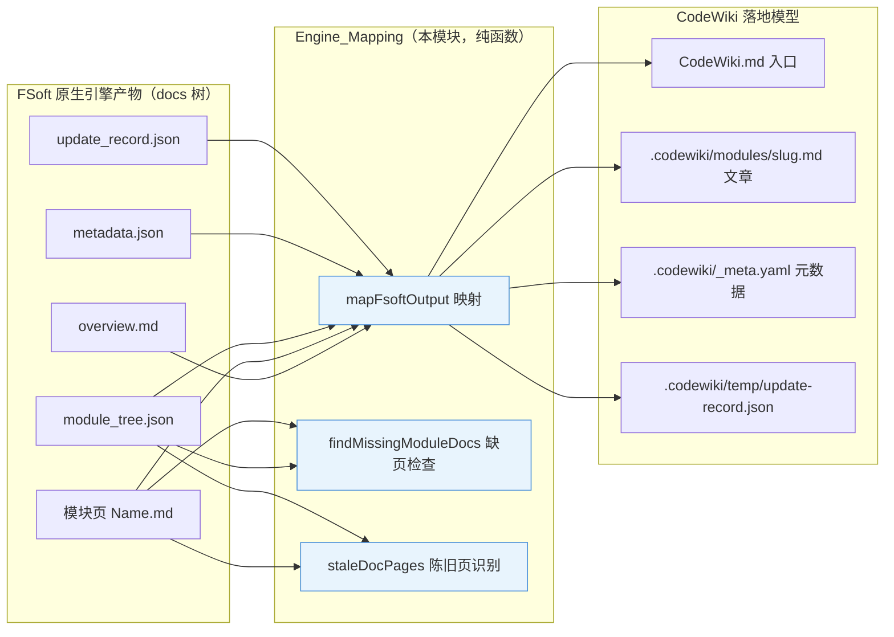
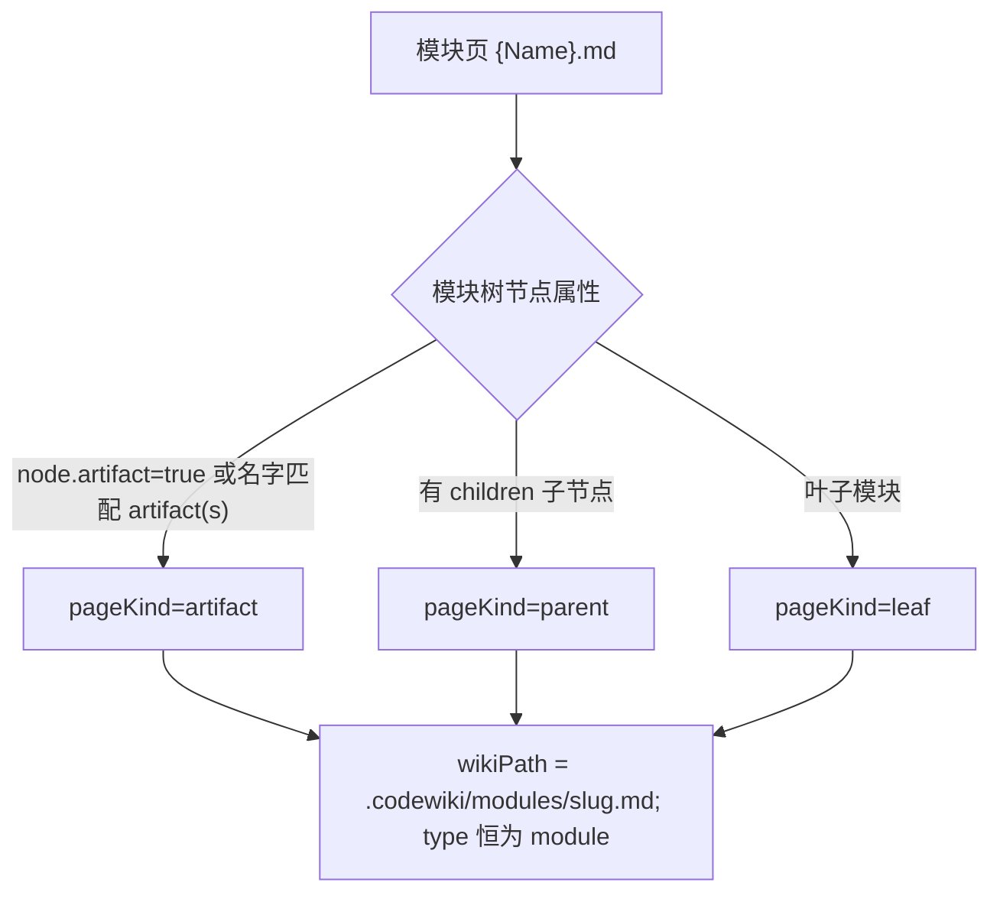
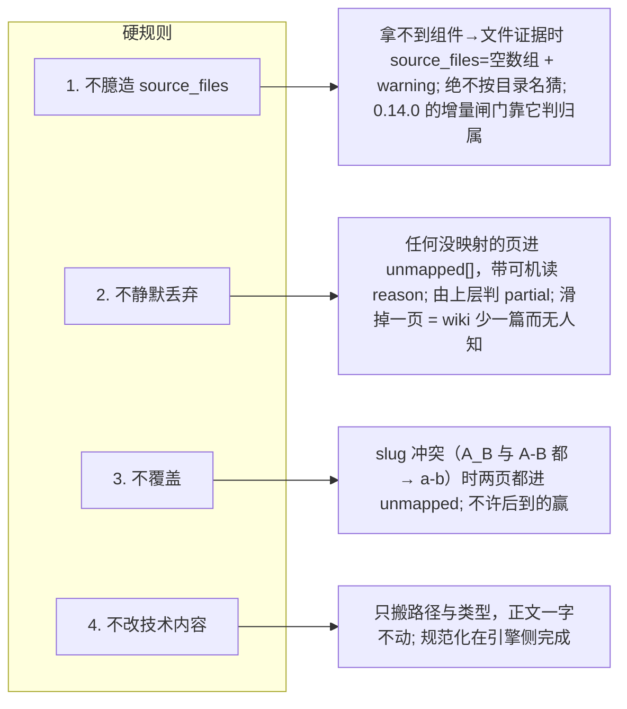
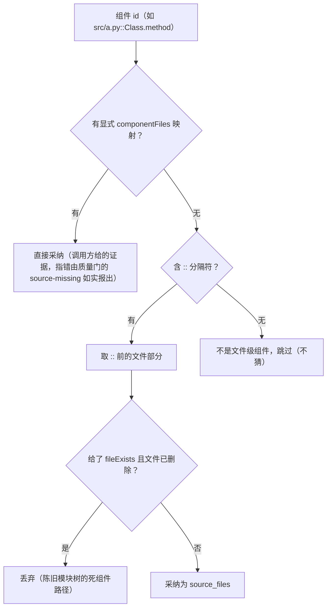
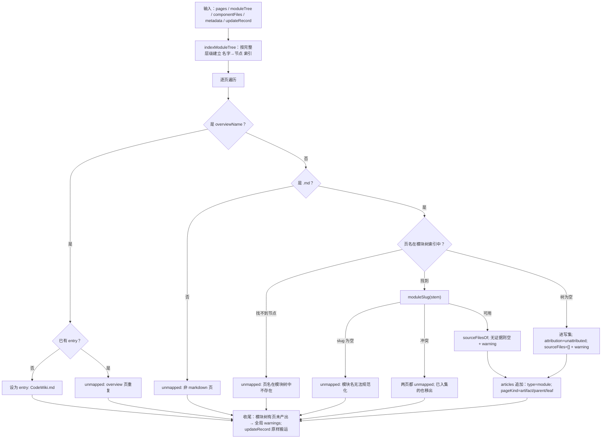
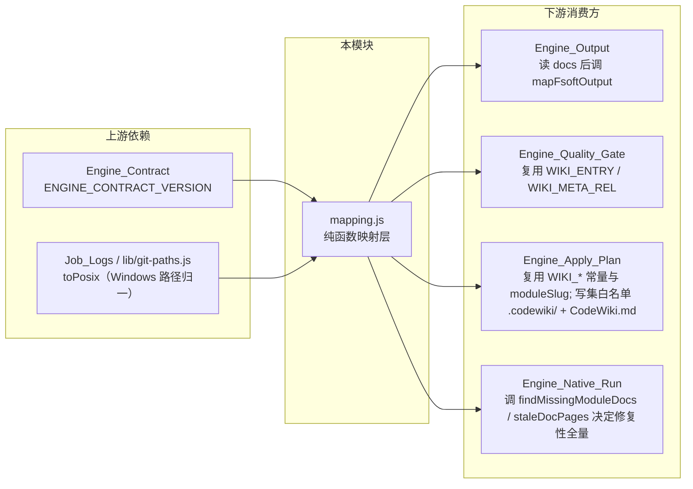

# Engine_Mapping：FSoft 产物到 CodeWiki 的格式映射层

!!! info "Generated documentation"
    This page was written by CodeWiki from the source code at commit [`6f631409`](https://github.com/ikliml666/dsh-codewiki/commit/6f631409754b5c2a22a443c558171f86885b086f) on 2026-11-07 with `doubao-seed-2.1-lite`. Check the code before relying on details.

## 简介

`Engine_Mapping`（`lib/engine/mapping.js`）是原生引擎流水线中的**阶段 0 格式翻译层**：它把 FSoft 原生引擎产出的 docs 树（`overview.md` + 模块页 + `module_tree.json` + `metadata.json` + `update_record.json`）翻译成 cw（CodeWiki）落地模型（仓库内 `.codewiki/` 五类文章 + 顶层 `CodeWiki.md` 入口）。

它是迁移架构里**唯一一处「格式翻译」**，边界被刻意收窄到「能被完整读一遍」的程度：**纯函数模块，不读写文件、不 spawn 进程、不改写文章正文**。所有映射规则（证据、冲突、缺页判定）都可以在这里被一次性读完并被单元测试钉死。

与相邻层的分工：

- [Engine_Output 模块文档](Engine_Output.md)：负责「读」——把 docs 目录读成结构化事实（页清单 + 四个 JSON），再调用本模块做映射，最后判「产物自洽」类问题；
- [Engine_Quality_Gate（原生引擎产物采用门）](Engine_Quality_Gate.md)：负责「采用裁决」——把映射结果渲染成真正的 wiki 文章后再走文章契约校验；
- [Engine_Apply_Plan（原生产物落地器）](Engine_Apply_Plan.md)：负责「落地」——按映射给出的写集写盘、索引、基线、提交；
- [Engine_Native_Run（原生编译裁决编排层）](Engine_Native_Run.md)：负责「编排」——用本模块的 `findMissingModuleDocs` / `staleDocPages` 决定增量轮是否需要修复性全量。

---

## 架构定位

上图中 `module_tree.json` 与 `metadata.json` **只作为证据来源参与映射、本身不落盘**——`.codewiki/` 模型里没有对应的文件类型。

---

## 核心映射规则

FSoft 模型与 cw 模型不是同构的两边，映射关系如下（这是本模块文件头注释中冻结的对照表）：

| FSoft 产物 | cw 落地目标 | 说明 |
| --- | --- | --- |
| `overview.md` | 仓库根 `CodeWiki.md` | 入口页，**不是「文章」**，不进 `.codewiki/modules/` |
| 模块页 `{Name}.md` | `.codewiki/modules/<slug>.md` | `type=module`，slug 由模块名规范化为 kebab-case |
| `module_tree.json` | 不落盘 | 只作 `source_files` 与归属的证据来源（`.codewiki` 无此类型） |
| `metadata.json` 的 `generation_info` | `.codewiki/_meta.yaml` 的 `last_compiled_commit` / `layout` | 取 `commit_id` / `layout` / `language` |
| `update_record.json` | `.codewiki/temp/update-record.json` | 原样搬运，并带出 `outcome` / `pages_written` / `pages_removed` |
| `pageKind=artifact` 的模块页 | 同一落地路径 | 明确标记为 artifact，**不冒充业务模块** |
| 有 children 的父模块页 | 同一落地路径 | `pageKind=parent`，但 `type` 仍是 `module` |

### 页面种类（pageKind）三态

---

## 四条硬规则（迁移安全边界）

这是本模块的设计核心，任何修改都不得放宽：

### 关于 `source_files` 的证据链（硬规则 1 的实现）

`sourceFilesOf(components, componentFiles, fileExists)` 是硬规则 1 的具体执行体，它体现了本仓库真机上踩过的坑：

为什么要过 `fileExists`：`module_tree.json` 是引擎**增量合并**的产物（`cluster_modules.py` 把新子树并进旧树），已删除的文件不会从旧树里消失。若照收死路径，每轮都会判 `source-missing` → 终态恒 partial → 基线永不推进（真机上本仓库因此卡了 9 个提交）。

---

## 核心组件

### 导出常量

| 常量 | 值 | 用途 |
| --- | --- | --- |
| `WIKI_ENTRY` | `CodeWiki.md` | 仓库根入口页路径 |
| `WIKI_DIR` | `.codewiki` | wiki 产物根目录 |
| `WIKI_META_REL` | `.codewiki/_meta.yaml` | 基线元数据文件 |
| `WIKI_UPDATE_RECORD_REL` | `.codewiki/temp/update-record.json` | 增量结局搬运目标 |
| `WIKI_MODULES_REL` | `.codewiki/modules` | 模块文章目录 |
| `LAYOUT_HIERARCHICAL` | `hierarchical` | 上游默认布局：页落在 `<父模块路径>/<模块名>.md` |
| `LAYOUT_FLAT` | `flat` | 平铺布局：页都落在 docs 根部 `<模块名>.md` |
| `OVERVIEW_FILENAME` / `OVERVIEW_STEM` | `overview.md` / `overview` | 入口页文件名与名字 |

> 布局词汇表与上游 `config.py` 同源（0.17.12 起对齐）。docs 里没有 `metadata.layout` 时上游就是 hierarchical，本模块按同一缺省解释。

### `moduleSlug(name)`

模块名 → cw 惯用的 kebab-case 文件名：`trim` → 所有非 `[A-Za-z0-9]` 字符折叠为 `-` → 去首尾 `-` → 转小写。与 cw 现有文章命名一致（`core-application.md` / `git-and-ops-artifacts.md`）。被 [Engine_Apply_Plan（原生产物落地器）](Engine_Apply_Plan.md) 复用。

### `mapFsoftOutput({ pages, moduleTree, componentFiles, metadata, updateRecord, overviewName, fileExists })`

把 docs 树映射成 cw 的**写集描述**（本模块的主入口）。入参全部为已读好的 JSON / 列表，出参可直接 JSON 序列化：

| 出参字段 | 内容 |
| --- | --- |
| `contractVersion` | 取自 [Engine_Contract 引擎契约](Engine_Contract.md) 的 `ENGINE_CONTRACT_VERSION`，使映射结果可被版本化校验 |
| `entry` | `{ path: CodeWiki.md, source }` 或 `null`；入口页只允许一个，重复出现时后到的进 `unmapped` |
| `articles` | `[{ source, wikiPath, type, pageKind, moduleName, sourceFiles, attribution, warnings }]` |
| `unmapped` | `[{ source, reason }]` —— 未映射页的可机读原因清单 |
| `meta` | `{ lastCompiledCommit, layout, language }`（来自 `metadata.generation_info`） |
| `updateRecord` | `{ path, outcome, pagesWritten, pagesRemoved, source: 'incremental' }` 或 `null` |
| `warnings` | 全局告警，如「模块树含 X 但未产出 X.md」 |

**whole-repository 模式的特殊分支**：当 `moduleTree` 为 `{}` 时（上游 `documentation_generator.py` 的原文行为：whole-repository 模式下 module tree 保持空），「页名不在模块树里」不等于孤儿页——页是真产物，必须进写集，但：

- `sourceFiles = []`、`attribution = 'unattributed'`；
- 附一条 warning：「模块树为空，无法确定该页的归属与 source_files（未臆造，按空处理）」。

硬给 `source_files` 才是错的（会伪造增量 ownership）；丢掉页更错（wiki 少一篇）。该降级事实由 [Engine_Quality_Gate（原生引擎产物采用门）](Engine_Quality_Gate.md) 的 `empty-module-tree` / `no-source-evidence` 类问题承接——**可以入库，但增量归属不可信，因此不得推进基线**。

**slug 冲突处理**：两个不同模块名规范化到同一 `wikiPath` 时，两页**都不写**——后到的进 `unmapped`，已先入写集的那篇也被移出并同样记为 `unmapped`。静默覆盖会丢内容且无法回溯。

### `findMissingModuleDocs({ pages, moduleTree, overviewName })`

检查模块树中的模块是否都有对应页面（当前模块树名清单 → 缺页名数组）。用于增量轮决议时判断是否需要修复：

- 与上游 `find_doc()` 一样先看层级主路径 `moduleDocRelPath(modulePath)`、再看根部同名文件；
- **不接受其它目录下的同名页**——那是模块搬家后遗留的旧页，算缺页才是修复性全量该处理的事；放宽它等于把 partial 伪装成 done。

### `moduleDocRelPath(modulePath, layout)`

页在 docs 里的应有相对路径（POSIX），与上游 `doc_layout.module_doc_relpath()` 同一口径：

- `flat`：`<模块名>.md`；
- `hierarchical`：`<父路径...>/<模块名>.md`（取完整层级，而不是只取名字）。

`modulePath` 必须记**完整层级**（含自己）：只记名字会让「同一模块从上层搬到更深一层」看起来「页已存在」，把真实缺页漏掉（真机 `dsh-git-worktree` 就栽在这里）。

### `staleDocPages({ pages, moduleTree, overviewName })`

产物目录里**不属于当前模块树**的页面（模块名改过、聚类重建后留下的旧页）。修复性全量必须先把它们清掉，否则引擎写完全部新页、旧页仍在 `docsDir` 里被映射成 `unmapped-page`，质量门每轮照样判 partial——这正是「缺页修好了但还是 partial」的机理。

- 只删 `docsDir`（仓库外的临时产物目录）；已提交的 wiki 页由落地器按写集处理；
- **`moduleTree` 为空时返回 `[]`**：whole-repository 模式没有权威模块名，不能凭名字删页。

---

## 数据流：一次 `mapFsoftOutput` 的裁决过程

---

## 依赖关系

- [Engine_Contract 引擎契约](Engine_Contract.md)：`mapFsoftOutput` 出参携带 `contractVersion`，使「同一份映射结果按哪个版本解释」可校验、可升级；契约中的 `unmapped-page` blocker 类别即由本模块的 `unmapped[]` 驱动。
- [Engine_Apply_Plan（原生产物落地器）](Engine_Apply_Plan.md)：落地器的写集白名单 `APPLY_WRITE_ROOTS = [WIKI_DIR, WIKI_ENTRY]` 直接取自本模块常量——本模块定义的落地边界就是落地器的安全边界，两层共享同一把尺子。
- [Engine_Native_Run（原生编译裁决编排层）](Engine_Native_Run.md)：修复性全量的触发链为「`findMissingModuleDocs` 报缺页 → `staleDocPages` 清旧页 → 引擎重跑」，两处判定口径都在本模块冻结。

---

## 设计要点小结

1. **边界窄**：纯函数、无 IO、无进程——映射规则可以被完整读完，也可以被 TDD 逐条钉死。
2. **证据驱动归属**：`source_files` 只来自组件→文件证据链；拿不到就空 + warning，绝不按目录名猜。这是 0.14.0 增量归属闸门的信任基础。
3. **失败显式化**：映射不出来的页进 `unmapped[]` 带机读原因；slug 冲突两页都不写；缺页进全局 warning。上层（[Engine_Quality_Gate（原生引擎产物采用门）](Engine_Quality_Gate.md)、[Engine_Apply_Plan（原生产物落地器）](Engine_Apply_Plan.md)）据此判 partial——映射层不替上层做「差不多就算了」的决定。
4. **与上游同一词汇表**：布局（`hierarchical` / `flat`）、页路径（`module_doc_relpath`）、whole-repository 空树行为都与 FSoft 上游逐条对齐，避免两层各猜一遍。

??? abstract "Documented components (1)"
    - [`findMissingModuleDocs`](https://github.com/ikliml666/dsh-codewiki/blob/6f631409754b5c2a22a443c558171f86885b086f/lib%5Cengine%5Cmapping.js) — `lib\engine\mapping.js`

