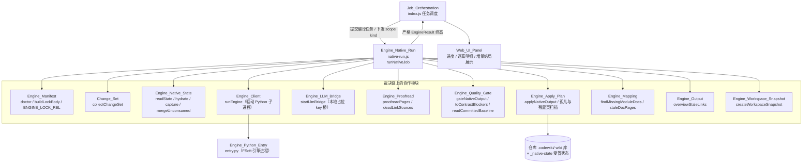
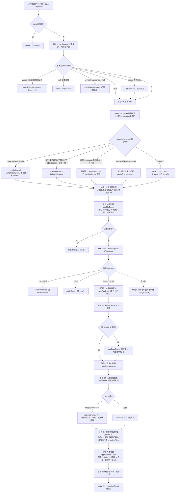
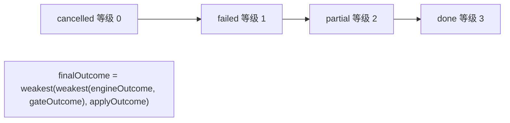
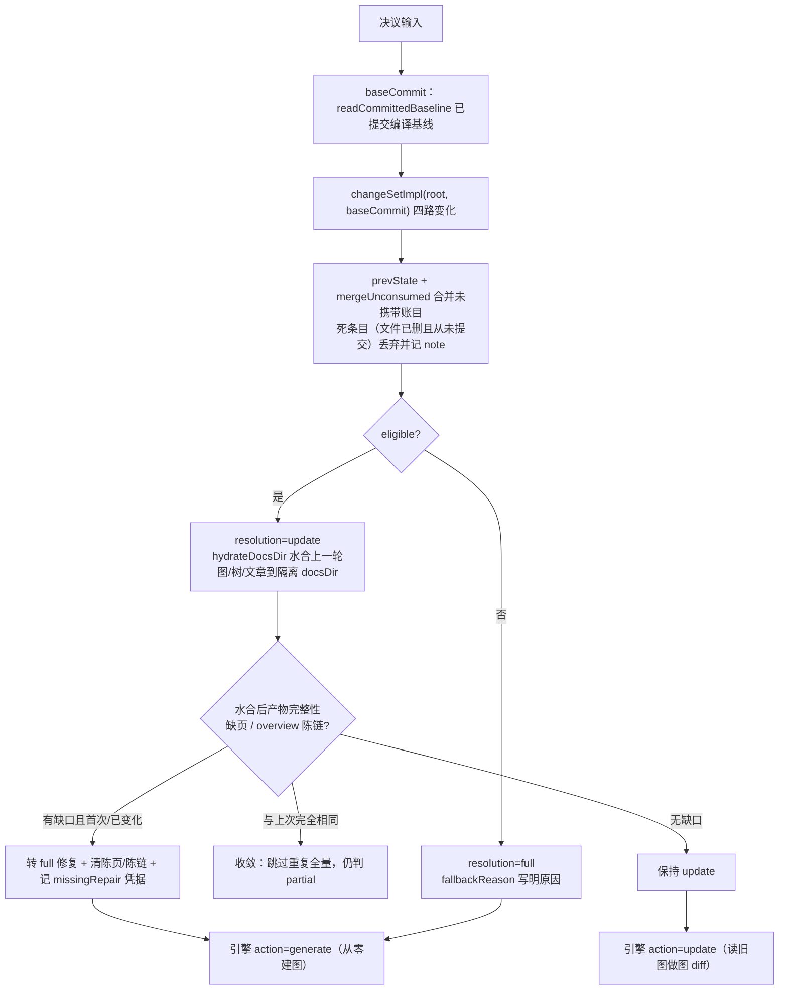

# Engine_Native_Run（原生编译裁决编排层）

!!! info "Generated documentation"
    This page was written by CodeWiki from the source code at commit [`57d63569`](https://github.com/ikliml666/dsh-codewiki/commit/57d635690667fc2f481ab95078e1a65fd6db9555) on 2026-11-07 with `doubao-seed-2.1-lite`. Check the code before relying on details.

## 简介

`Engine_Native_Run` 是原生引擎（native engine）通道的**一次「完整编译」编排与裁决层**，位于 `lib/engine/native-run.js`。它把一次 wiki 编译从环境校验、增量决议、引擎执行、质量门校对、受管状态采集，到最终落地（写盘/建索引/推进基线/自动提交）的整条链路**固定成一条直线**，并负责产出一个**严格的、不可洗白的终态**。

单独抽出这一层的根本原因：任务调度器 [Job Orchestration（编译任务编排服务）](Job_Orchestration.md)（`index.js`）已有数千行，若把环境校验、锁判定、模型桥、引擎调用、质量门、落地器全部塞进 `tick` 循环，「终态到底由谁裁决」会重新变得含糊。本模块只做一件事——把裁决链固定下来，使每一步的结论都不能被下一步覆盖或晋升：

```
env(doctor + engine-lock) → 增量决议(change-set + 受管状态) → 水合 docs → 引擎(generate|update) → 校对 → 质量门(gate) → 状态采集/落锁/孤儿清理 → 落地器(apply) → 严格合成终态
```

> 本模块导出的核心入口是 `runNativeJob()`；文件中字面量 `noop` 只是一个空回调占位（`onProgress`/`onLog` 的默认实现）。本页围绕 `runNativeJob` 的编排语义展开。

---

## 核心职责

1. **统一出口与终态归一**：所有分支（取消、环境失败、引擎失败、落地失败、成功）都经过内部 `settle()` 收口，借助 [Engine_Contract 引擎契约](Engine_Contract.md) 的 `engineResult()` 强制校验终态合法性。
2. **裁决链线性化**：环境、引擎、质量门、落地器四方结论各自独立产出，终态取「最弱一环」，不允许任何单方自报 `done` 掩盖其它环节的缺陷。
3. **统一增量决议**：本轮走全量还是组件级增量，由**可查证据**（变化集、受管状态、基线、版本）决定，而不是由调用方传进来的 `kind` 字面量决定。
4. **依赖全部注入**：真实实现直接取自 `client/manifest/quality-gate/apply-plan`，测试可替换为假 `runEngine` + 真门/真落地器，同时覆盖「接线」与「裁决」。

---

## 架构定位（在系统中的位置）



> 与本模块相邻的引擎子系统：契约校验见 [Engine_Contract 引擎契约](Engine_Contract.md)，进程驱动见 [Engine_Client（引擎进程客户端）](Engine_Client.md)，跨轮状态底座见 [Engine_Native_State（原生引擎跨轮受管状态）](Engine_Native_State.md)，质量门见 [Engine_Quality_Gate（原生引擎产物采用门）](Engine_Quality_Gate.md)，落地器见 [Engine_Apply_Plan（原生产物落地器）](Engine_Apply_Plan.md)，Python 入口见 [Engine_Python_Entry](Engine_Python_Entry.md)。

---

## 关键参数与默认值

`runNativeJob()` 接收一个选项对象，关键输入与常量如下：

| 参数 / 常量 | 默认 | 含义 |
| --- | --- | --- |
| `repoRoot` | 必填 | 仓库根（绝对路径），缺失直接抛错 |
| `scope` | `'full'` | `full`/`stale`/`auto`，决定是否尝试增量 |
| `kind` | `null` | 任务 kind（`'full'`/`'stale'`），与 scope 共同判定 `explicitFull` |
| `signal` | `null` | `AbortSignal`，取消时终止受管子进程树 |
| `timeoutMs` | `DEFAULT_ENGINE_TIMEOUT_MS` | 引擎单次超时 |
| `docsDir` | `null` | 引擎产物目录；增量时**必须**为独立隔离目录 |
| `language` | `''` | 文章书写语言，透传到引擎 `agent_instructions.language` |
| `moduleConcurrency` | `1` | 同层模块并行度，1 = 上游严格串行 |
| `requestLimit` | `0` | 单模块写作 LLM 请求上限，>0 才下发 |
| `rawTreeRoot` | `null` | 原始树留档根（仓库外），用于事实来源快照 |
| `deps` | `{}` | 依赖注入（测试替换点） |
| `onProgress` / `onLog` | `noop` | 进度帧 / 日志回调，默认空 |

两个模块级常量体现了经过真机实测的工程决策：

- **`DEFAULT_UPDATE_OPTIONS = { rung: '3' }`**：FSoft 增量算法档位，3 = 组件级方法（图 diff 决定哪些模块要重写），0 = 旧的按文件失效。必须**显式**给 3，而不是留空让引擎用内部默认——否则上游改默认值会让本插件的增量语义静默漂移。
- **`DEFAULT_ENGINE_TIMEOUT_MS = 180 * 60 * 1000`（3 小时）**：默认 45 分钟是按小 fixture 估的，真机实测一次完整编译约 174 分钟（articles 66min + crosscut 10min + review 68.9min + queued 29.2min）。超时后由 [Engine_Client（引擎进程客户端）](Engine_Client.md) 的「已写篇数 > 0 → partial 抢救」路径兜底，不白跑。

---

## 裁决链与数据流



---

## 五条硬不变量

本模块的裁决语义由以下五条不变量固定（与 [Engine_Contract 引擎契约](Engine_Contract.md)、[Engine_Quality_Gate（原生引擎产物采用门）](Engine_Quality_Gate.md)、[Engine_Apply_Plan（原生产物落地器）](Engine_Apply_Plan.md) 的不变量叠加）：

1. **锁不一致 / 依赖不闭合 → 直接 failed，不跑引擎**。跑出来的产物不可信，且「先跑再发现环境漂了」会让用户看到一堆无意义的失败文章。
2. **引擎 `done` 不能替代质量门**。门说 `partial`，终态就是 `partial`。
3. **落地器说 `partial`/`failed`，终态不许是 `done`**。产物没入库就是没交付。
4. **`failed`/`cancelled`/`partial` 一律不推进基线**。未完整消化的变化必须留到下一轮；已写出的合格文章可保留，但不能据此把整批变化记为已消费。
5. **取消是终态**。取消后不再 gate/apply，也不覆盖已写好的终态；但若落地事务已真实完成，按落地事实收尾，只把「取消来晚了」记进 notes。

终态强弱由一个单调等级表裁决（`weakest()`），合成终态只能取最弱的一环，绝不被后续步骤提升：



---

## 增量决议（阶段 5「统一增量」核心）

增量决议排在环境校验之后、引擎启动之前。它要回答三个问题，每个都用可查事实而非猜测：

1. **变化是什么？** 四路（committed/staged/unstaged/untracked）+ 上一轮未消费的携带（由 [Engine_Native_State（原生引擎跨轮受管状态）](Engine_Native_State.md) 的 `unconsumed` 携带）。
2. **能不能增量？** 受管状态是否齐全（图/模块树/metadata/文章）、版本是否兼容、基线是否可达。任一不成立 → 显式 `full`，并记 `incremental-fallback`。
3. **消费成立吗？** 只有「引擎真的做了组件级增量（`update_record.outcome=incremental`）且 gate/apply 全部 `done`」才推进基线。引擎自己退全量（`full_fallback`）、检测器失败、或产物被门判 `partial`，一律不推进基线。



### 三个关键设计点

- **「变化集为空」不是跳过引擎的理由**：FSoft 判断「有没有变」靠**图 diff**，不是 git 路径集合（重命名/跨文件重构能让路径集非空而图不变，反之亦然）。change-set 只用于决定「增量可不可信」，把「变没变」留给引擎自己的 `update_record`。
- **未提交改动的账**：引擎读的是工作区文件（内容对），但 cw 基线只能推进到 HEAD（记账指向 HEAD）。阶段 1.9 的**工作区快照**把未提交改动合成一个不挂 ref 的临时 commit，让本轮 `commitId` 指向它，使「文章反映的内容」与「账本记的位置」对齐。快照造不出不算失败，退回用 HEAD 记账并记 note。
- **死账丢弃**：上一轮携带的 `unconsumed` 里，凡是本轮 git 已完全看不见的条目（文件早被删掉、又从未提交过）都算死条目——按「只有 committed 才算消化」的规则它们会被永久携带，让工作区明明干净的仓库每轮仍判「有变化」白跑整轮。`mergeUnconsumed` 把它们收进 `dropped` 并从 `unconsumed` 移除，编排层随即记一条 note（列前 3 条路径），并把 `dropped` 写进增量现场证据 `inc.dropped` 供事后复盘。
- **无变化轮（idleRound）**：`updateOutcome=no_change` 且变化集空且无未消费路径时，**沿用**上一轮受管状态——不重写图/树/metadata/update_record/state.json，也不推进基线/提交，避免每次状态查询都制造一次纯记账提交。

---

## 终态合成与基线事实分离

`settle()` 统一收口所有分支，并把三类「基线事实」**分开记录、各有来源**，绝不互相冒充：

| 字段 | 来源 | 语义 |
| --- | --- | --- |
| `baselineEligible` | 质量门 `report.baselineEligible`（且非 stateIncomplete） | 「这轮变化都消化完了，**可以**推进」 |
| `baselineAdvanced` | 落地器 `applyRes.baseline.advanced` | 「cw meta update **真的成功了**」 |
| `canAdvanceBaseline` | 兼容字段，语义取落地事实 | 老调用方（JobService）只认这个名字 |

合成终态时的若干自洽约束：

- `engineOutcome !== 'done'` 或 `stateIncomplete` 时，**强制** `advanceBaseline=false`——质量门只看产物质量，不知道引擎有一批叶子失败了，也不知道下一轮已经无法增量。
- `finalOutcome === 'done'` 却还有 blockers → 宁可降级为 `partial`，绝不掩盖（有阻塞原因就不许报完整成功）。
- `finalOutcome === 'partial'` 却没有 blockers → 补一条说明三方各什么结论的 blocker。
- 增量降级（`degradedToFull` / 引擎自报 `engineRolledBack`）**只在产物已不完整时**才挂 `incremental-fallback` blocker；产物完整（门/apply 都 done）时只进 notes——那种情况下全量重建确实覆盖了全部源码，强行降 partial 会让仓库永远绿不了、基线永远不推进。

---

## 依赖注入与可测试性

`runNativeJob` 的 `deps` 对象是测试替换点。真实实现与注入点对照：

| 能力 | 真实实现（默认） | 注入键 |
| --- | --- | --- |
| 环境探测 | `realDoctor`（[引擎清单（Engine_Manifest）](Engine_Manifest.md)） | `deps.doctor` |
| 引擎驱动 | `realRunEngine`（[Engine_Client（引擎进程客户端）](Engine_Client.md)） | `deps.runEngine` |
| 质量门 | `realGate`（[Engine_Quality_Gate（原生引擎产物采用门）](Engine_Quality_Gate.md)） | `deps.gate` |
| 落地器 | `realApply`（[Engine_Apply_Plan（原生产物落地器）](Engine_Apply_Plan.md)） | `deps.apply` |
| 模型桥 | `realBridge`（[引擎 LLM 桥（Engine_LLM_Bridge）](Engine_LLM_Bridge.md)） | `deps.bridge` |
| 变化集 | `realCollectChangeSet`（[Change_Set 变更集采集模块](Change_Set.md)） | `deps.collectChangeSet` |
| 工作区快照 | `realSnapshot`（[工作区快照（Engine_Workspace_Snapshot）](Engine_Workspace_Snapshot.md)） | `deps.snapshot` |
| 语义校对 | `realProofreadPages`（[Engine_Proofread：原生引擎产物的死链语义校对](Engine_Proofread.md)） | `deps.proofreadPages` |
| 孤儿页扫描 | `realFindOrphanPages` 等 | `deps.findOrphanPages` / `findStaleModulePages` / `findSupersededLegacyPages` / `findDeprecatedConceptPages` |

这种设计使测试既能用「假 runEngine + 真 gate/真 apply」覆盖裁决接线，也能单独验证终态合成逻辑，而不必真的拉起一次 Python 引擎。

---

## 进度阶段与面板可见性

`runNativeJob` 通过 `onProgress(engineProgress(...))` 上报进度帧。阶段名必须属于 [Engine_Contract 引擎契约](Engine_Contract.md) 登记的 `ENGINE_STAGES`，**进度帧不吞异常**——传了契约外的阶段名是编程错误，必须当场抛（历史上曾因吞异常导致面板某格永不点亮而测试全绿）。典型上报节点：

| 进度帧 stage | percent | 时机 |
| --- | --- | --- |
| `env` | 3 / 8 | 环境与锁校验 |
| `graph` | 10 / 12 | 增量决议结论、引擎启动 |
| `proofread` | 88 | 有死链时的语义校对 |
| `validate` | 92 | 质量门校验产物 |
| `index` | 95 | 写盘/建索引/推进基线/提交 |
| `commit` 或 `baseline` | 99 | 收尾（按基线是否真推进区分）） |

面板 [Web_UI_Panel](Web_UI_Panel.md) 依据终态、逐篇明细（`gate.articles`）、`updateOutcome`（组件级增量是否真成立）、`incremental.fallbackReason`（为何退全量）、以及 `notes` 向用户解释「停在哪一步、为什么」。

---

## 与相邻模块的关系小结

- **被谁调用**：[Job Orchestration（编译任务编排服务）](Job_Orchestration.md) 在原生通道下调度编译任务，把 `runNativeJob` 的严格终态落账到 [Job Store（作业持久化与跨实例协调层）](Job_Store.md)，并驱动进度面板。
- **向下驱动引擎**：把 `action=generate|update`、`payload`（repoPath/docsDir/language/moduleConcurrency/updateOptions/commitId）交给 [Engine_Client（引擎进程客户端）](Engine_Client.md)，后者拉起 [Engine_Python_Entry](Engine_Python_Entry.md) 的 FSoft 子进程。
- **终态合法性**：所有出口经 [Engine_Contract 引擎契约](Engine_Contract.md) 的 `engineResult()` 硬校验，不合法即抛（接线 bug 必须响）。
- **增量底座**：跨轮受管状态的读写/水合/采集由 [Engine_Native_State（原生引擎跨轮受管状态）](Engine_Native_State.md) 承担。
- **产物裁决与交付**：死链修正见 [Engine_Proofread：原生引擎产物的死链语义校对](Engine_Proofread.md)，产物质量判定见 [Engine_Quality_Gate（原生引擎产物采用门）](Engine_Quality_Gate.md)，写盘/索引/基线/提交与孤儿清理见 [Engine_Apply_Plan（原生产物落地器）](Engine_Apply_Plan.md)，缺页判定见 [Engine_Mapping：FSoft 产物到 CodeWiki 的格式映射层](Engine_Mapping.md)，overview 陈链见 [Engine_Output 模块文档](Engine_Output.md)。
- **模型通道**：写作期 LLM 请求经 [引擎 LLM 桥（Engine_LLM_Bridge）](Engine_LLM_Bridge.md)（本地占位 key 桥）转发，空产出统计在 `finally` 阶段取走并记 notes。

---

## 一句话总结

`Engine_Native_Run` 是原生编译通道的**裁决中枢**：它不亲自写文章、不亲自算图 diff，而是把「环境 → 增量决议 → 引擎 → 校对 → 质量门 → 状态采集 → 落地」这条链固定成直线，并以「最弱一环说了算」的原则产出一个任何单步都无法洗白的严格终态，从而从结构上杜绝「引擎说 done 就 done、产物没入库也报完成、基线悄悄前移、变化悄悄丢失」这一类缺陷。

??? abstract "Documented components (1)"
    - [`noop`](https://github.com/ikliml666/dsh-codewiki/blob/57d635690667fc2f481ab95078e1a65fd6db9555/lib%5Cengine%5Cnative-run.js) — `lib\engine\native-run.js`

