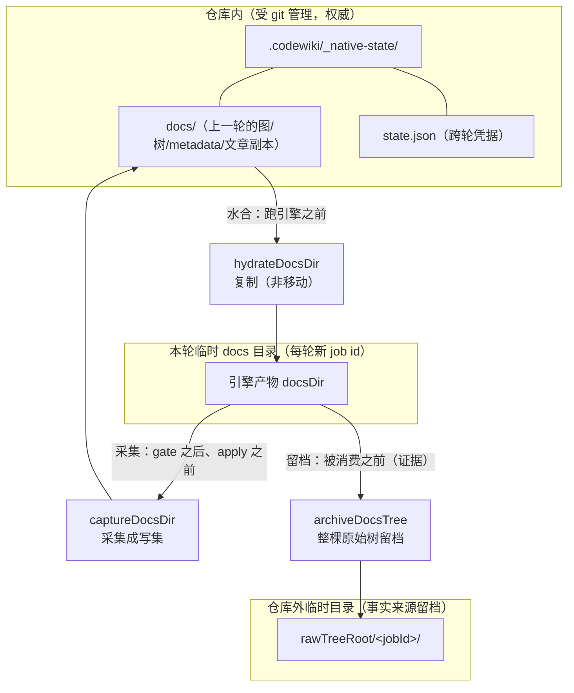
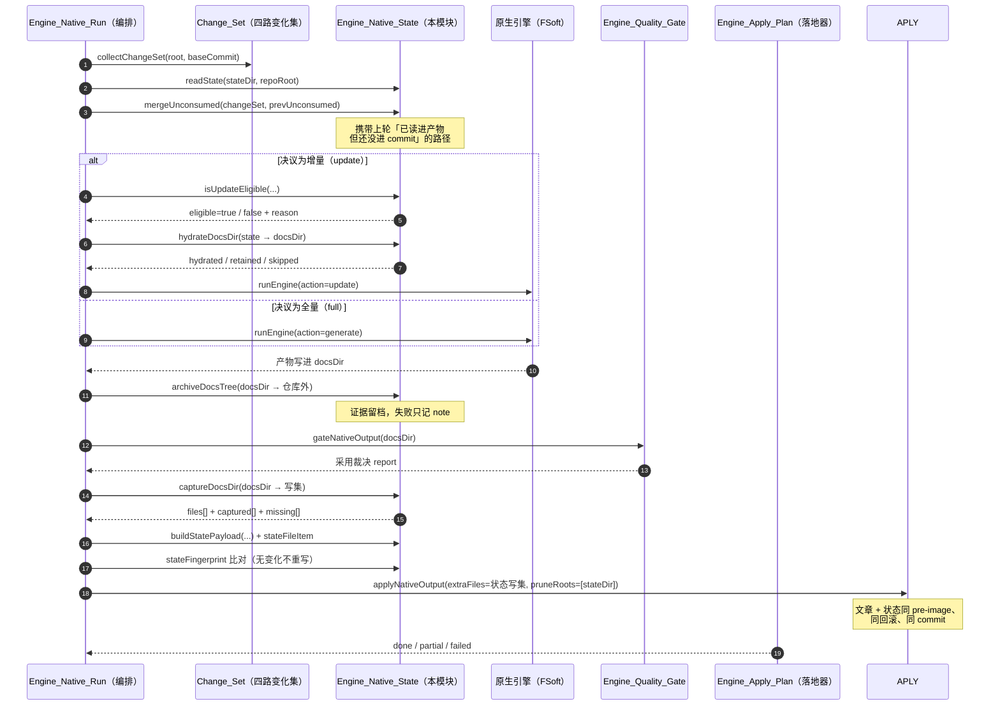
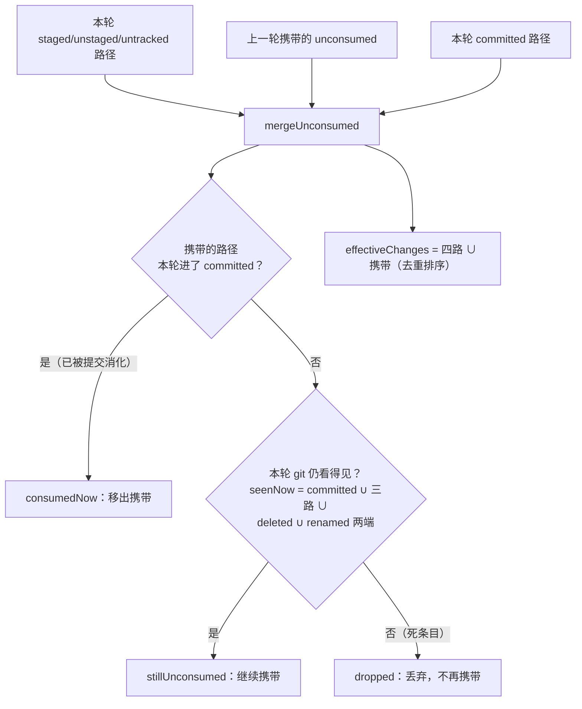
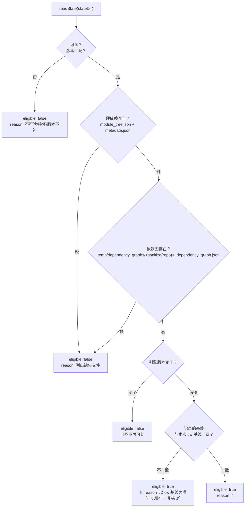
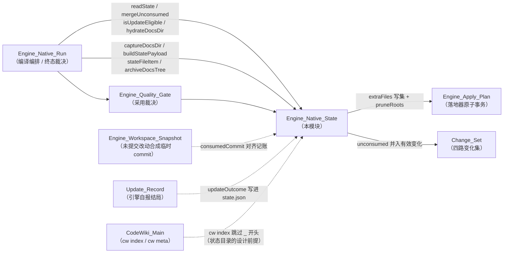

# Engine_Native_State（原生引擎跨轮受管状态）

!!! info "Generated documentation"
    This page was written by CodeWiki from the source code at commit [`9d08002f`](https://github.com/ikliml666/dsh-codewiki/commit/9d08002feba5ec5cd925796ba31c21de74a152ad) on 2026-11-07 with `doubao-seed-2.1-lite`. Check the code before relying on details.

## 简介

`Engine_Native_State` 是原生引擎编译流水线的**跨轮受管状态持久化底座**（阶段 5「统一增量」的核心层）。它的唯一职责是回答一个问题：**「上一轮引擎到底给了我们什么，才让下一轮能算『改了什么』？」**

原生引擎（FSoft）的组件级增量（rung 3）不是「重跑一遍全量再挑几篇改」，而是要读上一轮留下的四样东西才能做图 diff：

| 上一轮留下的文件 | 引擎读它的位置 | 缺了会怎样 |
| --- | --- | --- |
| `module_tree.json` | `_update_options()` 里 `exists()` 为假就返回 `None` | 整个增量退化成全量 |
| `temp/dependency_graphs/<repo>_dependency_graph.json` | `snapshot_old_graph()` 复制成 `*.prev.json` 做图 diff | 增量退化成全量 |
| `metadata.json` | `generation_info.commit_id` 是 updater 的 old_commit、质量门的 artifactCommit | old_commit 缺失 |
| 上一轮的文章 | updater **原地 patch** 的目标 | 页面不在就走 missing_page 重建，等于白退全量 |

问题在于：这些文件都写在引擎的 docs 输出目录里，而那个目录是**每轮一个新 job id 的临时目录**，轮与轮之间本来什么都不留。如果不持久化它们，第二轮的 `_update_options()` 必然返回 `None`——这正是「每轮都在全量、又慢又贵，却一路绿到底」的根源。

本模块把这四样东西从临时 docs 目录**采集**到仓库内受 git 管理的 `.codewiki/_native-state/`，下一轮开跑前再**水合**回引擎的隔离 docs 目录，让组件级增量有连续的「记忆」。

> 落地编排与终态裁决由 [Engine_Native_Run（原生编译裁决编排层）](Engine_Native_Run.md) 负责；状态文件与文章如何进同一个原子事务，见 [Engine_Apply_Plan（原生产物落地器）](Engine_Apply_Plan.md)。本页只讲状态层本身。

---

## 为什么状态目录必须以 `_` 开头

`cw index`（`vendor/codewiki/src/main.rs`）会 `WalkDir` 递归整个 `.codewiki/`，收录所有 `.md`，但**只**跳过仓库相对路径以 `_` 开头的项。

- 若把状态放在 `.codewiki/temp/native-state/`（首段 `temp` 不以 `_` 开头），持久化的原始文章会被 `cw index` 收成**第二份**文章——同一页在索引里出现两条链接。
- 所以状态目录必须是 `.codewiki/_native-state/`：整棵子树首段就是 `_native-state`，`cw index` 自然跳过；而落地器的「索引必须收录本次写的 `.md`」校验（[Engine_Apply_Plan（原生产物落地器）](Engine_Apply_Plan.md) 的 `findArticlesMissingFromIndex` 里 `seg.startsWith('_')`）也带同样的过滤。

对应常量：

```javascript
export const NATIVE_STATE_VERSION = 1
export const NATIVE_STATE_DIR = '.codewiki/_native-state'   // 仓库相对，POSIX
export const NATIVE_STATE_FILE = 'state.json'
```

---

## 状态清单：什么进、什么不进

```javascript
// 引擎做组件级增量时硬依赖的文档（缺任何一个都只能退全量）
export const STATE_REQUIRED_DOCS = Object.freeze(['module_tree.json', 'metadata.json'])

// 需要跨轮保留的 temp/ 内文件（其余 temp 中间件不入库：每轮会重算，存进来只让提交变大）
export const STATE_TEMP_FILES = Object.freeze([
  'temp/reference_index.json',
  'temp/artifact_index.json',
])
export const STATE_TEMP_DIRS = Object.freeze(['temp/dependency_graphs'])
```

判据是「它是不是下一轮增量需要读的输入」，不是「它在 docs 里」：

- 所有 `.md`（文章：updater 原地 patch 的目标）→ 收；
- 顶层 `.json`（module_tree / metadata / update_record 等）→ 收；
- `temp/` 下白名单（reference_index、artifact_index、dependency_graphs）→ 收；
- 其他子目录文件（hierarchical layout 把状态放进子目录）→ 收；
- `temp/` 其余中间件、`dsh_leaf_checkpoint.json` 及其分片 → **排除**。

`isStateDocPath(rel)` 与 `stateDocFiles(stateDir)` 是这套判据的两个出口：前者判断单个路径要不要收，后者列出受管状态的「硬骨架」（供审计与写集白名单判据）。

---

## 核心架构



**水合是复制而不是移动**：源状态目录在仓库里（受 git 管理，是下一轮的权威），docsDir 在临时目录里（引擎会就地改写）。任何一侧被写坏都不影响另一侧——「这一轮失败」绝不会毁掉「下一轮的输入」。

---

## 三条不变量


1. **只有「完整成功」才允许 consume**：partial / failed / cancelled 一律不推进基线（否则未消化的变化会被当成已消化）。
2. **状态不完整就显式 full**：缺图 / 缺 module_tree / 版本不符 / 基线不可达 → 在 `state.json` 里留 `fallbackReason`，绝不假装 clean。每个不可增量的原因都要说出来，因为「悄悄退全量」会让用户以为增量生效了、实际每轮都在全量重编。
3. **水合是复制不是移动**：详见上图。

状态文件与文章走**同一个** pre-image、同一次回滚、同一个自动提交（[Engine_Apply_Plan（原生产物落地器）](Engine_Apply_Plan.md) 的 `extraFiles`）——「图/模块树/metadata/update_record 与文章同事务」不是约定，是结构。

---

## 一次编译里的状态生命周期



关键点：

- **采集点是「gate 之后、apply 之前」**：此时引擎已写完 docsDir，而 apply 还没动仓库。放进 apply 的 `extraFiles` 意味着这些文件与文章共享同一份 pre-image。
- **留档在「被消费之前」**：之后每一步都在同一棵 docs 树上动手（采集、按映射改写、删孤儿页），不先留档就无法回答「这一轮的产物差异是引擎给的，还是我们落地时加工出来的」。

---

## `state.json` 的数据契约

`buildStatePayload()` 组装下一轮凭据。**关键设计：本文件不记录本轮结局**，只记录「本轮开始时的已消费范围」与「本轮看见了哪些变化」。原因是本轮结局（基线是否推进）的权威在 `.codewiki/_meta.yaml`，而 state.json 要在 apply 之前就落盘（与文章同一份 pre-image）；写成「本轮结局」就必须在 apply 之后再改一次文件——那会造出第二个提交，且回滚语义分叉。

| 字段 | 含义 |
| --- | --- |
| `stateVersion` | 状态格式版本（当前 `1`），磁盘版本不符 → 不可增量 |
| `consumedRange` | 本轮开始时「已消化到哪儿」（baseCommit / headCommit），权威副本供审计 |
| `pendingChanges` | 本轮引擎真正看见的变化（committed / staged / unstaged / untracked / deleted / renamed） |
| `unconsumed` | **「已读进产物、但还没进任何 commit」的路径**。下一轮无条件并入变化集；移出规则见下文 `mergeUnconsumed`：出现在本轮 committed → 移出（`consumedNow`）；本轮 git 仍看得见 → 继续携带；本轮 git 已看不见（文件已删且从未提交 / 被 `.gitignore`）→ 丢弃（`dropped`），绝不永久携带 |
| `engineVersion` | 引擎版本；与状态里记录的不一致 → 旧图不可比，退全量 |
| `scope` / `effectiveScope` | 本轮请求的 scope 与实际生效的 scope（显式记下 full 回退） |
| `updateOutcome` | 引擎自报的增量结局（incremental / no_change / full_fallback…） |
| `fallbackReason` | 为什么走了全量（可查证据） |
| `missingRepair` | 「因产物缺页而转过全量」的凭据；同一棵树同一批缺口只尝试一次全量修复 |
| `notes` | 最近 20 条诊断备注 |
| `updatedAt` | 时间戳（参与指纹排除，见下） |

### 为什么有 `stateFingerprint`

`updatedAt` 每轮都变，若照写，无变化的一轮也会产生一次真实提交。`stateFingerprint(text)` 剥掉 `updatedAt` 与 `notes` 后做实质内容比对：只有实质内容变了才写新的时间戳——这正是「无变化路径不错误重写/提交」的实现。

### `mergeUnconsumed`：第二类「丢变化」的解法

FSoft 的组件级增量读的是**工作区实际文件**构建的新图，未提交的改动确实会被引擎看见并写进文章；但 cw 基线（`_meta.yaml:last_compiled_commit`）推进的是 HEAD。于是「文章已覆盖未提交改动，基线却停在 HEAD」——下一轮 change-set 从新 HEAD 算起，那些未提交改动就再也算不进变化集里了：**文章与源码脱节，而系统一路绿到底**。



- `staged / unstaged / untracked` 一律算未消费，并入 `unconsumed`；
- `committed` 里的路径本轮被看见时已进 commit，不需要再携带；
- 上一轮携带的路径，「这一轮已出现在 committed」即被消化掉（`consumedNow`）；
- **死条目丢弃（`dropped`）**：本轮 git 完全看不见的旧账，是「文件已被删掉、又从未提交过」的死条目——它永远进不了 committed，按旧规则会被永久携带下去。真机上 `dsh-subagent-auto-router` 积了 37 条 `.dsh-ops/panel/*.json`（目录早被清掉）、`dsh-git-worktree` 积了 6 条 `.diag-tmp/*`，结果仓库工作区明明干净，每轮仍判「有变化」跑完整一轮。现在这类路径直接丢弃，不再携带。被 `.gitignore` 忽略的文件同样按「git 看不见」丢弃——这是有意的：用户写进 `.gitignore` 就是声明「这不是仓库内容」，携带它们等于保证 idleRound 永不成立（永久白跑），而丢掉不会少编译任何东西。

---

## 增量资格裁决：`isUpdateEligible`



### `graphFileName` 为什么必须逐字符对齐

引擎只读 `<sanitize(仓库名)>_dependency_graph.json`。Python 的 `sanitize_repo_name` 用的是 `c.isalnum()`——那是 **Unicode** 字母数字，中文/日文字符会原样保留（实测 `.probe-fsoft/wiki_out_1a/temp/dependency_graphs/` 里就是 `中文_空格_fixture_dependency_graph.json`）。所以这里必须用 `\p{L}` / `\p{N}` 而不是 `[A-Za-z0-9]`：

```javascript
export function graphFileName(repoRoot) {
  const base = path.basename(path.resolve(String(repoRoot ?? '.')))
  const safe = base.replace(/[^\p{L}\p{N}]/gu, '_')
  return `${safe}_dependency_graph.json`
}
```

后者会把中文仓库名的图判成「缺失」，于是每轮都白退全量。

---

## 原始树留档：`archiveDocsTree`

引擎（FSoft）把产物直接写进 docsDir，而 docsDir 是「本轮的临时工作区」——后续的 gate / 采集 / 落地器都在它上面就地动手（裁剪过期状态、删孤儿页、按映射改写）。**原始产物被就地消费**，一旦落地器做了无法从 `.codewiki/` 反推的加工，就没有任何地方能回答「引擎到底给了什么」。

- 留档位置**绝不能在仓库内**：`.codewiki/` 下任何非 `_` 开头的目录都会被 `cw index` 递归收集成文章（见上）。所以调用方传入的 `destDir` 必须是**仓库外**的临时目录（由 [Engine_Native_Run（原生编译裁决编排层）](Engine_Native_Run.md) 按 jobId 分目录 + TTL 清理）。
- 目标与源**互不嵌套**（两个方向都查）：嵌进去会把刚拷好的文件当源继续拷，反方向会让下一次留档读到上一轮的旧副本。跨盘时 `path.relative` 返回绝对路径，用 `isAbsolute` 排除在「嵌套」判定之外。
- **失败语义**：留档是**证据不是产物**，拷不动就不拷（返回 `ok:false + error`），由调用方记 note；绝不能因为它让一次编译失败。

---

## 与其他模块的关系



| 模块 | 关系 |
| --- | --- |
| [Engine_Native_Run（原生编译裁决编排层）](Engine_Native_Run.md) | 本模块的唯一生产调用方：编排「增量决议 → 水合 → 引擎 → 采集 → 落地」整条链，终态裁决决定「能不能 consume」 |
| [Engine_Apply_Plan（原生产物落地器）](Engine_Apply_Plan.md) | 状态写集以 `extraFiles` 进入落地器，与文章共享 pre-image / 回滚 / 自动提交；`pruneRoots` 让上一轮存在、本轮引擎删掉的图/页跟着消失 |
| [Change_Set 变更集采集模块](Change_Set.md) | 提供四路变化集（committed/staged/unstaged/untracked），是 `mergeUnconsumed` 的输入与 `effectiveChanges` 的来源 |
| [Engine_Quality_Gate（原生引擎产物采用门）](Engine_Quality_Gate.md) | 采集点排在它之后；它的采用裁决决定本轮是否有资格推进基线（即是否 consume） |
| [工作区快照（Engine_Workspace_Snapshot）](Engine_Workspace_Snapshot.md) | 把未提交改动合成临时 commit，让「本轮记账指向的内容」与引擎实际读到的工作区对齐 |
| [Update_Record（编译更新记录）](Update_Record.md) | 引擎自报的增量结局（`updateOutcome`）写进 `state.json`，是「增量真成立 vs 退了全量」的凭据 |
| [CodeWiki 主入口（cw CLI）](CodeWiki_Main.md) | `cw index` 对 `_` 开头路径的跳过规则，是「状态目录必须命名为 `_native-state`」的设计前提 |

---

## 导出 API 速查

| 函数 / 常量 | 作用 |
| --- | --- |
| `NATIVE_STATE_VERSION` / `NATIVE_STATE_DIR` / `NATIVE_STATE_FILE` | 状态格式版本与仓库内位置常量 |
| `STATE_REQUIRED_DOCS` / `STATE_TEMP_FILES` / `STATE_TEMP_DIRS` | 「什么进受管状态」的白名单 |
| `graphFileName(repoRoot)` | 按 Unicode 对齐规则生成依赖图文件名 |
| `stateDocsDir(stateDir)` | 状态目录里保存的 docs 副本根（`<stateDir>/docs`） |
| `isStateDocPath(rel)` | 单个 docs 路径要不要进受管状态 |
| `stateDocFiles(stateDir)` | 受管状态「硬骨架」清单（供审计 / 写集白名单判据） |
| `archiveDocsTree({docsDir, destDir})` | 整棵原始 docs 树留档到仓库外（证据，失败不拖垮编译） |
| `readState(stateDir, repoRoot)` | 读 `state.json`；损坏 / 缺文件 / 版本不符都返回 `ok:false + reason` |
| `readStateText(stateDir, repoRoot)` | 读原始文本（供指纹比对） |
| `isUpdateEligible({...})` | 裁决「能不能走真实增量」，每个原因都可查 |
| `hydrateDocsDir({stateDir, repoRoot, docsDir})` | 跑引擎前把状态**复制**进隔离 docs 目录 |
| `captureDocsDir({docsDir, stateDir})` | 把 docs 里的状态**采集**成「下一轮写集」（utf8 安全，非文本跳过） |
| `buildStatePayload({...})` | 组装 `state.json` 内容（不记本轮结局，只记开始时的凭据） |
| `stateFileItem(payload, stateDir)` | 把 payload 包成一条写集项交给落地器 |
| `stateFingerprint(text)` | 剥掉 `updatedAt`/`notes` 的实质内容指纹（无变化不重写） |
| `mergeUnconsumed({changeSet, prevUnconsumed})` | 跨轮「未消化变化」合并（纯函数）；返回 `unconsumed` / `consumedNow` / `dropped` / `effectiveChanges` / `carried`——本轮 git 已看不见的旧账进 `dropped`，不再永久携带 |

---

## 设计要点小结

1. **临时目录无记忆** → 必须把引擎增量依赖的四样东西持久化到仓库内 `_native-state/`，否则每轮白退全量。
2. **为什么 `_` 开头** → `cw index` 的跳过规则，避免原始文章被收成第二份索引副本。
3. **复制不移动** → 水合方向两侧互不影响，单轮失败不毁掉下一轮输入。
4. **同事务结构** → 状态写集进落地器 `extraFiles`，与文章同 pre-image / 回滚 / commit。
5. **未消费账不丢、也不烂** → `unconsumed` 把「已读进产物、还没进 commit」的路径每轮并入变化集；出现在本轮 committed 才移出，本轮 git 已看不见的死条目（含 `.gitignore` 忽略）进 `dropped` 丢弃，绝不永久携带导致每轮白跑。
6. **无变化不提交** → `stateFingerprint` 剥时间戳比对，避免 idle 轮产生纯记账提交。
7. **留档是证据不是产物** → `archiveDocsTree` 失败只记 note，绝不拖垮一次编译。

??? abstract "Documented components (1)"
    - [`stateDocFiles`](https://github.com/ikliml666/dsh-codewiki/blob/9d08002feba5ec5cd925796ba31c21de74a152ad/lib%5Cengine%5Cnative-state.js) — `lib\engine\native-state.js`

