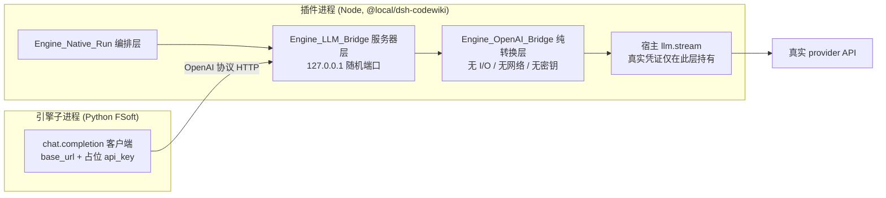
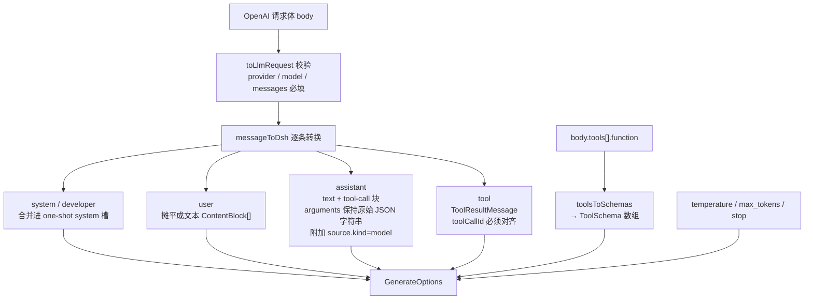
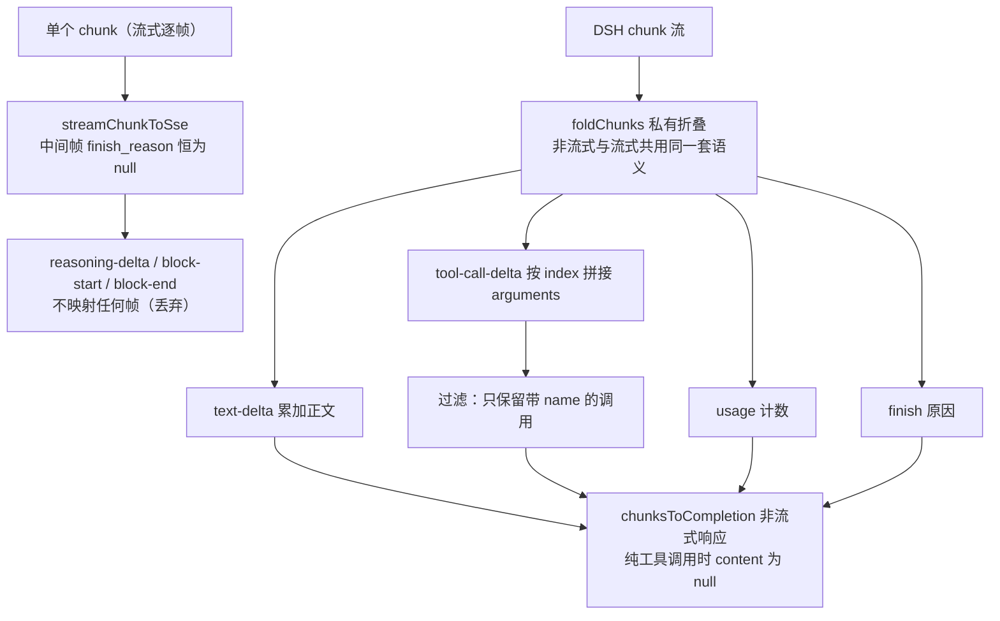
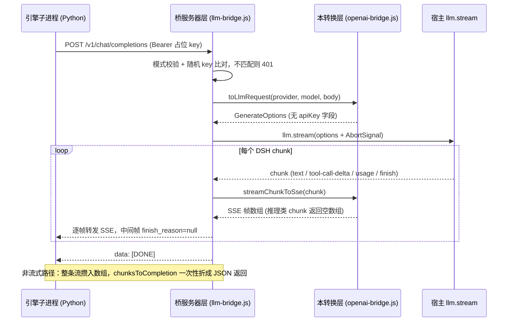

# Engine OpenAI 桥转换层

!!! info "Generated documentation"
    This page was written by CodeWiki from the source code at commit [`22a52db1`](https://github.com/ikliml666/dsh-codewiki/commit/22a52db11dedb4475d457a56274e3db2c5f2cf72) on 2026-11-06 with `doubao-seed-2.1-lite`. Check the code before relying on details.

## 简介

`Engine_OpenAI_Bridge`（`lib/engine/openai-bridge.js`）是原生引擎通道的「协议翻译官」。FSoft 原生引擎只会讲 OpenAI-compatible 的 `chat.completion` 协议（认 `base_url` + `api_key`），而插件运行在 DSH（DeepSeek Harness）宿主环境里，只能通过宿主的 `llm.stream()` 调用真实 provider——插件自身**既不保存也不传递密钥**（0.10.1 起的硬约束）。本模块把两侧协议互转，自身不做任何 I/O、不碰网络、不持有密钥，把所有容易出错的映射收敛成可被 TDD 钉死的纯函数（阶段 1B）。

进程内 HTTP 服务器、鉴权、调度与统计属于隔壁的 [引擎 LLM 桥（Engine_LLM_Bridge）](Engine_LLM_Bridge.md)；本模块是它的**纯转换内核**。

## 架构定位

引擎拿着**占位 key** 打到桥的 HTTP 端点上，桥把请求体转成 `llm.stream(GenerateOptions)`，再把流回来的 DSH chunk 转回 OpenAI 响应（非流式 JSON 或流式 SSE）。

## 导出函数一览

| 导出函数 | 方向 | 作用 |
| --- | --- | --- |
| `isPlaceholderKey(value)` | 鉴权 | 校验值是否符合占位 key 固定模式 `/^dsh-bridge-[a-z0-9-]+$/` |
| `toLlmRequest({provider, model, reasoningEffort, body})` | 请求方向 | OpenAI 请求体 → DSH `GenerateOptions`（不含 apiKey） |
| `finishReasonToOpenAI(reason)` | 响应方向 | DSH `FinishReason` → OpenAI `finish_reason` |
| `chunksToCompletion({id, model, chunks})` | 响应方向 | DSH chunk 流整条折叠 → OpenAI 非流式响应体 |
| `streamChunkToSse(chunk, {id, model, created})` | 响应方向 | 单个 DSH chunk → OpenAI SSE 帧数组（逐帧转发用） |
| `sseFrame(payload)` | 工具 | 构造一帧 `data: ...\n\n` SSE |

模块内部还有一组不导出的私有辅助函数：`contentToBlocks`、`toolsToSchemas`、`messageToDsh`、`usageToOpenAI`、`foldChunks`、`textBlock`。

## 请求方向：OpenAI → DSH

`toLlmRequest` 的硬校验（任一不满足直接抛错，服务器层翻成 `400 invalid_request_error`）：

- 缺 `provider`：路由不明会让请求落到错误端点；
- 缺 `model`；
- `messages` 必须是非空数组；
- 除 system 外没有任何有效消息。

逐条转换的关键规则：

- **content 摊平**：OpenAI 的 content 可以是 string 或 parts 数组，统一摊平为 DSH 的 `ContentBlock[]`；`image_url` 等非文本部分显式跳过（引擎只发文本，不造块）。
- **tool_calls 保持原始 JSON 字符串**：DSH 的 `ToolCallBlock.arguments` 定义就是 raw JSON string，提前 `JSON.parse` 会破坏增量拼接。
- **assistant 历史消息必须带 `source`**：宿主 `LlmRuntime.forAdapter()` 会无条件读 `message.source.replayState` 来决定是否丢弃跨适配器的 replay 数据；桥没有 replay 能力，所以只填 `{kind: 'model', provider, model}`，**不伪造** replayState。缺 source 会让整轮调用抛 "Cannot read properties of undefined (reading 'replayState')" 并被判 error。
- **tool 消息按 `tool_call_id` 对齐**：callId 对不上工具循环就断链。
- **tools[].function → ToolSchema**：缺这一步，agentic 工具循环会退化成空谈。

## 响应方向：DSH → OpenAI

`FinishReason` 映射表：

| DSH `reason.kind` | OpenAI `finish_reason` |
| --- | --- |
| `tool-calls` | `tool_calls` |
| `max-tokens` | `length` |
| `error` / `aborted` | `error` |
| `stop` / 其他缺省 | `stop` |

usage 口径（DSH 计数是**互斥**的，`inputTokens` 不含缓存）：

- `prompt_tokens = inputTokens + cacheRead + cacheWrite`（OpenAI 的 prompt_tokens 含缓存）；
- 缓存单列在 `prompt_tokens_details.cached_tokens`；
- `total_tokens = prompt_tokens + completion_tokens`。

## 关键设计决策

1. **流式与非流式共用同一套折叠语义**：`foldChunks` 是唯一的中间态折叠实现；`chunksToCompletion` 折整条流，`streamChunkToSse` 逐帧转发。区别只在「这条流是否已结束」。
2. **逐帧转发绝不补 `finish_reason`**：中间分片带假结束原因会让 OpenAI 客户端认为本轮已结束——工具调用还没发完就被截断，最终报 pydantic-ai 的 "Please return text or call a tool" 并重试到上限。只有 chunk 流末的 `finish` 帧才产出带结束原因的帧。
3. **只产出带 name 的 tool call**：无 name 的调用引擎无法执行，混进去只会制造莫名其妙的错误。缺 id 时现场生成 `call_xxxxxxxx`，缺 arguments 时补 `'{}'`。
4. **reasoning-delta 不进 content**：思考内容不该出现在文章正文里。
5. **纯工具调用时 content 为 `null`**：遵循 OpenAI 语义，不是空串。
6. **非流式缺 finish 时自行兜底**：`chunksToCompletion` 在流结束但没有 finish chunk 时，按「有 tool_calls 则 `tool_calls`、否则 `stop`」补结束原因。

## 安全边界

- 占位 key 是桥自己生成的固定串，模式由 `PLACEHOLDER_KEY_PATTERN` 钉死；**服务器层**还会额外比对本次启动随机生成的那一把（`dsh-bridge-` + 32 字节随机 hex，不复用、不落盘、不进日志）。`isPlaceholderKey` 只验模式，是双闸门的第一道。
- `toLlmRequest` 的返回值里**永远没有 apiKey 字段**；任何真实 key 都不该出现在引擎侧配置里。
- 401 错误体不回显收到的 key（哪怕它是错的），避免把用户误配的真实 key 写进日志。

## 在引擎裁决链中的位置

本模块由 [Engine_Native_Run（原生编译裁决编排层）](Engine_Native_Run.md) 的「模型桥」段接入一次原生编译：

1. **启动**：编排层调用 `startLlmBridge({llm, provider, model, reasoningEffort, effortByStage, timeoutMs, onLog, onRequestStart})`，拿回 `{url, placeholderKey, port, stats, setStage, close}`；
2. **注入**：引擎子进程（经 [Engine_Client（引擎进程客户端）](Engine_Client.md) 拉起）以 OpenAI 兼容方式拿到 `base_url = url`、`api_key = placeholderKey`；
3. **阶段换挡**：每条引擎进度帧同步 `bridge.setStage(p.stage)`，桥按 `effortByStage` 选当前阶段的 `reasoningEffort` 档位；
4. **收尾**：`finally` 中先取 `bridge.stats()`（含 `emptyResponses` 空产出计数——假 done 的重要来源），再 `await bridge.close()`。**先关桥会让还在读流的引擎拿到 502**，顺序不可颠倒。

桥建立失败时，编排层以 `engine-model` 错误、`stage: 'cluster'` 直接判本轮 failed，不跑引擎。

## 一次完整调用的时序

## 相关模块

- [引擎 LLM 桥（Engine_LLM_Bridge）](Engine_LLM_Bridge.md)：进程内 HTTP 服务器层——鉴权闸门、SSE 应答、超时/断连中止、请求统计与会话钩子的实现位置。
- [Engine_Native_Run（原生编译裁决编排层）](Engine_Native_Run.md)：编排层——桥的启停、URL/占位 key 注入引擎环境、阶段同步与收尾顺序。
- [Engine_Client（引擎进程客户端）](Engine_Client.md)：以子进程方式拉起 Python 引擎，引擎向桥发 OpenAI 协议 HTTP 调用。
- [Engine_Contract 引擎契约](Engine_Contract.md)：引擎终态契约；桥相关失败（`engine-model` / `upstream_error`）如何被裁决链吸收。
- [Web_UI_Panel](Web_UI_Panel.md)：「会话」视图消费 `onRequestStart` 会话记录（prompt 文本与模型输出），全程不含 Authorization 与占位 key。
- [Agentic_Host（agentic 工具循环 ↔ 宿主 llm 服务适配层）](Agentic_Host.md)：宿主侧 `llm.stream` 接口与 `message.source.replayState` 语义的持有方，`messageToDsh` 的 source 规则正是为它而设。

## 运行环境

插件包 `@local/dsh-codewiki`（见仓库 `package.json`）要求 Node `>=24.9.0`、DSH 宿主 `>=0.2.0-rc.0`；桥服务器监听 `127.0.0.1` 随机端口，不对外暴露，也不新增任何外部网络依赖。

??? abstract "Documented components (1)"
    - [`isPlaceholderKey`](https://github.com/ikliml666/dsh-codewiki/blob/22a52db11dedb4475d457a56274e3db2c5f2cf72/lib%5Cengine%5Copenai-bridge.js) — `lib\engine\openai-bridge.js`

