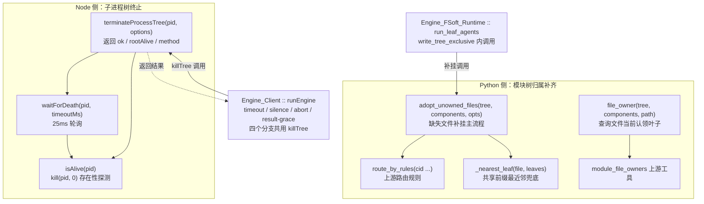
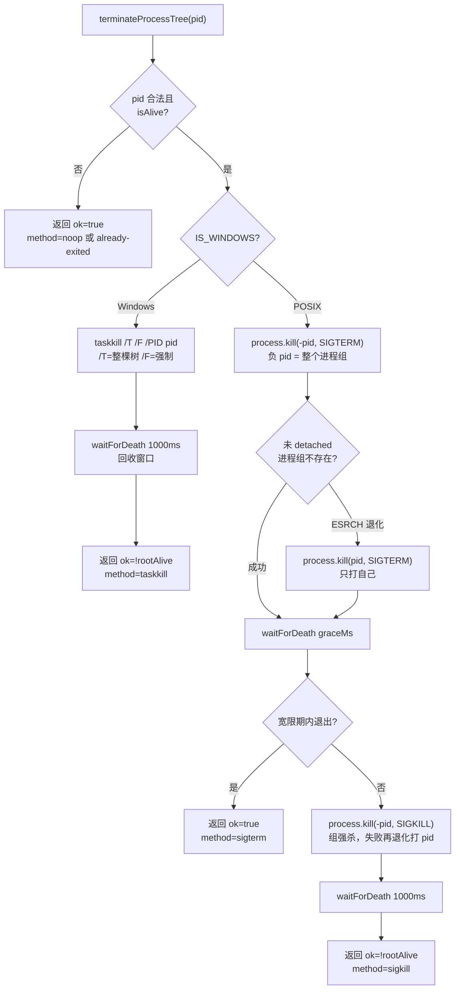
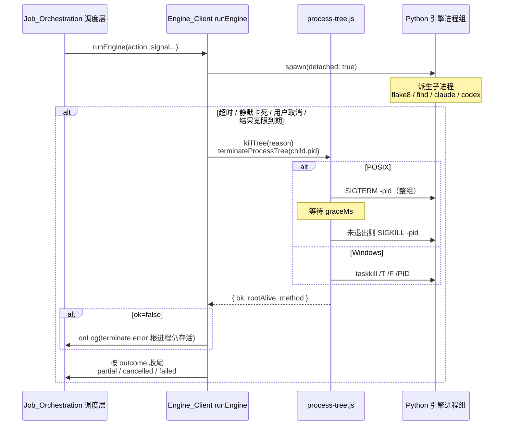
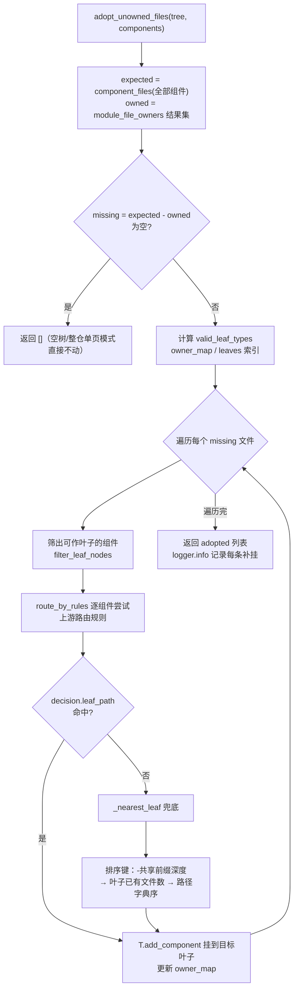

# Engine_Process_Tree 模块文档

!!! info "Generated documentation"
    This page was written by CodeWiki from the source code at commit [`70bf6404`](https://github.com/ikliml666/dsh-codewiki/commit/70bf6404241bf06b48f7d49b81a98c3ce74d2f90) on 2026-11-06 with `doubao-seed-2.1-lite`. Check the code before relying on details.

## 简介

`Engine_Process_Tree` 是引擎层（`lib/engine/`）中**「树」类职责的收拢层**。模块名里的 "tree" 实际上是两种互不相关的树，分别由两个文件承担：

1. **OS 子进程树** —— [`lib/engine/process-tree.js`](../lib/engine/process-tree.js)：负责「整棵子进程树的可靠终止」。FSoft 的 Python 引擎会自己派生 `flake8`、`find` 以及各后端的 `claude`/`codex` 进程，只 kill 直接子进程的 pid 会让孙进程变成孤儿继续烧 token。本模块把「终止」这件事单独抽成一层，做到小而可测，任何取消语义的 bug 都集中在这里暴露。
2. **模块归属树** —— [`lib/engine/python/tree_coverage.py`](../lib/engine/python/tree_coverage.py)：负责补齐 `module_tree.json` 的叶子文件归属。上游 `validate_module_file_coverage` 要求依赖图里的每个文件都被某个叶子模块认领，而增量修复只处理本轮 `diff.added`，历史遗留文件永远不进树会导致每轮校验都抛 `Invalid module file coverage`。本模块按上游自己的规则把缺失文件补挂到最近的叶子上。

前者是 Node 侧的**取消/超时语义地基**，被 [Engine_Client（引擎进程客户端）](Engine_Client.md) 的 `runEngine` 直接调用；后者是 Python 侧的**模块树自愈补丁**，被 [Engine_FSoft_Runtime：增量 Step 5 的受控并行与断点运行时](Engine_FSoft_Runtime.md) 的 `run_leaf_agents` 流程挂载执行。

## 架构总览

## 一、子进程树终止（`process-tree.js`）

### 设计意图

文件头注释明确了边界：**这个模块只做「终止」一件事**——不做进程启动、不做协议、不碰 stdout。原因是取消语义的 bug 极具破坏性（「任务已取消，但机器上还挂着一个 python 在烧 token」），把它集中在一个小模块里，比散落在业务代码中更容易定位和测试。

### 核心函数

#### `isAlive(pid)`

判断一个 pid 是否还活着的存在性探测：

| 行为 | 判定 |
| --- | --- |
| `process.kill(pid, 0)` 不抛错 | 活着（或僵尸进程，仍视为占用）→ `true` |
| 抛出 `ESRCH` | 已退出 → `false` |
| 抛出 `EPERM` | 存在但无权限 → 仍算活着 → `true` |

入参不是正整数时直接返回 `false`。

#### `terminateProcessTree(pid, options)`

整棵子进程树的终止入口，返回 `{ ok: boolean, rootAlive: boolean, method: string }`：

- `ok=false` 表示**根进程在超时后仍活着**——调用方应当据此报错，而不是假装取消成功。
- `method` 取值：`noop`（非法 pid）、`already-exited`（本就死了）、`taskkill`、`sigterm`、`sigkill`。
- 可选参数：`graceMs`（SIGTERM 宽限期，默认 3000ms）、`onLog`（诊断日志回调）。

### 平台差异（关键设计）

- **Windows**：没有进程组信号，可靠做法是 `taskkill /T /F`。不加 `/F` 时 GUI 进程常常收不到信号、无控制台进程也不响应。`taskkill` 是同步语义的，返回后树应已消失，再给一个极短的回收窗口判定。
- **POSIX**：子进程以 `detached: true` 启动（见 [Engine_Client（引擎进程客户端）](Engine_Client.md) 的 `runEngine` spawn 参数），自成一个进程组，`process.kill(-pid)` 负 pid 一次性打整组；先 SIGTERM 让它有机会收尾，超时再 SIGKILL。若目标并非 detached 进程组（负 pid 抛错），退化成只打直接 pid。

### 调用点：Engine_Client 的四个终止分支

[Engine_Client（引擎进程客户端）](Engine_Client.md) 中 `runEngine` 定义了内部的 `killTree(reason)`，统一委托给 `terminateProcessTree`，以下四类事件都会先杀树再按既有协议帧收尾：

设计要点：**杀树之后不推翻协议结论**——取消/超时分支以已收到的进度帧（`writtenCount`）为准决定 `partial` 还是 `failed`，并把「进程树已终止」写进错误详情，避免把已经写完的文章成果丢掉。

## 二、模块树归属补齐（`tree_coverage.py`）

### 问题背景

上游校验链条：`validate_module_file_coverage` 要求「依赖图里出现的每个文件都被某个叶子模块认领」。但：

- Step 2 的 `repair_tree` 只处理**本轮 `diff.added`** 的组件；
- 于是历史上某轮没写进树里的文件（新增文件正好落在 `full_fallback` 轮、或当时组件不属于叶子类型）永远不进树；
- 之后每轮增量都在校验处抛 `Invalid module file coverage: missing=[...]`，**且不会自愈**。

本模块的策略：按上游自己的规则补挂——**同文件 → 同目录 → 邻居多数 → 目录最近邻**。补挂不改变任何已写页面，只把缺失文件里的组件登记到最近的叶子上；校验本身仍由上游执行。

### 核心函数

#### `file_owner(tree, components, relative_path)`

查询某文件被哪个叶子认领（返回斜杠分隔的叶子路径）；无人认领时返回 `None`。实现委托给上游 `module_file_owners(tree, components)` 取 `owners[0]`。

#### `adopt_unowned_files(tree, components, opts)`

补挂主流程，返回本次补挂的文件列表：

兜底规则 `_nearest_leaf(file, leaves)` 的排序键（逐级比较）：

1. **共享目录前缀深度最大**（`-proximity`）——与候选叶子已认领文件的目录路径越近越优先；
2. **叶子已有文件数最少**——避免热点叶子无限膨胀；
3. **叶子路径字典序**——确定性 tie-break，保证可复现。

### 调用点：Engine_FSoft_Runtime 的挂载时机

[Engine_FSoft_Runtime：增量 Step 5 的受控并行与断点运行时](Engine_FSoft_Runtime.md) 中 `run_leaf_agents` 调用 `adopt_tree_coverage`，关键约束：

- **整仓单页模式（`whole_repo`）直接跳过**——没有叶子可挂；
- 必须基于**磁盘上的最新树**（而非 Step 4 的内存快照）做补挂，且结果要**覆盖写**：因为旧值是新值的真子集，走合并路径会被叶子判据误判为「两个分支分给不同组件」而抛错；
- 补挂包在 `write_tree_exclusive` 独占写锁内，与 [全量并行运行时（Engine_Full_Parallel_Runtime）](Engine_Full_Parallel_Runtime.md) 的 `_SharedTreeIO`（串行化 `module_tree.json` 读改写并合并并行分支增量）形成读写互斥；
- 补挂失败**不能让整轮增量崩掉**——异常被捕获后只写入 `detector_notes` 并记 warning。

## 模块边界与设计取舍

| 取舍 | 理由 |
| --- | --- |
| 终止层不做进程启动 | 启动协议在 [Engine_Client（引擎进程客户端）](Engine_Client.md)，终止语义独立可测；任何取消 bug 都集中在本层暴露 |
| 返回 `ok=false` 而非静默成功 | 根进程杀不掉时必须让调用方报错，否则「假装取消成功」会留下烧 token 的孤儿进程 |
| POSIX 先 SIGTERM 后 SIGKILL | 给子进程收尾机会（刷日志、关管道），宽限期默认 3000ms 可调 |
| 补挂不改已写页面 | 只登记组件归属，文档内容零改动，避免污染既有产出 |
| 补挂失败降级为 notes | 覆盖校验失败是「卡住」，补挂失败不能让整轮增量崩掉（比卡住更糟） |

## 相关模块

- [Engine_Client（引擎进程客户端）](Engine_Client.md) —— `runEngine` 是 `terminateProcessTree` 的唯一生产调用方，timeout / silence / abort / result-grace 四个分支共用其 `killTree`。
- [Engine_FSoft_Runtime：增量 Step 5 的受控并行与断点运行时](Engine_FSoft_Runtime.md) —— `run_leaf_agents` / `adopt_tree_coverage` 是 `adopt_unowned_files` 的挂载点。
- [全量并行运行时（Engine_Full_Parallel_Runtime）](Engine_Full_Parallel_Runtime.md) —— `_SharedTreeIO` 的 `module_tree.json` 串行化与本模块的独占写约束相关。
- [Engine_Python_Entry](Engine_Python_Entry.md) —— Python 引擎进程入口；心跳线程保证「静默卡死」判据下正常在跑的引擎不会被误杀。
- [Job Orchestration（编译任务编排服务）](Job_Orchestration.md) —— 调度层持有取消信号（`signal`），沿 `runEngine` 一路传到本模块的杀树逻辑。

??? abstract "Documented components (2)"
    - [`isAlive`](https://github.com/ikliml666/dsh-codewiki/blob/70bf6404241bf06b48f7d49b81a98c3ce74d2f90/lib%5Cengine%5Cprocess-tree.js) — `lib\engine\process-tree.js`
    - [`file_owner`](https://github.com/ikliml666/dsh-codewiki/blob/70bf6404241bf06b48f7d49b81a98c3ce74d2f90/lib%5Cengine%5Cpython%5Ctree_coverage.py) — `lib\engine\python\tree_coverage.py`

