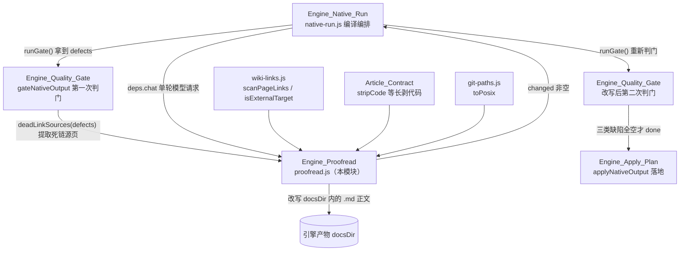
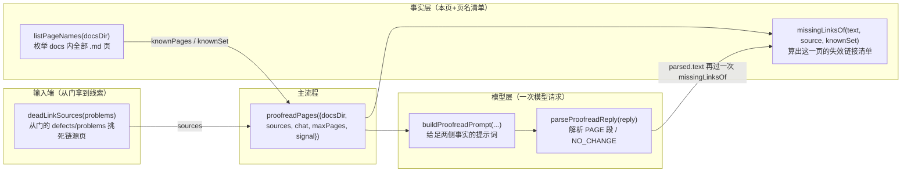
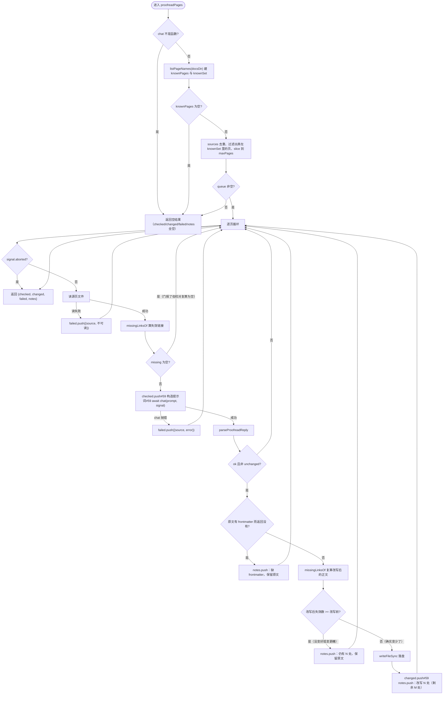
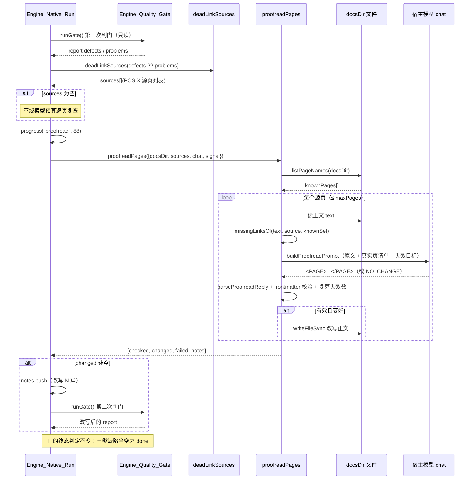

# Engine_Proofread：原生引擎产物的死链语义校对

!!! info "Generated documentation"
    This page was written by CodeWiki from the source code at commit [`b96a0b46`](https://github.com/ikliml666/dsh-codewiki/commit/b96a0b462d5e91e6a7f03b4ec47b345df7a505b6) on 2026-11-07 with `doubao-seed-2.1-lite`. Check the code before relying on details.

## 1. 这层是什么

**Engine_Proofread**（`lib/engine/proofread.js`）是原生引擎（FSoft）编译裁决链里夹在「质量门」与「落地」之间的一道**事后正文修正**：当质量门如实判出一批 `dead-link` 缺陷时，它把那些「正文里链接到不存在页面」的源页取出来，交给宿主模型**只改链接、不改别的**，改完让质量门重新判一次。

它存在的理由在文件头注释里说得很直白：原生引擎写作时，模型会照着旧版聚类的记忆**编造页面名**（真机案例：`client_review_console/status_readouts.md`、漏写 `_ui` 后缀的 `settings_and_logs.md`），而模块树里根本没有那些页。质量门判 dead-link 是对的——**产物真的错了**，于是这些仓库每一轮都停在「部分完成（partial）」。校对层修的不是判据，而是正文；改不掉就照旧判 partial，绝不在渲染期或终态里豁免缺页或死链。

### 它管什么、不管什么

| 范围 | 说明 |
| --- | --- |
| **只管** | 跨页链接目标不存在：把失效链接改成真实页名，或降级成纯文字。这是模型幻觉里唯一「只看本页 + 页名清单就能修对」的问题。 |
| **不管** | 正文事实错误（那要读源码，属于重写文章，不在校对范围）；不豁免质量门；不改 frontmatter、叙述、标题、代码块、表格、行号锚点。 |

在原生编译流水线中的位置（详见 [Engine_Native_Run（原生编译裁决编排层）](Engine_Native_Run.md)）：

```
env(doctor + lock) → 增量决议 → 水合 docs → 引擎 generate/update → 原始树留档
   → 第一次质量门 → 【死链校对 proofreadPages】 → 有改写则第二次质量门
   → 受管状态采集 → 落地器 apply → 终态裁决
```

---

## 2. 架构与依赖关系

### 2.1 模块在引擎生态中的位置



### 2.2 依赖清单

| 依赖 | 用途 | 相关文档 |
| --- | --- | --- |
| `lib/engine/wiki-links.js` | `scanPageLinks` 扫正文里的 `[文字](Engine_Output.md)` 相对链接；`isExternalTarget` 跳过 `http:`/`mailto:` 等外链 | [Job_Logs](Job_Logs.md)（该文件在模块树中的登记页） |
| `lib/article-contract.js` | `stripCode`：把代码围栏与行内代码等长替换成空白，避免「文章在讲解链接语法」被误判成死链 | [Article_Contract（文章契约闸门）](Article_Contract.md) |
| `lib/git-paths.js` | `toPosix`：Windows 反斜杠统一成 POSIX，路径比对与门保持同一口径 | [Job_Logs](Job_Logs.md) |
| 宿主 `chat(prompt, signal)` | 单轮文本生成（由 `native-run.js` 经 `deps.chat` 注入，最终走 [引擎 LLM 桥（Engine_LLM_Bridge）](Engine_LLM_Bridge.md) 的宿主模型通道） | [引擎 LLM 桥（Engine_LLM_Bridge）](Engine_LLM_Bridge.md) |

**上游调用方**：只有 [Engine_Native_Run（原生编译裁决编排层）](Engine_Native_Run.md) 一处（`native-run.js:60` 以具名导入引入 `deadLinkSources` 与 `proofreadPages`）。

---

## 3. 核心组件

本文件导出 6 个函数 + 1 个常量，职责分层如下：



### 3.1 `deadLinkSources(problems)` — 从门的报缺陷里挑出源页

质量门报出的「死链」有**两个来源**，必须都认，否则校对会看不见另一半问题：

1. `output.js` 判引擎原始页之间的引用 → `kind` 直接是 `dead-link`；
2. `article-contract` 判**落地后**的 wiki 页链接 → 被 [Engine_Quality_Gate（原生引擎产物采用门）](Engine_Quality_Gate.md)（`quality-gate.js:619`）统一改名成 `article-contract`，真实类别留在 `issue` 字段里（`issue === 'dead-link'`）。

只认前者会漏掉后者：契约层是唯一检查 `[[...]]` 与落地 slug 的地方，真机上「渲染期把链接降级成纯文字」的兜底路径正是靠它上报。返回去重、排序后的 POSIX 源页路径列表。

### 3.2 `listPageNames(docsDir)` — 真实页名清单

递归枚举 `docsDir` 下所有 `.md` 文件（POSIX、已排序）。跳过规则与 [Engine_Output 模块文档](Engine_Output.md) 的 `listMarkdownPages` 完全一致：
- 隐藏目录（`.` 开头）不扫；
- `temp/` 是引擎工作文件目录（依赖图、引用索引），**不是页**，不扫。

这份清单是提示词里「真实存在的页面清单」——模型只能从这里选替换目标，防止它继续编造。

### 3.3 `missingLinksOf(text, source, knownSet)` — 本页的失效链接

两种链接形态都要认，**因为质量门就是这么判的**：

| 形态 | 例子 | 识别方式 |
| --- | --- | --- |
| 相对链接 | `[文字](Engine_Output.md)` | 复用 `wiki-links.js` 的 `scanPageLinks`（三处共用的唯一一份正则） |
| wiki 索引语法 | `[[x]]` / `[[x\|文字]]` / `[[x#锚点]]` | 本函数内的正则，与 `article-contract.js` 的 `collectWikiLinks` 同形 |

判定规则（与门的判据同源，不另立判据）：
- 先 `stripCode` 剥掉代码块与行内代码——文章里写 `[[target]]` 往往是在**讲解链接语法**，是字面量不是引用；
- `isExternalTarget` 命中（`http:`、`mailto:` 等）直接跳过；
- wiki 词条约定省略后缀：目标不带 `.md` 时补一次再判（`core` 与 `core.md` 指同一篇）；
- 按源页所在目录做相对解析后，任一写法命中 `knownSet` 即算有效；
- 解析后越出 docs 根（`../` 开头）的不受理（那是指向仓库源码，归 source 校验管）。

### 3.4 `buildProofreadPrompt(...)` 与 `parseProofreadReply(reply)`

**提示词的立场：刻意给足两侧事实**——只给「本页原文」或只给「失效目标」其中一侧，模型只能靠猜，而「靠猜」正是它当初写错的方式。提示词包含：
- 当前文章名、真实页名清单（只能从这里选）、门报出的失效目标；
- 四条硬要求：只改链接不改叙述/标题/代码块/表格/锚点/frontmatter；清单里有对应页（含后缀差异、父模块前缀差异）就改成清单里的相对路径；找不到对应页就降级为纯文字（保留措辞、去掉 `[]()` 语法）；无需改动就在正文末尾单独一行写 `NO_CHANGE`；
- 固定返回格式：`<PAGE> ... </PAGE>` 包裹完整正文。

**回复解析**：提取 `<PAGE>` 段；末尾的 `NO_CHANGE` 标记表示「模型判定无需改动」——省一次 diff，也让「改了哪些页」有据可查。

### 3.5 `proofreadPages({ docsDir, sources, chat, maxPages, signal })` — 主流程



**关键安全约束**（任何一条不满足，该页宁可不动、原样保留，问题留给质量门如实上报）：
1. **frontmatter 保护**：原文有 frontmatter 而模型返回没有 → 放弃改写（校对本来就要动正文，动正文是授权的，但 frontmatter 被吃掉是模型失控）；
2. **有效性必须复算**：改写后再跑一遍 `missingLinksOf`，失效链接数没有严格减少就不落盘——防止模型「把 A 链接改坏成 B」；
3. **总量上限**：`maxPages` 默认 `DEFAULT_MAX_PAGES = 6`。每篇一次模型请求，6 篇已能盖住真机上「一批页同时引用了同一个被合并掉的模块」的形态；再多就变成整轮重跑。
4. **取消语义**：`signal.aborted` 即停，已改写的页面不回滚（门会在取消后的终态里如实上报）。

---

## 4. 端到端数据流（在一次原生编译里）



与 [Engine_Native_Run（原生编译裁决编排层）](Engine_Native_Run.md) 源码（`native-run.js` 约 791–862 行「2.6) 校对」段）的对应关系：
- 先跑一次门只为拿「哪几篇有失效链接」——门是纯读 `docsDir` 的，跑两次没有副作用；
- 校对只针对门报出的死链源页；门没报错就跳过，**不烧模型预算去逐页复查**（校对是修死链的一步，不是每轮都要走的例行检查）；
- 校对自身抛异常时 `proof = null`，只记 note、**不影响本轮终态**（门会如实上报死链）；
- 改写了页面才重新判门；之后才进入「受管状态采集 → 落地器」。

---

## 5. 设计立场与不变量（为什么不能放宽）

1. **修正文，不修判据**。校对后的正文仍要重新过质量门；改不掉就照旧判 partial。绝不在渲染期或终态里豁免缺页/死链。
2. **判据同源**。`missingLinksOf` 认的链接形态（相对链接 + `[[wiki]]`）、后缀补全、目录解析，必须与 [Engine_Output 模块文档](Engine_Output.md) 的 `validateOutput` 与 [Article_Contract（文章契约闸门）](Article_Contract.md) 的 `collectWikiLinks` 一致——门判它是死链、改写器却认不出这条链接，两边结论对不上就是白跑一次门。
3. **只修能修对的问题**。只看「本页 + 页名清单」就能修的幻觉（编造的页名）才属于校对；正文事实错误需要读源码，那是重写文章，越界会让这层长成第二个引擎。
4. **改写必须可证变好**。复算失效数严格减少才落盘；frontmatter 缺失即放弃。宁可少改，不可改坏。
5. **预算封顶**。`DEFAULT_MAX_PAGES = 6` 防止校对退化成整轮重跑；调用方（native-run）可经 `deps.proofreadMaxPages` 覆盖。

---

## 6. 返回值契约

`proofreadPages` 返回：

```javascript
{
  checked:  string[],  // 实际发起了模型请求的页（POSIX 相对路径）
  changed:  string[],  // 已落盘改写的页
  failed:   { source: string, error: string }[],  // 不可读 / chat 抛错
  notes:    string[],  // 人读备注：每篇「改写 N 处（剩余 M 处）」/「保留原文」的原因
}
```

调用方（[Engine_Native_Run（原生编译裁决编排层）](Engine_Native_Run.md)）把 `notes` 与 `failed` 并入本轮编译的 notes，随结果出现在面板与 job 记录里；`changed` 非空时触发第二次判门。

---

## 7. 相关模块索引

| 模块 | 关系 |
| --- | --- |
| [Engine_Native_Run（原生编译裁决编排层）](Engine_Native_Run.md) | 唯一调用方：编排「门 → 校对 → 再判门」的位置 |
| [Engine_Quality_Gate（原生引擎产物采用门）](Engine_Quality_Gate.md) | 上游判门与改写后复判的同一道门；`article-contract` 缺陷改名规则的出处 |
| [Engine_Output 模块文档](Engine_Output.md) | `dead-link` 问题的第一来源（产物自洽校验） |
| [Article_Contract（文章契约闸门）](Article_Contract.md) | `stripCode` 等长剥代码；`dead-link` error 级判据 |
| [引擎 LLM 桥（Engine_LLM_Bridge）](Engine_LLM_Bridge.md) | 宿主模型通道（`deps.chat` 的最终承载） |
| [Engine_Client（引擎进程客户端）](Engine_Client.md) / [Engine_Python_Entry](Engine_Python_Entry.md) | 被校对的产物来自它们驱动的原生引擎 |

??? abstract "Documented components (1)"
    - [`proofreadPages`](https://github.com/ikliml666/dsh-codewiki/blob/b96a0b462d5e91e6a7f03b4ec47b345df7a505b6/lib%5Cengine%5Cproofread.js) — `lib\engine\proofread.js`

