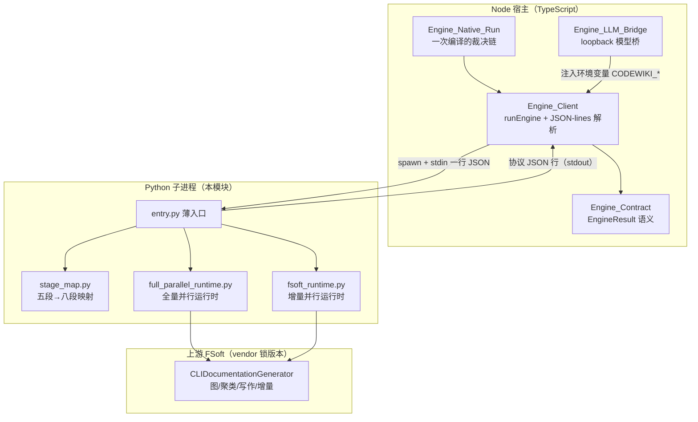
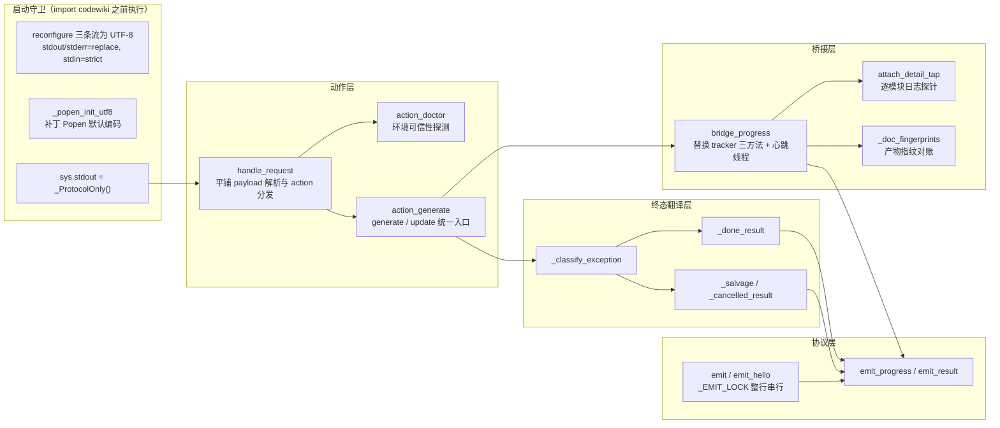
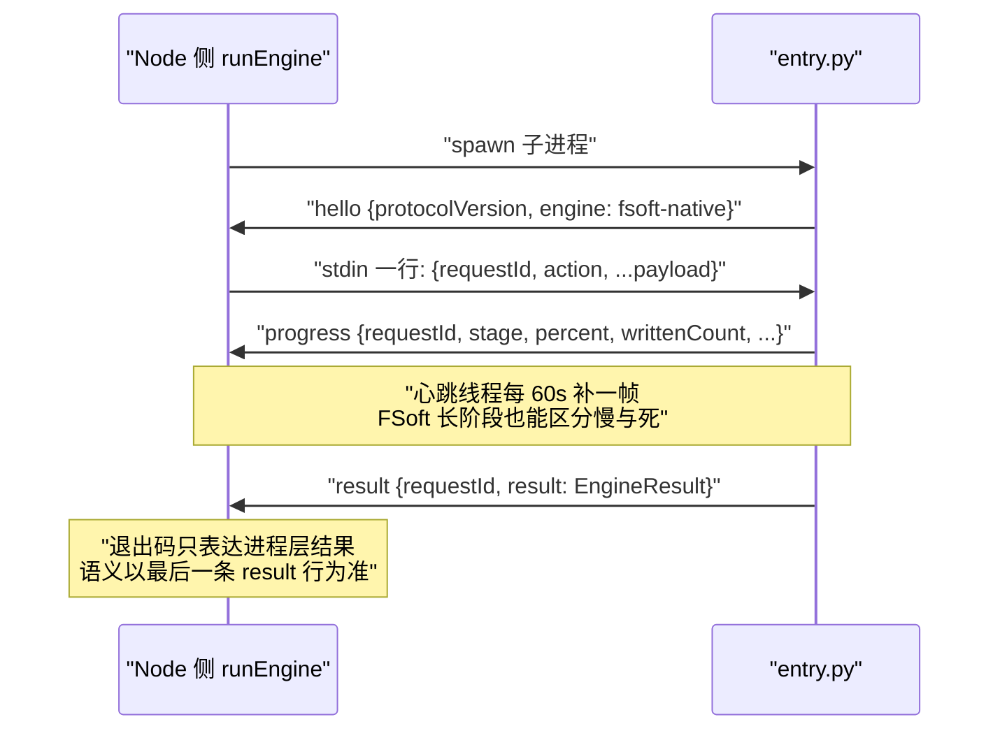
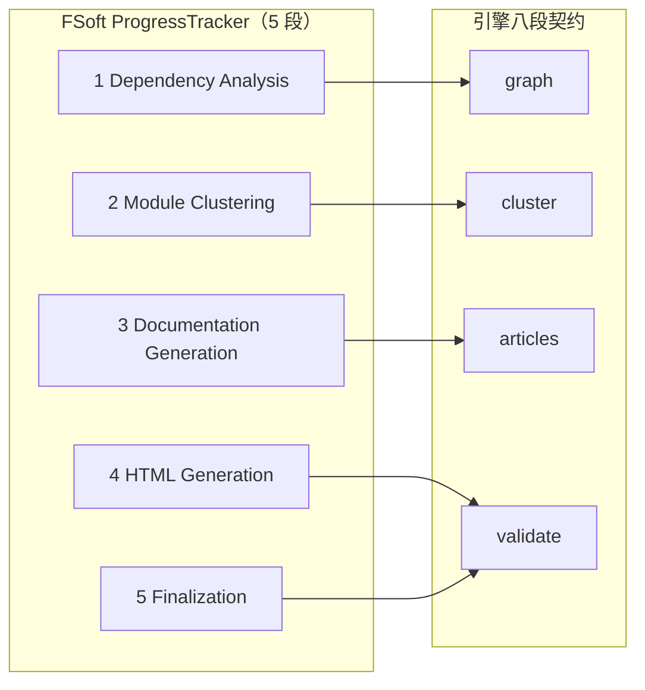
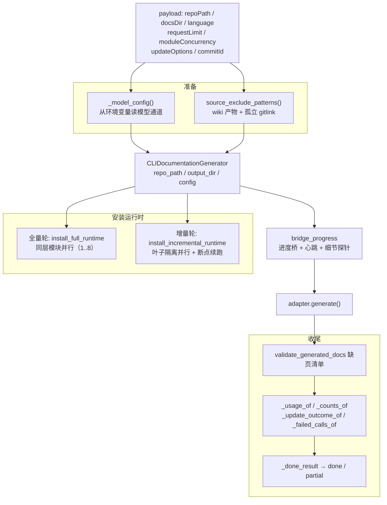
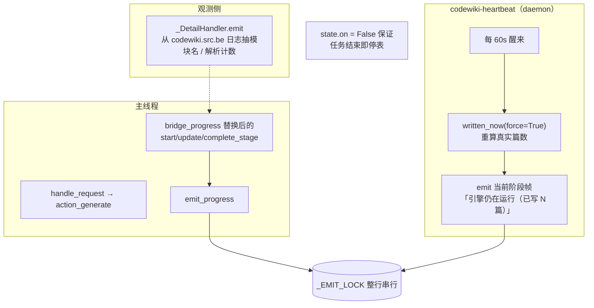

# Engine_Python_Entry

!!! info "Generated documentation"
    This page was written by CodeWiki from the source code at commit [`1ff0d38a`](https://github.com/ikliml666/dsh-codewiki/commit/1ff0d38adcb30f68320e768b4e29b10ab8676126) on 2026-11-07 with `deepseek-v4.1-flash`. Check the code before relying on details.

## 概述

`Engine_Python_Entry` 是 FSoft 原生引擎（Python 侧）与 Node 宿主之间的 **JSON-lines 薄入口**，位于 `lib/engine/python/entry.py`。它**不是算法实现**：依赖图构建、模块聚类、文章写作、增量 diff 全部由上游 FSoft（`CLIDocumentationGenerator`）完成；入口本身只承担四件事：

1. **协议翻译**：把 stdin 的一行 JSON 请求变成一次 FSoft 调用（`doctor` / `generate` / `update` / `cancel`）；
2. **进度桥接**：把 FSoft 的五段进度翻译成引擎八段契约（`stage_map.py`），以 JSON 行实时推给 Node；
3. **结果归一**：把成功 / 失败 / 取消统一翻译成 `EngineResult`（与 [Engine_Contract 引擎契约](Engine_Contract.md) 的同一份语义，`contractVersion` 当前为 3）；
4. **守住两条红线**：
   - **不读本机凭证库**——模型通道只从进程环境变量（`CODEWIKI_BASE_URL` / `CODEWIKI_API_KEY` / `CODEWIKI_MAIN_MODEL` / `CODEWIKI_CLUSTER_MODEL`）读取，绝不去碰 `~/.codewiki/config.json` 或 keyring；
   - **不让 FSoft 的打印污染协议流**——在导入任何 `codewiki` 模块之前就把 `sys.stdout` 换成只允许协议写出的守卫对象。

调用关系上，Node 侧由 [Engine_Native_Run（原生编译裁决编排层）](Engine_Native_Run.md) 编排一次完整编译、由 [Engine_Client（引擎进程客户端）](Engine_Client.md) 的 `runEngine` spawn 出本进程并解析 JSON-lines；模型通道由 [引擎 LLM 桥（Engine_LLM_Bridge）](Engine_LLM_Bridge.md) 以 loopback 桥的形式注入环境变量。

## 架构定位

## 核心组件

| 组件 | 职责 |
| --- | --- |
| `_ProtocolOnly` | `sys.stdout` 的替身对象：普通 `write` 一律改道 stderr（变成日志），协议行走保存下来的真实 stdout 句柄；连 `flush`、`fileno`、`isatty` 都要转，防止 FSoft 的进度条把半行日志挤进协议流 |
| `_popen_init_utf8` | 给 `subprocess.Popen.__init__` 打默认编码补丁：text 模式（`text=True` / `universal_newlines=True`）且未显式指定 encoding 的调用一律走 UTF-8 + `errors=replace`，兜住 FSoft 内部按 locale（Windows gbk/cp936）解码中文路径的崩溃 |
| `main` | 主循环：发 `hello` → 读 stdin 一行请求 → `handle_request` 分发 → `emit_result` 终态；协议破坏一律用「退出码 0 + failed result」表达，让 Node 侧拿到结构化失败原因而不是一句「exit 1」 |

## 模块内部分层

## 协议契约

Node 与 Python 之间是单向 JSON-lines 流，两类版本号分开管理：

| 常量 | 值 | 对端位置 |
| --- | --- | --- |
| `PROTOCOL_VERSION` | `1` | [Engine_Client（引擎进程客户端）](Engine_Client.md) 的 `ENGINE_PROTOCOL_VERSION` |
| `CONTRACT_VERSION` | `3` | [Engine_Contract 引擎契约](Engine_Contract.md) 的 `ENGINE_CONTRACT_VERSION` |

### 消息类型

### 关键协议不变量

1. **stdout 只走协议**：任何非 JSON 行由 Node 侧记 `not-json` 违规（见 [Engine_Client（引擎进程客户端）](Engine_Client.md)）。`_ProtocolOnly` 守卫 + `emit` 的 `_EMIT_LOCK` 整行串行化（心跳线程与主线程并发写）共同保证这一点。
2. **请求 payload 平铺**：契约与 `client.js` 都按 `{requestId, action, ...payload}` 平铺发送；`handle_request` 同时兼容嵌套 `payload` 对象（顶层平铺优先）。
3. **退出码 ≠ 语义**：协议破坏用 `0` 退出 + failed result 表达；`cancel` 动作直接应答 `{cancelled: true}` 而不是一份 `EngineResult`（取消是控制面动作）。

## 进度桥接

### 五段 → 八段映射

FSoft 的 `ProgressTracker` 只有五段（Dependency Analysis / Module Clustering / Documentation Generation / HTML Generation / Finalization），而面板步骤条用八段契约（`env / graph / cluster / articles / proofread / validate / index / baseline / commit`）。映射由 [Package_Manifest 包清单](Package_Manifest.md) 同目录的纯函数模块 `stage_map.py` 固定成一张表（`FSOFT_TO_ENGINE`：1→graph、2→cluster、3→articles、4/5→validate），并由测试双向对账。要点：

- **进度上限刻意压在 90%**：FSoft 只覆盖前四段，剩余 `index / baseline / commit` 由 Node 侧落地器执行——避免「引擎说 100% 但 wiki 还没索引」的假完成。
- **增量轮按 description 认**：FSoft 的增量更新复用 `start_stage(2, "Incremental Update")` 槽位，阶段号会谎报成 cluster；`bridge_progress` 靠 `is_incremental(description)` 把整轮改报 `articles`。
- **articles 阶段按真实篇数算百分比**：FSoft 阶段 3 的所有 `update_stage` 都被 `verbose=False` 门控，阶段内进度恒为 0，所以 `articles_percent(written, total)` 用「已写篇数 / 预期篇数」取代 stage_progress。
- **阶段 1 也按真实进度算百分比**：依赖分析的 `update_stage` 同样被 `verbose=False` 门控，阶段内进度恒为 0（真机上整段 3 分钟以上一动不动）。`_DetailHandler` 从逐文件日志（`parse-start` / `parse`）数出已解析文件数，非完成帧用 `percent_of(1, 已解析/总数)` 取代 stage_progress；阶段完成帧（`stage_progress=1.0`）刻意不走这条路——上游每十分之一文件才打一条日志，最后一条常停在 0.9，拿它算完成帧会让百分比倒退。

### 进度事实来源：产物指纹对账

`writtenCount` 是 Node 侧判「超时但有进度 → partial」的唯一依据，所以必须用**本轮真实改动篇数**而不是猜内部计数器：

- 进场时 `_doc_fingerprints(docs_dir)` 快照片段表 `{相对路径: (size, mtime_ns)}`；
- 每帧（或心跳）重新清点，与基线比对：新增 / 改写 / 删除的路径都算本轮动过账；
- 递归遍历带 2 秒节流（`_WRITTEN_RECOUNT_SEC`），阶段切换与阶段完成走 `force=True` 必算；
- 百分比分母 `expected_total` 取「本轮开始时 docs 里已有的 .md 篇数」，与 written 同源同口径。

### 逐模块细节探针

FSoft 以 `verbose=False` 运行时把 `codewiki.src.be` 的 logger 压到 WARNING，逐模块日志（`Processing leaf module: X`）全被吞掉，阶段 3 只能报「已写 N 篇」。`attach_detail_tap` 以**只读旁路**方式：

- 临时把该 logger 降到 INFO，同时把已有 handler 的 level 提到 WARNING（防止 INFO 灌进 stderr 被 Node 当日志 tail 收走）；
- 挂 `_DetailHandler`，用一组正则从日志文本抽出当前模块名 / 阶段；
- 存活期严格等于一次编译（挂在 `adapter.generate` 的 `try/finally` 里），结束即 `release_detail_tap` 还原；
- 措辞按阶段分：阶段 3「正在写 X」、阶段 2「正在聚类 X」、「正在生成仓库总览」；
- 阶段 1（依赖分析）没有模块概念：进入 `parse-start` 时把上一阶段残留的模块名清空（否则面板会挂着上一轮「正在写 X」），并记下解析总数；此后每来一条 `parse` 日志就更新「已解析 N/M 个源文件」后缀，同时供 `bridge_progress` 把阶段 1 的百分比从逐文件计数里算出来（见上文映射要点）；
- `attach_detail_tap` / `release_detail_tap` 都把 `parsed` / `parsed_total` 计数器归零，保证两轮编译之间不留上一轮的解析进度。

## 动作处理

### doctor（环境可信性）

`action_doctor` 是 1A 部署门禁（见 [FSoft 引擎环境搭建脚本（FSoft_Engine_Setup_Script）](FSoft_Engine_Setup_Script.md) 的 `setup-env.sh`）的运行时版本：

1. 探测 `codewiki.__version__`，导入不了 → `engine-missing`；
2. 跑一次 `pip check`（120s 超时）——装到一半的 venv 会让 FSoft 在生成中途才因缺包崩掉，代价是一整轮模型调用白烧；
3. 返回 `checks: [import, python, pip]` 与 `engine.deps` 摘要。

### generate / update 统一入口

`action_generate(request_id, payload, is_update)` 不判断改了什么（那是 FSoft 的 diff 与 agentic 循环），只做三件事：

关键配置决策（均在注释中记录了真机事故背景）：

| 配置 | 取值 | 理由 |
| --- | --- | --- |
| `request_limit` | 下发值夹到 `[1,1000]`，缺省 300 | 上游默认 100 + 续发提醒各吃一份预算，大模块撞上限整轮从 done 掉成 partial |
| `module_concurrency` | 下发值夹到 `[1,8]`，缺省 1 | 上游严格串行、单篇约 12 分钟；全量轮由 [全量并行运行时（Engine_Full_Parallel_Runtime）](Engine_Full_Parallel_Runtime.md) 按拓扑层分批并行 |
| `updateOptions` | `{rung: 3}`（组件级增量） | 显式给档位，不依赖上游默认值漂移 |
| `agent_instructions.exclude_patterns` | `.codewiki` / `CodeWiki.md` + 孤立 gitlink | 产物不能当源码（否则每轮自报 incremental）；被提交但 checkout 不出来的嵌套仓库会耗光整轮预算 |
| `agent_instructions.language` | 按 payload 展开 | 上游从这里读文章书写语言，缺省即上游默认英文 |

增量轮的并行运行时由 [Engine_FSoft_Runtime：增量 Step 5 的受控并行与断点运行时](Engine_FSoft_Runtime.md) 提供（每个叶子独立工作副本、冲突时串行重跑）。

### 源码分析面排除

- `WIKI_PRODUCT_PATTERNS = (".codewiki", "CodeWiki.md")`：本插件自己的 wiki 产物，每轮都会改写；
- `dangling_gitlink_patterns(repo_path)`：`git ls-files --stage` 找出 mode 160000 且未在 `.gitmodules` 登记的孤立 gitlink；读不到索引时返回空列表——排除是优化，绝不能让编译因此挂掉。

## 终态翻译

`_classify_exception` 按**异常类型**（而非消息文本）分类，文本随版本变、类型相对稳定：

| 异常 | 结果 |
| --- | --- |
| `IncompleteGenerationError` / `IncompleteDocumentationError` | `partial` + `article-missing` blockers（计划内文章缺失） |
| `RuntimeError("Documentation failed for modules: ...")` | `partial` + 逐条模块 blockers，已写页面照常交付 |
| `APIError*` / `ConfigurationError` | `engine-model`，并走 `_salvage` |
| `RepositoryError` | `engine-missing`（连仓库都没读出来，无本轮成果） |
| `KeyboardInterrupt` | `cancelled` |
| 其它 | `engine-crashed` + 截断 traceback，走 `_salvage` |

### _salvage：已写部分不白跑

原生引擎一轮动辄几十上百分钟，失败点通常在阶段 3 中途。`_salvage` 的规则：

- 已写出 ≥1 篇文章 → 降 `partial` 交付（保住已写文章与下一轮增量的状态），让 [Engine_Native_Run（原生编译裁决编排层）](Engine_Native_Run.md) 的裁决链有可能推进基线；
- 一篇都没写出来 → 仍然 `failed`——空产物冒充「部分完成」会让基线与面板失真。

### 终态事实字段

`_done_result` / `_counts_of` / `_usage_of` / `_update_outcome_of` 保证契约必填事实全部来自引擎自己的 `UpdateRecord`，不自己猜：

- `keptCount` / `removedCount` / `unmappedCount`：verdicts 里的 `no-op` 页数、去重后的 `pages_removed`、`repair.orphans` 长度；
- `updateOutcome`：`incremental / no_change / full_fallback / detector_failure`——「基线能不能推进」的唯一证据，取不到返回 `None`（表示引擎没说，而非编造 `full`）；
- `artifacts.stateFiles`：只报磁盘上真实存在的跨轮状态文件（顶层 `*.json`、`temp/dependency_graphs/*`、`temp/reference_index.json`、`temp/artifact_index.json`），供上层交叉校验采集结果；
- `usage`：`job.statistics.usage_totals`，且必须被每条出口调用（partial 分支曾直接 return，导致写了一半的任务用量恒为 0）。

## 并发与线程模型

- `_EMIT_LOCK`：协议行必须整行落盘（GIL 只保证单次 `write` 不交错，文本缓冲流可能拆多次底层写入）；
- 心跳间隔 `_HEARTBEAT_SEC = 60s`，刻意显著小于 Node 侧静默阈值（默认 10 分钟），否则心跳自己会被判成卡死；
- 心跳挂在 `adapter.generate` 上（唯一同步入口），`stop` 一定在 `try/finally` 里执行，不会泄漏到后续请求。

## 环境与部署依赖

- **运行环境**由 [FSoft 引擎环境搭建脚本（FSoft_Engine_Setup_Script）](FSoft_Engine_Setup_Script.md) 的 `tools/fsoft-engine/setup-env.sh` 按冻结快照 `--no-deps` 安装，并以 `pip check` + import 冒烟验收；入口的 `doctor` 动作是这套门禁的运行时镜像。
- **模型通道**由 [引擎 LLM 桥（Engine_LLM_Bridge）](Engine_LLM_Bridge.md) 启动 loopback 服务后，把 `CODEWIKI_BASE_URL`（指向 `http://127.0.0.1:<随机端口>/v1`）、占位 `CODEWIKI_API_KEY`、主模型与聚类模型注入子进程环境；入口侧 `_model_config` 缺任何一项直接 `engine-model` 失败，绝不回退读本机配置。相关占位 key 校验逻辑见 [Engine OpenAI 桥转换层](Engine_OpenAI_Bridge.md)。
- **阶段映射口径**与 Node 侧 [Engine_Contract 引擎契约](Engine_Contract.md) 的 `ENGINE_STAGES` 由 `stage_map.py` 共享并测试双向对账。
- **终止与取消**：取消由 Node 侧直接杀进程树完成（见 [Engine_Process_Tree 模块文档](Engine_Process_Tree.md)）；入口侧的 `cancel` 动作只立即应答 `{cancelled: true}`。
- **产物采集与状态水合**：入口写出的 `docsDir` 与跨轮状态文件由 [Engine_Native_State（原生引擎跨轮受管状态）](Engine_Native_State.md) 与 [Engine_Output 模块文档](Engine_Output.md) 在上层采集、映射到 wiki 页（详见 [Engine_Apply_Plan（原生产物落地器）](Engine_Apply_Plan.md) 与 [Engine_Proofread：原生引擎产物的死链语义校对](Engine_Proofread.md) 的落地裁决链）。

## 关键常量速查

| 常量 | 值 | 说明 |
| --- | --- | --- |
| `CONTRACT_VERSION` | `3` | 与 Node 侧 `ENGINE_CONTRACT_VERSION` 同步；单独抽常量是为了避免 5 处字面量漏改导致「同一进程报两个契约版本」 |
| `_WRITTEN_RECOUNT_SEC` | `2.0` | 普通 update 的产物指纹重算间隔 |
| `_HEARTBEAT_SEC` | `60.0` | 心跳补帧间隔，须显著小于 Node 侧 `silenceMs`（默认 10 分钟） |
| `_DETAIL_MAX_LEN` | `80` | 细节探针模块名面板显示截断长度 |
| `ACTIONS` | `doctor / generate / update / cancel` | 唯一登记的动作集合 |

??? abstract "Documented components (3)"
    - [`_ProtocolOnly`](https://github.com/ikliml666/dsh-codewiki/blob/1ff0d38adcb30f68320e768b4e29b10ab8676126/lib%5Cengine%5Cpython%5Centry.py) — `lib\engine\python\entry.py`
    - [`_popen_init_utf8`](https://github.com/ikliml666/dsh-codewiki/blob/1ff0d38adcb30f68320e768b4e29b10ab8676126/lib%5Cengine%5Cpython%5Centry.py) — `lib\engine\python\entry.py`
    - [`main`](https://github.com/ikliml666/dsh-codewiki/blob/1ff0d38adcb30f68320e768b4e29b10ab8676126/lib%5Cengine%5Cpython%5Centry.py) — `lib\engine\python\entry.py`

