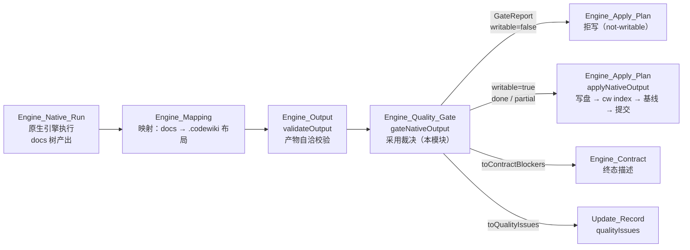
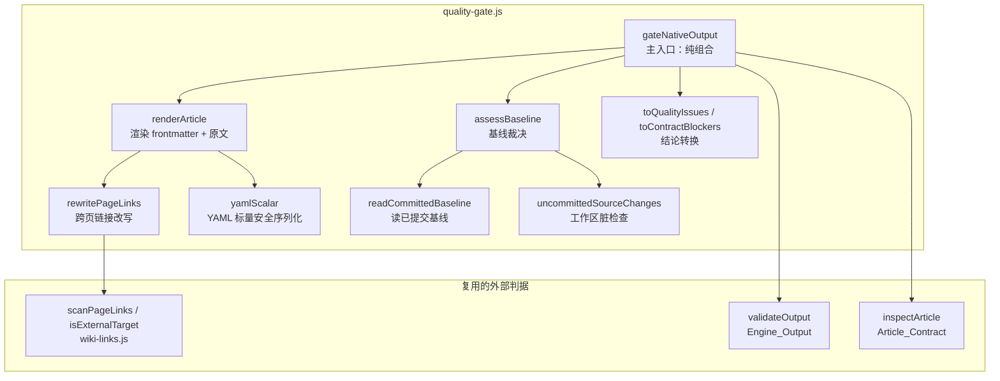
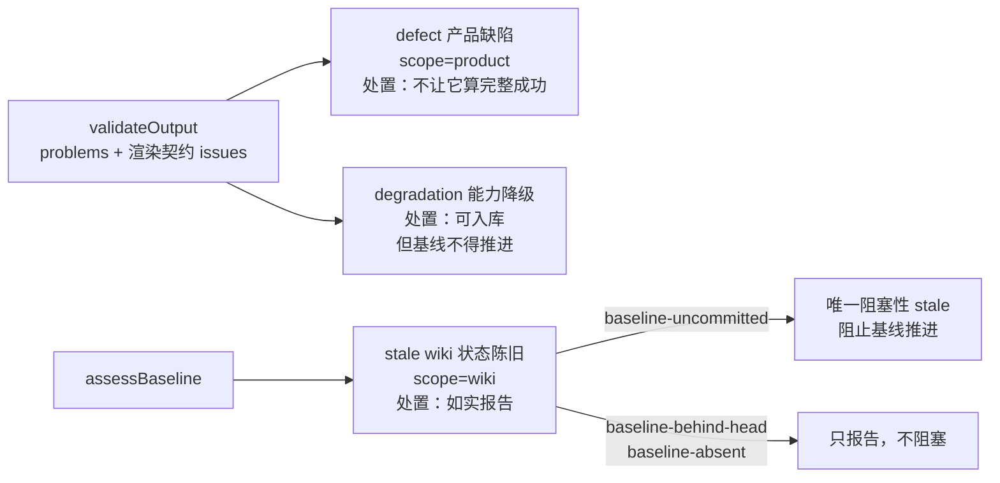
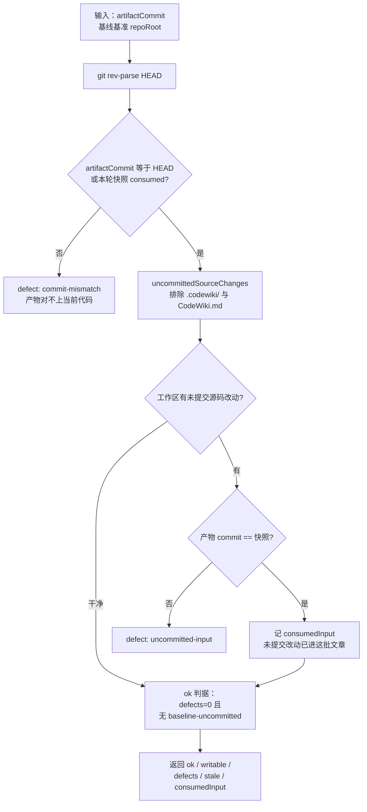
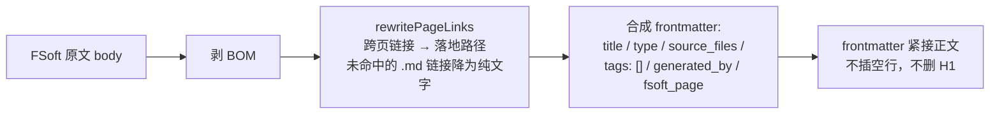
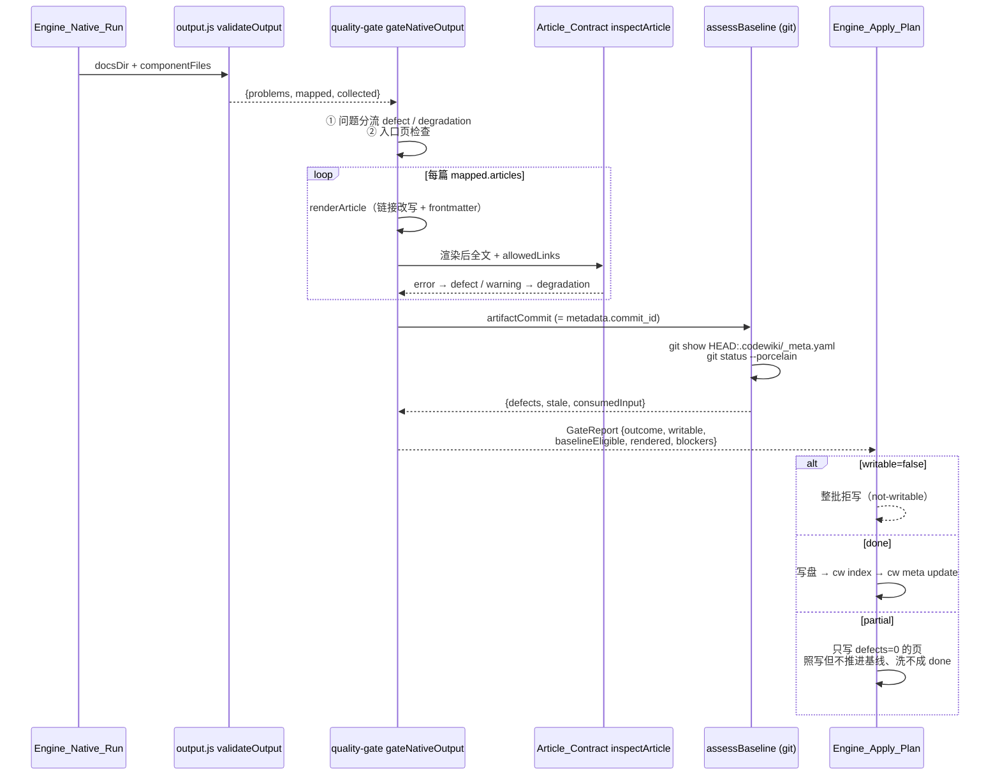

# Engine_Quality_Gate（原生引擎产物采用门）

!!! info "Generated documentation"
    This page was written by CodeWiki from the source code at commit [`d0adce52`](https://github.com/ikliml666/dsh-codewiki/commit/d0adce524f95d60d0bdb0d12ada263ed951b8fd9) on 2026-11-07 with `doubao-seed-2.1-lite`. Check the code before relying on details.

## 简介

`Engine_Quality_Gate` 是 CodeWiki 原生引擎通道（FSoft）编译流水线的**阶段 3 采用门**（quality gate），代码位于 `lib/engine/quality-gate.js`。它的职责是：引擎把一棵 docs 树交回来之后、产物真正写进 `.codewiki/` 与仓库根 `CodeWiki.md` 之前，对这批产物做出一份**可机读的采用裁决**（`GateReport`），回答三个问题——

1. **产物自洽**：页在不在、正文空不空、链接指的东西在不在计划内（复用 [Engine_Output 模块文档](Engine_Output.md) 的 `validateOutput`，不重写任何判定）；
2. **目标格式契约**：把映射结果渲染成真正的 wiki 文章（frontmatter + 正文），再过 [Article_Contract（文章契约闸门）](Article_Contract.md) 的 `inspectArticle`（frontmatter 唯一闭合 / 围栏闭合 / 死链 / `source_files` 证据 / 类型与位置匹配）；
3. **基线可推进性**：产物对应的 commit 必须是已提交的 HEAD（或本轮合成的工作区快照），且 `.codewiki/_meta.yaml` 的编译基线本身已入库——未提交的工作区内容不得被当成已提交基线固化下来。

本模块存在的核心理由是**问题三分类**（defect / degradation / stale）：0.14.0 的教训是「1 篇成功 + 19 篇失败也报 done」，但反过来把一切都塞进一个 blockers 数组同样有害——引擎会被归咎于不是它的问题，wiki 的陈旧状态会被当成产品缺陷。分类改变的是「谁来修、修什么」的定位，**不是放宽闸门**：终态仍然严格，三类问题皆空才是 `done`。

---

## 在流水线中的位置

闸门与上下游模块的关系：

- 上游：[Engine_Native_Run（原生编译裁决编排层）](Engine_Native_Run.md) 产出 docs 树；[Engine_Mapping：FSoft 产物到 CodeWiki 的格式映射层](Engine_Mapping.md) 提供布局常量（`WIKI_ENTRY = 'CodeWiki.md'`、`WIKI_META_REL = '.codewiki/_meta.yaml'`）与映射结果 `mapped`；[Engine_Output 模块文档](Engine_Output.md) 提供 `validateOutput` / `bodyLength` / `pageAliases`。
- 下游：[Engine_Apply_Plan（原生产物落地器）](Engine_Apply_Plan.md) 只认 `report.writable`、`report.outcome`、`report.rendered`、`report.canAdvanceBaseline` 四个结论字段，**不重复判定**；[Engine_Contract 引擎契约](Engine_Contract.md) 与 [Update_Record（编译更新记录）](Update_Record.md) 通过 `toContractBlockers` / `toQualityIssues` 消费本模块的分类结论。

---

## 架构与核心职责

### 主入口 `gateNativeOutput`

对一批原生产物做采用裁决，本身是**纯组合**：读产物（`validateOutput`）→ 渲染 → 契约 → 基线。输入参数与输出 `GateReport` 的关键字段：

| 输入 | 说明 |
| --- | --- |
| `docsDir` | 引擎产出的 docs 目录 |
| `repoRoot` | 仓库根（`source_files` 存在性、git 基线判定） |
| `componentFiles` | 组件 id → 仓库相对文件（`source_files` 的唯一证据） |
| `baseline` | `readCommittedBaseline` 的结果（不给则现读） |
| `requireCommittedInput` | 是否要求产物对应干净的已提交 HEAD（默认 true） |
| `consumedInputCommit` | 本轮合成的工作区快照 commit（产物对它的即为「对得上」） |
| `includeContent` | 返回值是否带渲染后正文（落地器要写盘） |

| 输出字段 | 说明 |
| --- | --- |
| `outcome` | `done` / `partial` / `failed`（严格：三类皆空才 done） |
| `writable` | 入口页可用 → 整批可入库 |
| `baselineEligible`（兼容名 `canAdvanceBaseline`） | 只有 `outcome === 'done'` 才为 true |
| `rendered[]` | 全部页的渲染结果（含 defects 计数；有缺陷的页也带上，规范化轮用） |
| `blockers[]` | defect + degradation + 阻塞性 stale 的并集 |
| `consumedInput` | 本轮吞下的未提交改动（快照 commit + 路径清单） |

处理分六步：① 产物自洽问题按类别分流到 defect / degradation；② 入口页（overview）存在性、非空、围栏闭合检查；③ 逐篇渲染 + 契约检查；④ 空 `source_files` 记为降级；⑤ 基线裁决 `assessBaseline`；⑥ 终态合成。

---

## 三类问题分类体系

类别词表是**稳定、可机读**的，新增只允许追加（消费者按 `kind` 分派）。

| 类别 | 代表 kind | 含义 | 处置 |
| --- | --- | --- | --- |
| defect | `missing-docs-dir` / `entry-missing` / `empty-body` / `article-missing` / `unmapped-page` / `source-missing` / `dead-link` / `article-contract` / `commit-mismatch` / `uncommitted-input` | 本次引擎产物自身的问题 | 不让它算完整成功（partial/failed） |
| degradation | `empty-module-tree`（whole-repository 模式下归属证据整体缺失）/ `no-source-evidence`（页照写但增量归属不可信）/ `missing-section` / `empty-section-optional` | 产物可用但证据不足 | 可以入库，但**不得推进基线** |
| stale | `baseline-behind-head`（既有基线落后 HEAD，本轮编译正是为消化它）/ `baseline-uncommitted`（基线只在工作区未提交）/ `baseline-absent`（首次编译） | 不是本次产物的错（既有 wiki 的状态问题） | 如实报告；只有 `baseline-uncommitted` 阻塞推进 |

设计要点：`empty-module-tree` 在 [Engine_Output 模块文档](Engine_Output.md) 里是 problem，但性质是「证据缺失」而非「产物坏了」——whole-repository 模式下 FSoft 本来就把 `module_tree` 留成 `{}`，所以在闸门里映射成 degradation。反过来，未来 output.js 新增未登记的问题类别时，闸门不许静默吞掉，一律当成 defect（`article-contract` 包装）报出来，逼这里补映射。

---

## 关键机制

### 1. 基线裁决 `assessBaseline` 与已提交基线读取 `readCommittedBaseline`

为什么基线必须从 `git show HEAD:.codewiki/_meta.yaml` 读而不是读工作区文件：工作区的 `_meta.yaml` 随时可能是上一轮编译刚写、还没提交的内容（自动提交是异步的，存在「已写入、未提交」窗口）。把它当基线等于把一堆未提交的产物宣布成「已消化」，而 git 里根本没有它们的记录——下次编译的 base 会指向一个不存在的状态。

两个豁免值得注意：

- **工作区快照豁免**：本轮若已把工作区改动合成临时 commit（native-run 的 1.9 段），产物对应的就是那棵**含工作区内容**的树。它当然不等于 HEAD，但这不是「对不上代码」，而是「对上了比 HEAD 更完整的代码」——记成 `consumedInput` 而不是缺陷。
- **空骨架豁免**：`cw init` 建出的 `_meta.yaml` 初值 `last_compiled_commit: null` 没有任何历史进度，不存在「把未提交状态记成已消化」的风险，判为 `baseline-absent`（首次编译）而非 `baseline-uncommitted`——否则首次编译永远推进不了基线，而落地事实上又推进了它。

### 2. 文章渲染 `renderArticle`：三条硬约束

1. **正文一字不动**：不删 H1、不改措辞、不补章节——产物规范化只处理格式与路径，正文一旦被本层改写，「模型写了什么」就无法逐字复核；
2. **frontmatter 只填有证据的字段**：`source_files` 原样来自映射（空就显式写成 `[]`），绝不按目录名猜；
3. **可回溯**：`fsoft_page` 记住正文来自原始树的哪个文件，「wiki 里这篇 ≠ 引擎产出的那篇」永远可以逐字比对。

### 3. 跨页链接改写 `rewritePageLinks`

引擎产物页名是 `agent_runtime.md`，落地时按 slug 规则改名成 `agent-runtime.md`，而正文里仍写原名——不改写就是「每一条跨页链接点开 404」（真机实测本仓 420 条内部链接有 412 条失效）。要点：

- **解析基准是引擎源页所在目录**，不是落地目录（层级布局的页落地后被拍平到 `.codewiki/modules/` 单层，按落地目录解析一条都命不中）；
- **只在非代码区域改写**：`stripCode` 把行内代码与围栏块等长掩码，演示链接写法是语法示例，改成真实路径反而破坏文档想表达的意思；
- pageMap 还合入两类固定分歧：根页别名（`README.md` / `overview.md` → `CodeWiki.md`）与 [Engine_Output 模块文档](Engine_Output.md) 的 `pageAliases`（模块名带扩展名、子模块页加父前缀）；
- 未命中的 `.md` 链接（引擎编造了树中不存在的页名）降级成纯文字保留作者文字——「引擎编造」这个事实仍由 output.js 的 `dead-link` 如实上报，不在渲染期静默丢弃。

### 4. YAML 标量序列化 `yamlScalar`

`cw` 用 serde_yaml 解析 frontmatter（见 [CodeWiki 主入口（cw CLI）](CodeWiki_Main.md) 的 Rust 侧）。真实页标题里会出现 `: `（冒号+空格）、` #`、反斜杠 Windows 路径——plain scalar 一旦含这些字符，serde_yaml 会把整行解析成「键 + 嵌套映射」或截断成注释，`parse_frontmatter` 直接判坏头、整篇文章在 `cw index` 里静默缺席（退出码仍是 0）。做法：只在确实不安全时才用 `JSON.stringify` 加双引号（JSON 字符串字面量是合法 YAML 双引号标量），安全形态保持裸值，与既有文章 frontmatter 观感一致。

### 5. 逐篇契约检查 `checkRendered`

复用 [Article_Contract（文章契约闸门）](Article_Contract.md) 的 `inspectArticle`，并带上 `NATIVE_ARTICLE_OPTS`（`requiredSections: []`、`allowEmptySourceFiles: true`——原生正文章节名由上游 prompt 决定，不能用本仓库 agentic 通道的 `Overview` / `Key Components` 去判死刑）；`allowedLinks` 传「落地后」的页路径集合，让契约层认得 slug 之后的真实文件名。额外兜一条：剥掉**自己合成的** frontmatter 再算正文长度——否则 8 行 frontmatter 会被当成正文，`# Web` 这种空壳页永远判不出空。

---

## 数据流：一轮编译的裁决过程

---

## 对外暴露的转换函数

| 函数 | 去向 | 作用 |
| --- | --- | --- |
| `toContractBlockers(report)` | [Engine_Contract 引擎契约](Engine_Contract.md) / update-record | 把 gate 的 blockers 翻成 `BLOCKER_KINDS`；一一对应不了的一律归 `quality-gate`（宁可粗也不能漏），原 kind 保留在 detail 里 |
| `toQualityIssues(report)` | [Update_Record（编译更新记录）](Update_Record.md) 的 `qualityIssues`（`judgeOutcome` 输入之一） | defect + degradation 全量喂入，外加唯一阻塞性的 `baseline-uncommitted`。为什么必须喂：`judgeOutcome` 只按「计划内文章写成了没有」判 done——一篇可写但 `source_files` 为空的页在它眼里就是成功，而空 `source_files` 正是「增量归属不可用」的证据降级。两条判定路径不能一个严一个松 |

---

## 设计原则小结

1. **不重写判据**：自洽交给 `validateOutput`，格式交给 `inspectArticle`，链接扫描交给同一份 `scanPageLinks`（门判它是死链、改写器却认不出这条链接，两边结论对不上的事故就是这么来的）；
2. **终态严格、分类温和**：`baselineEligible` 只有一种来源——`outcome === 'done'`。0.16.1 曾允许 partial 也许可推进以打破死循环，但那把「没消化完」直接记成已消化，死循环的正确解法是让**首次编译**能走成 done（空骨架不算未入库基线），而不是让 partial 偷偷推进；
3. **有缺陷的页也要进 rendered**：早先只收 `action==='write'` 的页，落地器因此永远看不见「有缺陷的旧落地页」，渲染规则改了旧页在库里继续错下去。写不写由落地器按轮次决定（正常轮只写 defects=0 的页，规范化轮全写），见 [Engine_Apply_Plan（原生产物落地器）](Engine_Apply_Plan.md)；
4. **git 只读**：基线与脏检查全部走 `git show` / `git rev-parse` / `git status --porcelain`，超时 15s，失败返回 null 并如实降级，不猜状态。

??? abstract "Documented components (2)"
    - [`gateNativeOutput`](https://github.com/ikliml666/dsh-codewiki/blob/d0adce524f95d60d0bdb0d12ada263ed951b8fd9/lib%5Cengine%5Cquality-gate.js) — `lib\engine\quality-gate.js`
    - [`toQualityIssues`](https://github.com/ikliml666/dsh-codewiki/blob/d0adce524f95d60d0bdb0d12ada263ed951b8fd9/lib%5Cengine%5Cquality-gate.js) — `lib\engine\quality-gate.js`

