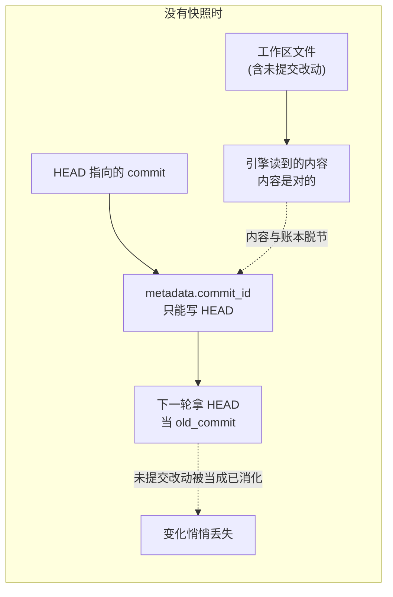
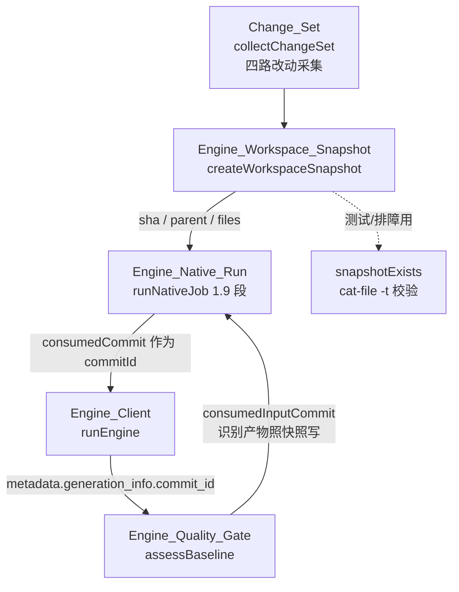
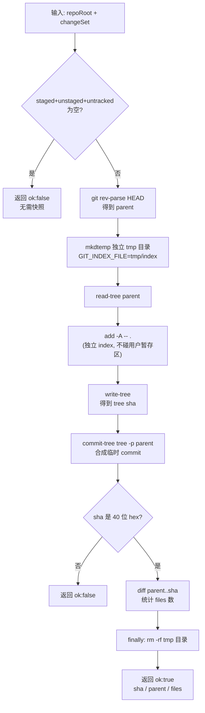
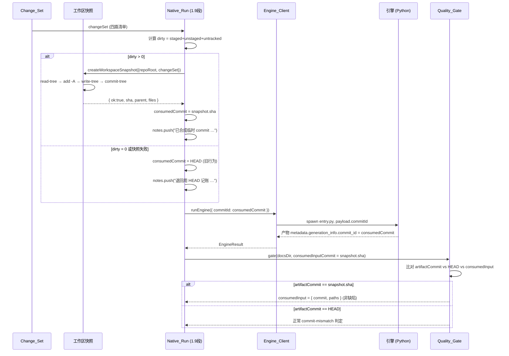
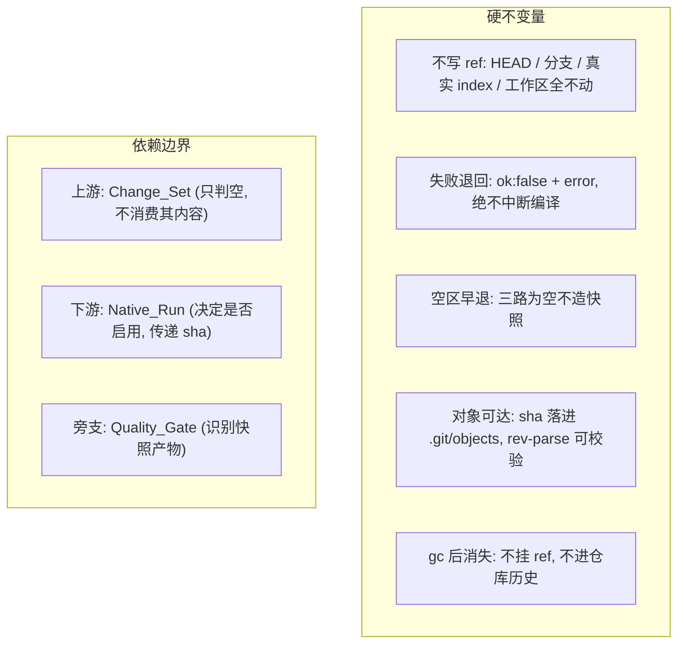

# 工作区快照（Engine_Workspace_Snapshot）

!!! info "Generated documentation"
    This page was written by CodeWiki from the source code at commit [`4877231e`](https://github.com/ikliml666/dsh-codewiki/commit/4877231e2f743a3ba18890a9db2d6468a9885218) on 2026-11-07 with `doubao-seed-2.1-lite`. Check the code before relying on details.

## 简介

`lib/engine/workspace-snapshot.js` 是原生引擎通道的一个**记账对齐**模块：它把工作区里**未提交**的四路改动（staged / unstaged / untracked）合成一棵真实的 git 树对象、生成一个不挂任何 ref 的临时 commit，让引擎（FSoft）能以 `<old_commit>..<new_commit>` 的方式读到这些改动并记入账本。

它解决的核心矛盾是：FSoft 只从两个 commit 之间取 diff，插件侧的 [Change_Set 变更集采集模块](Change_Set.md) 能采到未提交改动，但这些改动对引擎只是「工作区文件里的内容」，没有一个 commit 对象可以对齐。于是文章写的是工作区内容、metadata 里的 `commit_id` 却只能写 HEAD —— 下一轮拿 HEAD 当 old_commit，这些改动就会被当成已消化而丢失。快照正是给这批改动造一个**真实可达、但不进仓库历史**的临时 commit，让「产物对应的内容状态」与「记账指向的 commit」重新对齐。

快照**不写任何 ref**：用户的分支、HEAD、真实 index、工作区一个字节都不动。tree 与 commit 对象落进 `.git/objects`，gc 后自然消失，因此永远不能当作已提交基线推进。

---

## 设计动机与问题背景



FSoft 的增量逻辑（规格 L82）只认 `<old_commit>..<new_commit>` 的 diff。未提交的改动：

1. **内容层面**：引擎直接读工作区文件，读到的是对的；
2. **记账层面**：`metadata.generation_info.commit_id` 只能写 HEAD，于是账本指向一个不含这些改动的 commit。

两个后果（模块文件头注释明确列出）：

- **后果 1（本模块解决）**：下一轮增量拿 HEAD 当 old_commit，未提交改动已被跳过，文章与源码脱节却一路绿到底。
- **后果 2（交给质量门）**：质量门只能报「工作区有 N 个未提交源码改动」，判 partial —— 因为快照不是仓库历史里的提交，不能当前移的基线。这是对的。

---

## 架构位置



快照夹在「变更采集」与「引擎调用」之间：它的上游是 [Change_Set 变更集采集模块](Change_Set.md)（只用来判断「有没有东西要快照」），下游是 [Engine_Native_Run（原生编译裁决编排层）](Engine_Native_Run.md) 的 1.9 段，产出的 `sha` 被当作 `consumedCommit` 传给引擎的 `commitId` 参数。同时 [Engine_Quality_Gate（原生引擎产物采用门）](Engine_Quality_Gate.md) 通过 `consumedInputCommit` 参数识别「产物是照快照写的」，避免把「对上了比 HEAD 更完整的代码」误判为 `commit-mismatch` 缺陷。

---

## 核心组件

### `createWorkspaceSnapshot({ repoRoot, changeSet })`

主函数。流程如下：



关键点：

- **独立 index 文件**：通过 `GIT_INDEX_FILE` 环境变量指向临时目录里的 index，与用户真实 index 完全隔离。`add -A` 不会把用户已 staged 的东西顺手提交，也不会清掉暂存区。
- **不写 ref**：只用 `commit-tree` 造对象，不做 `commit`、不更新 `HEAD`、不碰分支。
- **失败语义**：快照失败一律 `{ ok: false, error }`，**绝不抛异常让一次编译失败**。调用方退回「用 HEAD 记账」的旧行为并记 note。快照是对齐精度的改进，不是编译成立的前提。
- **空快照早退**：如果 changeSet 显示三路都为空，HEAD 本身就是准确对应关系，多造一个内容相同的 commit 只会让 metadata 指向没人认识的 sha。

返回值结构：

```javascript
{
  ok: true,
  sha: 'a1b2c3d4...',      // 40 位临时 commit
  parent: '...',           // = HEAD
  files: 12,              // parent..sha 差异条数（人读证据）
  skipped: [],
  error: ''
}
```

### `snapshotExists({ repoRoot, sha })`

诊断助手：用 `git cat-file -t <sha>` 确认该对象存在且类型是 `commit`。给测试与排障用，**不参与任何裁决**。

### `shortSha(sha)`

把 sha 截前 12 位用于日志 / note 显示。内部走 [Job_Logs](Job_Logs.md) 里的 `toPosix`（`lib/git-paths.js`）做路径归一，保证 Windows 反斜杠与 POSIX 路径一致。

---

## 在编译流水线中的位置（数据流）



---

## 不变量与边界



**为什么快照不能当基线推进**：快照对象虽然真实可达，但它不在任何 ref 上。一旦基线（`last_compiled_commit`）被写成快照 sha，后续 rebase / gc 会让它从对象库消失，下一轮的 `base..HEAD` diff 就无从谈起。因此基线仍然只能写 HEAD，未提交改动的连续性由 [Engine_Native_State（原生引擎跨轮受管状态）](Engine_Native_State.md) 的 `unconsumed` 字段跨轮携带 —— 快照负责「本轮产物对得上内容」，state 负责「未消化的改动下一轮还在」。

---

## 与其他模块的关系

| 方向 | 模块 | 关系 |
| --- | --- | --- |
| 上游输入 | [Change_Set 变更集采集模块](Change_Set.md) | 接收四路变更清单，只用于判断是否需要快照及统计文件数 |
| 调用方 | [Engine_Native_Run（原生编译裁决编排层）](Engine_Native_Run.md) | 在 1.9 段调用，产出 `consumedCommit` 作为引擎 `commitId` |
| 下游消费 | [Engine_Client（引擎进程客户端）](Engine_Client.md) | `consumedCommit` 作为 payload 字段传给 Python 引擎 |
| 配对裁决 | [Engine_Quality_Gate（原生引擎产物采用门）](Engine_Quality_Gate.md) | 通过 `consumedInputCommit` 参数识别「产物照快照写」，不报 `commit-mismatch` |
| 连续性携带 | [Engine_Native_State（原生引擎跨轮受管状态）](Engine_Native_State.md) | 未提交改动的跨轮未消化清单由 state.json 的 `unconsumed` 携带，快照不管这一层 |
| 路径工具 | [Job_Logs](Job_Logs.md) | `toPosix` 做路径分隔符归一（`shortSha`） |

---

## 测试与排障

- `snapshotExists` 是排障入口：拿到一个 sha 后调用它，可确认对象是否真的落进了 `.git/objects`。
- 快照失败的常见原因：`git rev-parse HEAD` 失败（非 git 仓库 / 无提交）、`write-tree` 无输出、`commit-tree` 返回非 40 位 sha。这些都会以 `ok:false + error` 形式返回，调用方记 note 后继续。
- 临时目录前缀为 `cw-snapshot-`，`finally` 块里 `rm -rf` 清理；清理失败不影响结果（tree / commit 对象已落盘）。

??? abstract "Documented components (3)"
    - [`createWorkspaceSnapshot`](https://github.com/ikliml666/dsh-codewiki/blob/4877231e2f743a3ba18890a9db2d6468a9885218/lib%5Cengine%5Cworkspace-snapshot.js) — `lib\engine\workspace-snapshot.js`
    - [`shortSha`](https://github.com/ikliml666/dsh-codewiki/blob/4877231e2f743a3ba18890a9db2d6468a9885218/lib%5Cengine%5Cworkspace-snapshot.js) — `lib\engine\workspace-snapshot.js`
    - [`snapshotExists`](https://github.com/ikliml666/dsh-codewiki/blob/4877231e2f743a3ba18890a9db2d6468a9885218/lib%5Cengine%5Cworkspace-snapshot.js) — `lib\engine\workspace-snapshot.js`

