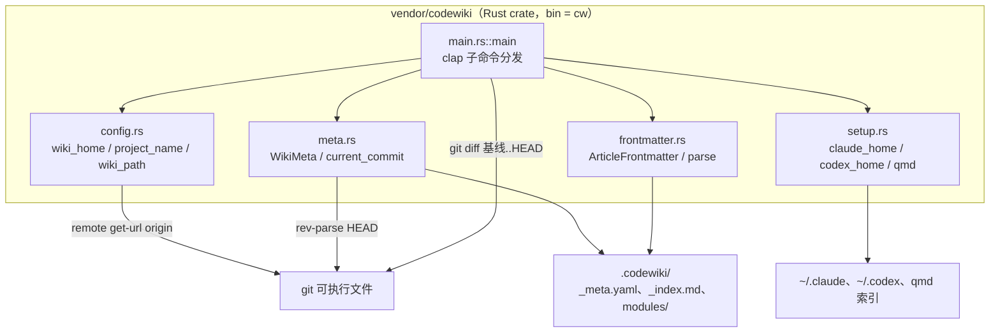
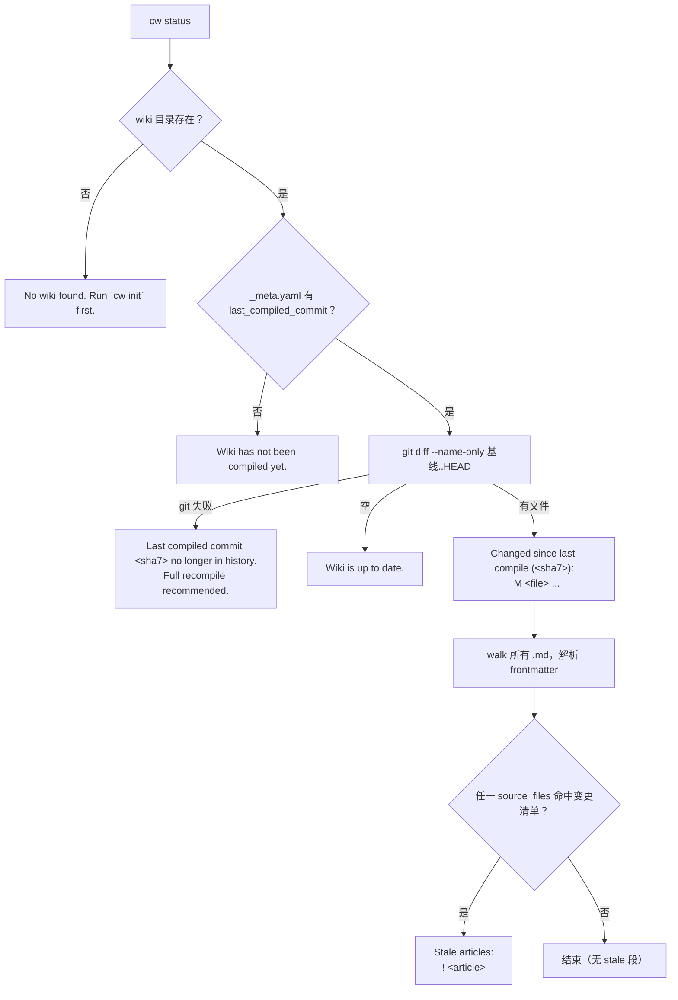
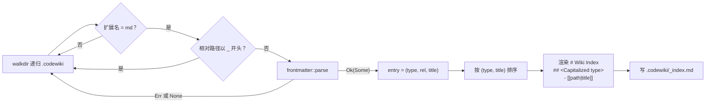
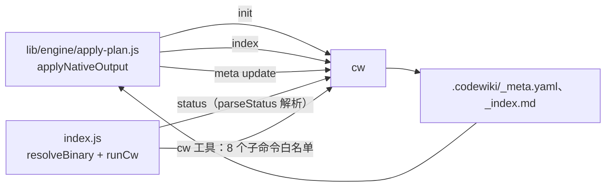
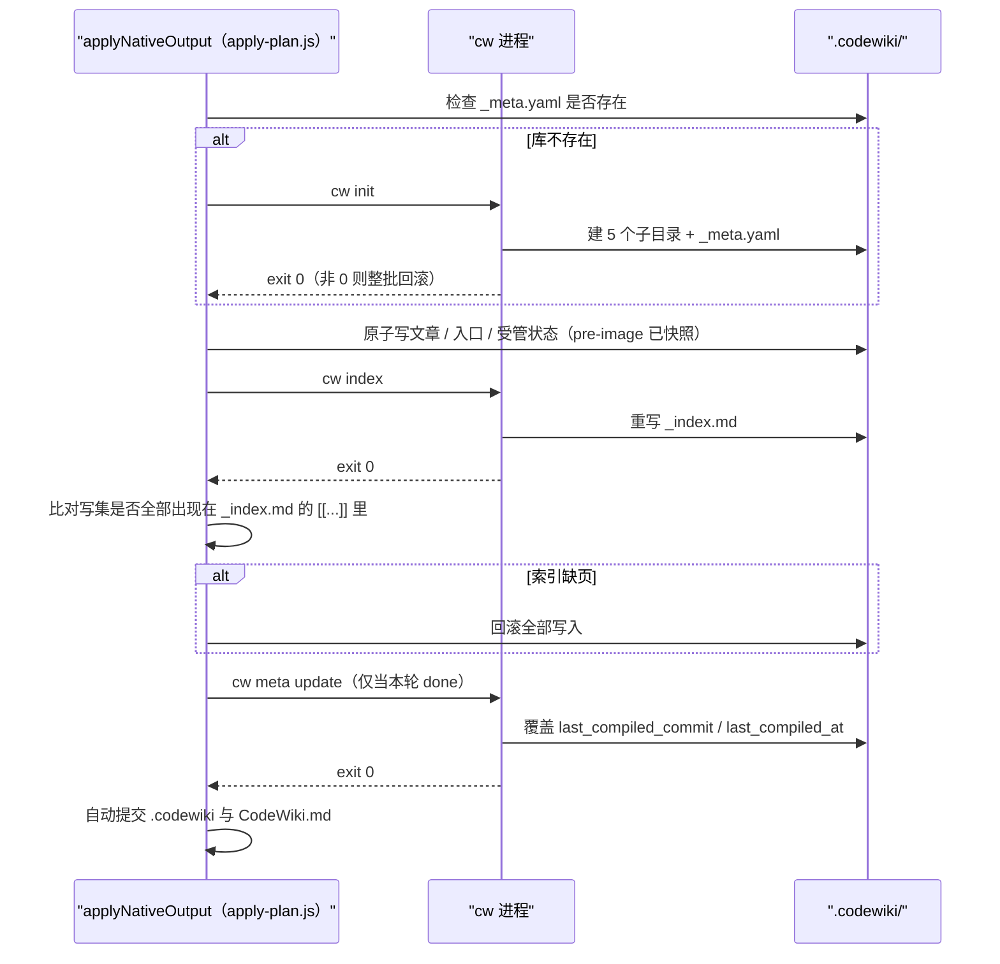
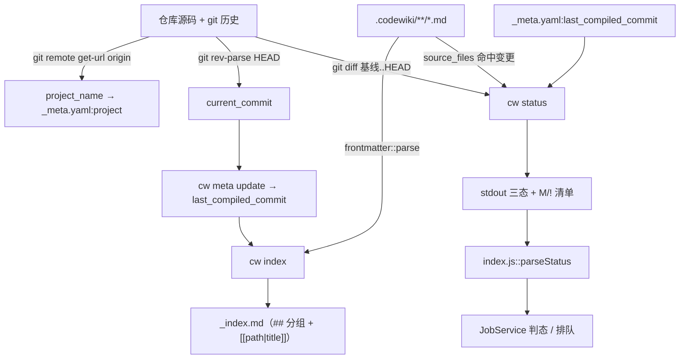

# codewiki-vendor（仓库内 vendored `cw` CLI）

!!! info "Generated documentation"
    This page was written by CodeWiki from the source code at commit [`65890014`](https://github.com/ikliml666/dsh-codewiki/commit/6589001428bc8eb6662303a05b6be49bacbd4061) on 2026-11-09 with `deepseek-v4.1-flash`. Check the code before relying on details.

`vendor/codewiki` 是本插件自带的 **`cw` 命令行工具的真源码**：它是 [mraza007/codewiki](https://github.com/mraza007/codewiki) 的本地 fork（Rust crate，`[[bin]] name = "cw"`），负责 wiki 的**骨架、索引与基线记账**——也就是 `.codewiki/` 目录的初始化、`_index.md` 的生成、以及 `_meta.yaml` 里 `last_compiled_commit` 的推进。

它**不做**任何理解与写作：依赖图、模块树、文章正文全部来自上游 FSoft Python 引擎（见 [engine-python-runtime：FSoft 原生引擎的 Python 侧运行时](engine-python-runtime.md)）；`cw` 只提供「文件系统 + git + YAML」这一层确定性操作，因此它可以在无模型、无网络的环境里被反复调用。

---

## 1. 模块定位

在整条编译链路里，`cw` 是**索引与基线的唯一写者**。这一点是硬边界，不是实现偏好：`.codewiki/_index.md` 只能由 `cw index` 生成，`.codewiki/_meta.yaml` 的 `last_compiled_commit` 只能由 `cw meta update` 推进。

| 归属 | 负责 | 本文档 |
| --- | --- | --- |
| FSoft Python 引擎 | 依赖图、模块树、文章写作、组件级增量 | [engine-python-runtime：FSoft 原生引擎的 Python 侧运行时](engine-python-runtime.md) |
| **`cw`（Rust，本模块）** | `init` / `status` / `index` / `meta update` / `path` / `projects` / `setup` / `uninstall` | 本页 |
| Node 插件 | 宿主模型通道、JobService、质量门、落地器、自动提交 | [Documentation_Generation_Engine 模块概览](../Documentation_Generation_Engine.md) |

关键推论：

- `cw` 的**退出码**只表达「文件操作成没成」，不表达「文章内容对不对」。内容裁决在质量门（[engine-contract-quality：引擎契约与质量裁决层](../Documentation_Generation_Engine/engine-core/engine-contract-quality.md)）。
- `cw` 的 **stdout 文案是机读协议**（被 `index.js::parseStatus` 逐串匹配），改文案等于改接口。
- `cw` 是**外部进程**，所以所有调用都必须处理超时、非零退出与「退出码 0 但语义没达成」三种失败形态（见 §5.3）。

---

## 2. 架构与组件关系

crate 只有 5 个源文件，全部是薄封装，没有任何业务判断：



### 2.1 依赖（`vendor/codewiki/Cargo.toml`）

| crate | 用途 |
| --- | --- |
| `clap 4`（`derive`） | 子命令/参数定义（`Cli`、`Commands`、`MetaAction`、`SetupTarget`、`UninstallTarget`） |
| `serde 1` + `serde_yaml 0.9` | `_meta.yaml` 与文章 frontmatter 的读写 |
| `chrono 0.4`（`serde`） | `created_at` / `last_compiled_at` 时间戳 |
| `walkdir 2` | 递归枚举 `.codewiki/` 下的 `.md` |
| `anyhow 1` | 错误上下文（`Context` / `bail!`） |
| `dirs 6` | 定位 home 目录（`~/.codewiki`、`~/.claude`、`~/.codex`） |

`[profile.release]` 为 `opt-level = 3` + `lto = true` + `strip = true`，产物即随包分发的 `bin/cw.exe`（见 §8）。

---

## 3. 命令面

`main()` 把 clap 解析结果直接分派到 8 个 `cmd_*` 函数，没有任何中间层：

| 子命令 | 实现 | 副作用 | 主要消费者 |
| --- | --- | --- | --- |
| `cw init` | `cmd_init()` | 建 `<repo>/.codewiki/` 与 5 个子目录，写 `_meta.yaml` | 落地器在库缺失时自动补建 |
| `cw status` | `cmd_status()` | 只读（`git diff` + walk `.md`） | `index.js::parseStatus` 判三态 |
| `cw index` | `cmd_index()` | 重写 `.codewiki/_index.md` | 落地器写盘后必跑 |
| `cw meta update` | `cmd_meta_update()` | 改 `_meta.yaml` 的基线字段 | 落地器「基线」阶段 |
| `cw path` | `cmd_path()` | 只读，打印 wiki 目录 | 调试/人工 |
| `cw projects` | `cmd_projects()` | 只读，枚举 `~/.codewiki/*` | 遗留能力（见 §7） |
| `cw setup {claude-code,codex,qmd}` | `setup.rs` | 写 `~/.claude/skills/codewiki/SKILL.md`、追加 `~/.codex/AGENTS.md`、注册 qmd collection | 与 dsh 插件无关 |
| `cw uninstall {claude-code,codex}` | `setup.rs` | 删 skill 目录 / 删 AGENTS.md 段落 | 与 dsh 插件无关 |

`index.js` 把这张表固化成白名单 `CW_SUBCOMMANDS = ['init','status','index','meta','path','projects','setup','uninstall']`，模型通过 `cw` 工具只能调这些（见 [作业编排与状态管理（Job Orchestration & State Management）](../Job_Orchestration___State_Management.md)）。

---

## 4. 核心组件

### 4.1 `config.rs`：路径与项目名

三个函数构成「wiki 落在哪」的唯一来源：

| 函数 | 行为 | 备注 |
| --- | --- | --- |
| `wiki_home()` | `~/.codewiki` | **fork 后仍保留**，只被 `cw projects` 与 `setup qmd` 使用 |
| `project_name(repo_path)` | 在仓库内跑 `git remote get-url origin`，取 URL 最后一段并去掉 `.git`；失败则退回目录名 | 只写进 `_meta.yaml` 的 `project` 字段；两者都拿不到时 `context` 报错 |
| `wiki_path(repo_path)` | `repo_path.join(".codewiki")` | **FORK MOD**：上游是 `~/.codewiki/<project>`，本 fork 把 wiki 内化到仓库内，随代码版本管理 |

因为 `init` / `status` / `index` / `meta update` / `path` 全部经过 `wiki_path()`，**一处改动即全部生效**——这是 fork 只改一处的设计前提。`project_name` 的 git 调用是「尽力而为」：`output()` 的 `Result` 被 `if let Ok(output)` 吞掉，非 git 仓库不会让命令失败，只是拿不到远端名。

### 4.2 `meta.rs`：`WikiMeta` 与基线

```rust
pub struct WikiMeta {
    pub project: String,
    pub repo_path: String,
    pub last_compiled_commit: Option<String>,
    pub last_compiled_at: Option<DateTime<Utc>>,
    pub created_at: DateTime<Utc>,
}
```

- `WikiMeta::new(project, repo_path)`：`created_at = Utc::now()`，基线两个字段为 `None`（即「未编译」）。
- `load(wiki_path)`：读 `<wiki>/_meta.yaml` 并 `serde_yaml` 反序列化；文件不存在或 YAML 坏了都会带上下文报错。**这条失败路径很重要**：落地器在写盘前会显式检查 `_meta.yaml` 是否存在，否则 `cw meta update` 必然 exit 1（`apply-plan.js` 的 `wiki-missing` 分支）。
- `save(wiki_path)`：序列化后整体覆写。
- `current_commit(repo_path)`：`git rev-parse HEAD`，非 git 仓库或无提交时 `bail!("Not a git repository or no commits yet")`。

`last_compiled_commit` 是整条增量链路的锚点：`cmd_status` 用它算 diff，Node 侧 `collectChangeSet` 用它当 base，`idleNativeReason` 用它判断「本轮无事可做」。**它只能指向一次已提交的 HEAD**（`current_commit` 的实现决定），所以「基线永远落后于当轮产物提交」是结构性的，不是 bug——这也是 `parseStatus` 必须把 `.codewiki/` 自身产物从变更清单里摘出去的原因。

### 4.3 `frontmatter.rs`：文章元数据

```rust
pub struct ArticleFrontmatter {
    pub title: Option<String>,
    #[serde(rename = "type")] pub article_type: Option<String>,
    pub source_files: Option<Vec<String>>,
    pub tags: Option<Vec<String>>,
}
```

`parse(content)` 的判据很窄：`trim()` 后必须以 `---` 开头，然后找第一个 `\n---` 作为结束标记，中间那段交给 `serde_yaml`。三种结果：

| 输入 | 返回 |
| --- | --- |
| 没有 frontmatter | `Ok(None)` |
| 有 frontmatter 且 YAML 合法 | `Ok(Some(..))`（字段全为 `Option`，缺字段即 `None`） |
| 有 frontmatter 但 YAML 非法（例如 `title: 核心: 引擎` 这种裸值被解析成嵌套映射） | `Err` |

**第三种情况是整条链路最危险的一处静默失败**：`cmd_index` 用的是 `if let Ok(Some(fm))`，`Err` 与 `None` 走同一条 `continue`，于是坏页被跳过、索引照写、退出码仍是 0。落地器因此必须自己比对「本轮写集是否真的进了索引」（`apply-plan.js::findArticlesMissingFromIndex`），否则会出现「索引里没有这篇，但落地报 done」。

`source_files` 是全链路唯一的增量归属证据：`cmd_status` 靠它判 stale，Node 侧靠它判孤儿页。因此渲染层（`quality-gate.js::renderArticle`）只写「有证据」的路径，空就显式写 `source_files: []`。

### 4.4 `main.rs`：8 个子命令

#### `cmd_init()`

1. `wiki.exists()` 为真 → `WikiMeta::load` 后打印 `Wiki already exists at <path>`，有基线则 `Last compiled: <sha7>`，否则 `Not yet compiled`，直接返回（**幂等**）。
2. 否则建 5 个子目录：`modules` / `concepts` / `decisions` / `learnings` / `queries`。
3. `project_name()` → `WikiMeta::new(project, repo_path)` → `save()`。
4. 打印 `Initialized wiki at ...` / `Project: ...` 与子目录清单。

注意它**不创建** `_index.md`：索引是 `cw index` 的产物，第一次 `index` 之前库里没有索引文件。

#### `cmd_status()`：三态判定 + 两份清单



要点：

- **只看已提交历史**（`git diff 基线..HEAD`）。工作区未提交改动它看不见——那一路由 `lib/change-set.js` 在 Node 侧补齐（见 [engine-state-manifest：引擎清单与跨轮受管状态](../Documentation_Generation_Engine/engine-core/engine-state-manifest.md)）。
- 基线 commit 被 rebase/GC 掉时 git 返回非零，`cw` 不报错而是打印「不再在历史里 + 建议全量重编」，退出码仍是 0。
- 输出前缀固定为两空格 + `M`（变更文件）或 `!`（stale 文章），`index.js::parseStatus` 用 `^\s+[M!]\s+(.+)$` 抓取。
- 路径一律经 `rel_path_string()` 渲染成 `/` 分隔（见 §7）。

#### `cmd_index()`：重建 `_index.md`



细节：

- `title` 缺省回落为相对路径，`type` 缺省回落为 `"unknown"`（`capitalize` 之后就是 `## Unknown`）。
- 链接格式是 `- [[<path 去掉 .md>|<title>]]`，**title 原文照搬**——所以标题里可以出现 `]`，下游解析必须只取 `[[` 到 `|` 之间那一段（`apply-plan.js` 就是这么做的）。
- `_` 开头的前缀（`_index.md`、`_native-state/`、`_techdocs/`）整棵子树被跳过。这条规则被 Node 侧多处逐字复刻：受管状态目录取名 `_native-state` 正是为了让 `cw index` 不收它，否则同一页会在索引里出现两次。
- 空库时写入 `_No articles yet. Wiki needs compilation._`，退出码 0——「索引是空的」不是错误。
- 结束打印 `Index updated: N articles`。

#### `cmd_meta_update()`

要求 wiki 已存在（否则 `bail!`），然后 `load` → `current_commit` → 覆盖 `last_compiled_commit` / `last_compiled_at` → `save` → 打印 `Updated meta: commit <sha7>`。**它只写当前 HEAD，不接受指定 sha**，所以基线永远等于「上一次完整成功那轮的 HEAD」。

#### `cmd_projects()` / `cmd_path()`

`projects` 枚举 `~/.codewiki/*` 目录，只列有 `_meta.yaml` 的项，打印 `project - repo_path [compiled (sha7)|not compiled]`。仓库内化之后这条命令基本不再有输出（wiki 不在中心目录），属于上游遗留能力。

`path` 直接打印 `wiki_path()`，即 `<repo>/.codewiki`。

#### 两个纯工具函数

- `capitalize(s)`：首字符 `to_uppercase()` 后拼剩余部分，用于 `## Modules` 这类分组标题。
- `rel_path_string(rel)`：`to_string_lossy().replace('\\', "/")`。**FORK FIX**，见 §7。

### 4.5 `setup.rs`：给外部 agent 装 hook（与 dsh 无关）

| 函数 | 行为 |
| --- | --- |
| `claude_home()` | `~/.claude`（`dirs::home_dir()` 拿不到时退回 `"."`） |
| `codex_home()` | `~/.codex` |
| `setup_claude_code()` | 把内嵌的 `SKILL_MD` 写到 `~/.claude/skills/codewiki/SKILL.md`（已存在则先打印「Updating...」再覆盖） |
| `setup_codex()` | 若 `~/.codex/AGENTS.md` 不含 `## CodeWiki`，则追加 `CODEX_AGENTS_SECTION` |
| `setup_qmd()` | 要求 `~/.codewiki` 存在 → 探测 `qmd --help` → `qmd collection add <wiki_home> --name codewiki` → `qmd embed` |
| `uninstall_claude_code()` | 删 `~/.claude/skills/codewiki` 整目录 |
| `uninstall_codex()` | `remove_section(content, "## CodeWiki")`：从该标题删到下一个 `## ` 为止 |

`SKILL_MD` 用 `include_str!("../skills/codewiki-session.md")` 编译期内嵌，所以 `cw setup claude-code` 写出的文本与 `vendor/codewiki/skills/codewiki-session.md` 永远一致。该 skill 文本本身已经现代化到「优先调 `codewiki_generate`、产物落 `<repo>/.codewiki/`、入口 `<repo>/CodeWiki.md`」，与 dsh 插件的用法对齐。

**dsh 插件不注册任何技能**：`setup` / `uninstall` 只是暴露给模型的子命令，语义是「给 Claude Code / Codex / qmd 装 hook」，与插件运行无关。

---

## 5. 与 Node 侧的接口契约

### 5.1 调用者



**二进制解析顺序**（`index.js::resolveBinary`）：`config.binaryPath` → PATH 里的 `cw`（`where cw` / `which cw`）→ 随包 `bin/cw(.exe)` → 裸名 `cw`。PATH 优先是刻意的：让「用户装的 cw 与其源码同步演进」，捆绑副本只在 PATH 找不到时兜底。

落地器另有一条更朴素的默认值：`deps.cwBinary ?? process.env.DSH_CODEWIKI_CW ?? 'cw'`（`apply-plan.js::defaultRunCw`，同步 `spawnSync`，超时 120s）。

### 5.2 stdout 文本协议

`index.js::parseStatus` 按字面量匹配，文案即契约：

| 文案 | 判态 |
| --- | --- |
| `No wiki found` | `missing` |
| `has not been compiled yet` | `uncompiled` |
| `Wiki is up to date` | `clean` |
| `  M <file>` / `  ! <article>` 行 | 变更清单 / stale 清单 |
| 其余 | `stale`（源码有变更）或 `clean`（只剩 `.codewiki/` 产物变更） |

`parseStatus` 会把 `.codewiki/` 前缀的条目摘进 `wikiChanges`，只有 `sourceChanges` 或 `staleArticles` 非空才判 `stale`——因为基线结构性落后于产物提交，不过滤的话「刚编译完」也会永远显示「有变更」。

### 5.3 落地器如何使用 `cw`（一次完整事务）



三条不变量（在 [apply-plan 落地器](../Documentation_Generation_Engine/engine-core/engine-orchestration/apply-plan.md) 里定义，此处只列与 `cw` 相关的部分）：

1. **`cw index` 失败 = 库坏了**：文章在、索引没有，磁盘必须回到应用前。
2. **`cw meta update` 失败 = 记账错误**：连文章一起回滚，否则下一轮会重复消费同一批变化。
3. **退出码 0 ≠ 语义达成**：索引必须真的收录本轮写集，`_index.md` 链接还要做 `/` 规范化（`normalizeIndexLinks` 作为纵深防御）。

### 5.4 隐式契约：`_` 前缀

`cw index` 只跳过「相对 `.codewiki/` 的完整路径首段以 `_` 开头」的项。这条规则被三方复刻：

- `lib/engine/native-state.js`：受管状态目录必须叫 `.codewiki/_native-state/`（否则原始文章会被索引收成第二份）。
- `lib/engine/techdocs.js`：站点落 `.codewiki/_techdocs/`，同理不进索引。
- `apply-plan.js::auditExistingArticles`：`inner.startsWith('_')` 与 `main.rs:246` 逐字一致。

**改这条规则等于同时改三处**，且失败形态是「同一页在索引里出现两条链接」，很难在测试里发现。

---

## 6. 数据流



一句话概括：**`cw` 把「git 事实」和「frontmatter 事实」翻译成两份可机读的文本产物**（`_index.md` 与 `status` 输出），Node 侧所有决策都建立在这两份产物上。

---

## 7. 相对上游的差异（fork 点）

`vendor/codewiki/FORK.md` 声明：本目录与上游 main `64323823` 的差异**只有两处**。

| # | 位置 | 改动 | 不修会怎样 |
| --- | --- | --- | --- |
| 1 | `src/config.rs::wiki_path()` | wiki 从 `~/.codewiki/<project>/` 内化到 `<repo>/.codewiki/` | 产物不随仓库提交、团队无法共享；编译产物跑 `cw index` 会报 `No wiki found` |
| 2 | `src/main.rs::rel_path_string()` | 相对路径统一渲染 `/`（上游用 `Path::display()`，Windows 输出 `\`） | stale 清单与 `_index.md` 的 `[[...]]` 链接被 `\` 污染；Node 侧按 `/` 比较会漏判 |

设计上刻意保留未改的部分：

- `wiki_home()` 与 `project_name()` 仍指向中心制语义——`_meta.yaml:project` 与 `cw projects` 的行为与「丢失源码的现役二进制」保持一致（见 FORK.md 的验证记录）。
- 内嵌 skill 文本跟随 `skills/codewiki-session.md` 的最新版本，与丢失版二进制内嵌的子代理时代旧文案不同；`cw setup claude-code` 写出的文本因此是现代化的那一版。

⚠️ **不要用上游原版覆盖本目录**：会把架构倒退回中心制，编译产物的 `cw index` 会报 `No wiki found`。改动本目录后必须重编译并同步 `bin/cw.exe` 与 `~/.cargo/bin/cw.exe` 两处二进制。

---

## 8. 构建与分发

```bash
cd vendor/codewiki
cargo build --release
cp target/release/cw.exe ../../bin/cw.exe      # 随包二进制
cp target/release/cw.exe ~/.cargo/bin/cw.exe   # PATH 里的全局二进制
```

- `package.json` 的 `files` 显式列出 `bin/cw.exe` 与 `bin/cw`，`bin/cw.exe` 是 **git 跟踪的 cargo release 产物**（`Cargo.lock` 一并入库，保证可复现）。
- 不要用 `cargo install --path .`：它会先联网更新 registry，在受限网络下会失败；直接复制编译产物即可。
- 二进制与源码必须同批更新：`FORK.md` 的验证记录（旧 md5 `835702929c4ec44149ad97ae25192955` → 新 md5 `952b0282523ad016c13688cc594afdd8`）就是「仓库源码 ↔ 已装二进制」一致性的审计线索。
- 发布清单相关的其余配置见 [构建与配置（build-configuration）](../Build___Development_Infrastructure/build-configuration.md)。

---

## 9. 已知问题与约束

| 问题 | 影响 | 现状 |
| --- | --- | --- |
| `cw index` 对 frontmatter 解析失败**静默跳过**（`if let Ok(Some(fm))`），退出码仍 0 | 坏 frontmatter 的文章从索引里消失而无人报错 | 由落地器的 `findArticlesMissingFromIndex` 兜底（比对写集与索引链接），失败即整批回滚 |
| `cw meta update` 只写当前 HEAD，不接受指定 sha | 基线永远落后当轮产物提交一步 | 结构性的；`parseStatus` 过滤 `.codewiki/` 产物来消除误判 |
| `cw status` 只看 `git diff 基线..HEAD` | 未提交改动对它不可见 | 由 `lib/change-set.js` 四路采集 + 工作区快照补齐 |
| 基线 commit 被 rebase/GC 后 `cw status` 只打印「不在历史里」并建议全量 | 不返回非零，上层拿不到机读信号；输出里既无 `M` 也无 `!` 行，`parseStatus` 按现有匹配规则会落成 `clean` | 只能靠人读文案发现；`idleNativeReason` 另有一层「基线读不到就退回全量」的兜底，但 `cw status` 这一路本身不报 stale |
| `setup.rs` 内嵌的 `CODEX_AGENTS_SECTION` 文案仍写 `~/.codewiki/` 中心制路径 | 与 fork 的仓库内化路径不一致（skill 文本已更新，Codex 段未更新） | 只影响 `cw setup codex` 写给外部 agent 的文本，dsh 插件不使用该路径 |
| `cw projects` 在仓库内化后基本枚举不到东西 | 遗留命令，无实用价值 | 白名单里保留，避免破坏模型已有调用习惯 |
| `FORK.md` 记录的构建噪音（`WikiMeta` 某字段未被读取的 `dead_code` 警告） | 仅为编译噪音，无行为影响 | 当前 `meta.rs` 已无该字段；有意不为消警告而重编译（会破坏二进制一致性记录） |

---

## 10. 相关页面

- [Execution_Runtime___Vendored_Engine 概览](../Execution_Runtime___Vendored_Engine.md) — 本模块所属的运行时/vendored 引擎分组
- [engine-python-runtime：FSoft 原生引擎的 Python 侧运行时](engine-python-runtime.md) — 上游 FSoft Python 引擎与协议入口（`entry.py`），与本模块共用同一条编译链路
- [apply-plan 落地器](../Documentation_Generation_Engine/engine-core/engine-orchestration/apply-plan.md) — 唯一调用 `cw init` / `index` / `meta update` 的落地器
- [engine-runner：原生引擎执行与裁决编排](../Documentation_Generation_Engine/engine-core/engine-orchestration/engine-runner.md) — 一次原生编译的裁决链编排
- [engine-state-manifest：引擎清单与跨轮受管状态](../Documentation_Generation_Engine/engine-core/engine-state-manifest.md) — `engine-lock.json`、映射与 `_native-state/` 持久化
- [engine-contract-quality：引擎契约与质量裁决层](../Documentation_Generation_Engine/engine-core/engine-contract-quality.md) — 质量门与文章契约（决定「能不能写进库」）
- [作业编排与状态管理（Job Orchestration & State Management）](../Job_Orchestration___State_Management.md) — 任务判态、排队与 `cw` 工具封装
- [构建与配置（build-configuration）](../Build___Development_Infrastructure/build-configuration.md) — `package.json` / `cordis.patch.yml` 等打包与配置

??? abstract "Documented components (7)"
    - [`project_name`](https://github.com/ikliml666/dsh-codewiki/blob/6589001428bc8eb6662303a05b6be49bacbd4061/vendor%5Ccodewiki%5Csrc%5Cconfig.rs) — `vendor\codewiki\src\config.rs`
    - [`ArticleFrontmatter`](https://github.com/ikliml666/dsh-codewiki/blob/6589001428bc8eb6662303a05b6be49bacbd4061/vendor%5Ccodewiki%5Csrc%5Cfrontmatter.rs) — `vendor\codewiki\src\frontmatter.rs`
    - [`Cli`](https://github.com/ikliml666/dsh-codewiki/blob/6589001428bc8eb6662303a05b6be49bacbd4061/vendor%5Ccodewiki%5Csrc%5Cmain.rs) — `vendor\codewiki\src\main.rs`
    - [`capitalize`](https://github.com/ikliml666/dsh-codewiki/blob/6589001428bc8eb6662303a05b6be49bacbd4061/vendor%5Ccodewiki%5Csrc%5Cmain.rs) — `vendor\codewiki\src\main.rs`
    - [`main`](https://github.com/ikliml666/dsh-codewiki/blob/6589001428bc8eb6662303a05b6be49bacbd4061/vendor%5Ccodewiki%5Csrc%5Cmain.rs) — `vendor\codewiki\src\main.rs`
    - [`WikiMeta`](https://github.com/ikliml666/dsh-codewiki/blob/6589001428bc8eb6662303a05b6be49bacbd4061/vendor%5Ccodewiki%5Csrc%5Cmeta.rs) — `vendor\codewiki\src\meta.rs`
    - [`claude_home`](https://github.com/ikliml666/dsh-codewiki/blob/6589001428bc8eb6662303a05b6be49bacbd4061/vendor%5Ccodewiki%5Csrc%5Csetup.rs) — `vendor\codewiki\src\setup.rs`

