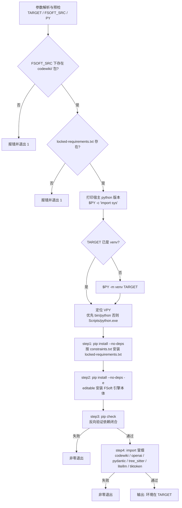
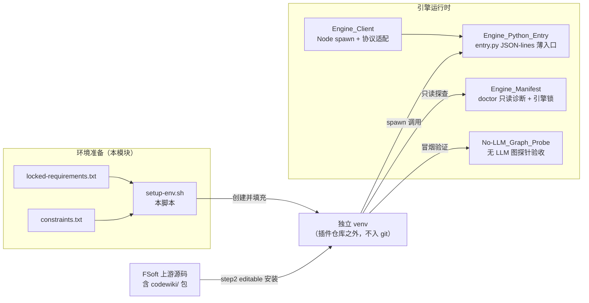
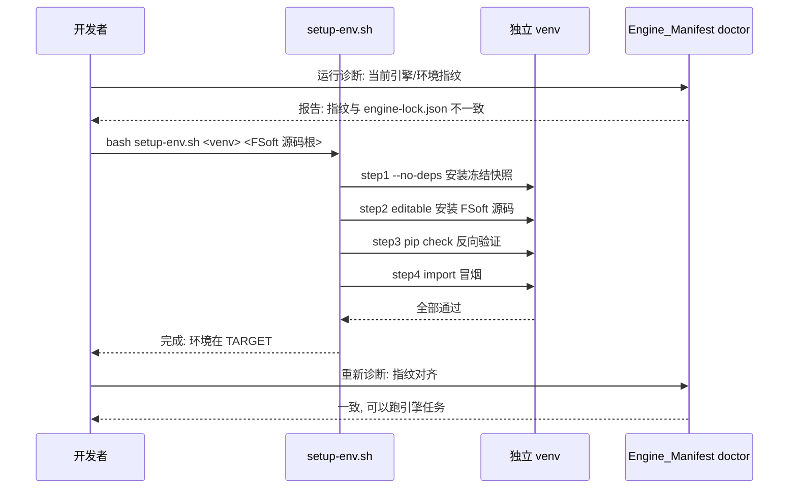

# FSoft 引擎环境搭建脚本（FSoft_Engine_Setup_Script）

!!! info "Generated documentation"
    This page was written by CodeWiki from the source code at commit [`11e4224e`](https://github.com/ikliml666/dsh-codewiki/commit/11e4224e6128a4b770f42f9d65782b1fb3a0cef0) on 2026-11-06 with `doubao-seed-2.1-lite`. Check the code before relying on details.

## 简介

`tools/fsoft-engine/setup-env.sh` 是 CodeWiki 插件「阶段 1A」的环境搭建脚本，负责在**插件仓库之外**的独立目录里，从零造出一个可信、可复现的 FSoft 原生 Python 引擎运行环境（venv）。它是整个原生引擎迁移的**第一步**：没有这个环境，后续的 [Engine_Client（引擎进程客户端）](Engine_Client.md)、[Engine_Python_Entry](Engine_Python_Entry.md) 等模块就没有可被 spawn 的 Python 解释器。

脚本解决的核心矛盾是：**FSoft 的依赖树无法走 pip 正常解析**。其依赖中 `openai` / `pydantic-ai-slim` / `pydantic` 的版本约束互相打架，正常解析必然报 `ResolutionImpossible`（实测报错：`Cannot install ... pydantic-ai-slim==2.61.0 and pydantic-ai-slim[anthropic,cli,evals,google,logfire,mcp,openai,web]==2.61.0 because these package versions have conflicting dependencies`）。脚本因此绕过解析器，直接按「已验证的环境快照」落盘，并用 `pip check` 反向验证依赖闭合。

## 设计目标

| 目标 | 实现方式 |
| --- | --- |
| 不重解析、不踩 ResolutionImpossible | `--no-deps` 全量安装冻结清单 `locked-requirements.txt` |
| 已验证组合可信 | 冻结清单本身是「已解析完成的完整环境快照」，等价于精确复制 |
| 防间接依赖漂移 | 附加 `constraints.txt` 约束文件，钉住未显式列出的间接依赖 |
| 装完必须自证 | step3 `pip check` 反向验证依赖闭合；step4 import 冒烟 |
| 不污染宿主 | venv 建在插件仓库之外、不进 git、不碰 DSH 进程的 Python |
| 快速失败 | `set -euo pipefail`，任何一步非零立即退出 |

## 用法

```bash
bash tools/fsoft-engine/setup-env.sh <目标目录> <FSoft 源码根> [python 可执行文件]
```

示例（与脚本注释中的典型用法一致）：

```bash
bash tools/fsoft-engine/setup-env.sh ../.probe-fsoft/venv ../.probe-fsoft/src
```

参数说明：

- `目标目录`（`TARGET`）：venv 的创建位置。若不存在则新建，已存在则**复用**（脚本检测 `$TARGET/bin/python` 或 Windows 的 `$TARGET/Scripts/python.exe` 以跨平台定位 venv 内解释器）。
- `FSoft 源码根`（`FSOFT_SRC`）：FSoft 上游源码的根目录，其下必须存在 `codewiki/` 包，否则脚本在预检阶段直接报错退出。
- `python 可执行文件`（`PY`）：可选，默认 `python`。

## 执行流程

下图展示脚本的四个阶段，以及各步所使用的外部输入文件。



### 四步详解

1. **step1 — 按冻结快照落盘（不重解析）**
   ```bash
   "$VPY" -m pip install --disable-pip-version-check -q --no-deps \
       -c "$CONSTRAINTS" -r "$LOCKED"
   ```
   `--no-deps` 是关键：告诉 pip「别解依赖关系，按清单逐个装上即可」，从而绕开必然触发的 `ResolutionImpossible`。`-c constraints.txt` 防止清单里某些未钉死的间接依赖被 pip 升级跑偏。

2. **step2 — editable 安装引擎本体**
   ```bash
   "$VPY" -m pip install --disable-pip-version-check -q --no-deps -e "$FSOFT_SRC"
   ```
   为什么要单独装一次：冻结快照（`pip freeze` 的产物）里不会出现 `codewiki` 自己——它是 editable 安装，在 freeze 输出中只体现为它自己的依赖项。因此必须显式以 editable 模式把 `$FSOFT_SRC` 源码装进环境，引擎本体才能被 import 到。

3. **step3 — pip check（反向兜底）**
   `--no-deps` 装出来的环境**靠这步反向验证**：若快照本身依赖不闭合（版本互相冲突），`pip check` 会非零退出，`set -e` 立即终止。这是「快照可信」的最后一道闸门。

4. **step4 — import 冒烟**
   通过 stdin  heredoc 在 venv 内执行，依次 import 六个关键模块：
   - `codewiki`（引擎本体）
   - `openai` / `litellm`（LLM 通道）
   - `pydantic`（数据契约）
   - `tree_sitter`（静态依赖图分析）
   - `tiktoken`（token 计数）

   任一模块 import 失败则整体非零退出。

## 架构与系统上下文

脚本处于「先环境、后运行」链条的最前端。产出的 venv 被后续多个环节消费：Node 侧的 [Engine_Client（引擎进程客户端）](Engine_Client.md) 通过 spawn 调用 venv 内 Python 运行 [Engine_Python_Entry](Engine_Python_Entry.md)；[引擎清单（Engine_Manifest）](Engine_Manifest.md) 的 `doctor` 只读诊断也跑在同一个 venv 上；验收探针 [No-LLM_Graph_Probe（无 LLM 依赖图验收探针）](No-LLM_Graph_Probe.md) 在该环境内验证中文/空格路径下的依赖图。



### 依赖输入文件

| 文件 | 角色 |
| --- | --- |
| `tools/fsoft-engine/locked-requirements.txt` | 已解析完成的完整环境快照；脚本在 step1 全量安装它 |
| `tools/fsoft-engine/constraints.txt` | 约束文件，防止未钉死的间接依赖被 pip 升级 |
| `<FSoft 源码根>/codewiki/` | 预检门槛 + step2 editable 安装对象 |

> 注：这两个清单文件与脚本同目录，由上游环境导出与人工审计产生；脚本本身不生成、不修改它们。

## 与其他模块的关系

- **上游锁定的上游版本**：[引擎清单（Engine_Manifest）](Engine_Manifest.md) 以显式常量 `UPSTREAM_COMMIT` 锁定 FSoft 源码 commit（`1b4af43d...`），并强调「升级上游必须走改常量 + 契约测试」，而不是「pip install 到最新版然后祈祷」。本脚本的 step2 把 `$FSOFT_SRC` 装进 venv——因此**传进来的 FSoft 源码根应当是该 commit 对应的检出**，否则 venv 与引擎指纹会漂移。
- **环境漂移的诊断侧**：[引擎清单（Engine_Manifest）](Engine_Manifest.md) 的 `doctor` 是**只读**的——它只报告「现在跑的是哪个引擎、哪个环境」，不装依赖、不修环境。脚本注释明确：「要不要重新 setup 是 1A 的 setup-env.sh 的职责」，即 doctor 报出不一致 → 人工重跑本脚本修环境。这两者分工为「诊断」与「修复」。
- **运行时协议**：装好的 venv 最终被 [Engine_Client（引擎进程客户端）](Engine_Client.md) 以子进程方式拉起，跑 [Engine_Python_Entry](Engine_Python_Entry.md) 的 JSON-lines 协议入口；脚本本身**不参与**运行时协议，只保证解释器与依赖可用。
- **验收探针**：[No-LLM_Graph_Probe（无 LLM 依赖图验收探针）](No-LLM_Graph_Probe.md) 是阶段 1A 的「引擎侧验收」，可在任意 venv 上重跑，验证中文/空格路径下的无 LLM 依赖图；它与本脚本共同构成 1A 阶段的「搭建 + 验收」闭环。

## 设计约束与边界

脚本刻意守住以下边界（源自其头部注释与实现）：

1. **只在插件仓库之外建环境**——venv 不进 git，避免把几百 MB 的 site-packages 误提交。
2. **不碰 DSH 进程的 Python**——宿主解释器（`PY`）只用于 `python -m venv`，后续全部安装/import 都发生在 venv 内的 `VPY` 上。
3. **快速失败**——`set -euo pipefail`：任何一步非零立即退出，不继续往脏环境里装东西。
4. **跨平台**——通过检测 `$TARGET/bin/python`（POSIX）与 `$TARGET/Scripts/python.exe`（Windows）定位 venv 解释器，可在两类系统复用。
5. **复用已有 venv**——若 `TARGET` 已存在则不重建，直接在其上重跑 step1–4，便于环境修复与重建。

## 典型运维场景



简言之：**doctor 负责「发现环境漂了」，setup-env.sh 负责「把环境修回已验证快照」**，二者配合保证同一份 wiki 在不同机器上的产物可复现。

??? abstract "Documented components (1)"
    - [`setup-env.sh`](https://github.com/ikliml666/dsh-codewiki/blob/11e4224e6128a4b770f42f9d65782b1fb3a0cef0/tools/fsoft-engine/setup-env.sh) — `tools/fsoft-engine/setup-env.sh`

